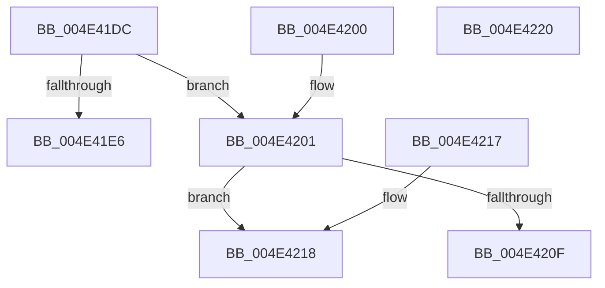

# KiGetProcessCpuSetMaskPointer

- RVA: `0x004E41DC`–`0x004E4221` (길이 `69` bytes)
- VA: `0x00000001404E41DC`
- 실행 섹션: `.text`
- PDB 이름 있음: `예`; PDB Function 태그: `아니요`
- unwind 정보 RVA: `0x000DB714`
- 디코드: `21`개 명령, `69/69` bytes 표시
- 미해석 바이트: `0` (있으면 어셈블리에 `.byte`로 보존)

> 이 문서는 커널 이미지의 기계어와 PDB 기호를 분석해 생성했습니다. 4번과 5번은 함수 원형과 자료형을 바이너리 사용 방식에서 추정한 C 해석이며 원본 소스 복구 결과는 아닙니다.

## 1. Dependencies

- 직접 호출 지점: **0**; 고유 호출 대상: **0**
- 직접 호출자로 확인된 함수: **1**
- RIP 상대 이미지 참조: **1**

### Outgoing calls
- 직접 디코드된 call 명령이 없습니다.

### Direct callers
- [KeSetCpuSetsProcess](../5C/KeSetCpuSetsProcess_function_005C10D4.md) at `0x005C112F`
- [KeSetCpuSetsProcess](../5C/KeSetCpuSetsProcess_function_005C10D4.md) at `0x005C1157`

### Static image references
- `0x004E4201` → RVA `0x00FC5014` (`ALMOSTRO`; read)

## 2. Other-region calls and transfers

- 다른 실행 섹션으로 향하는 call: **0**
- 별도 외부 분기/꼬리 이동을 확인하지 못했습니다.

## 3. Assembly (complete function range)

```asm
004E41DC  8B 81 FC 05 00 00               mov eax, dword ptr [rcx + 0x5fc]
004E41E2  84 C0                           test al, al
004E41E4  78 1B                           js 0x1404e4201
004E41E6  F7 DA                           neg edx
004E41E8  41 C7 00 01 00 00 00            mov dword ptr [r8], 1
004E41EF  48 1B C0                        sbb rax, rax
004E41F2  48 83 E0 F8                     and rax, 0xfffffffffffffff8
004E41F6  48 05 D0 06 00 00               add rax, 0x6d0
004E41FC  48 03 C1                        add rax, rcx
004E41FF  C3                              ret
004E4200  CC                              int3
004E4201  0F B7 05 0C 0E AE 00            movzx eax, word ptr [rip + 0xae0e0c]
004E4208  41 89 00                        mov dword ptr [r8], eax
004E420B  85 D2                           test edx, edx
004E420D  74 09                           je 0x1404e4218
004E420F  48 8B 81 C8 06 00 00            mov rax, qword ptr [rcx + 0x6c8]
004E4216  C3                              ret
004E4217  CC                              int3
004E4218  48 8B 81 D0 06 00 00            mov rax, qword ptr [rcx + 0x6d0]
004E421F  C3                              ret
004E4220  CC                              int3
```

## 4. C-style interpretation (structured pseudocode)

```c
__int64 __fastcall KiGetProcessCpuSetMaskPointer(__int64 a1, int a2, __int64 a3)
{
    __int64 result;

    if (sign_flag) goto loc_004E4201;
    a2 = (unsigned int)(-(a2));
    *(unsigned int *)(a3) = 1;
    result = ((unsigned int)(*(unsigned int *)(a1 + 1532))) & (-8);
    result = (result) + (0x6D0ULL);
    result = (result) + (a1);
    return result;
loc_004E4201:
    *(unsigned int *)(a3) = (unsigned int)(*(unsigned __int16 *)(v_rip + 11406860));
    if (a2 == 0) goto loc_004E4218;
    return *(unsigned __int64 *)(a1 + 1736);
loc_004E4218:
    return *(unsigned __int64 *)(a1 + 1744);
}
```

## 5. (Beta) C Style

```c
int64_t KiGetProcessCpuSetMaskPointer(void *Arg1, int32_t Arg2, void *Arg3)
{
    uint8_t *arg1 = (uint8_t *)Arg1;
    uint8_t *arg3 = (uint8_t *)Arg3;

    int64_t result;

    if (sign_flag) goto loc_004E4201;
    Arg2 = (uint32_t)(-(Arg2));
    *(uint32_t *)(arg3) = 1;
    result = ((uint32_t)(*(uint32_t *)(arg1 + 0x5FC))) & (-8);
    result = (result) + (0x6D0ULL);
    result = (result) + (Arg1);
    return result;
loc_004E4201:
    *(uint32_t *)(arg3) = (uint32_t)(*(uint16_t *)(v_rip + 0xAE0E0C));
    if (Arg2 == 0) goto loc_004E4218;
    return *(uint64_t *)(arg1 + 0x6C8);
loc_004E4218:
    return *(uint64_t *)(arg1 + 0x6D0);
}
```

### 관측된 메모리 오프셋

구조체 형식이 확인되지 않은 접근은 인자 기준의 오프셋으로만 기록했습니다.

| 기준 인자 | 오프셋 표현 | 폭 (bit) | 접근 |
|---|---:|---:|---|
| `Arg1` | `+ 0x5FC` | `32` | `R` |
| `Arg1` | `+ 0x6C8` | `64` | `R` |
| `Arg1` | `+ 0x6D0` | `64` | `R` |
| `Arg3` | `+ 0x0` | `32` | `W` |

## 6. Execution-region graph

[열기: 2D/3D 그래프와 함수 탐색 컨트롤 패널](../../../control-panel.html?section=text&rva=0x004E41DC&view=graph)

- 2D 그래프는 위에서 아래로 흐르고, 3D 그래프는 빈 공간을 드래그해 회전합니다. Shift+드래그는 이동, 휠은 확대·축소, 함수 노드 선택은 대상 보고서 이동입니다.

### Static fallback


