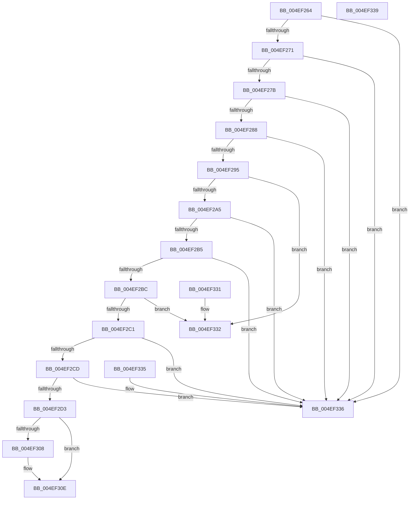

# KiIsStandbyThreadStealCandidate

- RVA: `0x004EF264`–`0x004EF33A` (길이 `214` bytes)
- VA: `0x00000001404EF264`
- 실행 섹션: `.text`
- PDB 이름 있음: `예`; PDB Function 태그: `아니요`
- unwind 정보 RVA: `0x000DB714`
- 디코드: `53`개 명령, `214/214` bytes 표시
- 미해석 바이트: `0` (있으면 어셈블리에 `.byte`로 보존)

> 이 문서는 커널 이미지의 기계어와 PDB 기호를 분석해 생성했습니다. 4번과 5번은 함수 원형과 자료형을 바이너리 사용 방식에서 추정한 C 해석이며 원본 소스 복구 결과는 아닙니다.

## 1. Dependencies

- 직접 호출 지점: **0**; 고유 호출 대상: **0**
- 직접 호출자로 확인된 함수: **1**
- RIP 상대 이미지 참조: **1**

### Outgoing calls
- 직접 디코드된 call 명령이 없습니다.

### Direct callers
- [KiMayStealStandbyThread](../30/KiMayStealStandbyThread_function_0030D704.md) at `0x0030D717`

### Static image references
- `0x004EF2A5` → RVA `0x00FC6B38` (`ALMOSTRO`; read)

## 2. Other-region calls and transfers

- 다른 실행 섹션으로 향하는 call: **0**
- 별도 외부 분기/꼬리 이동을 확인하지 못했습니다.

## 3. Assembly (complete function range)

```asm
004EF264  4C 8B 41 10                     mov r8, qword ptr [rcx + 0x10]
004EF268  4D 85 C0                        test r8, r8
004EF26B  0F 84 C5 00 00 00               je 0x1404ef336
004EF271  4C 3B 41 18                     cmp r8, qword ptr [rcx + 0x18]
004EF275  0F 84 BB 00 00 00               je 0x1404ef336
004EF27B  4C 3B 81 38 38 00 00            cmp r8, qword ptr [rcx + 0x3838]
004EF282  0F 84 AE 00 00 00               je 0x1404ef336
004EF288  4C 3B 81 80 8E 00 00            cmp r8, qword ptr [rcx + 0x8e80]
004EF28F  0F 84 A1 00 00 00               je 0x1404ef336
004EF295  48 8B 41 38                     mov rax, qword ptr [rcx + 0x38]
004EF299  8A 00                           mov al, byte ptr [rax]
004EF29B  24 7F                           and al, 0x7f
004EF29D  3C 10                           cmp al, 0x10
004EF29F  0F 83 8D 00 00 00               jae 0x1404ef332
004EF2A5  F7 05 89 78 AD 00 00 00 00 01   test dword ptr [rip + 0xad7889], 0x1000000
004EF2AF  0F 84 81 00 00 00               je 0x1404ef336
004EF2B5  8A 41 07                        mov al, byte ptr [rcx + 7]
004EF2B8  84 C0                           test al, al
004EF2BA  74 7A                           je 0x1404ef336
004EF2BC  F6 C2 01                        test dl, 1
004EF2BF  74 71                           je 0x1404ef332
004EF2C1  48 8B 81 40 88 00 00            mov rax, qword ptr [rcx + 0x8840]
004EF2C8  48 85 C0                        test rax, rax
004EF2CB  74 69                           je 0x1404ef336
004EF2CD  83 78 28 00                     cmp dword ptr [rax + 0x28], 0
004EF2D1  76 63                           jbe 0x1404ef336
004EF2D3  8B 81 80 88 00 00               mov eax, dword ptr [rcx + 0x8880]
004EF2D9  44 8A 91 AC 00 00 00            mov r10b, byte ptr [rcx + 0xac]
004EF2E0  48 83 64 24 08 00               and qword ptr [rsp + 8], 0
004EF2E6  4C 8B 99 B0 00 00 00            mov r11, qword ptr [rcx + 0xb0]
004EF2ED  48 69 D0 58 01 00 00            imul rdx, rax, 0x158
004EF2F4  48 8B 81 40 88 00 00            mov rax, qword ptr [rcx + 0x8840]
004EF2FB  44 8B 8C 02 38 05 00 00         mov r9d, dword ptr [rdx + rax + 0x538]
004EF303  45 84 D2                        test r10b, r10b
004EF306  74 06                           je 0x1404ef30e
004EF308  41 8A CA                        mov cl, r10b
004EF30B  49 D3 E1                        shl r9, cl
004EF30E  49 8B C3                        mov rax, r11
004EF311  49 F7 E1                        mul r9
004EF314  48 89 54 24 08                  mov qword ptr [rsp + 8], rdx
004EF319  41 8B 50 54                     mov edx, dword ptr [r8 + 0x54]
004EF31D  48 8B 44 24 08                  mov rax, qword ptr [rsp + 8]
004EF322  48 8D 0C 85 00 00 00 00         lea rcx, [rax*4]
004EF32A  48 3B CA                        cmp rcx, rdx
004EF32D  0F 97 C0                        seta al
004EF330  C3                              ret
004EF331  CC                              int3
004EF332  B0 01                           mov al, 1
004EF334  C3                              ret
004EF335  CC                              int3
004EF336  32 C0                           xor al, al
004EF338  C3                              ret
004EF339  CC                              int3
```

## 4. C-style interpretation (structured pseudocode)

```c
__int64 __fastcall KiIsStandbyThreadStealCandidate(__int64 a1, unsigned __int8 a2)
{
    __int64 result;
    unsigned __int64 v_stack_p8;

    if (*(unsigned __int64 *)(a1 + 16) == 0) goto loc_004EF336;
    if ((*(unsigned __int64 *)(a1 + 16)) == (*(unsigned __int64 *)(a1 + 24))) goto loc_004EF336;
    if ((*(unsigned __int64 *)(a1 + 16)) == (*(unsigned __int64 *)(a1 + 14392))) goto loc_004EF336;
    if ((*(unsigned __int64 *)(a1 + 16)) == (*(unsigned __int64 *)(a1 + 36480))) goto loc_004EF336;
    result = (unsigned __int8)((*(unsigned __int8 *)(*(unsigned __int64 *)(a1 + 56))) & (127));
    if (((unsigned __int8)(result)) >= 16) goto loc_004EF332;
    if (((*(unsigned int *)(v_rip + 11368585)) & (0x1000000ULL)) == 0) goto loc_004EF336;
    if ((unsigned __int8)(*(unsigned __int8 *)(a1 + 7)) == 0) goto loc_004EF336;
    if (((a2) & (1)) == 0) goto loc_004EF332;
    if (*(unsigned __int64 *)(a1 + 34880) == 0) goto loc_004EF336;
    if ((*(unsigned int *)(*(unsigned __int64 *)(a1 + 34880) + 40)) <= 0) goto loc_004EF336;
    a2 = (a2) * ((unsigned int)(*(unsigned int *)(a1 + 34944)));
    if ((unsigned __int8)(*(unsigned __int8 *)(a1 + 172)) != 0) {
        a1 = (unsigned __int8)(*(unsigned __int8 *)(a1 + 172));
        a4 = ((unsigned int)(*(unsigned int *)(a2 + *(unsigned __int64 *)(a1 + 34880) * 1 + 1336))) << ((unsigned __int8)(a1));
    }
    v_stack_p8 = a2;
    result = ((v_stack_p8 * 4) > ((unsigned int)(*(unsigned int *)(*(unsigned __int64 *)(a1 + 16) + 84)))) ? 1 : 0;
    return result;
loc_004EF332:
    return 1;
loc_004EF336:
    result = 0;
    return result;
}
```

## 5. (Beta) C Style

```c
int64_t KiIsStandbyThreadStealCandidate(void *Arg1, uint8_t Arg2)
{
    uint8_t *arg1 = (uint8_t *)Arg1;

    int64_t result;
    uint64_t v_stack_p8;

    if (*(uint64_t *)(arg1 + 0x10) == 0) goto loc_004EF336;
    if ((*(uint64_t *)(arg1 + 0x10)) == (*(uint64_t *)(arg1 + 0x18))) goto loc_004EF336;
    if ((*(uint64_t *)(arg1 + 0x10)) == (*(uint64_t *)(arg1 + 0x3838))) goto loc_004EF336;
    if ((*(uint64_t *)(arg1 + 0x10)) == (*(uint64_t *)(arg1 + 0x8E80))) goto loc_004EF336;
    result = (uint8_t)((*(uint8_t *)(*(uint64_t *)(arg1 + 0x38))) & (127));
    if (((uint8_t)(result)) >= 16) goto loc_004EF332;
    if (((*(uint32_t *)(v_rip + 0xAD7889)) & (0x1000000ULL)) == 0) goto loc_004EF336;
    if ((uint8_t)(*(uint8_t *)(arg1 + 0x7)) == 0) goto loc_004EF336;
    if (((Arg2) & (1)) == 0) goto loc_004EF332;
    if (*(uint64_t *)(arg1 + 0x8840) == 0) goto loc_004EF336;
    if ((*(uint32_t *)(*(uint64_t *)(arg1 + 0x8840) + 0x28)) <= 0) goto loc_004EF336;
    Arg2 = (Arg2) * ((uint32_t)(*(uint32_t *)(arg1 + 0x8880)));
    if ((uint8_t)(*(uint8_t *)(arg1 + 0xAC)) != 0) {
        Arg1 = (uint8_t)(*(uint8_t *)(arg1 + 0xAC));
        a4 = ((uint32_t)(*(uint32_t *)(Arg2 + *(uint64_t *)(arg1 + 0x8840) * 1 + 0x538))) << ((uint8_t)(Arg1));
    }
    v_stack_p8 = Arg2;
    result = ((v_stack_p8 * 4) > ((uint32_t)(*(uint32_t *)(*(uint64_t *)(arg1 + 0x10) + 0x54)))) ? 1 : 0;
    return result;
loc_004EF332:
    return 1;
loc_004EF336:
    result = 0;
    return result;
}
```

### 관측된 메모리 오프셋

구조체 형식이 확인되지 않은 접근은 인자 기준의 오프셋으로만 기록했습니다.

| 기준 인자 | 오프셋 표현 | 폭 (bit) | 접근 |
|---|---:|---:|---|
| `Arg1` | `+ 0x7` | `8` | `R` |
| `Arg1` | `+ 0x10` | `64` | `R` |
| `Arg1` | `+ 0x18` | `64` | `R` |
| `Arg1` | `+ 0x38` | `64` | `R` |
| `Arg1` | `+ 0xAC` | `8` | `R` |
| `Arg1` | `+ 0xB0` | `64` | `R` |
| `Arg1` | `+ 0x3838` | `64` | `R` |
| `Arg1` | `+ 0x8840` | `64` | `R` |
| `Arg1` | `+ 0x8880` | `32` | `R` |
| `Arg1` | `+ 0x8E80` | `64` | `R` |

## 6. Execution-region graph

[열기: 2D/3D 그래프와 함수 탐색 컨트롤 패널](../../../control-panel.html?section=text&rva=0x004EF264&view=graph)

- 2D 그래프는 위에서 아래로 흐르고, 3D 그래프는 빈 공간을 드래그해 회전합니다. Shift+드래그는 이동, 휠은 확대·축소, 함수 노드 선택은 대상 보고서 이동입니다.

### Static fallback


