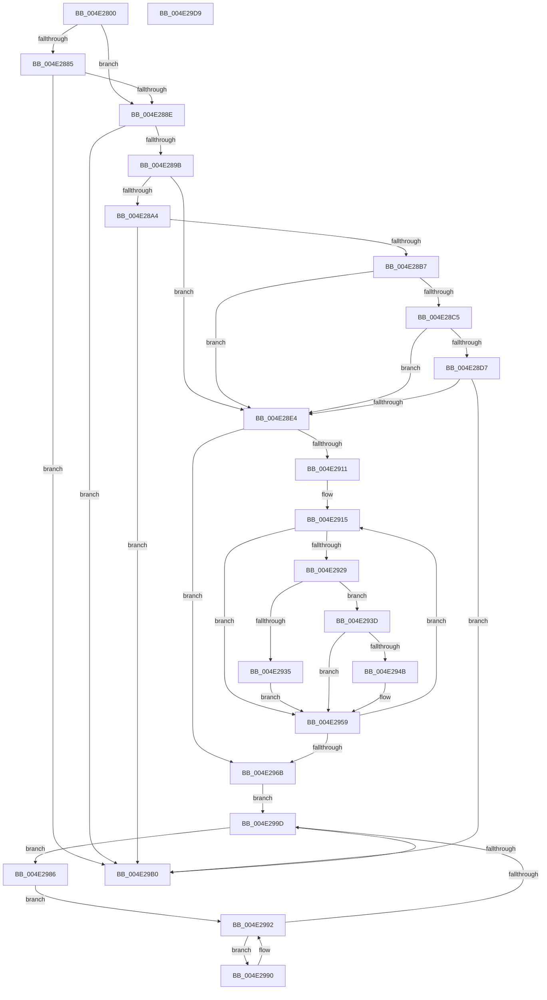

# KiSendThawExecution

- RVA: `0x004E2800`–`0x004E29DA` (길이 `474` bytes)
- VA: `0x00000001404E2800`
- 실행 섹션: `.text`
- PDB 이름 있음: `예`; PDB Function 태그: `아니요`
- unwind 정보 RVA: `0x000BF318`
- 디코드: `114`개 명령, `474/474` bytes 표시
- 미해석 바이트: `0` (있으면 어셈블리에 `.byte`로 보존)

> 이 문서는 커널 이미지의 기계어와 PDB 기호를 분석해 생성했습니다. 4번과 5번은 함수 원형과 자료형을 바이너리 사용 방식에서 추정한 C 해석이며 원본 소스 복구 결과는 아닙니다.

## 1. Dependencies

- 직접 호출 지점: **6**; 고유 호출 대상: **5**
- 직접 호출자로 확인된 함수: **5**
- RIP 상대 이미지 참조: **10**

### Outgoing calls
- `0x004E284E` → [memset](../6C/memset_function_006C6C40.md) (function, `0x006C6C40`)
- `0x004E28BC` → [KeIsBugCheckActive](../41/KeIsBugCheckActive_function_00418E70.md) (function, `0x00418E70`)
- `0x004E28F7` → [memset](../6C/memset_function_006C6C40.md) (function, `0x006C6C40`)
- `0x004E2954` → [KeAddProcessorAffinityEx](../25/KeAddProcessorAffinityEx_function_0025B6F0.md) (function, `0x0025B6F0`)
- `0x004E29A7` → [KeEnumerateNextProcessor](../41/KeEnumerateNextProcessor_function_00415480.md) (function, `0x00415480`)
- `0x004E29B7` → [_security_check_cookie](../6A/_security_check_cookie_function_006AC640.md) (function, `0x006AC640`)

### Direct callers
- [KeThawExecution](../4F/KeThawExecution_function_004F5240.md) at `0x004F52A1`
- [KeBugCheck2](../5B/KeBugCheck2_function_005B27D0.md) at `0x005B3757`
- [KiBugCheckRecoveryCleanupFromCrashDump](../5C/KiBugCheckRecoveryCleanupFromCrashDump_function_005C706C.md) at `0x005C70A8`
- [KiUpdateBugcheckRecoveryProgress](../5C/KiUpdateBugcheckRecoveryProgress_function_005C7E1C.md) at `0x005C7ECF`
- [ExRebootSystemForRecovery](../65/ExRebootSystemForRecovery_function_00655924.md) at `0x006559CF`

### Static image references
- `0x004E281F` → RVA `0x00E0A740` (`.data`; read)
- `0x004E2865` → RVA `0x00E66924` (`.data`; read)
- `0x004E286B` → RVA `0x00F10DF0` (`.data`; write)
- `0x004E2874` → RVA `0x00F10E00` (`.data`; read/write)
- `0x004E287B` → RVA `0x00FC6A80` (`ALMOSTRO`; read)
- `0x004E288E` → RVA `0x00F0BD23` (`.data`; read)
- `0x004E289B` → RVA `0x00E66890` (`.data`; read)
- `0x004E28A7` → RVA `0x00F10DE8` (`.data`; read/write)
- `0x004E28D7` → RVA `0x00F47548` (`.data`; read)
- `0x004E2902` → RVA `0x00FC8C40` (`ALMOSTRO`; read)

## 2. Other-region calls and transfers

- 다른 실행 섹션으로 향하는 call: **0**
- 별도 외부 분기/꼬리 이동을 확인하지 못했습니다.

## 3. Assembly (complete function range)

```asm
004E2800  48 8B C4                        mov rax, rsp
004E2803  48 89 58 08                     mov qword ptr [rax + 8], rbx
004E2807  48 89 70 10                     mov qword ptr [rax + 0x10], rsi
004E280B  48 89 78 18                     mov qword ptr [rax + 0x18], rdi
004E280F  4C 89 70 20                     mov qword ptr [rax + 0x20], r14
004E2813  55                              push rbp
004E2814  48 8D 68 98                     lea rbp, [rax - 0x68]
004E2818  48 81 EC 60 01 00 00            sub rsp, 0x160
004E281F  48 8B 05 1A 7F 92 00            mov rax, qword ptr [rip + 0x927f1a]
004E2826  48 33 C4                        xor rax, rsp
004E2829  48 89 45 50                     mov qword ptr [rbp + 0x50], rax
004E282D  33 FF                           xor edi, edi
004E282F  8A D9                           mov bl, cl
004E2831  41 BE 00 01 00 00               mov r14d, 0x100
004E2837  89 7C 24 24                     mov dword ptr [rsp + 0x24], edi
004E283B  45 8B C6                        mov r8d, r14d
004E283E  89 7C 24 3A                     mov dword ptr [rsp + 0x3a], edi
004E2842  33 D2                           xor edx, edx
004E2844  66 89 7C 24 3E                  mov word ptr [rsp + 0x3e], di
004E2849  48 8D 4C 24 48                  lea rcx, [rsp + 0x48]
004E284E  E8 ED 43 1E 00                  call 0x1406c6c40
004E2853  65 48 8B 14 25 20 00 00 00      mov rdx, qword ptr gs:[0x20]
004E285C  8D 77 01                        lea esi, [rdi + 1]
004E285F  89 BA 88 2D 00 00               mov dword ptr [rdx + 0x2d88], edi
004E2865  8B 05 B9 40 98 00               mov eax, dword ptr [rip + 0x9840b9]
004E286B  48 89 3D 7E E5 A2 00            mov qword ptr [rip + 0xa2e57e], rdi
004E2872  8B C7                           mov eax, edi
004E2874  48 87 05 85 E5 A2 00            xchg qword ptr [rip + 0xa2e585], rax
004E287B  8B 0D FF 41 AE 00               mov ecx, dword ptr [rip + 0xae41ff]
004E2881  3B CE                           cmp ecx, esi
004E2883  77 09                           ja 0x1404e288e
004E2885  39 7A 24                        cmp dword ptr [rdx + 0x24], edi
004E2888  0F 84 22 01 00 00               je 0x1404e29b0
004E288E  40 38 3D 8E 94 A2 00            cmp byte ptr [rip + 0xa2948e], dil
004E2895  0F 85 15 01 00 00               jne 0x1404e29b0
004E289B  40 38 3D EE 3F 98 00            cmp byte ptr [rip + 0x983fee], dil
004E28A2  75 40                           jne 0x1404e28e4
004E28A4  83 C8 FF                        or eax, 0xffffffff
004E28A7  F0 0F C1 05 39 E5 A2 00         lock xadd dword ptr [rip + 0xa2e539], eax
004E28AF  2B C6                           sub eax, esi
004E28B1  0F 8F F9 00 00 00               jg 0x1404e29b0
004E28B7  48 8D 4C 24 24                  lea rcx, [rsp + 0x24]
004E28BC  E8 AF 65 F3 FF                  call 0x140418e70
004E28C1  84 C0                           test al, al
004E28C3  74 1F                           je 0x1404e28e4
004E28C5  65 48 8B 04 25 20 00 00 00      mov rax, qword ptr gs:[0x20]
004E28CE  8B 48 24                        mov ecx, dword ptr [rax + 0x24]
004E28D1  39 4C 24 24                     cmp dword ptr [rsp + 0x24], ecx
004E28D5  75 0D                           jne 0x1404e28e4
004E28D7  40 38 3D 6A 4C A6 00            cmp byte ptr [rip + 0xa64c6a], dil
004E28DE  0F 85 CC 00 00 00               jne 0x1404e29b0
004E28E4  4D 8B C6                        mov r8, r14
004E28E7  48 C7 44 24 40 01 00 20 00      mov qword ptr [rsp + 0x40], 0x200001
004E28F0  33 D2                           xor edx, edx
004E28F2  48 8D 4C 24 48                  lea rcx, [rsp + 0x48]
004E28F7  E8 44 43 1E 00                  call 0x1406c6c40
004E28FC  8B 05 7E 41 AE 00               mov eax, dword ptr [rip + 0xae417e]
004E2902  4C 8D 35 37 63 AE 00            lea r14, [rip + 0xae6337]
004E2909  89 7C 24 20                     mov dword ptr [rsp + 0x20], edi
004E290D  85 C0                           test eax, eax
004E290F  74 5A                           je 0x1404e296b
004E2911  8B 4C 24 20                     mov ecx, dword ptr [rsp + 0x20]
004E2915  8B C1                           mov eax, ecx
004E2917  49 8B 0C C6                     mov rcx, qword ptr [r14 + rax*8]
004E291B  65 48 8B 04 25 20 00 00 00      mov rax, qword ptr gs:[0x20]
004E2924  48 3B C8                        cmp rcx, rax
004E2927  74 30                           je 0x1404e2959
004E2929  8B 81 88 2D 00 00               mov eax, dword ptr [rcx + 0x2d88]
004E292F  24 0F                           and al, 0xf
004E2931  3C 02                           cmp al, 2
004E2933  74 08                           je 0x1404e293d
004E2935  89 B9 88 2D 00 00               mov dword ptr [rcx + 0x2d88], edi
004E293B  EB 1C                           jmp 0x1404e2959
004E293D  C7 81 88 2D 00 00 03 00 00 00   mov dword ptr [rcx + 0x2d88], 3
004E2947  84 DB                           test bl, bl
004E2949  74 0E                           je 0x1404e2959
004E294B  8B 54 24 20                     mov edx, dword ptr [rsp + 0x20]
004E294F  48 8D 4C 24 40                  lea rcx, [rsp + 0x40]
004E2954  E8 97 8D D7 FF                  call 0x14025b6f0
004E2959  01 74 24 20                     add dword ptr [rsp + 0x20], esi
004E295D  8B 05 1D 41 AE 00               mov eax, dword ptr [rip + 0xae411d]
004E2963  8B 4C 24 20                     mov ecx, dword ptr [rsp + 0x20]
004E2967  3B C8                           cmp ecx, eax
004E2969  72 AA                           jb 0x1404e2915
004E296B  48 8B 44 24 48                  mov rax, qword ptr [rsp + 0x48]
004E2970  48 89 44 24 30                  mov qword ptr [rsp + 0x30], rax
004E2975  48 8D 44 24 40                  lea rax, [rsp + 0x40]
004E297A  48 89 44 24 28                  mov qword ptr [rsp + 0x28], rax
004E297F  66 89 7C 24 38                  mov word ptr [rsp + 0x38], di
004E2984  EB 17                           jmp 0x1404e299d
004E2986  8B 44 24 20                     mov eax, dword ptr [rsp + 0x20]
004E298A  49 8B 0C C6                     mov rcx, qword ptr [r14 + rax*8]
004E298E  EB 02                           jmp 0x1404e2992
004E2990  F3 90                           pause
004E2992  8B 81 88 2D 00 00               mov eax, dword ptr [rcx + 0x2d88]
004E2998  83 F8 03                        cmp eax, 3
004E299B  74 F3                           je 0x1404e2990
004E299D  48 8D 54 24 28                  lea rdx, [rsp + 0x28]
004E29A2  48 8D 4C 24 20                  lea rcx, [rsp + 0x20]
004E29A7  E8 D4 2A F3 FF                  call 0x140415480
004E29AC  85 C0                           test eax, eax
004E29AE  74 D6                           je 0x1404e2986
004E29B0  48 8B 4D 50                     mov rcx, qword ptr [rbp + 0x50]
004E29B4  48 33 CC                        xor rcx, rsp
004E29B7  E8 84 9C 1C 00                  call 0x1406ac640
004E29BC  4C 8D 9C 24 60 01 00 00         lea r11, [rsp + 0x160]
004E29C4  49 8B 5B 10                     mov rbx, qword ptr [r11 + 0x10]
004E29C8  49 8B 73 18                     mov rsi, qword ptr [r11 + 0x18]
004E29CC  49 8B 7B 20                     mov rdi, qword ptr [r11 + 0x20]
004E29D0  4D 8B 73 28                     mov r14, qword ptr [r11 + 0x28]
004E29D4  49 8B E3                        mov rsp, r11
004E29D7  5D                              pop rbp
004E29D8  C3                              ret
004E29D9  CC                              int3
```

## 4. C-style interpretation (structured pseudocode)

```c
__int64 __fastcall KiSendThawExecution(unsigned __int8 a1, int a2)
{
    __int64 result;
    __int64 v_rdi;
    __int64 v_rsp;
    unsigned __int64 v_stack_m120;
    unsigned __int64 v_stack_m128;
    unsigned __int16 v_stack_m12A;
    unsigned int v_stack_m12E;
    unsigned __int16 v_stack_m130;
    unsigned __int64 v_stack_m138;
    unsigned __int64 v_stack_m140;
    unsigned int v_stack_m144;
    unsigned int v_stack_m148;
    unsigned __int64 v_stack_m8;

    *(unsigned __int64 *)(v_rsp + 8) = v_rbx;
    *(unsigned __int64 *)(v_rsp + 16) = v_rsi;
    *(unsigned __int64 *)(v_rsp + 24) = v_rdi;
    *(unsigned __int64 *)(v_rsp + 32) = v_r14;
    v_rsp = (v_rsp) - (352);
    result = (*(unsigned __int64 *)(v_rip + 9600794)) ^ (v_rsp);
    *(unsigned __int64 *)(v_rsp - 104 + 80) = result;
    v_rdi = 0;
    v_stack_m144 = 0;
    v_stack_m12E = 0;
    a2 = 0;
    v_stack_m12A = 0;
    result = memset(v_stack_m120, a2, 256, a4);
    *(unsigned int *)(*(unsigned __int64 *)(gs_base + (0 + 32)) + 11656) = 0;
    *(unsigned __int64 *)(v_rip + 10675582) = 0;
    if (((unsigned int)((unsigned int)(*(unsigned int *)(v_rip + 11420159)))) > ((unsigned int)(v_rdi + 1))) goto loc_004E288E;
    if ((*(unsigned int *)(*(unsigned __int64 *)(gs_base + (0 + 32)) + 36)) == 0) goto loc_004E29B0;
loc_004E288E:
    if ((*(unsigned __int8 *)(v_rip + 10654862)) != 0) goto loc_004E29B0;
    if ((*(unsigned __int8 *)(v_rip + 9977838)) != 0) goto loc_004E28E4;
    result = (unsigned int)((0) | (0xFFFFFFFFULL));
    result = (unsigned int)((result) - ((unsigned int)(v_rdi + 1)));
    if (condition_is_greater) goto loc_004E29B0;
    result = KeIsBugCheckActive(v_stack_m144, *(unsigned __int64 *)(gs_base + (0 + 32)), 256, a4);
    if ((unsigned __int8)(result) == 0) goto loc_004E28E4;
    if (v_stack_m144 != ((unsigned int)((unsigned int)(*(unsigned int *)(*(unsigned __int64 *)(gs_base + (0 + 32)) + 36))))) goto loc_004E28E4;
    if ((*(unsigned __int8 *)(v_rip + 10898538)) != 0) goto loc_004E29B0;
loc_004E28E4:
    v_stack_m128 = 0x200001ULL;
    a2 = 0;
    result = memset(v_stack_m120, a2, 256, a4);
    v_stack_m148 = 0;
    if ((unsigned int)((unsigned int)(*(unsigned int *)(v_rip + 11420030))) == 0) goto loc_004E296B;
loc_004E2915:
    if ((*(unsigned __int64 *)(v_rip + 11428663 + (unsigned int)((unsigned int)((unsigned int)(v_stack_m148))) * 8)) == (*(unsigned __int64 *)(gs_base + (0 + 32)))) goto loc_004E2959;
    result = (unsigned __int8)(((unsigned int)(*(unsigned int *)(*(unsigned __int64 *)(v_rip + 11428663 + (unsigned int)((unsigned int)((unsigned int)(v_stack_m148))) * 8) + 11656))) & (15));
    if (((unsigned __int8)(result)) == 2) goto loc_004E293D;
    *(unsigned int *)(*(unsigned __int64 *)(v_rip + 11428663 + (unsigned int)((unsigned int)((unsigned int)(v_stack_m148))) * 8) + 11656) = 0;
    goto loc_004E2959;
loc_004E293D:
    *(unsigned int *)(*(unsigned __int64 *)(v_rip + 11428663 + (unsigned int)((unsigned int)((unsigned int)(v_stack_m148))) * 8) + 11656) = 3;
    if (a1 != 0) {
        a2 = v_stack_m148;
        a1 = v_stack_m128;
        result = KeAddProcessorAffinityEx(a1, a2, 256, a4);
    }
    if (((unsigned int)((unsigned int)(v_stack_m148))) < ((unsigned int)((unsigned int)(*(unsigned int *)(v_rip + 11419933))))) goto loc_004E2915;
loc_004E296B:
    v_stack_m138 = v_stack_m120;
    v_stack_m140 = v_stack_m128;
    v_stack_m130 = 0;
    goto loc_004E299D;
loc_004E2986:
    goto loc_004E2992;
loc_004E2990:
loc_004E2992:
    if (((unsigned int)((unsigned int)(*(unsigned int *)(*(unsigned __int64 *)(v_rip + 11428663 + (unsigned int)(v_stack_m148) * 8) + 11656)))) == 3) goto loc_004E2990;
loc_004E299D:
    result = KeEnumerateNextProcessor(v_stack_m148, v_stack_m140, 256, a4);
    if ((unsigned int)(result) == 0) goto loc_004E2986;
loc_004E29B0:
    a1 = (*(unsigned __int64 *)(v_rsp - 104 + 80)) ^ (v_rsp);
    result = _security_check_cookie(a1, v_stack_m140, 256, a4);
    return result;
}
```

## 5. (Beta) C Style

```c
int64_t KiSendThawExecution(uint8_t Arg1, int32_t Arg2)
{
    int64_t result;
    int64_t local_rdi;
    int64_t local_rsp;
    uint64_t v_stack_m120;
    uint64_t v_stack_m128;
    uint16_t v_stack_m12A;
    uint32_t v_stack_m12E;
    uint16_t v_stack_m130;
    uint64_t v_stack_m138;
    uint64_t v_stack_m140;
    uint32_t v_stack_m144;
    uint32_t v_stack_m148;
    uint64_t v_stack_m8;

    *(uint64_t *)(local_rsp + 0x8) = local_rbx;
    *(uint64_t *)(local_rsp + 0x10) = local_rsi;
    *(uint64_t *)(local_rsp + 0x18) = local_rdi;
    *(uint64_t *)(local_rsp + 0x20) = local_r14;
    local_rsp = (local_rsp) - (352);
    result = (*(uint64_t *)(v_rip + 0x927F1A)) ^ (local_rsp);
    *(uint64_t *)(local_rsp - 0x68 + 0x50) = result;
    local_rdi = 0;
    v_stack_m144 = 0;
    v_stack_m12E = 0;
    Arg2 = 0;
    v_stack_m12A = 0;
    result = memset(v_stack_m120, Arg2, 256, a4);
    *(uint32_t *)(*(uint64_t *)(gs_base + (0 + 0x20)) + 0x2D88) = 0;
    *(uint64_t *)(v_rip + 0xA2E57E) = 0;
    if (((uint32_t)((uint32_t)(*(uint32_t *)(v_rip + 0xAE41FF)))) > ((uint32_t)(local_rdi + 1))) goto loc_004E288E;
    if ((*(uint32_t *)(*(uint64_t *)(gs_base + (0 + 0x20)) + 0x24)) == 0) goto loc_004E29B0;
loc_004E288E:
    if ((*(uint8_t *)(v_rip + 0xA2948E)) != 0) goto loc_004E29B0;
    if ((*(uint8_t *)(v_rip + 0x983FEE)) != 0) goto loc_004E28E4;
    result = (uint32_t)((0) | (0xFFFFFFFFULL));
    result = (uint32_t)((result) - ((uint32_t)(local_rdi + 1)));
    if (condition_is_greater) goto loc_004E29B0;
    result = KeIsBugCheckActive(v_stack_m144, *(uint64_t *)(gs_base + (0 + 0x20)), 256, a4);
    if ((uint8_t)(result) == 0) goto loc_004E28E4;
    if (v_stack_m144 != ((uint32_t)((uint32_t)(*(uint32_t *)(*(uint64_t *)(gs_base + (0 + 0x20)) + 0x24))))) goto loc_004E28E4;
    if ((*(uint8_t *)(v_rip + 0xA64C6A)) != 0) goto loc_004E29B0;
loc_004E28E4:
    v_stack_m128 = 0x200001ULL;
    Arg2 = 0;
    result = memset(v_stack_m120, Arg2, 256, a4);
    v_stack_m148 = 0;
    if ((uint32_t)((uint32_t)(*(uint32_t *)(v_rip + 0xAE417E))) == 0) goto loc_004E296B;
loc_004E2915:
    if ((*(uint64_t *)(v_rip + 0xAE6337 + (uint32_t)((uint32_t)((uint32_t)(v_stack_m148))) * 8)) == (*(uint64_t *)(gs_base + (0 + 0x20)))) goto loc_004E2959;
    result = (uint8_t)(((uint32_t)(*(uint32_t *)(*(uint64_t *)(v_rip + 0xAE6337 + (uint32_t)((uint32_t)((uint32_t)(v_stack_m148))) * 8) + 0x2D88))) & (15));
    if (((uint8_t)(result)) == 2) goto loc_004E293D;
    *(uint32_t *)(*(uint64_t *)(v_rip + 0xAE6337 + (uint32_t)((uint32_t)((uint32_t)(v_stack_m148))) * 8) + 0x2D88) = 0;
    goto loc_004E2959;
loc_004E293D:
    *(uint32_t *)(*(uint64_t *)(v_rip + 0xAE6337 + (uint32_t)((uint32_t)((uint32_t)(v_stack_m148))) * 8) + 0x2D88) = 3;
    if (Arg1 != 0) {
        Arg2 = v_stack_m148;
        Arg1 = v_stack_m128;
        result = KeAddProcessorAffinityEx(Arg1, Arg2, 256, a4);
    }
    if (((uint32_t)((uint32_t)(v_stack_m148))) < ((uint32_t)((uint32_t)(*(uint32_t *)(v_rip + 0xAE411D))))) goto loc_004E2915;
loc_004E296B:
    v_stack_m138 = v_stack_m120;
    v_stack_m140 = v_stack_m128;
    v_stack_m130 = 0;
    goto loc_004E299D;
loc_004E2986:
    goto loc_004E2992;
loc_004E2990:
loc_004E2992:
    if (((uint32_t)((uint32_t)(*(uint32_t *)(*(uint64_t *)(v_rip + 0xAE6337 + (uint32_t)(v_stack_m148) * 8) + 0x2D88)))) == 3) goto loc_004E2990;
loc_004E299D:
    result = KeEnumerateNextProcessor(v_stack_m148, v_stack_m140, 256, a4);
    if ((uint32_t)(result) == 0) goto loc_004E2986;
loc_004E29B0:
    Arg1 = (*(uint64_t *)(local_rsp - 0x68 + 0x50)) ^ (local_rsp);
    result = _security_check_cookie(Arg1, v_stack_m140, 256, a4);
    return result;
}
```

## 6. Execution-region graph

[열기: 2D/3D 그래프와 함수 탐색 컨트롤 패널](../../../control-panel.html?section=text&rva=0x004E2800&view=graph)

- 2D 그래프는 위에서 아래로 흐르고, 3D 그래프는 빈 공간을 드래그해 회전합니다. Shift+드래그는 이동, 휠은 확대·축소, 함수 노드 선택은 대상 보고서 이동입니다.

### Static fallback


