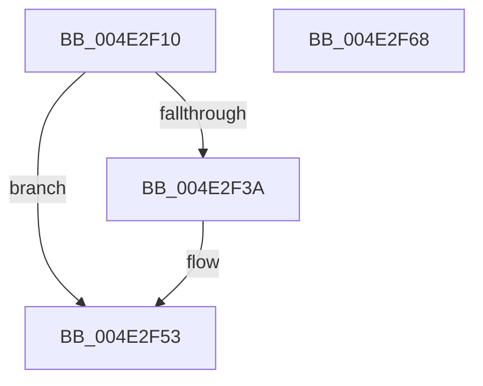

# LZ4_compress_HC_extStateHC

- RVA: `0x004E2F10`–`0x004E2F69` (길이 `89` bytes)
- VA: `0x00000001404E2F10`
- 실행 섹션: `.text`
- PDB 이름 있음: `예`; PDB Function 태그: `아니요`
- unwind 정보 RVA: `0x00066400`
- 디코드: `26`개 명령, `89/89` bytes 표시
- 미해석 바이트: `0` (있으면 어셈블리에 `.byte`로 보존)

> 이 문서는 커널 이미지의 기계어와 PDB 기호를 분석해 생성했습니다. 4번과 5번은 함수 원형과 자료형을 바이너리 사용 방식에서 추정한 C 해석이며 원본 소스 복구 결과는 아닙니다.

## 1. Dependencies

- 직접 호출 지점: **2**; 고유 호출 대상: **2**
- 직접 호출자로 확인된 함수: **1**
- RIP 상대 이미지 참조: **0**

### Outgoing calls
- `0x004E2F30` → [LZ4_initStreamHC](../4F/LZ4_initStreamHC_function_004FB668.md) (function, `0x004FB668`)
- `0x004E2F4E` → [LZ4_compress_HC_extStateHC_fastReset](../5F/LZ4_compress_HC_extStateHC_fastReset_function_005FFBB0.md) (function, `0x005FFBB0`)

### Direct callers
- [RtlCompressBufferLz4](../26/RtlCompressBufferLz4_function_0026A3A0.md) at `0x0026A3FB`

### Static image references
- 디코드된 RIP-relative 메모리 참조가 없습니다.

## 2. Other-region calls and transfers

- 다른 실행 섹션으로 향하는 call: **0**
- 별도 외부 분기/꼬리 이동을 확인하지 못했습니다.

## 3. Assembly (complete function range)

```asm
004E2F10  48 89 5C 24 08                  mov qword ptr [rsp + 8], rbx
004E2F15  48 89 6C 24 10                  mov qword ptr [rsp + 0x10], rbp
004E2F1A  48 89 74 24 18                  mov qword ptr [rsp + 0x18], rsi
004E2F1F  57                              push rdi
004E2F20  48 83 EC 30                     sub rsp, 0x30
004E2F24  41 8B F9                        mov edi, r9d
004E2F27  49 8B F0                        mov rsi, r8
004E2F2A  48 8B EA                        mov rbp, rdx
004E2F2D  48 8B D9                        mov rbx, rcx
004E2F30  E8 33 87 01 00                  call 0x1404fb668
004E2F35  48 85 C0                        test rax, rax
004E2F38  74 19                           je 0x1404e2f53
004E2F3A  8B 44 24 60                     mov eax, dword ptr [rsp + 0x60]
004E2F3E  44 8B CF                        mov r9d, edi
004E2F41  4C 8B C6                        mov r8, rsi
004E2F44  89 44 24 20                     mov dword ptr [rsp + 0x20], eax
004E2F48  48 8B D5                        mov rdx, rbp
004E2F4B  48 8B CB                        mov rcx, rbx
004E2F4E  E8 5D CC 11 00                  call 0x1405ffbb0
004E2F53  48 8B 5C 24 40                  mov rbx, qword ptr [rsp + 0x40]
004E2F58  48 8B 6C 24 48                  mov rbp, qword ptr [rsp + 0x48]
004E2F5D  48 8B 74 24 50                  mov rsi, qword ptr [rsp + 0x50]
004E2F62  48 83 C4 30                     add rsp, 0x30
004E2F66  5F                              pop rdi
004E2F67  C3                              ret
004E2F68  CC                              int3
```

## 4. C-style interpretation (structured pseudocode)

```c
__int64 __fastcall LZ4_compress_HC_extStateHC(__int64 a1, __int64 a2, __int64 a3, int a4, unsigned int a5)
{
    __int64 result;
    __int64 v_rsp;
    unsigned int v_stack_m18;
    unsigned __int64 v_stack_p10;
    unsigned __int64 v_stack_p18;
    unsigned __int64 v_stack_p8;

    v_stack_p8 = v_rbx;
    v_stack_p10 = v_rbp;
    v_stack_p18 = v_rsi;
    v_rsp = (v_rsp) - (48);
    result = LZ4_initStreamHC(a1, a2, a3, a4);
    if (result != 0) {
        result = a5;
        a4 = (unsigned int)((unsigned int)(a4));
        a3 = a3;
        v_stack_m18 = (unsigned int)(result);
        a2 = a2;
        a1 = a1;
        result = LZ4_compress_HC_extStateHC_fastReset(a1, a2, a3, a4);
    }
    v_rsp = (v_rsp) + (48);
    return result;
}
```

## 5. (Beta) C Style

```c
int64_t LZ4_compress_HC_extStateHC(int64_t Arg1, int64_t Arg2, int64_t Arg3, int32_t Arg4, uint32_t Arg5)
{
    int64_t result;
    int64_t local_rsp;
    uint32_t v_stack_m18;
    uint64_t v_stack_p10;
    uint64_t v_stack_p18;
    uint64_t v_stack_p8;

    v_stack_p8 = local_rbx;
    v_stack_p10 = local_rbp;
    v_stack_p18 = local_rsi;
    local_rsp = (local_rsp) - (48);
    result = LZ4_initStreamHC(Arg1, Arg2, Arg3, Arg4);
    if (result != 0) {
        result = Arg5;
        Arg4 = (uint32_t)((uint32_t)(Arg4));
        Arg3 = Arg3;
        v_stack_m18 = (uint32_t)(result);
        Arg2 = Arg2;
        Arg1 = Arg1;
        result = LZ4_compress_HC_extStateHC_fastReset(Arg1, Arg2, Arg3, Arg4);
    }
    local_rsp = (local_rsp) + (48);
    return result;
}
```

## 6. Execution-region graph

[열기: 2D/3D 그래프와 함수 탐색 컨트롤 패널](../../../control-panel.html?section=text&rva=0x004E2F10&view=graph)

- 2D 그래프는 위에서 아래로 흐르고, 3D 그래프는 빈 공간을 드래그해 회전합니다. Shift+드래그는 이동, 휠은 확대·축소, 함수 노드 선택은 대상 보고서 이동입니다.

### Static fallback


