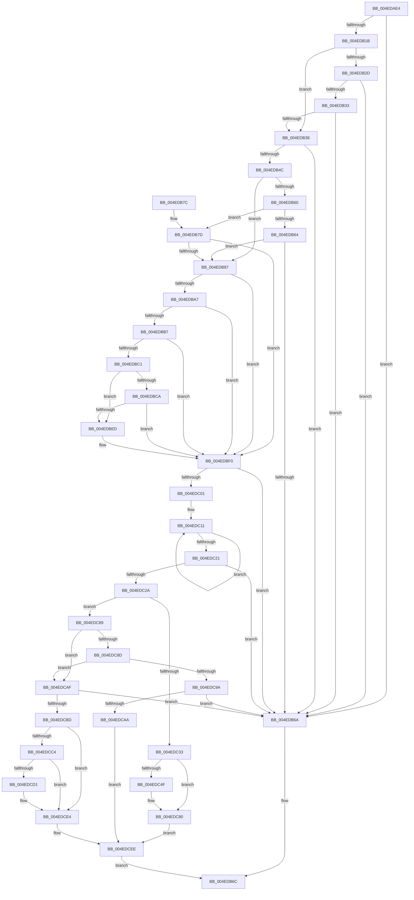

# MiComputeTrimAmount

- RVA: `0x004EDAE4`–`0x004EDD17` (길이 `563` bytes)
- VA: `0x00000001404EDAE4`
- 실행 섹션: `.text`
- PDB 이름 있음: `예`; PDB Function 태그: `아니요`
- unwind 정보 RVA: `0x000D7FF8`
- 디코드: `155`개 명령, `563/563` bytes 표시
- 미해석 바이트: `0` (있으면 어셈블리에 `.byte`로 보존)

> 이 문서는 커널 이미지의 기계어와 PDB 기호를 분석해 생성했습니다. 4번과 5번은 함수 원형과 자료형을 바이너리 사용 방식에서 추정한 C 해석이며 원본 소스 복구 결과는 아닙니다.

## 1. Dependencies

- 직접 호출 지점: **1**; 고유 호출 대상: **1**
- 직접 호출자로 확인된 함수: **1**
- RIP 상대 이미지 참조: **1**

### Outgoing calls
- `0x004EDBAE` → [MiIsStoreProcess](../2B/MiIsStoreProcess_function_002B62E0.md) (function, `0x002B62E0`)

### Direct callers
- [MiTrimOrAgeWorkingSet](../34/MiTrimOrAgeWorkingSet_function_0034EFC0.md) at `0x0034F10B`

### Static image references
- `0x004EDB03` → RVA `0x00E30088` (`.data`; read)

## 2. Other-region calls and transfers

- 다른 실행 섹션으로 향하는 call: **0**
- 별도 외부 분기/꼬리 이동을 확인하지 못했습니다.

## 3. Assembly (complete function range)

```asm
004EDAE4  48 89 5C 24 08                  mov qword ptr [rsp + 8], rbx
004EDAE9  48 89 74 24 10                  mov qword ptr [rsp + 0x10], rsi
004EDAEE  44 89 44 24 18                  mov dword ptr [rsp + 0x18], r8d
004EDAF3  57                              push rdi
004EDAF4  48 83 EC 20                     sub rsp, 0x20
004EDAF8  44 0F B7 82 AE 00 00 00         movzx r8d, word ptr [rdx + 0xae]
004EDB00  4C 8B DA                        mov r11, rdx
004EDB03  48 8B 05 7E 25 94 00            mov rax, qword ptr [rip + 0x94257e]
004EDB0A  4C 8B C9                        mov r9, rcx
004EDB0D  4A 8B 1C C0                     mov rbx, qword ptr [rax + r8*8]
004EDB11  4C 8B 41 60                     mov r8, qword ptr [rcx + 0x60]
004EDB15  4C 39 41 50                     cmp qword ptr [rcx + 0x50], r8
004EDB19  74 4F                           je 0x1404edb6a
004EDB1B  48 8B 41 48                     mov rax, qword ptr [rcx + 0x48]
004EDB1F  BE 03 00 00 00                  mov esi, 3
004EDB24  48 39 83 00 49 00 00            cmp qword ptr [rbx + 0x4900], rax
004EDB2B  72 0B                           jb 0x1404edb38
004EDB2D  40 38 71 03                     cmp byte ptr [rcx + 3], sil
004EDB31  72 37                           jb 0x1404edb6a
004EDB33  F6 01 7F                        test byte ptr [rcx], 0x7f
004EDB36  75 32                           jne 0x1404edb6a
004EDB38  4C 8B 82 90 00 00 00            mov r8, qword ptr [rdx + 0x90]
004EDB3F  48 8B 42 10                     mov rax, qword ptr [rdx + 0x10]
004EDB43  48 8B 78 20                     mov rdi, qword ptr [rax + 0x20]
004EDB47  4C 3B C7                        cmp r8, rdi
004EDB4A  76 1E                           jbe 0x1404edb6a
004EDB4C  8B 8A B8 00 00 00               mov ecx, dword ptr [rdx + 0xb8]
004EDB52  8B 82 B8 00 00 00               mov eax, dword ptr [rdx + 0xb8]
004EDB58  89 4C 24 40                     mov dword ptr [rsp + 0x40], ecx
004EDB5C  A8 0F                           test al, 0xf
004EDB5E  75 27                           jne 0x1404edb87
004EDB60  84 C9                           test cl, cl
004EDB62  79 19                           jns 0x1404edb7d
004EDB64  4C 3B 42 70                     cmp r8, qword ptr [rdx + 0x70]
004EDB68  77 1D                           ja 0x1404edb87
004EDB6A  33 C0                           xor eax, eax
004EDB6C  48 8B 5C 24 30                  mov rbx, qword ptr [rsp + 0x30]
004EDB71  48 8B 74 24 38                  mov rsi, qword ptr [rsp + 0x38]
004EDB76  48 83 C4 20                     add rsp, 0x20
004EDB7A  5F                              pop rdi
004EDB7B  C3                              ret
004EDB7C  CC                              int3
004EDB7D  8B 82 F4 FD FF FF               mov eax, dword ptr [rdx - 0x20c]
004EDB83  A8 40                           test al, 0x40
004EDB85  75 69                           jne 0x1404edbf0
004EDB87  48 8B 4A 70                     mov rcx, qword ptr [rdx + 0x70]
004EDB8B  49 8B C0                        mov rax, r8
004EDB8E  48 2B C1                        sub rax, rcx
004EDB91  49 3B C8                        cmp rcx, r8
004EDB94  4D 1B D2                        sbb r10, r10
004EDB97  4C 23 D0                        and r10, rax
004EDB9A  8B 82 B8 00 00 00               mov eax, dword ptr [rdx + 0xb8]
004EDBA0  4D 8B C2                        mov r8, r10
004EDBA3  A8 0F                           test al, 0xf
004EDBA5  75 49                           jne 0x1404edbf0
004EDBA7  48 8D 8A 00 FC FF FF            lea rcx, [rdx - 0x400]
004EDBAE  E8 2D 87 DC FF                  call 0x1402b62e0
004EDBB3  85 C0                           test eax, eax
004EDBB5  74 39                           je 0x1404edbf0
004EDBB7  8B 83 B0 06 00 00               mov eax, dword ptr [rbx + 0x6b0]
004EDBBD  85 C0                           test eax, eax
004EDBBF  74 2F                           je 0x1404edbf0
004EDBC1  41 8A 01                        mov al, byte ptr [r9]
004EDBC4  24 7F                           and al, 0x7f
004EDBC6  3C 04                           cmp al, 4
004EDBC8  72 23                           jb 0x1404edbed
004EDBCA  48 8B 83 C0 44 00 00            mov rax, qword ptr [rbx + 0x44c0]
004EDBD1  48 8B 88 38 01 00 00            mov rcx, qword ptr [rax + 0x138]
004EDBD8  B8 20 4E 00 00                  mov eax, 0x4e20
004EDBDD  48 3B C8                        cmp rcx, rax
004EDBE0  48 0F 47 C1                     cmova rax, rcx
004EDBE4  48 39 83 00 49 00 00            cmp qword ptr [rbx + 0x4900], rax
004EDBEB  72 03                           jb 0x1404edbf0
004EDBED  45 33 C0                        xor r8d, r8d
004EDBF0  41 0F B6 49 01                  movzx ecx, byte ptr [r9 + 1]
004EDBF5  45 33 D2                        xor r10d, r10d
004EDBF8  83 F9 08                        cmp ecx, 8
004EDBFB  0F 83 69 FF FF FF               jae 0x1404edb6a
004EDC01  41 8D 42 08                     lea eax, [r10 + 8]
004EDC05  49 8D 53 28                     lea rdx, [r11 + 0x28]
004EDC09  2B C1                           sub eax, ecx
004EDC0B  48 8D 14 CA                     lea rdx, [rdx + rcx*8]
004EDC0F  8B C8                           mov ecx, eax
004EDC11  48 8B 02                        mov rax, qword ptr [rdx]
004EDC14  48 8D 52 08                     lea rdx, [rdx + 8]
004EDC18  4C 03 D0                        add r10, rax
004EDC1B  48 83 E9 01                     sub rcx, 1
004EDC1F  75 F0                           jne 0x1404edc11
004EDC21  4D 85 D2                        test r10, r10
004EDC24  0F 84 40 FF FF FF               je 0x1404edb6a
004EDC2A  41 8A 01                        mov al, byte ptr [r9]
004EDC2D  24 7F                           and al, 0x7f
004EDC2F  3C 01                           cmp al, 1
004EDC31  77 56                           ja 0x1404edc89
004EDC33  80 7C 24 42 02                  cmp byte ptr [rsp + 0x42], 2
004EDC38  B9 01 00 00 00                  mov ecx, 1
004EDC3D  4D 8B DA                        mov r11, r10
004EDC40  0F 44 CE                        cmove ecx, esi
004EDC43  49 D3 EB                        shr r11, cl
004EDC46  49 8B 49 68                     mov rcx, qword ptr [r9 + 0x68]
004EDC4A  49 3B CA                        cmp rcx, r10
004EDC4D  72 31                           jb 0x1404edc80
004EDC4F  33 D2                           xor edx, edx
004EDC51  49 6B C2 64                     imul rax, r10, 0x64
004EDC55  48 F7 F1                        div rcx
004EDC58  48 8B C8                        mov rcx, rax
004EDC5B  48 B8 15 AE 47 E1 7A 14 AE 47   movabs rax, 0x47ae147ae147ae15
004EDC65  49 0F AF CA                     imul rcx, r10
004EDC69  48 F7 E1                        mul rcx
004EDC6C  48 2B CA                        sub rcx, rdx
004EDC6F  48 D1 E9                        shr rcx, 1
004EDC72  48 03 CA                        add rcx, rdx
004EDC75  48 C1 E9 06                     shr rcx, 6
004EDC79  4C 3B D9                        cmp r11, rcx
004EDC7C  4C 0F 42 D9                     cmovb r11, rcx
004EDC80  4D 3B D8                        cmp r11, r8
004EDC83  4D 0F 46 C3                     cmovbe r8, r11
004EDC87  EB 65                           jmp 0x1404edcee
004EDC89  3C 04                           cmp al, 4
004EDC8B  75 22                           jne 0x1404edcaf
004EDC8D  48 81 BB 00 49 00 00 E0 00 00 00  cmp qword ptr [rbx + 0x4900], 0xe0
004EDC98  73 15                           jae 0x1404edcaf
004EDC9A  4D 8B 83 90 00 00 00            mov r8, qword ptr [r11 + 0x90]
004EDCA1  4C 3B C7                        cmp r8, rdi
004EDCA4  0F 86 C0 FE FF FF               jbe 0x1404edb6a
004EDCAA  4C 2B C7                        sub r8, rdi
004EDCAD  EB 3F                           jmp 0x1404edcee
004EDCAF  49 8B 41 50                     mov rax, qword ptr [r9 + 0x50]
004EDCB3  49 39 41 60                     cmp qword ptr [r9 + 0x60], rax
004EDCB7  0F 87 AD FE FF FF               ja 0x1404edb6a
004EDCBD  80 7C 24 42 02                  cmp byte ptr [rsp + 0x42], 2
004EDCC2  74 20                           je 0x1404edce4
004EDCC4  49 8B 41 68                     mov rax, qword ptr [r9 + 0x68]
004EDCC8  49 8B 49 58                     mov rcx, qword ptr [r9 + 0x58]
004EDCCC  48 3B C1                        cmp rax, rcx
004EDCCF  76 13                           jbe 0x1404edce4
004EDCD1  33 D2                           xor edx, edx
004EDCD3  48 F7 F1                        div rcx
004EDCD6  33 D2                           xor edx, edx
004EDCD8  48 8B C8                        mov rcx, rax
004EDCDB  49 8B C2                        mov rax, r10
004EDCDE  48 F7 F1                        div rcx
004EDCE1  4C 8B D0                        mov r10, rax
004EDCE4  4D 3B D0                        cmp r10, r8
004EDCE7  4D 0F 47 D0                     cmova r10, r8
004EDCEB  4D 8B C2                        mov r8, r10
004EDCEE  49 8B 41 50                     mov rax, qword ptr [r9 + 0x50]
004EDCF2  49 2B 41 60                     sub rax, qword ptr [r9 + 0x60]
004EDCF6  41 0F B6 09                     movzx ecx, byte ptr [r9]
004EDCFA  4C 3B C0                        cmp r8, rax
004EDCFD  48 8B 93 C0 44 00 00            mov rdx, qword ptr [rbx + 0x44c0]
004EDD04  49 0F 46 C0                     cmovbe rax, r8
004EDD08  83 E1 7F                        and ecx, 0x7f
004EDD0B  FF 84 8A D4 01 00 00            inc dword ptr [rdx + rcx*4 + 0x1d4]
004EDD12  E9 55 FE FF FF                  jmp 0x1404edb6c
```

## 4. C-style interpretation (structured pseudocode)

```c
__int64 __fastcall MiComputeTrimAmount(__int64 a1, __int64 a2, int a3)
{
    __int64 result;
    __int64 v_r10;
    __int64 v_r11;
    __int64 v_rsp;
    unsigned __int64 v_stack_p10;
    unsigned int v_stack_p18;
    unsigned __int8 v_stack_p42;
    unsigned __int64 v_stack_p8;

    v_stack_p8 = v_rbx;
    v_stack_p10 = v_rsi;
    v_stack_p18 = a3;
    v_rsp = (v_rsp) - (32);
    if ((*(unsigned __int64 *)(a1 + 80)) == (*(unsigned __int64 *)(a1 + 96))) goto loc_004EDB6A;
    if ((*(unsigned __int64 *)(*(unsigned __int64 *)(*(unsigned __int64 *)(v_rip + 9708926) + *(unsigned __int16 *)(a2 + 174) * 8) + 18688)) < (*(unsigned __int64 *)(a1 + 72))) goto loc_004EDB38;
    if ((*(unsigned __int8 *)(a1 + 3)) < 3) goto loc_004EDB6A;
    if (((*(unsigned __int8 *)(a1)) & (127)) != 0) goto loc_004EDB6A;
loc_004EDB38:
    if ((*(unsigned __int64 *)(a2 + 144)) <= (*(unsigned __int64 *)(*(unsigned __int64 *)(a2 + 16) + 32))) goto loc_004EDB6A;
    v_stack_p18 = (unsigned int)((unsigned int)(*(unsigned int *)(a2 + 184)));
    if ((((unsigned __int8)((unsigned int)(*(unsigned int *)(a2 + 184)))) & (15)) != 0) goto loc_004EDB87;
    if (!sign_flag) goto loc_004EDB7D;
    if ((*(unsigned __int64 *)(a2 + 144)) > (*(unsigned __int64 *)(a2 + 112))) goto loc_004EDB87;
loc_004EDB6A:
    result = 0;
loc_004EDB6C:
    v_rsp = (v_rsp) + (32);
    return result;
loc_004EDB7D:
    if ((((unsigned __int8)((unsigned int)(*(unsigned int *)(a2 - 524)))) & (64)) != 0) goto loc_004EDBF0;
loc_004EDB87:
    result = (*(unsigned __int64 *)(a2 + 144)) - (*(unsigned __int64 *)(a2 + 112));
    v_r10 = (v_r10) & (result);
    if ((((unsigned __int8)((unsigned int)(*(unsigned int *)(a2 + 184)))) & (15)) != 0) goto loc_004EDBF0;
    result = MiIsStoreProcess(a2 - 1024, a2, v_r10, a1);
    if ((unsigned int)(result) == 0) goto loc_004EDBF0;
    if ((unsigned int)((unsigned int)(*(unsigned int *)(v_stack_p8 + 1712))) == 0) goto loc_004EDBF0;
    result = (unsigned __int8)((*(unsigned __int8 *)(a1)) & (127));
    if (((unsigned __int8)(result)) < 4) goto loc_004EDBED;
    result = (unsigned int)(0x4E20ULL);
    if ((*(unsigned __int64 *)(*(unsigned __int64 *)(v_stack_p8 + 17600) + 312)) > ((unsigned int)(0x4E20ULL))) { result = *(unsigned __int64 *)(*(unsigned __int64 *)(v_stack_p8 + 17600) + 312); }
    if ((*(unsigned __int64 *)(v_stack_p8 + 18688)) >= result) {
        a3 = 0;
    }
    v_r10 = 0;
    if (((unsigned int)(*(unsigned __int8 *)(a1 + 1))) >= 8) goto loc_004EDB6A;
    result = (unsigned int)((v_r10 + 8) - ((unsigned int)(*(unsigned __int8 *)(a1 + 1))));
loc_004EDC11:
    v_r10 = (v_r10) + (*(unsigned __int64 *)(a2 + 40 + *(unsigned __int8 *)(a1 + 1) * 8));
    a1 = ((unsigned int)((unsigned int)(result))) - (1);
    if (condition_is_not_equal) goto loc_004EDC11;
    if (v_r10 == 0) goto loc_004EDB6A;
    result = (unsigned __int8)((*(unsigned __int8 *)(a1)) & (127));
    if (((unsigned __int8)(result)) > 1) goto loc_004EDC89;
    a1 = 1;
    if (v_stack_p42 == 2) { a1 = (unsigned int)(v_stack_p10); }
    v_r11 = (v_r10) >> ((unsigned __int8)(a1));
    if ((*(unsigned __int64 *)(a1 + 104)) >= v_r10) {
        a2 = 0;
        result = (result) * (v_r10);
        a1 = result;
        a1 = (a1) * (v_r10);
        a1 = (a1) - (0);
        a1 = (a1) >> (1);
        a1 = (a1) + (0);
        a1 = (a1) >> (6);
        if (v_r11 < a1) { v_r11 = a1; }
    }
    if (v_r11 <= 0) { a3 = v_r11; }
    goto loc_004EDCEE;
loc_004EDC89:
    if (((unsigned __int8)(result)) != 4) goto loc_004EDCAF;
    if ((*(unsigned __int64 *)(v_stack_p8 + 18688)) >= 224) goto loc_004EDCAF;
    if ((*(unsigned __int64 *)(v_r11 + 144)) <= (*(unsigned __int64 *)(*(unsigned __int64 *)(a2 + 16) + 32))) goto loc_004EDB6A;
    a3 = (*(unsigned __int64 *)(v_r11 + 144)) - (*(unsigned __int64 *)(*(unsigned __int64 *)(a2 + 16) + 32));
    goto loc_004EDCEE;
loc_004EDCAF:
    if ((*(unsigned __int64 *)(a1 + 96)) > (*(unsigned __int64 *)(a1 + 80))) goto loc_004EDB6A;
    if (v_stack_p42 == 2) goto loc_004EDCE4;
    result = *(unsigned __int64 *)(a1 + 104);
    if ((*(unsigned __int64 *)(a1 + 104)) >= = (*(unsigned __int64 *)(a1 + 88))) {
        a2 = 0;
        a2 = 0;
        a1 = *(unsigned __int64 *)(a1 + 104);
        result = v_r10;
        v_r10 = result;
    }
    if (v_r10 > a3) { v_r10 = a3; }
loc_004EDCEE:
    result = (*(unsigned __int64 *)(a1 + 80)) - (*(unsigned __int64 *)(a1 + 96));
    if (v_r10 <= result) { result = v_r10; }
    a1 = (unsigned int)((*(unsigned __int8 *)(a1)) & (127));
    goto loc_004EDB6C;
}
```

## 5. (Beta) C Style

```c
int64_t MiComputeTrimAmount(void *Arg1, void *Arg2, int32_t Arg3)
{
    uint8_t *arg1 = (uint8_t *)Arg1;
    uint8_t *arg2 = (uint8_t *)Arg2;

    int64_t result;
    int64_t local_r10;
    int64_t local_r11;
    int64_t local_rsp;
    uint64_t v_stack_p10;
    uint32_t v_stack_p18;
    uint8_t v_stack_p42;
    uint64_t v_stack_p8;

    v_stack_p8 = local_rbx;
    v_stack_p10 = local_rsi;
    v_stack_p18 = Arg3;
    local_rsp = (local_rsp) - (32);
    if ((*(uint64_t *)(arg1 + 0x50)) == (*(uint64_t *)(arg1 + 0x60))) goto loc_004EDB6A;
    if ((*(uint64_t *)(*(uint64_t *)(*(uint64_t *)(v_rip + 0x94257E) + *(uint16_t *)(arg2 + 0xAE) * 8) + 0x4900)) < (*(uint64_t *)(arg1 + 0x48))) goto loc_004EDB38;
    if ((*(uint8_t *)(arg1 + 0x3)) < 3) goto loc_004EDB6A;
    if (((*(uint8_t *)(arg1)) & (127)) != 0) goto loc_004EDB6A;
loc_004EDB38:
    if ((*(uint64_t *)(arg2 + 0x90)) <= (*(uint64_t *)(*(uint64_t *)(arg2 + 0x10) + 0x20))) goto loc_004EDB6A;
    v_stack_p18 = (uint32_t)((uint32_t)(*(uint32_t *)(arg2 + 0xB8)));
    if ((((uint8_t)((uint32_t)(*(uint32_t *)(arg2 + 0xB8)))) & (15)) != 0) goto loc_004EDB87;
    if (!sign_flag) goto loc_004EDB7D;
    if ((*(uint64_t *)(arg2 + 0x90)) > (*(uint64_t *)(arg2 + 0x70))) goto loc_004EDB87;
loc_004EDB6A:
    result = 0;
loc_004EDB6C:
    local_rsp = (local_rsp) + (32);
    return result;
loc_004EDB7D:
    if ((((uint8_t)((uint32_t)(*(uint32_t *)(arg2 - 0x20C)))) & (64)) != 0) goto loc_004EDBF0;
loc_004EDB87:
    result = (*(uint64_t *)(arg2 + 0x90)) - (*(uint64_t *)(arg2 + 0x70));
    local_r10 = (local_r10) & (result);
    if ((((uint8_t)((uint32_t)(*(uint32_t *)(arg2 + 0xB8)))) & (15)) != 0) goto loc_004EDBF0;
    result = MiIsStoreProcess(Arg2 - 1024, Arg2, local_r10, Arg1);
    if ((uint32_t)(result) == 0) goto loc_004EDBF0;
    if ((uint32_t)((uint32_t)(*(uint32_t *)(v_stack_p8 + 0x6B0))) == 0) goto loc_004EDBF0;
    result = (uint8_t)((*(uint8_t *)(arg1)) & (127));
    if (((uint8_t)(result)) < 4) goto loc_004EDBED;
    result = (uint32_t)(0x4E20ULL);
    if ((*(uint64_t *)(*(uint64_t *)(v_stack_p8 + 0x44C0) + 0x138)) > ((uint32_t)(0x4E20ULL))) { result = *(uint64_t *)(*(uint64_t *)(v_stack_p8 + 0x44C0) + 0x138); }
    if ((*(uint64_t *)(v_stack_p8 + 0x4900)) >= result) {
        Arg3 = 0;
    }
    local_r10 = 0;
    if (((uint32_t)(*(uint8_t *)(arg1 + 0x1))) >= 8) goto loc_004EDB6A;
    result = (uint32_t)((local_r10 + 8) - ((uint32_t)(*(uint8_t *)(arg1 + 0x1))));
loc_004EDC11:
    local_r10 = (local_r10) + (*(uint64_t *)(arg2 + 0x28 + *(uint8_t *)(arg1 + 0x1) * 8));
    Arg1 = ((uint32_t)((uint32_t)(result))) - (1);
    if (condition_is_not_equal) goto loc_004EDC11;
    if (local_r10 == 0) goto loc_004EDB6A;
    result = (uint8_t)((*(uint8_t *)(arg1)) & (127));
    if (((uint8_t)(result)) > 1) goto loc_004EDC89;
    Arg1 = 1;
    if (v_stack_p42 == 2) { Arg1 = (uint32_t)(v_stack_p10); }
    local_r11 = (local_r10) >> ((uint8_t)(Arg1));
    if ((*(uint64_t *)(arg1 + 0x68)) >= local_r10) {
        Arg2 = 0;
        result = (result) * (local_r10);
        Arg1 = result;
        Arg1 = (Arg1) * (local_r10);
        Arg1 = (Arg1) - (0);
        Arg1 = (Arg1) >> (1);
        Arg1 = (Arg1) + (0);
        Arg1 = (Arg1) >> (6);
        if (local_r11 < Arg1) { local_r11 = Arg1; }
    }
    if (local_r11 <= 0) { Arg3 = local_r11; }
    goto loc_004EDCEE;
loc_004EDC89:
    if (((uint8_t)(result)) != 4) goto loc_004EDCAF;
    if ((*(uint64_t *)(v_stack_p8 + 0x4900)) >= 224) goto loc_004EDCAF;
    if ((*(uint64_t *)(local_r11 + 0x90)) <= (*(uint64_t *)(*(uint64_t *)(arg2 + 0x10) + 0x20))) goto loc_004EDB6A;
    Arg3 = (*(uint64_t *)(local_r11 + 0x90)) - (*(uint64_t *)(*(uint64_t *)(arg2 + 0x10) + 0x20));
    goto loc_004EDCEE;
loc_004EDCAF:
    if ((*(uint64_t *)(arg1 + 0x60)) > (*(uint64_t *)(arg1 + 0x50))) goto loc_004EDB6A;
    if (v_stack_p42 == 2) goto loc_004EDCE4;
    result = *(uint64_t *)(arg1 + 0x68);
    if ((*(uint64_t *)(arg1 + 0x68)) >= = (*(uint64_t *)(arg1 + 0x58))) {
        Arg2 = 0;
        Arg2 = 0;
        Arg1 = *(uint64_t *)(arg1 + 0x68);
        result = local_r10;
        local_r10 = result;
    }
    if (local_r10 > Arg3) { local_r10 = Arg3; }
loc_004EDCEE:
    result = (*(uint64_t *)(arg1 + 0x50)) - (*(uint64_t *)(arg1 + 0x60));
    if (local_r10 <= result) { result = local_r10; }
    Arg1 = (uint32_t)((*(uint8_t *)(arg1)) & (127));
    goto loc_004EDB6C;
}
```

### 관측된 메모리 오프셋

구조체 형식이 확인되지 않은 접근은 인자 기준의 오프셋으로만 기록했습니다.

| 기준 인자 | 오프셋 표현 | 폭 (bit) | 접근 |
|---|---:|---:|---|
| `Arg1` | `+ 0x0` | `8` | `R` |
| `Arg1` | `+ 0x3` | `8` | `R` |
| `Arg1` | `+ 0x48` | `64` | `R` |
| `Arg1` | `+ 0x50` | `64` | `R` |
| `Arg1` | `+ 0x60` | `64` | `R` |
| `Arg2` | `- 0x400` | `64` | `R` |
| `Arg2` | `- 0x20C` | `32` | `R` |
| `Arg2` | `+ 0x10` | `64` | `R` |
| `Arg2` | `+ 0x70` | `64` | `R` |
| `Arg2` | `+ 0x90` | `64` | `R` |
| `Arg2` | `+ 0xAE` | `16` | `R` |
| `Arg2` | `+ 0xB8` | `32` | `R` |

## 6. Execution-region graph

[열기: 2D/3D 그래프와 함수 탐색 컨트롤 패널](../../../control-panel.html?section=text&rva=0x004EDAE4&view=graph)

- 2D 그래프는 위에서 아래로 흐르고, 3D 그래프는 빈 공간을 드래그해 회전합니다. Shift+드래그는 이동, 휠은 확대·축소, 함수 노드 선택은 대상 보고서 이동입니다.

### Static fallback


