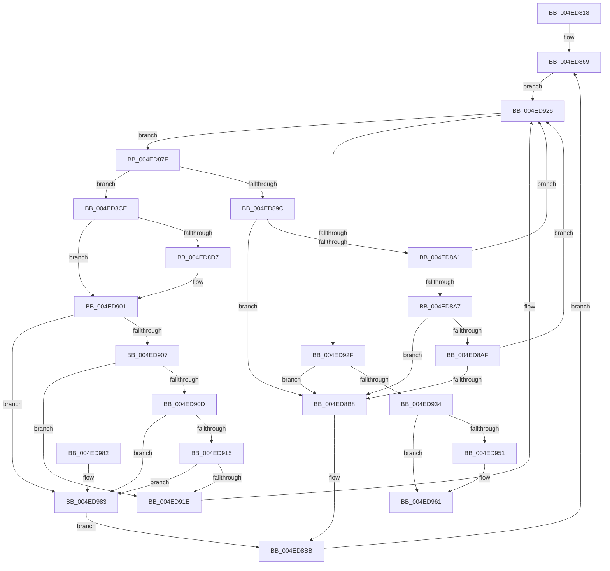

# MiDeleteEmptySubsections

- RVA: `0x004ED818`–`0x004ED993` (길이 `379` bytes)
- VA: `0x00000001404ED818`
- 실행 섹션: `.text`
- PDB 이름 있음: `예`; PDB Function 태그: `아니요`
- unwind 정보 RVA: `0x000D7CD4`
- 디코드: `107`개 명령, `379/379` bytes 표시
- 미해석 바이트: `0` (있으면 어셈블리에 `.byte`로 보존)

> 이 문서는 커널 이미지의 기계어와 PDB 기호를 분석해 생성했습니다. 4번과 5번은 함수 원형과 자료형을 바이너리 사용 방식에서 추정한 C 해석이며 원본 소스 복구 결과는 아닙니다.

## 1. Dependencies

- 직접 호출 지점: **13**; 고유 호출 대상: **9**
- 직접 호출자로 확인된 함수: **2**
- RIP 상대 이미지 참조: **0**

### Outgoing calls
- `0x004ED84E` → [memset](../6C/memset_function_006C6C40.md) (function, `0x006C6C40`)
- `0x004ED86F` → [ExAcquireSpinLockExclusive](../24/ExAcquireSpinLockExclusive_function_00248690.md) (function, `0x00248690`)
- `0x004ED893` → [ExTryAcquireSpinLockExclusiveAtDpcLevel](../2B/ExTryAcquireSpinLockExclusiveAtDpcLevel_function_002BB800.md) (function, `0x002BB800`)
- `0x004ED8AF` → [KeShouldYieldProcessor](../27/KeShouldYieldProcessor_function_002773E0.md) (function, `0x002773E0`)
- `0x004ED8BE` → [MiReleaseSpinLockExclusive](../24/MiReleaseSpinLockExclusive_function_002482C0.md) (function, `0x002482C0`)
- `0x004ED8C7` → [MiDeleteEmptySubsectionProtoPool](../48/MiDeleteEmptySubsectionProtoPool_function_004842B8.md) (function, `0x004842B8`)
- `0x004ED8EF` → [MiUpdateSystemProtoPtesTree](../29/MiUpdateSystemProtoPtesTree_function_00295F0C.md) (function, `0x00295F0C`)
- `0x004ED8FC` → [MiUnlinkUnusedSubsection](../24/MiUnlinkUnusedSubsection_function_002496F4.md) (function, `0x002496F4`)
- `0x004ED915` → [KeShouldYieldProcessor](../27/KeShouldYieldProcessor_function_002773E0.md) (function, `0x002773E0`)
- `0x004ED921` → [ExReleaseSpinLockExclusiveFromDpcLevel](../24/ExReleaseSpinLockExclusiveFromDpcLevel_function_002497E0.md) (function, `0x002497E0`)
- `0x004ED946` → [MiReleaseSpinLockExclusive](../24/MiReleaseSpinLockExclusive_function_002482C0.md) (function, `0x002482C0`)
- `0x004ED95C` → [MiDeleteEmptySubsectionProtoPool](../48/MiDeleteEmptySubsectionProtoPool_function_004842B8.md) (function, `0x004842B8`)
- `0x004ED986` → [ExReleaseSpinLockExclusiveFromDpcLevel](../24/ExReleaseSpinLockExclusiveFromDpcLevel_function_002497E0.md) (function, `0x002497E0`)

### Direct callers
- [MiSegmentDereferenceWorker](../46/MiSegmentDereferenceWorker_function_00464D40.md) at `0x00464D59`
- [MiDeleteMoreUnusedSegments](../67/MiDeleteMoreUnusedSegments_function_00677DDC.md) at `0x00677E11`

### Static image references
- 디코드된 RIP-relative 메모리 참조가 없습니다.

## 2. Other-region calls and transfers

- 다른 실행 섹션으로 향하는 call: **0**
- 별도 외부 분기/꼬리 이동을 확인하지 못했습니다.

## 3. Assembly (complete function range)

```asm
004ED818  48 8B C4                        mov rax, rsp
004ED81B  48 89 58 10                     mov qword ptr [rax + 0x10], rbx
004ED81F  48 89 70 18                     mov qword ptr [rax + 0x18], rsi
004ED823  48 89 78 20                     mov qword ptr [rax + 0x20], rdi
004ED827  48 89 48 08                     mov qword ptr [rax + 8], rcx
004ED82B  55                              push rbp
004ED82C  41 54                           push r12
004ED82E  41 55                           push r13
004ED830  41 56                           push r14
004ED832  41 57                           push r15
004ED834  48 8D 68 A1                     lea rbp, [rax - 0x5f]
004ED838  48 81 EC B0 00 00 00            sub rsp, 0xb0
004ED83F  48 8B F9                        mov rdi, rcx
004ED842  33 D2                           xor edx, edx
004ED844  48 8D 4D AF                     lea rcx, [rbp - 0x51]
004ED848  41 B8 80 00 00 00               mov r8d, 0x80
004ED84E  E8 ED 93 1D 00                  call 0x1406c6c40
004ED853  83 65 AB 00                     and dword ptr [rbp - 0x55], 0
004ED857  48 8D 9F C0 06 00 00            lea rbx, [rdi + 0x6c0]
004ED85E  83 65 A7 00                     and dword ptr [rbp - 0x59], 0
004ED862  48 81 C7 50 08 00 00            add rdi, 0x850
004ED869  45 33 E4                        xor r12d, r12d
004ED86C  48 8B CB                        mov rcx, rbx
004ED86F  E8 1C AE D5 FF                  call 0x140248690
004ED874  4C 8B 3F                        mov r15, qword ptr [rdi]
004ED877  44 8A F0                        mov r14b, al
004ED87A  E9 A7 00 00 00                  jmp 0x1404ed926
004ED87F  49 8D 77 A8                     lea rsi, [r15 - 0x58]
004ED883  41 FF C4                        inc r12d
004ED886  4C 8B 2E                        mov r13, qword ptr [rsi]
004ED889  4D 8B 3F                        mov r15, qword ptr [r15]
004ED88C  49 83 C5 48                     add r13, 0x48
004ED890  49 8B CD                        mov rcx, r13
004ED893  E8 68 DF DC FF                  call 0x1402bb800
004ED898  85 C0                           test eax, eax
004ED89A  75 32                           jne 0x1404ed8ce
004ED89C  39 45 A7                        cmp dword ptr [rbp - 0x59], eax
004ED89F  75 17                           jne 0x1404ed8b8
004ED8A1  41 F6 C4 0F                     test r12b, 0xf
004ED8A5  75 7F                           jne 0x1404ed926
004ED8A7  8B 03                           mov eax, dword ptr [rbx]
004ED8A9  0F BA E0 1E                     bt eax, 0x1e
004ED8AD  72 09                           jb 0x1404ed8b8
004ED8AF  E8 2C 9B D8 FF                  call 0x1402773e0
004ED8B4  85 C0                           test eax, eax
004ED8B6  74 6E                           je 0x1404ed926
004ED8B8  48 8B CB                        mov rcx, rbx
004ED8BB  41 8A D6                        mov dl, r14b
004ED8BE  E8 FD A9 D5 FF                  call 0x1402482c0
004ED8C3  48 8D 4D A7                     lea rcx, [rbp - 0x59]
004ED8C7  E8 EC 69 F9 FF                  call 0x1404842b8
004ED8CC  EB 9B                           jmp 0x1404ed869
004ED8CE  8B 46 20                        mov eax, dword ptr [rsi + 0x20]
004ED8D1  0F BA E0 13                     bt eax, 0x13
004ED8D5  73 2A                           jae 0x1404ed901
004ED8D7  8B 55 A7                        mov edx, dword ptr [rbp - 0x59]
004ED8DA  48 8D 4E 78                     lea rcx, [rsi + 0x78]
004ED8DE  48 8B 46 08                     mov rax, qword ptr [rsi + 8]
004ED8E2  48 89 44 D5 AF                  mov qword ptr [rbp + rdx*8 - 0x51], rax
004ED8E7  BA 02 00 00 00                  mov edx, 2
004ED8EC  FF 45 A7                        inc dword ptr [rbp - 0x59]
004ED8EF  E8 18 86 DA FF                  call 0x140295f0c
004ED8F4  48 83 66 08 00                  and qword ptr [rsi + 8], 0
004ED8F9  48 8B CE                        mov rcx, rsi
004ED8FC  E8 F3 BD D5 FF                  call 0x1402496f4
004ED901  83 7D A7 10                     cmp dword ptr [rbp - 0x59], 0x10
004ED905  74 7C                           je 0x1404ed983
004ED907  41 F6 C4 0F                     test r12b, 0xf
004ED90B  75 11                           jne 0x1404ed91e
004ED90D  8B 03                           mov eax, dword ptr [rbx]
004ED90F  0F BA E0 1E                     bt eax, 0x1e
004ED913  72 6E                           jb 0x1404ed983
004ED915  E8 C6 9A D8 FF                  call 0x1402773e0
004ED91A  85 C0                           test eax, eax
004ED91C  75 65                           jne 0x1404ed983
004ED91E  49 8B CD                        mov rcx, r13
004ED921  E8 BA BE D5 FF                  call 0x1402497e0
004ED926  4C 3B FF                        cmp r15, rdi
004ED929  0F 85 50 FF FF FF               jne 0x1404ed87f
004ED92F  48 39 3F                        cmp qword ptr [rdi], rdi
004ED932  75 84                           jne 0x1404ed8b8
004ED934  48 8B 45 67                     mov rax, qword ptr [rbp + 0x67]
004ED938  41 8A D6                        mov dl, r14b
004ED93B  48 8B CB                        mov rcx, rbx
004ED93E  48 83 A0 10 07 00 00 00         and qword ptr [rax + 0x710], 0
004ED946  E8 75 A9 D5 FF                  call 0x1402482c0
004ED94B  83 7D A7 00                     cmp dword ptr [rbp - 0x59], 0
004ED94F  74 10                           je 0x1404ed961
004ED951  48 8D 4D A7                     lea rcx, [rbp - 0x59]
004ED955  C7 45 AB 01 00 00 00            mov dword ptr [rbp - 0x55], 1
004ED95C  E8 57 69 F9 FF                  call 0x1404842b8
004ED961  4C 8D 9C 24 B0 00 00 00         lea r11, [rsp + 0xb0]
004ED969  49 8B 5B 38                     mov rbx, qword ptr [r11 + 0x38]
004ED96D  49 8B 73 40                     mov rsi, qword ptr [r11 + 0x40]
004ED971  49 8B 7B 48                     mov rdi, qword ptr [r11 + 0x48]
004ED975  49 8B E3                        mov rsp, r11
004ED978  41 5F                           pop r15
004ED97A  41 5E                           pop r14
004ED97C  41 5D                           pop r13
004ED97E  41 5C                           pop r12
004ED980  5D                              pop rbp
004ED981  C3                              ret
004ED982  CC                              int3
004ED983  48 8B CB                        mov rcx, rbx
004ED986  E8 55 BE D5 FF                  call 0x1402497e0
004ED98B  49 8B CD                        mov rcx, r13
004ED98E  E9 28 FF FF FF                  jmp 0x1404ed8bb
```

## 4. C-style interpretation (structured pseudocode)

```c
__int64 __fastcall MiDeleteEmptySubsections(__int64 a1, int a2)
{
    __int64 result;
    __int64 v_r12;
    __int64 v_r13;
    __int64 v_rdi;
    __int64 v_rsp;
    unsigned __int64 v_stack_m28;

    *(unsigned __int64 *)(v_rsp + 16) = v_rbx;
    *(unsigned __int64 *)(v_rsp + 24) = v_rsi;
    *(unsigned __int64 *)(v_rsp + 32) = v_rdi;
    *(unsigned __int64 *)(v_rsp + 8) = a1;
    v_rsp = (v_rsp) - (176);
    a2 = 0;
    result = memset(v_rsp - 95 - 81, a2, 128, a4);
    v_rdi = (a1) + (0x850ULL);
loc_004ED869:
    v_r12 = 0;
    result = ExAcquireSpinLockExclusive(a1 + 1728, a2, 128, a4);
    goto loc_004ED926;
loc_004ED87F:
    v_r12 = (unsigned int)((v_r12) + 1);
    v_r13 = (*(unsigned __int64 *)(*(unsigned __int64 *)(v_rdi) - 88)) + (72);
    result = ExTryAcquireSpinLockExclusiveAtDpcLevel(v_r13, a2, 128, a4);
    if ((unsigned int)(result) != 0) goto loc_004ED8CE;
    if ((*(unsigned int *)(v_rsp - 95 - 89)) != ((unsigned int)(result))) goto loc_004ED8B8;
    if ((((unsigned __int8)(v_r12)) & (15)) != 0) goto loc_004ED926;
    if (condition_is_below) goto loc_004ED8B8;
    result = KeShouldYieldProcessor(v_r13, a2, 128, a4);
    if ((unsigned int)(result) == 0) goto loc_004ED926;
loc_004ED8B8:
loc_004ED8BB:
    result = MiReleaseSpinLockExclusive(a1 + 1728, (unsigned __int8)((unsigned __int8)(result)), 128, a4);
    result = MiDeleteEmptySubsectionProtoPool(v_rsp - 95 - 89, (unsigned __int8)((unsigned __int8)(result)), 128, a4);
    goto loc_004ED869;
loc_004ED8CE:
    result = (unsigned int)(*(unsigned int *)(*(unsigned __int64 *)(v_rdi) - 88 + 32));
    if (!(condition_is_above_or_equal)) {
        a2 = *(unsigned int *)(v_rsp - 95 - 89);
        a1 = *(unsigned __int64 *)(v_rdi) - 88 + 120;
        result = *(unsigned __int64 *)(*(unsigned __int64 *)(v_rdi) - 88 + 8);
        *(unsigned __int64 *)(v_rsp - 95 + a2 * 8 - 81) = result;
        a2 = 2;
        result = MiUpdateSystemProtoPtesTree(a1, a2, 128, a4);
        a1 = *(unsigned __int64 *)(v_rdi) - 88;
        result = MiUnlinkUnusedSubsection(a1, a2, 128, a4);
    }
    if ((*(unsigned int *)(v_rsp - 95 - 89)) == 16) goto loc_004ED983;
    if ((((unsigned __int8)(v_r12)) & (15)) != 0) goto loc_004ED91E;
    if (condition_is_below) goto loc_004ED983;
    result = KeShouldYieldProcessor(a1, a2, 128, a4);
    if ((unsigned int)(result) != 0) goto loc_004ED983;
loc_004ED91E:
    result = ExReleaseSpinLockExclusiveFromDpcLevel(v_r13, a2, 128, a4);
loc_004ED926:
    if ((*(unsigned __int64 *)(*(unsigned __int64 *)(v_rdi))) != v_rdi) goto loc_004ED87F;
    if ((*(unsigned __int64 *)(v_rdi)) != v_rdi) goto loc_004ED8B8;
    result = MiReleaseSpinLockExclusive(a1 + 1728, (unsigned __int8)((unsigned __int8)(result)), 128, a4);
    if ((*(unsigned int *)(v_rsp - 95 - 89)) != 0) {
        a1 = v_rsp - 95 - 89;
        *(unsigned int *)(v_rsp - 95 - 85) = 1;
        result = MiDeleteEmptySubsectionProtoPool(a1, (unsigned __int8)((unsigned __int8)(result)), 128, a4);
    }
    return result;
loc_004ED983:
    result = ExReleaseSpinLockExclusiveFromDpcLevel(*(unsigned __int64 *)(v_stack_m28 + 56), (unsigned __int8)((unsigned __int8)(result)), 128, a4);
    goto loc_004ED8BB;
}
```

## 5. (Beta) C Style

```c
int64_t MiDeleteEmptySubsections(void *Arg1, int32_t Arg2)
{
    uint8_t *arg1 = (uint8_t *)Arg1;

    int64_t result;
    int64_t local_r12;
    int64_t local_r13;
    int64_t local_rdi;
    int64_t local_rsp;
    uint64_t v_stack_m28;

    *(uint64_t *)(local_rsp + 0x10) = local_rbx;
    *(uint64_t *)(local_rsp + 0x18) = local_rsi;
    *(uint64_t *)(local_rsp + 0x20) = local_rdi;
    *(void **)(local_rsp + 0x8) = Arg1;
    local_rsp = (local_rsp) - (176);
    Arg2 = 0;
    result = memset(local_rsp - 95 - 81, Arg2, 128, a4);
    local_rdi = (Arg1) + (0x850ULL);
loc_004ED869:
    local_r12 = 0;
    result = ExAcquireSpinLockExclusive(Arg1 + 1728, Arg2, 128, a4);
    goto loc_004ED926;
loc_004ED87F:
    local_r12 = (uint32_t)((local_r12) + 1);
    local_r13 = (*(uint64_t *)(*(uint64_t *)(local_rdi) - 0x58)) + (72);
    result = ExTryAcquireSpinLockExclusiveAtDpcLevel(local_r13, Arg2, 128, a4);
    if ((uint32_t)(result) != 0) goto loc_004ED8CE;
    if ((*(uint32_t *)(local_rsp - 0x5F - 0x59)) != ((uint32_t)(result))) goto loc_004ED8B8;
    if ((((uint8_t)(local_r12)) & (15)) != 0) goto loc_004ED926;
    if (condition_is_below) goto loc_004ED8B8;
    result = KeShouldYieldProcessor(local_r13, Arg2, 128, a4);
    if ((uint32_t)(result) == 0) goto loc_004ED926;
loc_004ED8B8:
loc_004ED8BB:
    result = MiReleaseSpinLockExclusive(Arg1 + 1728, (uint8_t)((uint8_t)(result)), 128, a4);
    result = MiDeleteEmptySubsectionProtoPool(local_rsp - 95 - 89, (uint8_t)((uint8_t)(result)), 128, a4);
    goto loc_004ED869;
loc_004ED8CE:
    result = (uint32_t)(*(uint32_t *)(*(uint64_t *)(local_rdi) - 0x58 + 0x20));
    if (!(condition_is_above_or_equal)) {
        Arg2 = *(uint32_t *)(local_rsp - 0x5F - 0x59);
        Arg1 = *(uint64_t *)(local_rdi) - 88 + 120;
        result = *(uint64_t *)(*(uint64_t *)(local_rdi) - 0x58 + 0x8);
        *(uint64_t *)(local_rsp - 0x5F + Arg2 * 8 - 0x51) = result;
        Arg2 = 2;
        result = MiUpdateSystemProtoPtesTree(Arg1, Arg2, 128, a4);
        Arg1 = *(uint64_t *)(local_rdi) - 88;
        result = MiUnlinkUnusedSubsection(Arg1, Arg2, 128, a4);
    }
    if ((*(uint32_t *)(local_rsp - 0x5F - 0x59)) == 16) goto loc_004ED983;
    if ((((uint8_t)(local_r12)) & (15)) != 0) goto loc_004ED91E;
    if (condition_is_below) goto loc_004ED983;
    result = KeShouldYieldProcessor(Arg1, Arg2, 128, a4);
    if ((uint32_t)(result) != 0) goto loc_004ED983;
loc_004ED91E:
    result = ExReleaseSpinLockExclusiveFromDpcLevel(local_r13, Arg2, 128, a4);
loc_004ED926:
    if ((*(uint64_t *)(*(uint64_t *)(local_rdi))) != local_rdi) goto loc_004ED87F;
    if ((*(uint64_t *)(local_rdi)) != local_rdi) goto loc_004ED8B8;
    result = MiReleaseSpinLockExclusive(Arg1 + 1728, (uint8_t)((uint8_t)(result)), 128, a4);
    if ((*(uint32_t *)(local_rsp - 0x5F - 0x59)) != 0) {
        Arg1 = local_rsp - 95 - 89;
        *(uint32_t *)(local_rsp - 0x5F - 0x55) = 1;
        result = MiDeleteEmptySubsectionProtoPool(Arg1, (uint8_t)((uint8_t)(result)), 128, a4);
    }
    return result;
loc_004ED983:
    result = ExReleaseSpinLockExclusiveFromDpcLevel(*(uint64_t *)(v_stack_m28 + 0x38), (uint8_t)((uint8_t)(result)), 128, a4);
    goto loc_004ED8BB;
}
```

### 관측된 메모리 오프셋

구조체 형식이 확인되지 않은 접근은 인자 기준의 오프셋으로만 기록했습니다.

| 기준 인자 | 오프셋 표현 | 폭 (bit) | 접근 |
|---|---:|---:|---|
| `Arg1` | `+ 0x0` | `32` | `R` |
| `Arg1` | `+ 0x0` | `64` | `R` |
| `Arg1` | `+ 0x6C0` | `64` | `R` |

## 6. Execution-region graph

[열기: 2D/3D 그래프와 함수 탐색 컨트롤 패널](../../../control-panel.html?section=text&rva=0x004ED818&view=graph)

- 2D 그래프는 위에서 아래로 흐르고, 3D 그래프는 빈 공간을 드래그해 회전합니다. Shift+드래그는 이동, 휠은 확대·축소, 함수 노드 선택은 대상 보고서 이동입니다.

### Static fallback


