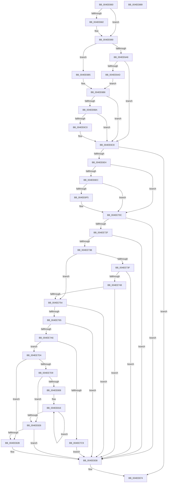

# MiFinishPteChangesInPageTable

- RVA: `0x004EE660`–`0x004EE88A` (길이 `554` bytes)
- VA: `0x00000001404EE660`
- 실행 섹션: `.text`
- PDB 이름 있음: `예`; PDB Function 태그: `아니요`
- unwind 정보 RVA: `0x0005C954`
- 디코드: `155`개 명령, `554/554` bytes 표시
- 미해석 바이트: `0` (있으면 어셈블리에 `.byte`로 보존)

> 이 문서는 커널 이미지의 기계어와 PDB 기호를 분석해 생성했습니다. 4번과 5번은 함수 원형과 자료형을 바이너리 사용 방식에서 추정한 C 해석이며 원본 소스 복구 결과는 아닙니다.

## 1. Dependencies

- 직접 호출 지점: **11**; 고유 호출 대상: **11**
- 직접 호출자로 확인된 함수: **1**
- RIP 상대 이미지 참조: **0**

### Outgoing calls
- `0x004EE682` → [MiFlushTbList](../31/MiFlushTbList_function_00311FC0.md) (function, `0x00311FC0`)
- `0x004EE687` → [MiReleaseProcessorFlushList](../31/MiReleaseProcessorFlushList_function_00313C70.md) (function, `0x00313C70`)
- `0x004EE690` → [Feature_Servicing_Mm_AweLazyFlushOptIn__private_IsEnabledDeviceUsageNoInline](../68/Feature_Servicing_Mm_AweLazyFlushOptIn__private_IsEnabledDeviceUsageNoInline_function_00687974.md) (function, `0x00687974`)
- `0x004EE6C3` → [MiApplyLazyStampToAwePtes](../68/MiApplyLazyStampToAwePtes_function_006879C8.md) (function, `0x006879C8`)
- `0x004EE6D3` → [MiUpdateAwePageTable](../36/MiUpdateAwePageTable_function_00368730.md) (function, `0x00368730`)
- `0x004EE703` → [MiFlushGraphicsPtes](MiFlushGraphicsPtes_function_004E1374.md) (function, `0x004E1374`)
- `0x004EE70F` → [MI_READ_PTE_LOCK_FREE](../28/MI_READ_PTE_LOCK_FREE_function_002828A0.md) (function, `0x002828A0`)
- `0x004EE71B` → [MiUnlockPageTable](../21/MiUnlockPageTable_function_00216EC0.md) (function, `0x00216EC0`)
- `0x004EE76C` → [MiGetLeafVa](../27/MiGetLeafVa_function_0027C0A0.md) (function, `0x0027C0A0`)
- `0x004EE842` → [MiUnlockWorkingSetShared](../27/MiUnlockWorkingSetShared_function_0027D690.md) (function, `0x0027D690`)
- `0x004EE86F` → [memset](../6C/memset_function_006C6C40.md) (function, `0x006C6C40`)

### Direct callers
- [MiWriteAwePtes](../4C/MiWriteAwePtes_function_004C51E0.md) at `0x004C562C`
- [MiWriteAwePtes](../4C/MiWriteAwePtes_function_004C51E0.md) at `0x004C5A42`

### Static image references
- 디코드된 RIP-relative 메모리 참조가 없습니다.

## 2. Other-region calls and transfers

- 다른 실행 섹션으로 향하는 call: **0**
- 별도 외부 분기/꼬리 이동을 확인하지 못했습니다.

## 3. Assembly (complete function range)

```asm
004EE660  48 89 5C 24 08                  mov qword ptr [rsp + 8], rbx
004EE665  48 89 6C 24 10                  mov qword ptr [rsp + 0x10], rbp
004EE66A  48 89 74 24 18                  mov qword ptr [rsp + 0x18], rsi
004EE66F  57                              push rdi
004EE670  48 83 EC 20                     sub rsp, 0x20
004EE674  48 8B D9                        mov rbx, rcx
004EE677  33 FF                           xor edi, edi
004EE679  48 8B 49 40                     mov rcx, qword ptr [rcx + 0x40]
004EE67D  48 85 C9                        test rcx, rcx
004EE680  74 0E                           je 0x1404ee690
004EE682  E8 39 39 E2 FF                  call 0x140311fc0
004EE687  E8 E4 55 E2 FF                  call 0x140313c70
004EE68C  48 89 7B 40                     mov qword ptr [rbx + 0x40], rdi
004EE690  E8 DF 92 19 00                  call 0x140687974
004EE695  48 8B 8B A8 00 00 00            mov rcx, qword ptr [rbx + 0xa8]
004EE69C  BE 01 00 00 00                  mov esi, 1
004EE6A1  8B 51 08                        mov edx, dword ptr [rcx + 8]
004EE6A4  85 C0                           test eax, eax
004EE6A6  74 0D                           je 0x1404ee6b5
004EE6A8  F6 C2 10                        test dl, 0x10
004EE6AB  74 1B                           je 0x1404ee6c8
004EE6AD  8B 43 14                        mov eax, dword ptr [rbx + 0x14]
004EE6B0  40 84 C6                        test sil, al
004EE6B3  EB 03                           jmp 0x1404ee6b8
004EE6B5  F6 C2 10                        test dl, 0x10
004EE6B8  74 0E                           je 0x1404ee6c8
004EE6BA  48 39 7B 30                     cmp qword ptr [rbx + 0x30], rdi
004EE6BE  74 08                           je 0x1404ee6c8
004EE6C0  48 8B CB                        mov rcx, rbx
004EE6C3  E8 00 93 19 00                  call 0x1406879c8
004EE6C8  44 8B 43 10                     mov r8d, dword ptr [rbx + 0x10]
004EE6CC  48 8B 53 08                     mov rdx, qword ptr [rbx + 8]
004EE6D0  48 8B 0B                        mov rcx, qword ptr [rbx]
004EE6D3  E8 58 A0 E7 FF                  call 0x140368730
004EE6D8  8B E8                           mov ebp, eax
004EE6DA  48 39 7B 30                     cmp qword ptr [rbx + 0x30], rdi
004EE6DE  0F 84 90 01 00 00               je 0x1404ee874
004EE6E4  8B 4B 14                        mov ecx, dword ptr [rbx + 0x14]
004EE6E7  F6 C1 08                        test cl, 8
004EE6EA  74 20                           je 0x1404ee70c
004EE6EC  48 8B 4B 18                     mov rcx, qword ptr [rbx + 0x18]
004EE6F0  48 85 C9                        test rcx, rcx
004EE6F3  74 17                           je 0x1404ee70c
004EE6F5  48 8B 53 20                     mov rdx, qword ptr [rbx + 0x20]
004EE6F9  48 2B D1                        sub rdx, rcx
004EE6FC  48 C1 FA 03                     sar rdx, 3
004EE700  48 03 D6                        add rdx, rsi
004EE703  E8 6C 2C FF FF                  call 0x1404e1374
004EE708  48 89 7B 18                     mov qword ptr [rbx + 0x18], rdi
004EE70C  48 8B 0B                        mov rcx, qword ptr [rbx]
004EE70F  E8 8C 41 D9 FF                  call 0x1402828a0
004EE714  48 8B 13                        mov rdx, qword ptr [rbx]
004EE717  48 8B 4B 28                     mov rcx, qword ptr [rbx + 0x28]
004EE71B  E8 A0 87 D2 FF                  call 0x140216ec0
004EE720  8B 83 98 00 00 00               mov eax, dword ptr [rbx + 0x98]
004EE726  40 84 C6                        test sil, al
004EE729  0F 84 09 01 00 00               je 0x1404ee838
004EE72F  39 BB 9C 00 00 00               cmp dword ptr [rbx + 0x9c], edi
004EE735  0F 85 FD 00 00 00               jne 0x1404ee838
004EE73B  3B EE                           cmp ebp, esi
004EE73D  74 15                           je 0x1404ee754
004EE73F  83 FD 02                        cmp ebp, 2
004EE742  0F 85 F0 00 00 00               jne 0x1404ee838
004EE748  8B 43 14                        mov eax, dword ptr [rbx + 0x14]
004EE74B  40 84 C5                        test bpl, al
004EE74E  0F 85 E4 00 00 00               jne 0x1404ee838
004EE754  4C 8B 5B 38                     mov r11, qword ptr [rbx + 0x38]
004EE758  49 8B 6B 30                     mov rbp, qword ptr [r11 + 0x30]
004EE75C  48 85 ED                        test rbp, rbp
004EE75F  0F 84 D3 00 00 00               je 0x1404ee838
004EE765  48 8B 0B                        mov rcx, qword ptr [rbx]
004EE768  4C 8B 4B 30                     mov r9, qword ptr [rbx + 0x30]
004EE76C  E8 2F D9 D8 FF                  call 0x14027c0a0
004EE771  41 0F B6 51 20                  movzx edx, byte ptr [r9 + 0x20]
004EE776  4C 8B D0                        mov r10, rax
004EE779  41 8B 49 18                     mov ecx, dword ptr [r9 + 0x18]
004EE77D  49 81 E2 00 00 E0 FF            and r10, 0xffffffffffe00000
004EE784  48 C1 E2 20                     shl rdx, 0x20
004EE788  48 0B D1                        or rdx, rcx
004EE78B  48 81 E2 00 FE FF FF            and rdx, 0xfffffffffffffe00
004EE792  48 C1 E2 0C                     shl rdx, 0xc
004EE796  4C 2B D2                        sub r10, rdx
004EE799  49 C1 EA 15                     shr r10, 0x15
004EE79D  4C 3B D5                        cmp r10, rbp
004EE7A0  0F 83 92 00 00 00               jae 0x1404ee838
004EE7A6  49 8B 43 38                     mov rax, qword ptr [r11 + 0x38]
004EE7AA  4D 8B CA                        mov r9, r10
004EE7AD  41 83 E1 1F                     and r9d, 0x1f
004EE7B1  49 8B CA                        mov rcx, r10
004EE7B4  48 C1 E9 05                     shr rcx, 5
004EE7B8  48 8B D6                        mov rdx, rsi
004EE7BB  4C 8D 04 88                     lea r8, [rax + rcx*4]
004EE7BF  49 8D 41 01                     lea rax, [r9 + 1]
004EE7C3  48 83 F8 20                     cmp rax, 0x20
004EE7C7  77 0B                           ja 0x1404ee7d4
004EE7C9  41 8B C9                        mov ecx, r9d
004EE7CC  D3 E6                           shl esi, cl
004EE7CE  F0 41 09 30                     lock or dword ptr [r8], esi
004EE7D2  EB 64                           jmp 0x1404ee838
004EE7D4  4D 85 C9                        test r9, r9
004EE7D7  74 52                           je 0x1404ee82b
004EE7D9  41 83 E2 1F                     and r10d, 0x1f
004EE7DD  BA 20 00 00 00                  mov edx, 0x20
004EE7E2  41 2B D2                        sub edx, r10d
004EE7E5  8B C6                           mov eax, esi
004EE7E7  8B CA                           mov ecx, edx
004EE7E9  D3 E0                           shl eax, cl
004EE7EB  49 8B C9                        mov rcx, r9
004EE7EE  2B C6                           sub eax, esi
004EE7F0  D3 E0                           shl eax, cl
004EE7F2  F0 41 09 00                     lock or dword ptr [r8], eax
004EE7F6  8B C2                           mov eax, edx
004EE7F8  49 83 C0 04                     add r8, 4
004EE7FC  48 8B D6                        mov rdx, rsi
004EE7FF  48 2B D0                        sub rdx, rax
004EE802  48 83 FA 20                     cmp rdx, 0x20
004EE806  72 1E                           jb 0x1404ee826
004EE808  48 8B CA                        mov rcx, rdx
004EE80B  48 C1 E9 05                     shr rcx, 5
004EE80F  48 6B C1 E0                     imul rax, rcx, -0x20
004EE813  48 03 D0                        add rdx, rax
004EE816  41 C7 00 FF FF FF FF            mov dword ptr [r8], 0xffffffff
004EE81D  49 83 C0 04                     add r8, 4
004EE821  48 2B CE                        sub rcx, rsi
004EE824  75 F0                           jne 0x1404ee816
004EE826  48 85 D2                        test rdx, rdx
004EE829  74 0D                           je 0x1404ee838
004EE82B  48 8B CA                        mov rcx, rdx
004EE82E  8B C6                           mov eax, esi
004EE830  D3 E0                           shl eax, cl
004EE832  2B C6                           sub eax, esi
004EE834  F0 41 09 00                     lock or dword ptr [r8], eax
004EE838  8A 93 B0 00 00 00               mov dl, byte ptr [rbx + 0xb0]
004EE83E  48 8B 4B 28                     mov rcx, qword ptr [rbx + 0x28]
004EE842  E8 49 EE D8 FF                  call 0x14027d690
004EE847  83 63 14 FB                     and dword ptr [rbx + 0x14], 0xfffffffb
004EE84B  48 89 3B                        mov qword ptr [rbx], rdi
004EE84E  48 89 7B 08                     mov qword ptr [rbx + 8], rdi
004EE852  89 7B 10                        mov dword ptr [rbx + 0x10], edi
004EE855  8B 43 48                        mov eax, dword ptr [rbx + 0x48]
004EE858  A8 1F                           test al, 0x1f
004EE85A  48 8B 4B 50                     mov rcx, qword ptr [rbx + 0x50]
004EE85E  40 0F 95 C7                     setne dil
004EE862  C1 E8 05                        shr eax, 5
004EE865  33 D2                           xor edx, edx
004EE867  44 8D 04 38                     lea r8d, [rax + rdi]
004EE86B  41 C1 E0 02                     shl r8d, 2
004EE86F  E8 CC 83 1D 00                  call 0x1406c6c40
004EE874  48 8B 5C 24 30                  mov rbx, qword ptr [rsp + 0x30]
004EE879  48 8B 6C 24 38                  mov rbp, qword ptr [rsp + 0x38]
004EE87E  48 8B 74 24 40                  mov rsi, qword ptr [rsp + 0x40]
004EE883  48 83 C4 20                     add rsp, 0x20
004EE887  5F                              pop rdi
004EE888  C3                              ret
004EE889  CC                              int3
```

## 4. C-style interpretation (structured pseudocode)

```c
__int64 __fastcall MiFinishPteChangesInPageTable(__int64 a1)
{
    __int64 result;
    __int64 v_r10;
    __int64 v_rdi;
    __int64 v_rsi;
    __int64 v_rsp;
    unsigned __int64 v_stack_p10;
    unsigned __int64 v_stack_p18;
    unsigned __int64 v_stack_p8;

    v_stack_p8 = v_rbx;
    v_stack_p10 = v_rbp;
    v_stack_p18 = v_rsi;
    v_rsp = (v_rsp) - (32);
    v_rdi = 0;
    if (*(unsigned __int64 *)(a1 + 64) != 0) {
        result = MiFlushTbList(*(unsigned __int64 *)(a1 + 64), a2, a3, a4);
        result = MiReleaseProcessorFlushList(*(unsigned __int64 *)(a1 + 64), a2, a3, a4);
        *(unsigned __int64 *)(a1 + 64) = 0;
    }
    result = Feature_Servicing_Mm_AweLazyFlushOptIn__private_IsEnabledDeviceUsageNoInline(*(unsigned __int64 *)(a1 + 64), a2, a3, a4);
    if ((unsigned int)(result) == 0) goto loc_004EE6B5;
    if ((((unsigned __int8)((unsigned int)(*(unsigned int *)(*(unsigned __int64 *)(a1 + 168) + 8)))) & (16)) == 0) goto loc_004EE6C8;
    goto loc_004EE6B8;
loc_004EE6B5:
loc_004EE6B8:
    if ((((unsigned __int8)((unsigned int)(*(unsigned int *)(*(unsigned __int64 *)(a1 + 168) + 8)))) & (16)) == 0) goto loc_004EE6C8;
    result = (unsigned int)(*(unsigned int *)(a1 + 20));
    if ((*(unsigned __int64 *)(a1 + 48)) != 0) {
        a1 = a1;
        result = MiApplyLazyStampToAwePtes(a1, (unsigned int)(*(unsigned int *)(*(unsigned __int64 *)(a1 + 168) + 8)), a3, a4);
    }
    result = MiUpdateAwePageTable(*(unsigned __int64 *)(a1), *(unsigned __int64 *)(a1 + 8), (unsigned int)(*(unsigned int *)(a1 + 16)), a4);
    if ((*(unsigned __int64 *)(a1 + 48)) == 0) goto loc_004EE874;
    if ((((unsigned __int8)((unsigned int)(*(unsigned int *)(a1 + 20)))) & (8)) == 0) goto loc_004EE70C;
    if (*(unsigned __int64 *)(a1 + 24) != 0) {
        a2 = *(unsigned __int64 *)(a1 + 32);
        a2 = (a2) - (*(unsigned __int64 *)(a1 + 24));
        a2 = (a2) >> (3);
        a2 = (a2) + (1);
        result = MiFlushGraphicsPtes(*(unsigned __int64 *)(a1 + 24), a2, (unsigned int)(*(unsigned int *)(a1 + 16)), a4);
        *(unsigned __int64 *)(a1 + 24) = 0;
    }
    result = MI_READ_PTE_LOCK_FREE(*(unsigned __int64 *)(a1), a2, (unsigned int)(*(unsigned int *)(a1 + 16)), a4);
    result = MiUnlockPageTable(*(unsigned __int64 *)(a1 + 40), *(unsigned __int64 *)(a1), (unsigned int)(*(unsigned int *)(a1 + 16)), a4);
    if (((1) & ((unsigned __int8)((unsigned int)(*(unsigned int *)(a1 + 152))))) == 0) goto loc_004EE838;
    if ((*(unsigned int *)(a1 + 156)) != 0) goto loc_004EE838;
    if (((unsigned int)((unsigned int)((unsigned int)(result)))) == 1) goto loc_004EE754;
    if (((unsigned int)((unsigned int)((unsigned int)(result)))) != 2) goto loc_004EE838;
    if ((((unsigned __int8)((unsigned int)((unsigned int)(result)))) & ((unsigned __int8)((unsigned int)(*(unsigned int *)(a1 + 20))))) != 0) goto loc_004EE838;
loc_004EE754:
    if (*(unsigned __int64 *)(*(unsigned __int64 *)(a1 + 56) + 48) == 0) goto loc_004EE838;
    result = MiGetLeafVa(*(unsigned __int64 *)(a1), *(unsigned __int64 *)(a1), (unsigned int)(*(unsigned int *)(a1 + 16)), *(unsigned __int64 *)(a1 + 48));
    v_r10 = (result) & (0xFFFFFFFFFFE00000ULL);
    a2 = (*(unsigned __int8 *)(*(unsigned __int64 *)(a1 + 48) + 32)) << (32);
    a2 = (a2) | ((unsigned int)(*(unsigned int *)(*(unsigned __int64 *)(a1 + 48) + 24)));
    a2 = (a2) & (-512);
    a2 = (a2) << (12);
    v_r10 = (v_r10) - (a2);
    v_r10 = (v_r10) >> (21);
    if (v_r10 >= (*(unsigned __int64 *)(*(unsigned __int64 *)(a1 + 56) + 48))) goto loc_004EE838;
    a4 = (unsigned int)((v_r10) & (31));
    a1 = (v_r10) >> (5);
    if ((a4 + 1) > 32) goto loc_004EE7D4;
    v_rsi = (unsigned int)((1) << ((unsigned __int8)((unsigned int)((unsigned int)(a4)))));
    goto loc_004EE838;
loc_004EE7D4:
    if (a4 == 0) goto loc_004EE82B;
    v_r10 = (unsigned int)((v_r10) & (31));
    a2 = (unsigned int)((32) - ((unsigned int)(v_r10)));
    result = (unsigned int)(((unsigned int)((unsigned int)(v_rsi))) << ((unsigned __int8)((unsigned int)((unsigned int)(a2)))));
    result = (unsigned int)((result) - ((unsigned int)(v_rsi)));
    result = (unsigned int)((result) << ((unsigned __int8)(a4)));
    a3 = (*(unsigned __int64 *)(*(unsigned __int64 *)(a1 + 56) + 56) + a1 * 4) + (4);
    a2 = (v_rsi) - ((unsigned int)((unsigned int)(a2)));
    if (a2 < 32) goto loc_004EE826;
    a1 = (a2) >> (5);
    result = ((unsigned int)((unsigned int)(a2))) * (a1);
    a2 = (a2) + (result);
loc_004EE816:
    *(unsigned int *)(a3) = 0xFFFFFFFFULL;
    a3 = (a3) + (4);
    a1 = (a1) - (v_rsi);
    if (condition_is_not_equal) goto loc_004EE816;
loc_004EE826:
    if (a2 != 0) {
        a1 = a2;
        result = (unsigned int)(v_rsi);
        result = (unsigned int)((result) << ((unsigned __int8)(a1)));
        result = (unsigned int)((result) - ((unsigned int)(v_rsi)));
    }
    result = MiUnlockWorkingSetShared(*(unsigned __int64 *)(a1 + 40), *(unsigned __int8 *)(a1 + 176), a3, a4);
    *(unsigned __int64 *)(a1) = 0;
    *(unsigned __int64 *)(a1 + 8) = 0;
    *(unsigned int *)(a1 + 16) = 0;
    v_rdi = ((((unsigned __int8)((unsigned int)(*(unsigned int *)(a1 + 72)))) & (31)) != 0) ? 1 : 0;
    result = (unsigned int)(((unsigned int)(*(unsigned int *)(a1 + 72))) >> (5));
    a2 = 0;
    a3 = (unsigned int)((result + v_rdi * 1) << (2));
    result = memset(*(unsigned __int64 *)(a1 + 80), a2, a3, a4);
loc_004EE874:
    v_rsp = (v_rsp) + (32);
    return result;
}
```

## 5. (Beta) C Style

```c
int64_t MiFinishPteChangesInPageTable(void *Arg1)
{
    uint8_t *arg1 = (uint8_t *)Arg1;

    int64_t result;
    int64_t local_r10;
    int64_t local_rdi;
    int64_t local_rsi;
    int64_t local_rsp;
    uint64_t v_stack_p10;
    uint64_t v_stack_p18;
    uint64_t v_stack_p8;

    v_stack_p8 = local_rbx;
    v_stack_p10 = local_rbp;
    v_stack_p18 = local_rsi;
    local_rsp = (local_rsp) - (32);
    local_rdi = 0;
    if (*(uint64_t *)(arg1 + 0x40) != 0) {
        result = MiFlushTbList(*(uint64_t *)(arg1 + 0x40), a2, a3, a4);
        result = MiReleaseProcessorFlushList(*(uint64_t *)(arg1 + 0x40), a2, a3, a4);
        *(uint64_t *)(arg1 + 0x40) = 0;
    }
    result = Feature_Servicing_Mm_AweLazyFlushOptIn__private_IsEnabledDeviceUsageNoInline(*(uint64_t *)(arg1 + 0x40), a2, a3, a4);
    if ((uint32_t)(result) == 0) goto loc_004EE6B5;
    if ((((uint8_t)((uint32_t)(*(uint32_t *)(*(uint64_t *)(arg1 + 0xA8) + 0x8)))) & (16)) == 0) goto loc_004EE6C8;
    goto loc_004EE6B8;
loc_004EE6B5:
loc_004EE6B8:
    if ((((uint8_t)((uint32_t)(*(uint32_t *)(*(uint64_t *)(arg1 + 0xA8) + 0x8)))) & (16)) == 0) goto loc_004EE6C8;
    result = (uint32_t)(*(uint32_t *)(arg1 + 0x14));
    if ((*(uint64_t *)(arg1 + 0x30)) != 0) {
        Arg1 = Arg1;
        result = MiApplyLazyStampToAwePtes(Arg1, (uint32_t)(*(uint32_t *)(*(uint64_t *)(arg1 + 0xA8) + 0x8)), a3, a4);
    }
    result = MiUpdateAwePageTable(*(uint64_t *)(arg1), *(uint64_t *)(arg1 + 0x8), (uint32_t)(*(uint32_t *)(arg1 + 0x10)), a4);
    if ((*(uint64_t *)(arg1 + 0x30)) == 0) goto loc_004EE874;
    if ((((uint8_t)((uint32_t)(*(uint32_t *)(arg1 + 0x14)))) & (8)) == 0) goto loc_004EE70C;
    if (*(uint64_t *)(arg1 + 0x18) != 0) {
        a2 = *(uint64_t *)(arg1 + 0x20);
        a2 = (a2) - (*(uint64_t *)(arg1 + 0x18));
        a2 = (a2) >> (3);
        a2 = (a2) + (1);
        result = MiFlushGraphicsPtes(*(uint64_t *)(arg1 + 0x18), a2, (uint32_t)(*(uint32_t *)(arg1 + 0x10)), a4);
        *(uint64_t *)(arg1 + 0x18) = 0;
    }
    result = MI_READ_PTE_LOCK_FREE(*(uint64_t *)(arg1), a2, (uint32_t)(*(uint32_t *)(arg1 + 0x10)), a4);
    result = MiUnlockPageTable(*(uint64_t *)(arg1 + 0x28), *(uint64_t *)(arg1), (uint32_t)(*(uint32_t *)(arg1 + 0x10)), a4);
    if (((1) & ((uint8_t)((uint32_t)(*(uint32_t *)(arg1 + 0x98))))) == 0) goto loc_004EE838;
    if ((*(uint32_t *)(arg1 + 0x9C)) != 0) goto loc_004EE838;
    if (((uint32_t)((uint32_t)((uint32_t)(result)))) == 1) goto loc_004EE754;
    if (((uint32_t)((uint32_t)((uint32_t)(result)))) != 2) goto loc_004EE838;
    if ((((uint8_t)((uint32_t)((uint32_t)(result)))) & ((uint8_t)((uint32_t)(*(uint32_t *)(arg1 + 0x14))))) != 0) goto loc_004EE838;
loc_004EE754:
    if (*(uint64_t *)(*(uint64_t *)(arg1 + 0x38) + 0x30) == 0) goto loc_004EE838;
    result = MiGetLeafVa(*(uint64_t *)(arg1), *(uint64_t *)(arg1), (uint32_t)(*(uint32_t *)(arg1 + 0x10)), *(uint64_t *)(arg1 + 0x30));
    local_r10 = (result) & (0xFFFFFFFFFFE00000ULL);
    a2 = (*(uint8_t *)(*(uint64_t *)(arg1 + 0x30) + 0x20)) << (32);
    a2 = (a2) | ((uint32_t)(*(uint32_t *)(*(uint64_t *)(arg1 + 0x30) + 0x18)));
    a2 = (a2) & (-512);
    a2 = (a2) << (12);
    local_r10 = (local_r10) - (a2);
    local_r10 = (local_r10) >> (21);
    if (local_r10 >= (*(uint64_t *)(*(uint64_t *)(arg1 + 0x38) + 0x30))) goto loc_004EE838;
    a4 = (uint32_t)((local_r10) & (31));
    Arg1 = (local_r10) >> (5);
    if ((a4 + 1) > 32) goto loc_004EE7D4;
    local_rsi = (uint32_t)((1) << ((uint8_t)((uint32_t)((uint32_t)(a4)))));
    goto loc_004EE838;
loc_004EE7D4:
    if (a4 == 0) goto loc_004EE82B;
    local_r10 = (uint32_t)((local_r10) & (31));
    a2 = (uint32_t)((32) - ((uint32_t)(local_r10)));
    result = (uint32_t)(((uint32_t)((uint32_t)(local_rsi))) << ((uint8_t)((uint32_t)((uint32_t)(a2)))));
    result = (uint32_t)((result) - ((uint32_t)(local_rsi)));
    result = (uint32_t)((result) << ((uint8_t)(a4)));
    a3 = (*(uint64_t *)(*(uint64_t *)(arg1 + 0x38) + 0x38) + Arg1 * 4) + (4);
    a2 = (local_rsi) - ((uint32_t)((uint32_t)(a2)));
    if (a2 < 32) goto loc_004EE826;
    Arg1 = (a2) >> (5);
    result = ((uint32_t)((uint32_t)(a2))) * (Arg1);
    a2 = (a2) + (result);
loc_004EE816:
    *(uint32_t *)(a3) = 0xFFFFFFFFULL;
    a3 = (a3) + (4);
    Arg1 = (Arg1) - (local_rsi);
    if (condition_is_not_equal) goto loc_004EE816;
loc_004EE826:
    if (a2 != 0) {
        Arg1 = a2;
        result = (uint32_t)(local_rsi);
        result = (uint32_t)((result) << ((uint8_t)(Arg1)));
        result = (uint32_t)((result) - ((uint32_t)(local_rsi)));
    }
    result = MiUnlockWorkingSetShared(*(uint64_t *)(arg1 + 0x28), *(uint8_t *)(arg1 + 0xB0), a3, a4);
    *(uint64_t *)(arg1) = 0;
    *(uint64_t *)(arg1 + 0x8) = 0;
    *(uint32_t *)(arg1 + 0x10) = 0;
    local_rdi = ((((uint8_t)((uint32_t)(*(uint32_t *)(arg1 + 0x48)))) & (31)) != 0) ? 1 : 0;
    result = (uint32_t)(((uint32_t)(*(uint32_t *)(arg1 + 0x48))) >> (5));
    a2 = 0;
    a3 = (uint32_t)((result + local_rdi * 1) << (2));
    result = memset(*(uint64_t *)(arg1 + 0x50), a2, a3, a4);
loc_004EE874:
    local_rsp = (local_rsp) + (32);
    return result;
}
```

### 관측된 메모리 오프셋

구조체 형식이 확인되지 않은 접근은 인자 기준의 오프셋으로만 기록했습니다.

| 기준 인자 | 오프셋 표현 | 폭 (bit) | 접근 |
|---|---:|---:|---|
| `Arg1` | `+ 0x0` | `64` | `R` |
| `Arg1` | `+ 0x0` | `64` | `W` |
| `Arg1` | `+ 0x8` | `64` | `R` |
| `Arg1` | `+ 0x8` | `64` | `W` |
| `Arg1` | `+ 0x10` | `32` | `R` |
| `Arg1` | `+ 0x10` | `32` | `W` |
| `Arg1` | `+ 0x14` | `32` | `R` |
| `Arg1` | `+ 0x14` | `32` | `R/W` |
| `Arg1` | `+ 0x18` | `64` | `R` |
| `Arg1` | `+ 0x18` | `64` | `W` |
| `Arg1` | `+ 0x20` | `64` | `R` |
| `Arg1` | `+ 0x28` | `64` | `R` |
| `Arg1` | `+ 0x30` | `64` | `R` |
| `Arg1` | `+ 0x38` | `64` | `R` |
| `Arg1` | `+ 0x40` | `64` | `R` |
| `Arg1` | `+ 0x40` | `64` | `W` |
| `Arg1` | `+ 0x48` | `32` | `R` |
| `Arg1` | `+ 0x50` | `64` | `R` |
| `Arg1` | `+ 0x98` | `32` | `R` |
| `Arg1` | `+ 0x9C` | `32` | `R` |
| `Arg1` | `+ 0xA8` | `64` | `R` |
| `Arg1` | `+ 0xB0` | `8` | `R` |

## 6. Execution-region graph

[열기: 2D/3D 그래프와 함수 탐색 컨트롤 패널](../../../control-panel.html?section=text&rva=0x004EE660&view=graph)

- 2D 그래프는 위에서 아래로 흐르고, 3D 그래프는 빈 공간을 드래그해 회전합니다. Shift+드래그는 이동, 휠은 확대·축소, 함수 노드 선택은 대상 보고서 이동입니다.

### Static fallback


