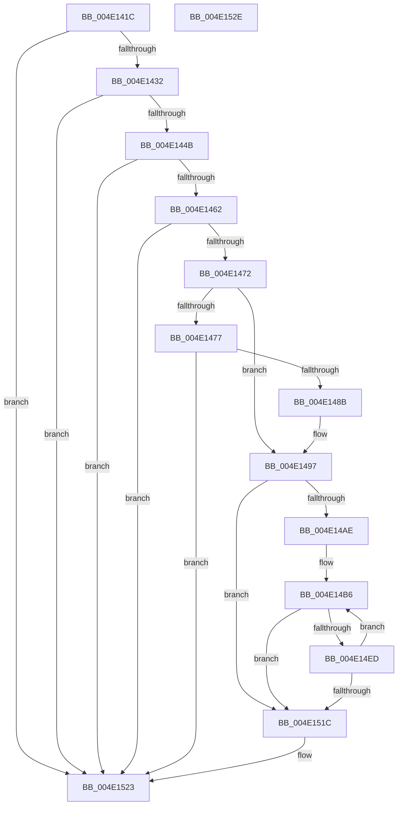

# MiFlushAllFilesystemPages

- RVA: `0x004E141C`–`0x004E152F` (길이 `275` bytes)
- VA: `0x00000001404E141C`
- 실행 섹션: `.text`
- PDB 이름 있음: `예`; PDB Function 태그: `아니요`
- unwind 정보 RVA: `0x0005CAAC`
- 디코드: `63`개 명령, `275/275` bytes 표시
- 미해석 바이트: `0` (있으면 어셈블리에 `.byte`로 보존)

> 이 문서는 커널 이미지의 기계어와 PDB 기호를 분석해 생성했습니다. 4번과 5번은 함수 원형과 자료형을 바이너리 사용 방식에서 추정한 C 해석이며 원본 소스 복구 결과는 아닙니다.

## 1. Dependencies

- 직접 호출 지점: **4**; 고유 호출 대상: **4**
- 직접 호출자로 확인된 함수: **7**
- RIP 상대 이미지 참조: **11**

### Outgoing calls
- `0x004E1492` → [MiEmptyAllWorkingSets](../67/MiEmptyAllWorkingSets_function_0067E6C8.md) (function, `0x0067E6C8`)
- `0x004E14C2` → [KeSetEvent](../33/KeSetEvent_function_0033F310.md) (function, `0x0033F310`)
- `0x004E14D8` → [CcForEachPartition](../2F/CcForEachPartition_function_002F0828.md) (function, `0x002F0828`)
- `0x004E14F8` → [KeDelayExecutionThread](../20/KeDelayExecutionThread_function_00209550.md) (function, `0x00209550`)

### Direct callers
- [sub_0027BB85](../27/Unknown_function_0027BB85.md) at `0x0027BCE4`
- [MiMakeSystemAddressValid](../27/MiMakeSystemAddressValid_function_0027FF70.md) at `0x00280C67`
- [MiInPageSingleKernelStack](../36/MiInPageSingleKernelStack_function_0036A3E8.md) at `0x0036A81F`
- [MiLockPagedAddress](../48/MiLockPagedAddress_function_00484CDC.md) at `0x00484F28`
- [MiReadPagefilePage](../66/MiReadPagefilePage_function_0066F78C.md) at `0x0066FA70`
- [MiReadPagefilePage](../66/MiReadPagefilePage_function_0066F78C.md) at `0x0066FA9D`
- [sub_006E4582](../6E/Unknown_function_006E4582.md) at `0x006E46B6`
- [MiShutdownSystem](../../pagelk/B7/MiShutdownSystem_function_00B73934.md) at `0x00B73970`

### Static image references
- `0x004E1452` → RVA `0x0047E5F0` (`MiModifiedPageWriter`; read)
- `0x004E1462` → RVA `0x00404AC0` (`MiMappedPageWriter`; read)
- `0x004E1479` → RVA `0x00E30148` (`.data`; read/write)
- `0x004E148B` → RVA `0x00E38D00` (`.data`; read)
- `0x004E1497` → RVA `0x00E39044` (`.data`; read/write)
- `0x004E149E` → RVA `0x00E3D8C0` (`.data`; read)
- `0x004E14A5` → RVA `0x00E3D9A0` (`.data`; read)
- `0x004E14AE` → RVA `0x00E38FDC` (`.data`; read)
- `0x004E14B9` → RVA `0x00E39048` (`.data`; read)
- `0x004E14CA` → RVA `0x0057BA80` (`CcNotifyWriteBehindHelper`; read)
- `0x004E14ED` → RVA `0x00011C80` (`.rdata`; read)

## 2. Other-region calls and transfers

- 다른 실행 섹션으로 향하는 call: **0**
- 별도 외부 분기/꼬리 이동을 확인하지 못했습니다.

## 3. Assembly (complete function range)

```asm
004E141C  48 89 5C 24 08                  mov qword ptr [rsp + 8], rbx
004E1421  57                              push rdi
004E1422  48 83 EC 20                     sub rsp, 0x20
004E1426  44 0F 20 C0                     mov rax, cr8
004E142A  3C 01                           cmp al, 1
004E142C  0F 87 F1 00 00 00               ja 0x1404e1523
004E1432  65 48 8B 14 25 88 01 00 00      mov rdx, qword ptr gs:[0x188]
004E143B  F7 82 A4 05 00 00 00 20 00 00   test dword ptr [rdx + 0x5a4], 0x2000
004E1445  0F 85 D8 00 00 00               jne 0x1404e1523
004E144B  48 8B 82 60 05 00 00            mov rax, qword ptr [rdx + 0x560]
004E1452  48 8D 15 97 D1 F9 FF            lea rdx, [rip - 0x62e69]
004E1459  48 3B C2                        cmp rax, rdx
004E145C  0F 84 C1 00 00 00               je 0x1404e1523
004E1462  48 8D 15 57 36 F2 FF            lea rdx, [rip - 0xdc9a9]
004E1469  48 3B C2                        cmp rax, rdx
004E146C  0F 84 B1 00 00 00               je 0x1404e1523
004E1472  83 F9 01                        cmp ecx, 1
004E1475  75 20                           jne 0x1404e1497
004E1477  8B C1                           mov eax, ecx
004E1479  F0 0F C1 05 C7 EC 94 00         lock xadd dword ptr [rip + 0x94ecc7], eax
004E1481  FF C0                           inc eax
004E1483  3B C1                           cmp eax, ecx
004E1485  0F 85 98 00 00 00               jne 0x1404e1523
004E148B  48 8D 0D 6E 78 95 00            lea rcx, [rip + 0x95786e]
004E1492  E8 31 D2 19 00                  call 0x14067e6c8
004E1497  F0 FF 05 A6 7B 95 00            lock inc dword ptr [rip + 0x957ba6]
004E149E  48 8B 05 1B C4 95 00            mov rax, qword ptr [rip + 0x95c41b]
004E14A5  48 3B 05 F4 C4 95 00            cmp rax, qword ptr [rip + 0x95c4f4]
004E14AC  74 6E                           je 0x1404e151c
004E14AE  8B 3D 28 7B 95 00               mov edi, dword ptr [rip + 0x957b28]
004E14B4  33 DB                           xor ebx, ebx
004E14B6  45 33 C0                        xor r8d, r8d
004E14B9  48 8D 0D 88 7B 95 00            lea rcx, [rip + 0x957b88]
004E14C0  33 D2                           xor edx, edx
004E14C2  E8 49 DE E5 FF                  call 0x14033f310
004E14C7  45 33 C9                        xor r9d, r9d
004E14CA  48 8D 0D AF A5 09 00            lea rcx, [rip + 0x9a5af]
004E14D1  45 33 C0                        xor r8d, r8d
004E14D4  41 8D 51 02                     lea edx, [r9 + 2]
004E14D8  E8 4B F3 E0 FF                  call 0x1402f0828
004E14DD  48 8B 05 DC C3 95 00            mov rax, qword ptr [rip + 0x95c3dc]
004E14E4  48 3B 05 B5 C4 95 00            cmp rax, qword ptr [rip + 0x95c4b5]
004E14EB  74 2F                           je 0x1404e151c
004E14ED  4C 8D 05 8C 07 B3 FF            lea r8, [rip - 0x4cf874]
004E14F4  33 D2                           xor edx, edx
004E14F6  33 C9                           xor ecx, ecx
004E14F8  E8 53 80 D2 FF                  call 0x140209550
004E14FD  8B 05 D9 7A 95 00               mov eax, dword ptr [rip + 0x957ad9]
004E1503  83 C9 FF                        or ecx, 0xffffffff
004E1506  3B F8                           cmp edi, eax
004E1508  0F 45 D9                        cmovne ebx, ecx
004E150B  FF C3                           inc ebx
004E150D  3B F8                           cmp edi, eax
004E150F  0F 44 C7                        cmove eax, edi
004E1512  8B F8                           mov edi, eax
004E1514  81 FB FF 00 00 00               cmp ebx, 0xff
004E151A  72 9A                           jb 0x1404e14b6
004E151C  F0 FF 0D 21 7B 95 00            lock dec dword ptr [rip + 0x957b21]
004E1523  48 8B 5C 24 30                  mov rbx, qword ptr [rsp + 0x30]
004E1528  48 83 C4 20                     add rsp, 0x20
004E152C  5F                              pop rdi
004E152D  C3                              ret
004E152E  CC                              int3
```

## 4. C-style interpretation (structured pseudocode)

```c
__int64 __fastcall MiFlushAllFilesystemPages(int a1, __int64 a2, int a3, int a4)
{
    __int64 result;
    __int64 v_rbx;
    __int64 v_rsp;
    unsigned __int64 v_stack_p8;

    v_stack_p8 = v_rbx;
    v_rsp = (v_rsp) - (32);
    if (((unsigned __int8)(v_cr8)) > 1) goto loc_004E1523;
    if (((*(unsigned int *)(*(unsigned __int64 *)(gs_base + (0 + 392)) + 1444)) & (0x2000ULL)) != 0) goto loc_004E1523;
    if ((*(unsigned __int64 *)(*(unsigned __int64 *)(gs_base + (0 + 392)) + 1376)) == (v_rip - 405097)) goto loc_004E1523;
    if ((*(unsigned __int64 *)(*(unsigned __int64 *)(gs_base + (0 + 392)) + 1376)) == (v_rip - 903593)) goto loc_004E1523;
    if (a1 != 1) goto loc_004E1497;
    result = (unsigned int)(((unsigned int)(a1)) + 1);
    if (((unsigned int)(result)) != a1) goto loc_004E1523;
    result = MiEmptyAllWorkingSets(v_rip + 9795694, v_rip - 903593, a3, a4);
loc_004E1497:
    if ((*(unsigned __int64 *)(v_rip + 9815067)) == (*(unsigned __int64 *)(v_rip + 9815284))) goto loc_004E151C;
    v_rbx = 0;
loc_004E14B6:
    a3 = 0;
    a2 = 0;
    result = KeSetEvent(v_rip + 9796488, a2, a3, a4);
    a4 = 0;
    a3 = 0;
    result = CcForEachPartition(v_rip + 632239, a4 + 2, a3, a4);
    if ((*(unsigned __int64 *)(v_rip + 9815004)) == (*(unsigned __int64 *)(v_rip + 9815221))) goto loc_004E151C;
    a2 = 0;
    a1 = 0;
    result = KeDelayExecutionThread(a1, a2, v_rip - 5044340, a4);
    a1 = (unsigned int)((a1) | (0xFFFFFFFFULL));
    if (((unsigned int)((unsigned int)(*(unsigned int *)(v_rip + 9796392)))) != ((unsigned int)((unsigned int)(*(unsigned int *)(v_rip + 9796313))))) { v_rbx = a1; }
    v_rbx = (unsigned int)((v_rbx) + 1);
    result = (unsigned int)(*(unsigned int *)(v_rip + 9796313));
    if (((unsigned int)((unsigned int)(*(unsigned int *)(v_rip + 9796392)))) == ((unsigned int)((unsigned int)(*(unsigned int *)(v_rip + 9796313))))) { result = (unsigned int)((unsigned int)(*(unsigned int *)(v_rip + 9796392))); }
    if (((unsigned int)(v_rbx)) < 255) goto loc_004E14B6;
loc_004E151C:
loc_004E1523:
    v_rsp = (v_rsp) + (32);
    return result;
}
```

## 5. (Beta) C Style

```c
int64_t MiFlushAllFilesystemPages(int32_t Arg1, int64_t Arg2, int32_t Arg3, int32_t Arg4)
{
    int64_t result;
    int64_t local_rbx;
    int64_t local_rsp;
    uint64_t v_stack_p8;

    v_stack_p8 = local_rbx;
    local_rsp = (local_rsp) - (32);
    if (((uint8_t)(v_cr8)) > 1) goto loc_004E1523;
    if (((*(uint32_t *)(*(uint64_t *)(gs_base + (0 + 0x188)) + 0x5A4)) & (0x2000ULL)) != 0) goto loc_004E1523;
    if ((*(uint64_t *)(*(uint64_t *)(gs_base + (0 + 0x188)) + 0x560)) == (v_rip - 405097)) goto loc_004E1523;
    if ((*(uint64_t *)(*(uint64_t *)(gs_base + (0 + 0x188)) + 0x560)) == (v_rip - 903593)) goto loc_004E1523;
    if (Arg1 != 1) goto loc_004E1497;
    result = (uint32_t)(((uint32_t)(Arg1)) + 1);
    if (((uint32_t)(result)) != Arg1) goto loc_004E1523;
    result = MiEmptyAllWorkingSets(v_rip + 9795694, v_rip - 903593, Arg3, Arg4);
loc_004E1497:
    if ((*(uint64_t *)(v_rip + 0x95C41B)) == (*(uint64_t *)(v_rip + 0x95C4F4))) goto loc_004E151C;
    local_rbx = 0;
loc_004E14B6:
    Arg3 = 0;
    Arg2 = 0;
    result = KeSetEvent(v_rip + 9796488, Arg2, Arg3, Arg4);
    Arg4 = 0;
    Arg3 = 0;
    result = CcForEachPartition(v_rip + 632239, Arg4 + 2, Arg3, Arg4);
    if ((*(uint64_t *)(v_rip + 0x95C3DC)) == (*(uint64_t *)(v_rip + 0x95C4B5))) goto loc_004E151C;
    Arg2 = 0;
    Arg1 = 0;
    result = KeDelayExecutionThread(Arg1, Arg2, v_rip - 5044340, Arg4);
    Arg1 = (uint32_t)((Arg1) | (0xFFFFFFFFULL));
    if (((uint32_t)((uint32_t)(*(uint32_t *)(v_rip + 0x957B28)))) != ((uint32_t)((uint32_t)(*(uint32_t *)(v_rip + 0x957AD9))))) { local_rbx = Arg1; }
    local_rbx = (uint32_t)((local_rbx) + 1);
    result = (uint32_t)(*(uint32_t *)(v_rip + 0x957AD9));
    if (((uint32_t)((uint32_t)(*(uint32_t *)(v_rip + 0x957B28)))) == ((uint32_t)((uint32_t)(*(uint32_t *)(v_rip + 0x957AD9))))) { result = (uint32_t)((uint32_t)(*(uint32_t *)(v_rip + 0x957B28))); }
    if (((uint32_t)(local_rbx)) < 255) goto loc_004E14B6;
loc_004E151C:
loc_004E1523:
    local_rsp = (local_rsp) + (32);
    return result;
}
```

## 6. Execution-region graph

[열기: 2D/3D 그래프와 함수 탐색 컨트롤 패널](../../../control-panel.html?section=text&rva=0x004E141C&view=graph)

- 2D 그래프는 위에서 아래로 흐르고, 3D 그래프는 빈 공간을 드래그해 회전합니다. Shift+드래그는 이동, 휠은 확대·축소, 함수 노드 선택은 대상 보고서 이동입니다.

### Static fallback


