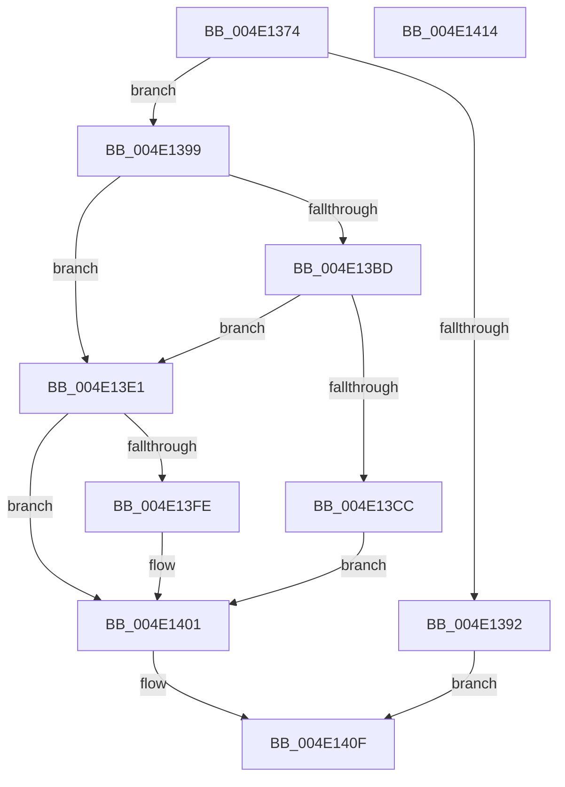

# MiFlushGraphicsPtes

- RVA: `0x004E1374`–`0x004E1415` (길이 `161` bytes)
- VA: `0x00000001404E1374`
- 실행 섹션: `.text`
- PDB 이름 있음: `예`; PDB Function 태그: `아니요`
- unwind 정보 RVA: `0x0005C788`
- 디코드: `44`개 명령, `161/161` bytes 표시
- 미해석 바이트: `0` (있으면 어셈블리에 `.byte`로 보존)

> 이 문서는 커널 이미지의 기계어와 PDB 기호를 분석해 생성했습니다. 4번과 5번은 함수 원형과 자료형을 바이너리 사용 방식에서 추정한 C 해석이며 원본 소스 복구 결과는 아닙니다.

## 1. Dependencies

- 직접 호출 지점: **1**; 고유 호출 대상: **1**
- 직접 호출자로 확인된 함수: **6**
- RIP 상대 이미지 참조: **0**

### Outgoing calls
- `0x004E140A` → [KeInvalidateRangeAllCachesNoIpi](../30/KeInvalidateRangeAllCachesNoIpi_function_00308C50.md) (function, `0x00308C50`)

### Direct callers
- [MiDecommitPagesTail](../27/MiDecommitPagesTail_function_002790FC.md) at `0x00279227`
- [MiProtectPrivateMemory](../2C/MiProtectPrivateMemory_function_002C45B0.md) at `0x002C4B84`
- [MiProtectPrivateMemory](../2C/MiProtectPrivateMemory_function_002C45B0.md) at `0x002C4D0A`
- [MiProtectPrivateMemory](../2C/MiProtectPrivateMemory_function_002C45B0.md) at `0x002C4F1A`
- [MiProtectPrivateMemory](../2C/MiProtectPrivateMemory_function_002C45B0.md) at `0x002C5135`
- [MiCommitExistingVad](../32/MiCommitExistingVad_function_0032A860.md) at `0x0032B5FE`
- [MiCommitExistingVad](../32/MiCommitExistingVad_function_0032A860.md) at `0x0032B620`
- [MiCommitExistingVad](../32/MiCommitExistingVad_function_0032A860.md) at `0x0032B63B`
- [MiMapUserLargePages](../3D/MiMapUserLargePages_function_003D26F4.md) at `0x003D2C75`
- [MiMapUserLargePages](../3D/MiMapUserLargePages_function_003D26F4.md) at `0x003D2D4B`
- [MiProtectAweRegion](../4C/MiProtectAweRegion_function_004CE62C.md) at `0x004CE9C6`
- [MiProtectAweRegion](../4C/MiProtectAweRegion_function_004CE62C.md) at `0x004CEDE9`
- [MiFinishPteChangesInPageTable](MiFinishPteChangesInPageTable_function_004EE660.md) at `0x004EE703`

### Static image references
- 디코드된 RIP-relative 메모리 참조가 없습니다.

## 2. Other-region calls and transfers

- 다른 실행 섹션으로 향하는 call: **0**
- 별도 외부 분기/꼬리 이동을 확인하지 못했습니다.

## 3. Assembly (complete function range)

```asm
004E1374  48 83 EC 28                     sub rsp, 0x28
004E1378  44 8B 04 25 48 00 00 00         mov r8d, dword ptr [0x48]
004E1380  4C 8B CA                        mov r9, rdx
004E1383  41 8B C0                        mov eax, r8d
004E1386  25 00 03 00 00                  and eax, 0x300
004E138B  3D 00 01 00 00                  cmp eax, 0x100
004E1390  75 07                           jne 0x1404e1399
004E1392  F0 83 0C 24 00                  lock or dword ptr [rsp], 0
004E1397  EB 76                           jmp 0x1404e140f
004E1399  48 C1 E1 19                     shl rcx, 0x19
004E139D  48 BA 00 00 00 00 80 F6 FF FF   movabs rdx, 0xfffff68000000000
004E13A7  48 8B C2                        mov rax, rdx
004E13AA  48 C1 E0 19                     shl rax, 0x19
004E13AE  48 2B C8                        sub rcx, rax
004E13B1  48 C1 F9 10                     sar rcx, 0x10
004E13B5  48 8B C2                        mov rax, rdx
004E13B8  48 3B C8                        cmp rcx, rax
004E13BB  72 24                           jb 0x1404e13e1
004E13BD  48 B8 FF FF FF FF FF F6 FF FF   movabs rax, 0xfffff6ffffffffff
004E13C7  48 3B C8                        cmp rcx, rax
004E13CA  77 15                           ja 0x1404e13e1
004E13CC  B8 01 00 00 00                  mov eax, 1
004E13D1  B9 09 00 00 00                  mov ecx, 9
004E13D6  41 2B C8                        sub ecx, r8d
004E13D9  D3 E0                           shl eax, cl
004E13DB  49 0F AF C1                     imul rax, r9
004E13DF  EB 20                           jmp 0x1404e1401
004E13E1  41 8B C8                        mov ecx, r8d
004E13E4  33 D2                           xor edx, edx
004E13E6  41 B8 01 00 00 00               mov r8d, 1
004E13EC  41 8B C0                        mov eax, r8d
004E13EF  D3 E0                           shl eax, cl
004E13F1  8B C8                           mov ecx, eax
004E13F3  49 8B C1                        mov rax, r9
004E13F6  48 F7 F1                        div rcx
004E13F9  48 85 D2                        test rdx, rdx
004E13FC  74 03                           je 0x1404e1401
004E13FE  49 03 C0                        add rax, r8
004E1401  8D 14 C5 00 00 00 00            lea edx, [rax*8]
004E1408  33 C9                           xor ecx, ecx
004E140A  E8 41 78 E2 FF                  call 0x140308c50
004E140F  48 83 C4 28                     add rsp, 0x28
004E1413  C3                              ret
004E1414  CC                              int3
```

## 4. C-style interpretation (structured pseudocode)

```c
__int64 __fastcall MiFlushGraphicsPtes(__int64 a1, __int64 a2)
{
    __int64 result;
    __int64 v_rsp;
    unsigned int v_stack_m28;

    v_rsp = (v_rsp) - (40);
    result = (unsigned int)(((unsigned int)((unsigned int)((unsigned int)(*(unsigned int *)(0 + 72))))) & (768));
    if (((unsigned int)(result)) != 256) goto loc_004E1399;
    goto loc_004E140F;
loc_004E1399:
    a1 = (a1) << (25);
    result = (a2) << (25);
    a1 = (a1) - (result);
    a1 = (a1) >> (16);
    if (a1 < a2) goto loc_004E13E1;
    if (a1 > a2) goto loc_004E13E1;
    a1 = (unsigned int)((9) - ((unsigned int)((unsigned int)(*(unsigned int *)(0 + 72)))));
    result = (unsigned int)((1) << ((unsigned __int8)(a1)));
    result = (result) * (a2);
    goto loc_004E1401;
loc_004E13E1:
    a2 = 0;
    result = (unsigned int)((1) << ((unsigned __int8)((unsigned int)((unsigned int)((unsigned int)(*(unsigned int *)(0 + 72)))))));
    result = 0;
    if (0 != 0) {
        result = (0) + (1);
    }
    a1 = 0;
    result = KeInvalidateRangeAllCachesNoIpi(a1, result * 8, 1, a2);
loc_004E140F:
    v_rsp = (v_rsp) + (40);
    return result;
}
```

## 5. (Beta) C Style

```c
int64_t MiFlushGraphicsPtes(int64_t Arg1, int64_t Arg2)
{
    int64_t result;
    int64_t local_rsp;
    uint32_t v_stack_m28;

    local_rsp = (local_rsp) - (40);
    result = (uint32_t)(((uint32_t)((uint32_t)((uint32_t)(*(uint32_t *)(0 + 0x48))))) & (768));
    if (((uint32_t)(result)) != 256) goto loc_004E1399;
    goto loc_004E140F;
loc_004E1399:
    Arg1 = (Arg1) << (25);
    result = (Arg2) << (25);
    Arg1 = (Arg1) - (result);
    Arg1 = (Arg1) >> (16);
    if (Arg1 < Arg2) goto loc_004E13E1;
    if (Arg1 > Arg2) goto loc_004E13E1;
    Arg1 = (uint32_t)((9) - ((uint32_t)((uint32_t)(*(uint32_t *)(0 + 0x48)))));
    result = (uint32_t)((1) << ((uint8_t)(Arg1)));
    result = (result) * (Arg2);
    goto loc_004E1401;
loc_004E13E1:
    Arg2 = 0;
    result = (uint32_t)((1) << ((uint8_t)((uint32_t)((uint32_t)((uint32_t)(*(uint32_t *)(0 + 0x48)))))));
    result = 0;
    if (0 != 0) {
        result = (0) + (1);
    }
    Arg1 = 0;
    result = KeInvalidateRangeAllCachesNoIpi(Arg1, result * 8, 1, Arg2);
loc_004E140F:
    local_rsp = (local_rsp) + (40);
    return result;
}
```

## 6. Execution-region graph

[열기: 2D/3D 그래프와 함수 탐색 컨트롤 패널](../../../control-panel.html?section=text&rva=0x004E1374&view=graph)

- 2D 그래프는 위에서 아래로 흐르고, 3D 그래프는 빈 공간을 드래그해 회전합니다. Shift+드래그는 이동, 휠은 확대·축소, 함수 노드 선택은 대상 보고서 이동입니다.

### Static fallback


