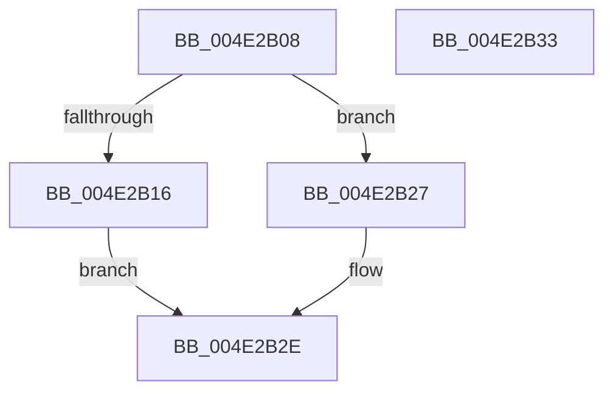

# MiFreeTransitionPageHeatList

- RVA: `0x004E2B08`–`0x004E2B34` (길이 `44` bytes)
- VA: `0x00000001404E2B08`
- 실행 섹션: `.text`
- PDB 이름 있음: `예`; PDB Function 태그: `아니요`
- unwind 정보 RVA: `0x0005C788`
- 디코드: `12`개 명령, `44/44` bytes 표시
- 미해석 바이트: `0` (있으면 어셈블리에 `.byte`로 보존)

> 이 문서는 커널 이미지의 기계어와 PDB 기호를 분석해 생성했습니다. 4번과 5번은 함수 원형과 자료형을 바이너리 사용 방식에서 추정한 C 해석이며 원본 소스 복구 결과는 아닙니다.

## 1. Dependencies

- 직접 호출 지점: **2**; 고유 호출 대상: **2**
- 직접 호출자로 확인된 함수: **3**
- RIP 상대 이미지 참조: **1**

### Outgoing calls
- `0x004E2B20` → [ExpInterlockedPushEntrySList](../6B/ExpInterlockedPushEntrySList_function_006BA5B0.md) (function, `0x006BA5B0`)
- `0x004E2B29` → [ExFreePoolWithTag](../../poolcode/B8/ExFreePoolWithTag_function_00B82870.md) (function, `0x00B82870`)

### Direct callers
- [MmCopyToCachedPage](../34/MmCopyToCachedPage_function_00347B44.md) at `0x00348167`
- [sub_006DA10C](../6D/Unknown_function_006DA10C.md) at `0x006DA115`
- [sub_006DF29A](../6D/Unknown_function_006DF29A.md) at `0x006DF2F4`

### Static image references
- `0x004E2B0C` → RVA `0x00E35D40` (`.data`; read)

## 2. Other-region calls and transfers

- 다른 실행 섹션으로 향하는 call: **1**
  - `0x004E2B29` → [ExFreePoolWithTag](../../poolcode/B8/ExFreePoolWithTag_function_00B82870.md) (`.text` → `POOLCODE`)
- 별도 외부 분기/꼬리 이동을 확인하지 못했습니다.

## 3. Assembly (complete function range)

```asm
004E2B08  48 83 EC 28                     sub rsp, 0x28
004E2B0C  66 83 3D 2C 32 95 00 40         cmp word ptr [rip + 0x95322c], 0x40
004E2B14  73 11                           jae 0x1404e2b27
004E2B16  48 8B D1                        mov rdx, rcx
004E2B19  48 8D 0D 20 32 95 00            lea rcx, [rip + 0x953220]
004E2B20  E8 8B 7A 1D 00                  call 0x1406ba5b0
004E2B25  EB 07                           jmp 0x1404e2b2e
004E2B27  33 D2                           xor edx, edx
004E2B29  E8 42 FD 69 00                  call 0x140b82870
004E2B2E  48 83 C4 28                     add rsp, 0x28
004E2B32  C3                              ret
004E2B33  CC                              int3
```

## 4. C-style interpretation (structured pseudocode)

```c
__int64 __fastcall MiFreeTransitionPageHeatList(__int64 a1)
{
    __int64 result;
    __int64 v_rsp;

    v_rsp = (v_rsp) - (40);
    if ((*(unsigned __int16 *)(v_rip + 9777708)) >= 64) goto loc_004E2B27;
    result = ExpInterlockedPushEntrySList(v_rip + 9777696, a1, a3, a4);
    goto loc_004E2B2E;
loc_004E2B27:
    a2 = 0;
    result = ExFreePoolWithTag(v_rip + 9777696, a2, a3, a4);
loc_004E2B2E:
    v_rsp = (v_rsp) + (40);
    return result;
}
```

## 5. (Beta) C Style

```c
int64_t MiFreeTransitionPageHeatList(int64_t Arg1)
{
    int64_t result;
    int64_t local_rsp;

    local_rsp = (local_rsp) - (40);
    if ((*(uint16_t *)(v_rip + 0x95322C)) >= 64) goto loc_004E2B27;
    result = ExpInterlockedPushEntrySList(v_rip + 9777696, Arg1, a3, a4);
    goto loc_004E2B2E;
loc_004E2B27:
    a2 = 0;
    result = ExFreePoolWithTag(v_rip + 9777696, a2, a3, a4);
loc_004E2B2E:
    local_rsp = (local_rsp) + (40);
    return result;
}
```

## 6. Execution-region graph

[열기: 2D/3D 그래프와 함수 탐색 컨트롤 패널](../../../control-panel.html?section=text&rva=0x004E2B08&view=graph)

- 2D 그래프는 위에서 아래로 흐르고, 3D 그래프는 빈 공간을 드래그해 회전합니다. Shift+드래그는 이동, 휠은 확대·축소, 함수 노드 선택은 대상 보고서 이동입니다.

### Static fallback


