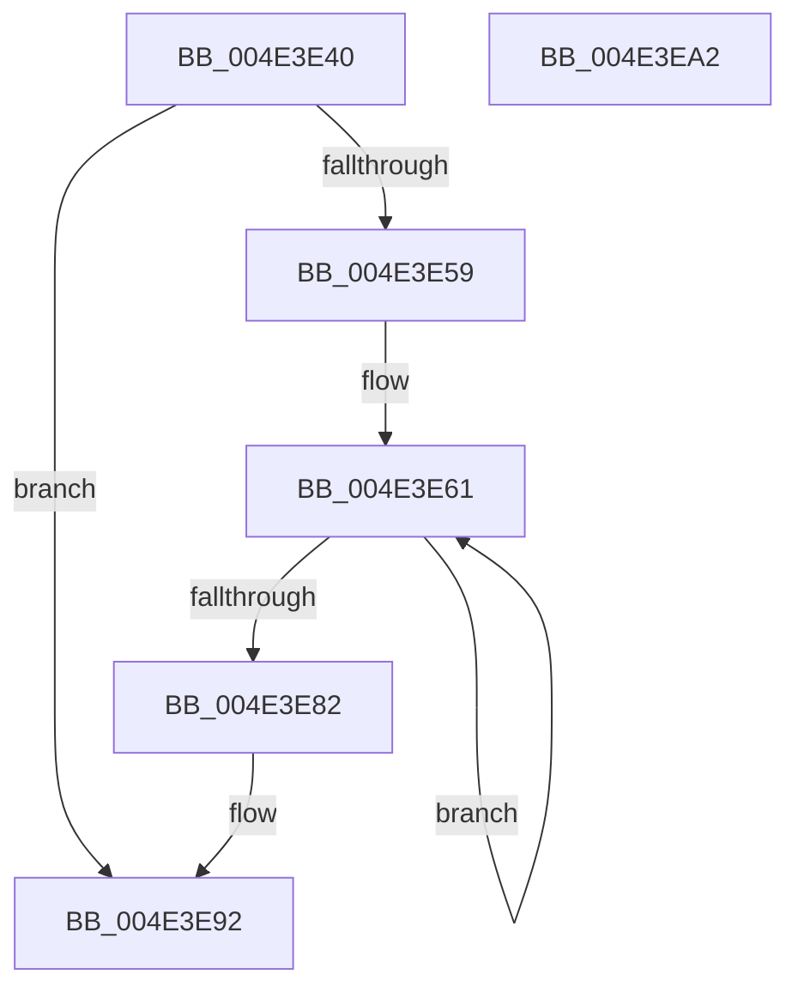

# MiInvokeIoReleasePages

- RVA: `0x004E3E40`–`0x004E3EA3` (길이 `99` bytes)
- VA: `0x00000001404E3E40`
- 실행 섹션: `.text`
- PDB 이름 있음: `예`; PDB Function 태그: `아니요`
- unwind 정보 RVA: `0x00060BC4`
- 디코드: `29`개 명령, `99/99` bytes 표시
- 미해석 바이트: `0` (있으면 어셈블리에 `.byte`로 보존)

> 이 문서는 커널 이미지의 기계어와 PDB 기호를 분석해 생성했습니다. 4번과 5번은 함수 원형과 자료형을 바이너리 사용 방식에서 추정한 C 해석이며 원본 소스 복구 결과는 아닙니다.

## 1. Dependencies

- 직접 호출 지점: **1**; 고유 호출 대상: **1**
- 직접 호출자로 확인된 함수: **2**
- RIP 상대 이미지 참조: **0**

### Outgoing calls
- `0x004E3E78` → [IoTryReleasePages](../44/IoTryReleasePages_function_00442B58.md) (function, `0x00442B58`)

### Direct callers
- [MiUnlockOpportunisticPagesInPageTable](../2A/MiUnlockOpportunisticPagesInPageTable_function_002AA88C.md) at `0x002AAADF`
- [sub_006DB1E0](../6D/Unknown_function_006DB1E0.md) at `0x006DB271`

### Static image references
- 디코드된 RIP-relative 메모리 참조가 없습니다.

## 2. Other-region calls and transfers

- 다른 실행 섹션으로 향하는 call: **0**
- 별도 외부 분기/꼬리 이동을 확인하지 못했습니다.

## 3. Assembly (complete function range)

```asm
004E3E40  48 89 5C 24 08                  mov qword ptr [rsp + 8], rbx
004E3E45  48 89 74 24 10                  mov qword ptr [rsp + 0x10], rsi
004E3E4A  57                              push rdi
004E3E4B  48 83 EC 20                     sub rsp, 0x20
004E3E4F  8B 79 1C                        mov edi, dword ptr [rcx + 0x1c]
004E3E52  48 8B D9                        mov rbx, rcx
004E3E55  85 FF                           test edi, edi
004E3E57  74 39                           je 0x1404e3e92
004E3E59  48 8D 71 28                     lea rsi, [rcx + 0x28]
004E3E5D  48 8D 34 FE                     lea rsi, [rsi + rdi*8]
004E3E61  48 8D 76 F8                     lea rsi, [rsi - 8]
004E3E65  48 8B 0E                        mov rcx, qword ptr [rsi]
004E3E68  48 8B D1                        mov rdx, rcx
004E3E6B  48 C1 E9 0C                     shr rcx, 0xc
004E3E6F  81 E2 FF 03 00 00               and edx, 0x3ff
004E3E75  48 FF C2                        inc rdx
004E3E78  E8 DB EC F5 FF                  call 0x140442b58
004E3E7D  83 C7 FF                        add edi, -1
004E3E80  75 DF                           jne 0x1404e3e61
004E3E82  66 21 7B 19                     and word ptr [rbx + 0x19], di
004E3E86  21 7B 1C                        and dword ptr [rbx + 0x1c], edi
004E3E89  48 83 63 20 00                  and qword ptr [rbx + 0x20], 0
004E3E8E  83 63 10 DB                     and dword ptr [rbx + 0x10], 0xffffffdb
004E3E92  48 8B 5C 24 30                  mov rbx, qword ptr [rsp + 0x30]
004E3E97  48 8B 74 24 38                  mov rsi, qword ptr [rsp + 0x38]
004E3E9C  48 83 C4 20                     add rsp, 0x20
004E3EA0  5F                              pop rdi
004E3EA1  C3                              ret
004E3EA2  CC                              int3
```

## 4. C-style interpretation (structured pseudocode)

```c
__int64 __fastcall MiInvokeIoReleasePages(__int64 a1)
{
    __int64 result;
    __int64 v_rdi;
    __int64 v_rsp;
    unsigned __int64 v_stack_p10;
    unsigned __int64 v_stack_p8;

    v_stack_p8 = v_rbx;
    v_stack_p10 = v_rsi;
    v_rsp = (v_rsp) - (32);
    if ((unsigned int)((unsigned int)(*(unsigned int *)(a1 + 28))) == 0) goto loc_004E3E92;
loc_004E3E61:
    a1 = (*(unsigned __int64 *)(a1 + 40 + (unsigned int)(*(unsigned int *)(a1 + 28)) * 8 - 8)) >> (12);
    a2 = (unsigned int)((*(unsigned __int64 *)(a1 + 40 + (unsigned int)(*(unsigned int *)(a1 + 28)) * 8 - 8)) & (0x3FFULL));
    a2 = (a2) + 1;
    result = IoTryReleasePages(a1, a2, a3, a4);
    v_rdi = (unsigned int)(((unsigned int)(*(unsigned int *)(a1 + 28))) + (-1));
    if (condition_is_not_equal) goto loc_004E3E61;
loc_004E3E92:
    v_rsp = (v_rsp) + (32);
    return result;
}
```

## 5. (Beta) C Style

```c
int64_t MiInvokeIoReleasePages(void *Arg1)
{
    uint8_t *arg1 = (uint8_t *)Arg1;

    int64_t result;
    int64_t local_rdi;
    int64_t local_rsp;
    uint64_t v_stack_p10;
    uint64_t v_stack_p8;

    v_stack_p8 = local_rbx;
    v_stack_p10 = local_rsi;
    local_rsp = (local_rsp) - (32);
    if ((uint32_t)((uint32_t)(*(uint32_t *)(arg1 + 0x1C))) == 0) goto loc_004E3E92;
loc_004E3E61:
    Arg1 = (*(uint64_t *)(arg1 + 0x28 + (uint32_t)(*(uint32_t *)(arg1 + 0x1C)) * 8 - 0x8)) >> (12);
    a2 = (uint32_t)((*(uint64_t *)(arg1 + 0x28 + (uint32_t)(*(uint32_t *)(arg1 + 0x1C)) * 8 - 0x8)) & (0x3FFULL));
    a2 = (a2) + 1;
    result = IoTryReleasePages(Arg1, a2, a3, a4);
    local_rdi = (uint32_t)(((uint32_t)(*(uint32_t *)(arg1 + 0x1C))) + (-1));
    if (condition_is_not_equal) goto loc_004E3E61;
loc_004E3E92:
    local_rsp = (local_rsp) + (32);
    return result;
}
```

### 관측된 메모리 오프셋

구조체 형식이 확인되지 않은 접근은 인자 기준의 오프셋으로만 기록했습니다.

| 기준 인자 | 오프셋 표현 | 폭 (bit) | 접근 |
|---|---:|---:|---|
| `Arg1` | `- 0x8` | `64` | `R` |
| `Arg1` | `+ 0x0` | `64` | `R` |
| `Arg1` | `+ 0x0 + rdi*8` | `64` | `R` |
| `Arg1` | `+ 0x10` | `32` | `R/W` |
| `Arg1` | `+ 0x19` | `16` | `R/W` |
| `Arg1` | `+ 0x1C` | `32` | `R` |
| `Arg1` | `+ 0x1C` | `32` | `R/W` |
| `Arg1` | `+ 0x20` | `64` | `R/W` |
| `Arg1` | `+ 0x28` | `64` | `R` |

## 6. Execution-region graph

[열기: 2D/3D 그래프와 함수 탐색 컨트롤 패널](../../../control-panel.html?section=text&rva=0x004E3E40&view=graph)

- 2D 그래프는 위에서 아래로 흐르고, 3D 그래프는 빈 공간을 드래그해 회전합니다. Shift+드래그는 이동, 휠은 확대·축소, 함수 노드 선택은 대상 보고서 이동입니다.

### Static fallback


