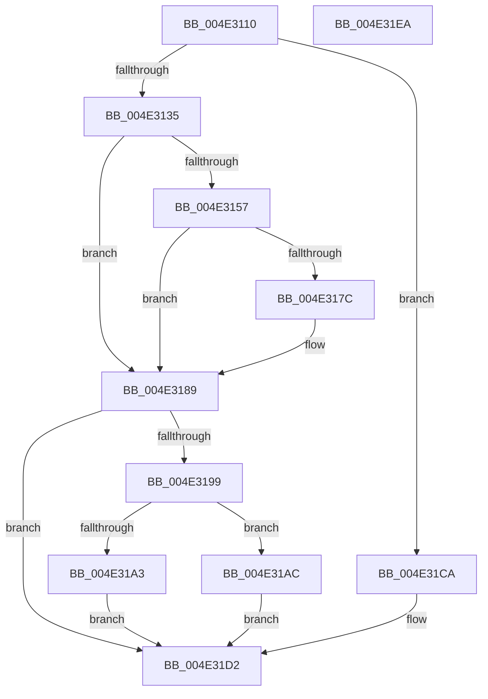

# MiLockWorkingSetForLargeMapping

- RVA: `0x004E3110`–`0x004E31EB` (길이 `219` bytes)
- VA: `0x00000001404E3110`
- 실행 섹션: `.text`
- PDB 이름 있음: `예`; PDB Function 태그: `아니요`
- unwind 정보 RVA: `0x0005C954`
- 디코드: `57`개 명령, `219/219` bytes 표시
- 미해석 바이트: `0` (있으면 어셈블리에 `.byte`로 보존)

> 이 문서는 커널 이미지의 기계어와 PDB 기호를 분석해 생성했습니다. 4번과 5번은 함수 원형과 자료형을 바이너리 사용 방식에서 추정한 C 해석이며 원본 소스 복구 결과는 아닙니다.

## 1. Dependencies

- 직접 호출 지점: **7**; 고유 호출 대상: **5**
- 직접 호출자로 확인된 함수: **2**
- RIP 상대 이미지 참조: **0**

### Outgoing calls
- `0x004E316F` → [ExAllocatePoolMm](../35/ExAllocatePoolMm_function_0035B690.md) (function, `0x0035B690`)
- `0x004E3184` → [memset](../6C/memset_function_006C6C40.md) (function, `0x006C6C40`)
- `0x004E318C` → [MiLockWorkingSetExclusive](../32/MiLockWorkingSetExclusive_function_003238A0.md) (function, `0x003238A0`)
- `0x004E31B1` → [MiUnlockWorkingSetExclusive](../27/MiUnlockWorkingSetExclusive_function_0027EC70.md) (function, `0x0027EC70`)
- `0x004E31BB` → [ExFreePoolWithTag](../../poolcode/B8/ExFreePoolWithTag_function_00B82870.md) (function, `0x00B82870`)
- `0x004E31C3` → [MiLockWorkingSetExclusive](../32/MiLockWorkingSetExclusive_function_003238A0.md) (function, `0x003238A0`)
- `0x004E31CA` → [MiLockWorkingSetExclusive](../32/MiLockWorkingSetExclusive_function_003238A0.md) (function, `0x003238A0`)

### Direct callers
- [MiCommitExistingVad](../32/MiCommitExistingVad_function_0032A860.md) at `0x0032B1C9`
- [MiMapUserLargePages](../3D/MiMapUserLargePages_function_003D26F4.md) at `0x003D2CD8`

### Static image references
- 디코드된 RIP-relative 메모리 참조가 없습니다.

## 2. Other-region calls and transfers

- 다른 실행 섹션으로 향하는 call: **1**
  - `0x004E31BB` → [ExFreePoolWithTag](../../poolcode/B8/ExFreePoolWithTag_function_00B82870.md) (`.text` → `POOLCODE`)
- 별도 외부 분기/꼬리 이동을 확인하지 못했습니다.

## 3. Assembly (complete function range)

```asm
004E3110  48 89 5C 24 08                  mov qword ptr [rsp + 8], rbx
004E3115  48 89 6C 24 10                  mov qword ptr [rsp + 0x10], rbp
004E311A  48 89 74 24 18                  mov qword ptr [rsp + 0x18], rsi
004E311F  57                              push rdi
004E3120  48 83 EC 20                     sub rsp, 0x20
004E3124  8B 81 B8 00 00 00               mov eax, dword ptr [rcx + 0xb8]
004E312A  48 8B F9                        mov rdi, rcx
004E312D  A8 0F                           test al, 0xf
004E312F  0F 85 95 00 00 00               jne 0x1404e31ca
004E3135  65 48 8B 04 25 88 01 00 00      mov rax, qword ptr gs:[0x188]
004E313E  33 DB                           xor ebx, ebx
004E3140  48 8B 90 B8 00 00 00            mov rdx, qword ptr [rax + 0xb8]
004E3147  48 8B AA 10 04 00 00            mov rbp, qword ptr [rdx + 0x410]
004E314E  48 39 9D 68 05 00 00            cmp qword ptr [rbp + 0x568], rbx
004E3155  75 32                           jne 0x1404e3189
004E3157  41 0F BA E8 1F                  bts r8d, 0x1f
004E315C  8D 4B 40                        lea ecx, [rbx + 0x40]
004E315F  45 8B C8                        mov r9d, r8d
004E3162  BE 00 08 00 00                  mov esi, 0x800
004E3167  41 B8 4D 69 53 6C               mov r8d, 0x6c53694d
004E316D  8B D6                           mov edx, esi
004E316F  E8 1C 85 E7 FF                  call 0x14035b690
004E3174  48 8B D8                        mov rbx, rax
004E3177  48 85 C0                        test rax, rax
004E317A  74 0D                           je 0x1404e3189
004E317C  44 8B C6                        mov r8d, esi
004E317F  33 D2                           xor edx, edx
004E3181  48 8B C8                        mov rcx, rax
004E3184  E8 B7 3A 1E 00                  call 0x1406c6c40
004E3189  48 8B CF                        mov rcx, rdi
004E318C  E8 0F 07 E4 FF                  call 0x1403238a0
004E3191  40 8A F0                        mov sil, al
004E3194  48 85 DB                        test rbx, rbx
004E3197  74 39                           je 0x1404e31d2
004E3199  48 83 BD 68 05 00 00 00         cmp qword ptr [rbp + 0x568], 0
004E31A1  75 09                           jne 0x1404e31ac
004E31A3  48 89 9D 68 05 00 00            mov qword ptr [rbp + 0x568], rbx
004E31AA  EB 26                           jmp 0x1404e31d2
004E31AC  8A D0                           mov dl, al
004E31AE  48 8B CF                        mov rcx, rdi
004E31B1  E8 BA BA D9 FF                  call 0x14027ec70
004E31B6  33 D2                           xor edx, edx
004E31B8  48 8B CB                        mov rcx, rbx
004E31BB  E8 B0 F6 69 00                  call 0x140b82870
004E31C0  48 8B CF                        mov rcx, rdi
004E31C3  E8 D8 06 E4 FF                  call 0x1403238a0
004E31C8  EB 08                           jmp 0x1404e31d2
004E31CA  E8 D1 06 E4 FF                  call 0x1403238a0
004E31CF  40 8A F0                        mov sil, al
004E31D2  48 8B 5C 24 30                  mov rbx, qword ptr [rsp + 0x30]
004E31D7  40 8A C6                        mov al, sil
004E31DA  48 8B 74 24 40                  mov rsi, qword ptr [rsp + 0x40]
004E31DF  48 8B 6C 24 38                  mov rbp, qword ptr [rsp + 0x38]
004E31E4  48 83 C4 20                     add rsp, 0x20
004E31E8  5F                              pop rdi
004E31E9  C3                              ret
004E31EA  CC                              int3
```

## 4. C-style interpretation (structured pseudocode)

```c
__int64 __fastcall MiLockWorkingSetForLargeMapping(__int64 a1, __int64 a2, int a3)
{
    __int64 result;
    __int64 v_rbx;
    __int64 v_rsp;
    unsigned __int64 v_stack_p10;
    unsigned __int64 v_stack_p18;
    unsigned __int64 v_stack_p8;

    v_stack_p8 = v_rbx;
    v_stack_p10 = v_rbp;
    v_stack_p18 = v_rsi;
    v_rsp = (v_rsp) - (32);
    if ((((unsigned __int8)((unsigned int)(*(unsigned int *)(a1 + 184)))) & (15)) != 0) goto loc_004E31CA;
    v_rbx = 0;
    if ((*(unsigned __int64 *)(*(unsigned __int64 *)(*(unsigned __int64 *)(*(unsigned __int64 *)(gs_base + (0 + 392)) + 184) + 1040) + 1384)) != 0) goto loc_004E3189;
    result = ExAllocatePoolMm(v_rbx + 64, (unsigned int)((unsigned int)((unsigned int)(0x800ULL))), (unsigned int)(0x6C53694DULL), (unsigned int)(a3));
    if (result != 0) {
        a3 = (unsigned int)((unsigned int)(0x800ULL));
        a2 = 0;
        a1 = result;
        result = memset(a1, a2, a3, (unsigned int)(a3));
    }
    result = MiLockWorkingSetExclusive(a1, a2, a3, (unsigned int)(a3));
    if (result == 0) goto loc_004E31D2;
    if ((*(unsigned __int64 *)(*(unsigned __int64 *)(*(unsigned __int64 *)(*(unsigned __int64 *)(gs_base + (0 + 392)) + 184) + 1040) + 1384)) != 0) goto loc_004E31AC;
    *(unsigned __int64 *)(*(unsigned __int64 *)(*(unsigned __int64 *)(*(unsigned __int64 *)(gs_base + (0 + 392)) + 184) + 1040) + 1384) = result;
    goto loc_004E31D2;
loc_004E31AC:
    result = MiUnlockWorkingSetExclusive(a1, (unsigned __int8)(result), a3, (unsigned int)(a3));
    a2 = 0;
    result = ExFreePoolWithTag(result, a2, a3, (unsigned int)(a3));
    result = MiLockWorkingSetExclusive(a1, a2, a3, (unsigned int)(a3));
    goto loc_004E31D2;
loc_004E31CA:
    result = MiLockWorkingSetExclusive(a1, a2, a3, (unsigned int)(a3));
loc_004E31D2:
    v_rsp = (v_rsp) + (32);
    return (unsigned __int8)((unsigned __int8)(result));
}
```

## 5. (Beta) C Style

```c
int64_t MiLockWorkingSetForLargeMapping(void *Arg1, int64_t Arg2, int32_t Arg3)
{
    uint8_t *arg1 = (uint8_t *)Arg1;

    int64_t result;
    int64_t local_rbx;
    int64_t local_rsp;
    uint64_t v_stack_p10;
    uint64_t v_stack_p18;
    uint64_t v_stack_p8;

    v_stack_p8 = local_rbx;
    v_stack_p10 = local_rbp;
    v_stack_p18 = local_rsi;
    local_rsp = (local_rsp) - (32);
    if ((((uint8_t)((uint32_t)(*(uint32_t *)(arg1 + 0xB8)))) & (15)) != 0) goto loc_004E31CA;
    local_rbx = 0;
    if ((*(uint64_t *)(*(uint64_t *)(*(uint64_t *)(*(uint64_t *)(gs_base + (0 + 0x188)) + 0xB8) + 0x410) + 0x568)) != 0) goto loc_004E3189;
    result = ExAllocatePoolMm(local_rbx + 64, (uint32_t)((uint32_t)((uint32_t)(0x800ULL))), (uint32_t)(0x6C53694DULL), (uint32_t)(Arg3));
    if (result != 0) {
        Arg3 = (uint32_t)((uint32_t)(0x800ULL));
        Arg2 = 0;
        Arg1 = result;
        result = memset(Arg1, Arg2, Arg3, (uint32_t)(Arg3));
    }
    result = MiLockWorkingSetExclusive(Arg1, Arg2, Arg3, (uint32_t)(Arg3));
    if (result == 0) goto loc_004E31D2;
    if ((*(uint64_t *)(*(uint64_t *)(*(uint64_t *)(*(uint64_t *)(gs_base + (0 + 0x188)) + 0xB8) + 0x410) + 0x568)) != 0) goto loc_004E31AC;
    *(uint64_t *)(*(uint64_t *)(*(uint64_t *)(*(uint64_t *)(gs_base + (0 + 0x188)) + 0xB8) + 0x410) + 0x568) = result;
    goto loc_004E31D2;
loc_004E31AC:
    result = MiUnlockWorkingSetExclusive(Arg1, (uint8_t)(result), Arg3, (uint32_t)(Arg3));
    Arg2 = 0;
    result = ExFreePoolWithTag(result, Arg2, Arg3, (uint32_t)(Arg3));
    result = MiLockWorkingSetExclusive(Arg1, Arg2, Arg3, (uint32_t)(Arg3));
    goto loc_004E31D2;
loc_004E31CA:
    result = MiLockWorkingSetExclusive(Arg1, Arg2, Arg3, (uint32_t)(Arg3));
loc_004E31D2:
    local_rsp = (local_rsp) + (32);
    return (uint8_t)((uint8_t)(result));
}
```

### 관측된 메모리 오프셋

구조체 형식이 확인되지 않은 접근은 인자 기준의 오프셋으로만 기록했습니다.

| 기준 인자 | 오프셋 표현 | 폭 (bit) | 접근 |
|---|---:|---:|---|
| `Arg1` | `+ 0xB8` | `32` | `R` |

## 6. Execution-region graph

[열기: 2D/3D 그래프와 함수 탐색 컨트롤 패널](../../../control-panel.html?section=text&rva=0x004E3110&view=graph)

- 2D 그래프는 위에서 아래로 흐르고, 3D 그래프는 빈 공간을 드래그해 회전합니다. Shift+드래그는 이동, 휠은 확대·축소, 함수 노드 선택은 대상 보고서 이동입니다.

### Static fallback


