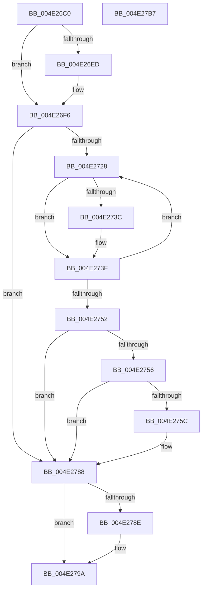

# MiMakeSystemLeavesNonZero

- RVA: `0x004E26C0`–`0x004E27B8` (길이 `248` bytes)
- VA: `0x00000001404E26C0`
- 실행 섹션: `.text`
- PDB 이름 있음: `예`; PDB Function 태그: `아니요`
- unwind 정보 RVA: `0x000BCF54`
- 디코드: `72`개 명령, `248/248` bytes 표시
- 미해석 바이트: `0` (있으면 어셈블리에 `.byte`로 보존)

> 이 문서는 커널 이미지의 기계어와 PDB 기호를 분석해 생성했습니다. 4번과 5번은 함수 원형과 자료형을 바이너리 사용 방식에서 추정한 C 해석이며 원본 소스 복구 결과는 아닙니다.

## 1. Dependencies

- 직접 호출 지점: **5**; 고유 호출 대상: **5**
- 직접 호출자로 확인된 함수: **2**
- RIP 상대 이미지 참조: **0**

### Outgoing calls
- `0x004E26F1` → [MiLockNestedPageTable](../23/MiLockNestedPageTable_function_0023E890.md) (function, `0x0023E890`)
- `0x004E271B` → [MiMakeDemandZeroPte](../33/MiMakeDemandZeroPte_function_00337A00.md) (function, `0x00337A00`)
- `0x004E2732` → [MI_READ_PTE_LOCK_FREE](../28/MI_READ_PTE_LOCK_FREE_function_002828A0.md) (function, `0x002828A0`)
- `0x004E2783` → [MiIncreaseUsedPtes](../24/MiIncreaseUsedPtes_function_00243630.md) (function, `0x00243630`)
- `0x004E2795` → [MiUnlockPageTable](../21/MiUnlockPageTable_function_00216EC0.md) (function, `0x00216EC0`)

### Direct callers
- [sub_0027B90E](../27/Unknown_function_0027B90E.md) at `0x0027BAB4`
- [MiCreateSystemPageTable](../45/MiCreateSystemPageTable_function_004518D0.md) at `0x00451C19`

### Static image references
- 디코드된 RIP-relative 메모리 참조가 없습니다.

## 2. Other-region calls and transfers

- 다른 실행 섹션으로 향하는 call: **0**
- 별도 외부 분기/꼬리 이동을 확인하지 못했습니다.

## 3. Assembly (complete function range)

```asm
004E26C0  48 89 5C 24 08                  mov qword ptr [rsp + 8], rbx
004E26C5  48 89 6C 24 10                  mov qword ptr [rsp + 0x10], rbp
004E26CA  48 89 74 24 20                  mov qword ptr [rsp + 0x20], rsi
004E26CF  57                              push rdi
004E26D0  41 54                           push r12
004E26D2  41 55                           push r13
004E26D4  41 56                           push r14
004E26D6  41 57                           push r15
004E26D8  48 83 EC 20                     sub rsp, 0x20
004E26DC  8B 01                           mov eax, dword ptr [rcx]
004E26DE  33 ED                           xor ebp, ebp
004E26E0  4D 63 E0                        movsxd r12, r8d
004E26E3  4C 8B FA                        mov r15, rdx
004E26E6  48 8B F9                        mov rdi, rcx
004E26E9  A8 04                           test al, 4
004E26EB  74 09                           je 0x1404e26f6
004E26ED  48 8B 49 20                     mov rcx, qword ptr [rcx + 0x20]
004E26F1  E8 9A C1 D5 FF                  call 0x14023e890
004E26F6  4E 8B 6C E7 78                  mov r13, qword ptr [rdi + r12*8 + 0x78]
004E26FB  B9 10 00 00 00                  mov ecx, 0x10
004E2700  4E 8B 74 E7 58                  mov r14, qword ptr [rdi + r12*8 + 0x58]
004E2705  49 8B C6                        mov rax, r14
004E2708  48 25 00 F0 FF FF               and rax, 0xfffffffffffff000
004E270E  48 05 F8 0F 00 00               add rax, 0xff8
004E2714  4C 3B E8                        cmp r13, rax
004E2717  4C 0F 47 E8                     cmova r13, rax
004E271B  E8 E0 52 E5 FF                  call 0x140337a00
004E2720  48 8B D8                        mov rbx, rax
004E2723  4D 3B F5                        cmp r14, r13
004E2726  77 60                           ja 0x1404e2788
004E2728  49 8B CE                        mov rcx, r14
004E272B  89 6C 24 60                     mov dword ptr [rsp + 0x60], ebp
004E272F  49 8B F6                        mov rsi, r14
004E2732  E8 69 01 DA FF                  call 0x1402828a0
004E2737  48 85 C0                        test rax, rax
004E273A  75 03                           jne 0x1404e273f
004E273C  49 89 1E                        mov qword ptr [r14], rbx
004E273F  FF C5                           inc ebp
004E2741  48 85 C0                        test rax, rax
004E2744  0F 45 6C 24 60                  cmovne ebp, dword ptr [rsp + 0x60]
004E2749  49 83 C6 08                     add r14, 8
004E274D  4D 3B F5                        cmp r14, r13
004E2750  76 D6                           jbe 0x1404e2728
004E2752  85 ED                           test ebp, ebp
004E2754  74 32                           je 0x1404e2788
004E2756  41 83 FC 04                     cmp r12d, 4
004E275A  74 2C                           je 0x1404e2788
004E275C  48 C1 EE 09                     shr rsi, 9
004E2760  48 BA F8 FF FF FF 7F 00 00 00   movabs rdx, 0x7ffffffff8
004E276A  48 23 D6                        and rdx, rsi
004E276D  48 B8 00 00 00 00 80 F6 FF FF   movabs rax, 0xfffff68000000000
004E2777  48 03 D0                        add rdx, rax
004E277A  41 B9 02 00 00 00               mov r9d, 2
004E2780  44 8B C5                        mov r8d, ebp
004E2783  E8 A8 0E D6 FF                  call 0x140243630
004E2788  8B 07                           mov eax, dword ptr [rdi]
004E278A  A8 04                           test al, 4
004E278C  74 0C                           je 0x1404e279a
004E278E  48 8B 4F 20                     mov rcx, qword ptr [rdi + 0x20]
004E2792  49 8B D7                        mov rdx, r15
004E2795  E8 26 47 D3 FF                  call 0x140216ec0
004E279A  48 8B 5C 24 50                  mov rbx, qword ptr [rsp + 0x50]
004E279F  48 8B 6C 24 58                  mov rbp, qword ptr [rsp + 0x58]
004E27A4  48 8B 74 24 68                  mov rsi, qword ptr [rsp + 0x68]
004E27A9  48 83 C4 20                     add rsp, 0x20
004E27AD  41 5F                           pop r15
004E27AF  41 5E                           pop r14
004E27B1  41 5D                           pop r13
004E27B3  41 5C                           pop r12
004E27B5  5F                              pop rdi
004E27B6  C3                              ret
004E27B7  CC                              int3
```

## 4. C-style interpretation (structured pseudocode)

```c
__int64 __fastcall MiMakeSystemLeavesNonZero(__int64 a1, __int64 a2, int a3)
{
    __int64 result;
    __int64 v_r13;
    __int64 v_r14;
    __int64 v_rbp;
    __int64 v_rsi;
    __int64 v_rsp;
    unsigned __int64 v_stack_p10;
    unsigned int v_stack_p18;
    unsigned __int64 v_stack_p20;
    unsigned __int64 v_stack_p8;

    v_stack_p8 = v_rbx;
    v_stack_p10 = v_rbp;
    v_stack_p20 = v_rsi;
    v_rsp = (v_rsp) - (32);
    v_rbp = 0;
    result = (unsigned int)(*(unsigned int *)(a1));
    if ((((unsigned __int8)((unsigned int)(*(unsigned int *)(a1)))) & (4)) != 0) {
        a1 = *(unsigned __int64 *)(a1 + 32);
        result = MiLockNestedPageTable(a1, a2, a3, a4);
    }
    result = (*(unsigned __int64 *)(a1 + (int)(a3) * 8 + 88)) & (0xFFFFFFFFFFFFF000ULL);
    result = (result) + (0xFF8ULL);
    v_r13 = *(unsigned __int64 *)(a1 + (int)(a3) * 8 + 120);
    if ((*(unsigned __int64 *)(a1 + (int)(a3) * 8 + 120)) > result) { v_r13 = result; }
    result = MiMakeDemandZeroPte(16, a2, a3, a4);
    if ((*(unsigned __int64 *)(a1 + (int)(a3) * 8 + 88)) > v_r13) goto loc_004E2788;
loc_004E2728:
    v_stack_p18 = 0;
    result = MI_READ_PTE_LOCK_FREE(*(unsigned __int64 *)(a1 + (int)(a3) * 8 + 88), a2, a3, a4);
    if (result == 0) {
        *(unsigned __int64 *)(*(unsigned __int64 *)(a1 + (int)(a3) * 8 + 88)) = result;
    }
    v_rbp = (unsigned int)((v_rbp) + 1);
    if (result != 0) { v_rbp = v_stack_p18; }
    v_r14 = (*(unsigned __int64 *)(a1 + (int)(a3) * 8 + 88)) + (8);
    if (v_r14 <= v_r13) goto loc_004E2728;
    if ((unsigned int)(v_rbp) == 0) goto loc_004E2788;
    v_rsi = *(unsigned __int64 *)(a1 + (int)(a3) * 8 + 88);
    if (((unsigned int)((int)(a3))) != 4) {
        v_rsi = (*(unsigned __int64 *)(a1 + (int)(a3) * 8 + 88)) >> (9);
        a2 = (a2) & (v_rsi);
        a2 = (a2) + (result);
        a4 = 2;
        a3 = (unsigned int)(v_rbp);
        result = MiIncreaseUsedPtes(*(unsigned __int64 *)(a1 + (int)(a3) * 8 + 88), a2, a3, a4);
    }
    result = (unsigned int)(*(unsigned int *)(a1));
    if ((((unsigned __int8)((unsigned int)(*(unsigned int *)(a1)))) & (4)) != 0) {
        a1 = *(unsigned __int64 *)(a1 + 32);
        a2 = a2;
        result = MiUnlockPageTable(a1, a2, a3, a4);
    }
    v_rsp = (v_rsp) + (32);
    return result;
}
```

## 5. (Beta) C Style

```c
int64_t MiMakeSystemLeavesNonZero(void *Arg1, int64_t Arg2, int32_t Arg3)
{
    uint8_t *arg1 = (uint8_t *)Arg1;

    int64_t result;
    int64_t local_r13;
    int64_t local_r14;
    int64_t local_rbp;
    int64_t local_rsi;
    int64_t local_rsp;
    uint64_t v_stack_p10;
    uint32_t v_stack_p18;
    uint64_t v_stack_p20;
    uint64_t v_stack_p8;

    v_stack_p8 = local_rbx;
    v_stack_p10 = local_rbp;
    v_stack_p20 = local_rsi;
    local_rsp = (local_rsp) - (32);
    local_rbp = 0;
    result = (uint32_t)(*(uint32_t *)(arg1));
    if ((((uint8_t)((uint32_t)(*(uint32_t *)(arg1)))) & (4)) != 0) {
        Arg1 = *(uint64_t *)(arg1 + 0x20);
        result = MiLockNestedPageTable(Arg1, Arg2, Arg3, a4);
    }
    result = (*(uint64_t *)(arg1 + (int32_t)(Arg3) * 8 + 0x58)) & (0xFFFFFFFFFFFFF000ULL);
    result = (result) + (0xFF8ULL);
    local_r13 = *(uint64_t *)(arg1 + (int32_t)(Arg3) * 8 + 0x78);
    if ((*(uint64_t *)(arg1 + (int32_t)(Arg3) * 8 + 0x78)) > result) { local_r13 = result; }
    result = MiMakeDemandZeroPte(16, Arg2, Arg3, a4);
    if ((*(uint64_t *)(arg1 + (int32_t)(Arg3) * 8 + 0x58)) > local_r13) goto loc_004E2788;
loc_004E2728:
    v_stack_p18 = 0;
    result = MI_READ_PTE_LOCK_FREE(*(uint64_t *)(arg1 + (int32_t)(Arg3) * 8 + 0x58), Arg2, Arg3, a4);
    if (result == 0) {
        *(uint64_t *)(*(uint64_t *)(arg1 + (int32_t)(Arg3) * 8 + 0x58)) = result;
    }
    local_rbp = (uint32_t)((local_rbp) + 1);
    if (result != 0) { local_rbp = v_stack_p18; }
    local_r14 = (*(uint64_t *)(arg1 + (int32_t)(Arg3) * 8 + 0x58)) + (8);
    if (local_r14 <= local_r13) goto loc_004E2728;
    if ((uint32_t)(local_rbp) == 0) goto loc_004E2788;
    local_rsi = *(uint64_t *)(arg1 + (int32_t)(Arg3) * 8 + 0x58);
    if (((uint32_t)((int32_t)(Arg3))) != 4) {
        local_rsi = (*(uint64_t *)(arg1 + (int32_t)(Arg3) * 8 + 0x58)) >> (9);
        Arg2 = (Arg2) & (local_rsi);
        Arg2 = (Arg2) + (result);
        a4 = 2;
        Arg3 = (uint32_t)(local_rbp);
        result = MiIncreaseUsedPtes(*(uint64_t *)(arg1 + (int32_t)(Arg3) * 8 + 0x58), Arg2, Arg3, a4);
    }
    result = (uint32_t)(*(uint32_t *)(arg1));
    if ((((uint8_t)((uint32_t)(*(uint32_t *)(arg1)))) & (4)) != 0) {
        Arg1 = *(uint64_t *)(arg1 + 0x20);
        Arg2 = Arg2;
        result = MiUnlockPageTable(Arg1, Arg2, Arg3, a4);
    }
    local_rsp = (local_rsp) + (32);
    return result;
}
```

### 관측된 메모리 오프셋

구조체 형식이 확인되지 않은 접근은 인자 기준의 오프셋으로만 기록했습니다.

| 기준 인자 | 오프셋 표현 | 폭 (bit) | 접근 |
|---|---:|---:|---|
| `Arg1` | `+ 0x0` | `32` | `R` |
| `Arg1` | `+ 0x20` | `64` | `R` |
| `Arg1` | `+ 0x58 + r12*8` | `64` | `R` |
| `Arg1` | `+ 0x78 + r12*8` | `64` | `R` |

## 6. Execution-region graph

[열기: 2D/3D 그래프와 함수 탐색 컨트롤 패널](../../../control-panel.html?section=text&rva=0x004E26C0&view=graph)

- 2D 그래프는 위에서 아래로 흐르고, 3D 그래프는 빈 공간을 드래그해 회전합니다. Shift+드래그는 이동, 휠은 확대·축소, 함수 노드 선택은 대상 보고서 이동입니다.

### Static fallback


