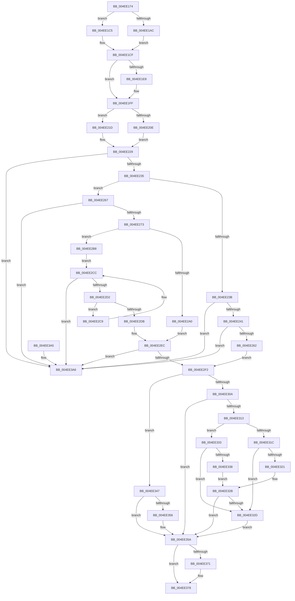

# MiMakeSystemRangeAvailable

- RVA: `0x004EE174`–`0x004EE3C1` (길이 `589` bytes)
- VA: `0x00000001404EE174`
- 실행 섹션: `.text`
- PDB 이름 있음: `예`; PDB Function 태그: `아니요`
- unwind 정보 RVA: `0x000D8090`
- 디코드: `169`개 명령, `589/589` bytes 표시
- 미해석 바이트: `0` (있으면 어셈블리에 `.byte`로 보존)

> 이 문서는 커널 이미지의 기계어와 PDB 기호를 분석해 생성했습니다. 4번과 5번은 함수 원형과 자료형을 바이너리 사용 방식에서 추정한 C 해석이며 원본 소스 복구 결과는 아닙니다.

## 1. Dependencies

- 직접 호출 지점: **10**; 고유 호출 대상: **10**
- 직접 호출자로 확인된 함수: **1**
- RIP 상대 이미지 참조: **4**

### Outgoing calls
- `0x004EE1AC` → [MiNonPagedPoolToNode](../49/MiNonPagedPoolToNode_function_00496978.md) (function, `0x00496978`)
- `0x004EE1C7` → [MiSystemVaToDynamicBitmap](../3B/MiSystemVaToDynamicBitmap_function_003B4F88.md) (function, `0x003B4F88`)
- `0x004EE216` → [ExAcquireSpinLockExclusiveAtDpcLevel](../24/ExAcquireSpinLockExclusiveAtDpcLevel_function_00248E80.md) (function, `0x00248E80`)
- `0x004EE21D` → [ExAcquireSpinLockExclusive](../24/ExAcquireSpinLockExclusive_function_00248690.md) (function, `0x00248690`)
- `0x004EE2FB` → [RtlClearBitsEx](../29/RtlClearBitsEx_function_00297740.md) (function, `0x00297740`)
- `0x004EE313` → [Feature_ARM64_ASLR_AddressSpace_128MB__private_IsEnabledDeviceUsageNoInline](../67/Feature_ARM64_ASLR_AddressSpace_128MB__private_IsEnabledDeviceUsageNoInline_function_00671374.md) (function, `0x00671374`)
- `0x004EE33E` → [MiIsDriverVaImportOptimizable](../67/MiIsDriverVaImportOptimizable_function_0067F9B4.md) (function, `0x0067F9B4`)
- `0x004EE349` → [MiReduceSystemRegionType](../3B/MiReduceSystemRegionType_function_003B5FCC.md) (function, `0x003B5FCC`)
- `0x004EE382` → [MiReleaseSpinLockExclusive](../24/MiReleaseSpinLockExclusive_function_002482C0.md) (function, `0x002482C0`)
- `0x004EE3BB` → [KeBugCheckEx](../4F/KeBugCheckEx_function_004FD660.md) (function, `0x004FD660`)

### Direct callers
- [MiReturnSystemVa](../23/MiReturnSystemVa_function_002394C4.md) at `0x00239557`

### Static image references
- `0x004EE1BC` → RVA `0x00E2DBF8` (`.data`; read)
- `0x004EE321` → RVA `0x00F10EC0` (`.data`; read)
- `0x004EE360` → RVA `0x00E38A08` (`.data`; read)
- `0x004EE371` → RVA `0x00E2EEC8` (`.data`; read/write)

## 2. Other-region calls and transfers

- 다른 실행 섹션으로 향하는 call: **0**
- 별도 외부 분기/꼬리 이동을 확인하지 못했습니다.

## 3. Assembly (complete function range)

```asm
004EE174  48 8B C4                        mov rax, rsp
004EE177  48 89 58 08                     mov qword ptr [rax + 8], rbx
004EE17B  48 89 68 10                     mov qword ptr [rax + 0x10], rbp
004EE17F  48 89 70 20                     mov qword ptr [rax + 0x20], rsi
004EE183  57                              push rdi
004EE184  41 54                           push r12
004EE186  41 55                           push r13
004EE188  41 56                           push r14
004EE18A  41 57                           push r15
004EE18C  48 83 EC 40                     sub rsp, 0x40
004EE190  48 8B EA                        mov rbp, rdx
004EE193  49 63 F0                        movsxd rsi, r8d
004EE196  48 C1 ED 15                     shr rbp, 0x15
004EE19A  0F 57 C0                        xorps xmm0, xmm0
004EE19D  4C 8B FA                        mov r15, rdx
004EE1A0  4C 8B E1                        mov r12, rcx
004EE1A3  0F 11 40 C8                     movups xmmword ptr [rax - 0x38], xmm0
004EE1A7  83 FE 04                        cmp esi, 4
004EE1AA  75 19                           jne 0x1404ee1c5
004EE1AC  E8 C7 87 FA FF                  call 0x140496978
004EE1B1  44 8B C0                        mov r8d, eax
004EE1B4  4B 8D 1C 40                     lea rbx, [r8 + r8*2]
004EE1B8  48 C1 E3 07                     shl rbx, 7
004EE1BC  48 03 1D 35 FA 93 00            add rbx, qword ptr [rip + 0x93fa35]
004EE1C3  EB 0A                           jmp 0x1404ee1cf
004EE1C5  8B CE                           mov ecx, esi
004EE1C7  E8 BC 6D EC FF                  call 0x1403b4f88
004EE1CC  48 8B D8                        mov rbx, rax
004EE1CF  49 8B FC                        mov rdi, r12
004EE1D2  8D 4E F6                        lea ecx, [rsi - 0xa]
004EE1D5  48 2B 7B 20                     sub rdi, qword ptr [rbx + 0x20]
004EE1D9  4C 8B F3                        mov r14, rbx
004EE1DC  48 C1 EF 15                     shr rdi, 0x15
004EE1E0  F7 C1 FD FF FF FF               test ecx, 0xfffffffd
004EE1E6  75 17                           jne 0x1404ee1ff
004EE1E8  48 8B 4B 08                     mov rcx, qword ptr [rbx + 8]
004EE1EC  4C 8D 74 24 30                  lea r14, [rsp + 0x30]
004EE1F1  48 8B 43 10                     mov rax, qword ptr [rbx + 0x10]
004EE1F5  48 89 4C 24 38                  mov qword ptr [rsp + 0x38], rcx
004EE1FA  48 89 44 24 30                  mov qword ptr [rsp + 0x30], rax
004EE1FF  44 0F 20 C0                     mov rax, cr8
004EE203  4C 8D 6B 40                     lea r13, [rbx + 0x40]
004EE207  49 8B CD                        mov rcx, r13
004EE20A  3C 02                           cmp al, 2
004EE20C  75 0F                           jne 0x1404ee21d
004EE20E  C6 84 24 80 00 00 00 11         mov byte ptr [rsp + 0x80], 0x11
004EE216  E8 65 AC D5 FF                  call 0x140248e80
004EE21B  EB 0C                           jmp 0x1404ee229
004EE21D  E8 6E A4 D5 FF                  call 0x140248690
004EE222  88 84 24 80 00 00 00            mov byte ptr [rsp + 0x80], al
004EE229  49 8B 0E                        mov rcx, qword ptr [r14]
004EE22C  48 3B F9                        cmp rdi, rcx
004EE22F  0F 83 71 01 00 00               jae 0x1404ee3a6
004EE235  48 83 FD 01                     cmp rbp, 1
004EE239  77 2C                           ja 0x1404ee267
004EE23B  0F 85 65 01 00 00               jne 0x1404ee3a6
004EE241  49 8B 46 08                     mov rax, qword ptr [r14 + 8]
004EE245  48 8B D7                        mov rdx, rdi
004EE248  83 E2 3F                        and edx, 0x3f
004EE24B  48 8B CF                        mov rcx, rdi
004EE24E  48 C1 E9 06                     shr rcx, 6
004EE252  48 0F A3 14 C8                  bt qword ptr [rax + rcx*8], rdx
004EE257  0F 92 C0                        setb al
004EE25A  84 C0                           test al, al
004EE25C  0F 84 44 01 00 00               je 0x1404ee3a6
004EE262  E9 8B 00 00 00                  jmp 0x1404ee2f2
004EE267  48 2B CF                        sub rcx, rdi
004EE26A  48 3B CD                        cmp rcx, rbp
004EE26D  0F 82 33 01 00 00               jb 0x1404ee3a6
004EE273  49 8B 4E 08                     mov rcx, qword ptr [r14 + 8]
004EE277  4C 8D 5D FF                     lea r11, [rbp - 1]
004EE27B  4C 03 DF                        add r11, rdi
004EE27E  48 8B C7                        mov rax, rdi
004EE281  48 C1 E8 06                     shr rax, 6
004EE285  49 83 C8 FF                     or r8, 0xffffffffffffffff
004EE289  48 8D 14 C1                     lea rdx, [rcx + rax*8]
004EE28D  49 8B C3                        mov rax, r11
004EE290  4C 8B 0A                        mov r9, qword ptr [rdx]
004EE293  48 C1 E8 06                     shr rax, 6
004EE297  4C 8D 14 C1                     lea r10, [rcx + rax*8]
004EE29B  49 3B D2                        cmp rdx, r10
004EE29E  75 18                           jne 0x1404ee2b8
004EE2A0  41 8D 48 41                     lea ecx, [r8 + 0x41]
004EE2A4  40 2A CD                        sub cl, bpl
004EE2A7  49 D3 E8                        shr r8, cl
004EE2AA  48 8B CF                        mov rcx, rdi
004EE2AD  49 D3 E0                        shl r8, cl
004EE2B0  4D 23 C8                        and r9, r8
004EE2B3  4D 3B C8                        cmp r9, r8
004EE2B6  EB 34                           jmp 0x1404ee2ec
004EE2B8  48 8B CF                        mov rcx, rdi
004EE2BB  49 8B C0                        mov rax, r8
004EE2BE  48 D3 E0                        shl rax, cl
004EE2C1  4C 23 C8                        and r9, rax
004EE2C4  4C 3B C8                        cmp r9, rax
004EE2C7  EB 03                           jmp 0x1404ee2cc
004EE2C9  4C 39 02                        cmp qword ptr [rdx], r8
004EE2CC  0F 85 D4 00 00 00               jne 0x1404ee3a6
004EE2D2  48 83 C2 08                     add rdx, 8
004EE2D6  49 3B D2                        cmp rdx, r10
004EE2D9  75 EE                           jne 0x1404ee2c9
004EE2DB  48 8B 02                        mov rax, qword ptr [rdx]
004EE2DE  41 8A CB                        mov cl, r11b
004EE2E1  F6 D1                           not cl
004EE2E3  49 D3 E8                        shr r8, cl
004EE2E6  49 23 C0                        and rax, r8
004EE2E9  49 3B C0                        cmp rax, r8
004EE2EC  0F 85 B4 00 00 00               jne 0x1404ee3a6
004EE2F2  4C 8B C5                        mov r8, rbp
004EE2F5  48 8B D7                        mov rdx, rdi
004EE2F8  49 8B CE                        mov rcx, r14
004EE2FB  E8 40 94 DA FF                  call 0x140297740
004EE300  8D 46 F6                        lea eax, [rsi - 0xa]
004EE303  A9 FD FF FF FF                  test eax, 0xfffffffd
004EE308  74 3D                           je 0x1404ee347
004EE30A  48 8B 43 18                     mov rax, qword ptr [rbx + 0x18]
004EE30E  48 3B F8                        cmp rdi, rax
004EE311  73 47                           jae 0x1404ee35a
004EE313  E8 5C 30 18 00                  call 0x140671374
004EE318  85 C0                           test eax, eax
004EE31A  75 17                           jne 0x1404ee333
004EE31C  83 FE 0B                        cmp esi, 0xb
004EE31F  75 0C                           jne 0x1404ee32d
004EE321  F7 05 95 2B A2 00 00 00 02 00   test dword ptr [rip + 0xa22b95], 0x20000
004EE32B  74 2D                           je 0x1404ee35a
004EE32D  48 89 7B 18                     mov qword ptr [rbx + 0x18], rdi
004EE331  EB 27                           jmp 0x1404ee35a
004EE333  83 FE 0B                        cmp esi, 0xb
004EE336  75 F5                           jne 0x1404ee32d
004EE338  49 8B D7                        mov rdx, r15
004EE33B  49 8B CC                        mov rcx, r12
004EE33E  E8 71 16 19 00                  call 0x14067f9b4
004EE343  85 C0                           test eax, eax
004EE345  EB E4                           jmp 0x1404ee32b
004EE347  8B CE                           mov ecx, esi
004EE349  E8 7E 7C EC FF                  call 0x1403b5fcc
004EE34E  8B F0                           mov esi, eax
004EE350  48 3B 7B 30                     cmp rdi, qword ptr [rbx + 0x30]
004EE354  73 04                           jae 0x1404ee35a
004EE356  48 89 7B 30                     mov qword ptr [rbx + 0x30], rdi
004EE35A  48 F7 DD                        neg rbp
004EE35D  48 63 C6                        movsxd rax, esi
004EE360  48 8D 0D A1 A6 94 00            lea rcx, [rip + 0x94a6a1]
004EE367  F0 48 01 2C C1                  lock add qword ptr [rcx + rax*8], rbp
004EE36C  83 FE 07                        cmp esi, 7
004EE36F  75 07                           jne 0x1404ee378
004EE371  4C 01 3D 50 0B 94 00            add qword ptr [rip + 0x940b50], r15
004EE378  8A 94 24 80 00 00 00            mov dl, byte ptr [rsp + 0x80]
004EE37F  49 8B CD                        mov rcx, r13
004EE382  E8 39 9F D5 FF                  call 0x1402482c0
004EE387  4C 8D 5C 24 40                  lea r11, [rsp + 0x40]
004EE38C  49 8B 5B 30                     mov rbx, qword ptr [r11 + 0x30]
004EE390  49 8B 6B 38                     mov rbp, qword ptr [r11 + 0x38]
004EE394  49 8B 73 48                     mov rsi, qword ptr [r11 + 0x48]
004EE398  49 8B E3                        mov rsp, r11
004EE39B  41 5F                           pop r15
004EE39D  41 5E                           pop r14
004EE39F  41 5D                           pop r13
004EE3A1  41 5C                           pop r12
004EE3A3  5F                              pop rdi
004EE3A4  C3                              ret
004EE3A5  CC                              int3
004EE3A6  4D 8B CF                        mov r9, r15
004EE3A9  48 89 74 24 20                  mov qword ptr [rsp + 0x20], rsi
004EE3AE  4D 8B C4                        mov r8, r12
004EE3B1  BA 1C 10 00 00                  mov edx, 0x101c
004EE3B6  B9 1A 00 00 00                  mov ecx, 0x1a
004EE3BB  E8 A0 F2 00 00                  call 0x1404fd660
004EE3C0  CC                              int3
```

## 4. C-style interpretation (structured pseudocode)

```c
__int64 __fastcall MiMakeSystemRangeAvailable(__int64 a1, __int64 a2, int a3)
{
    __int64 result;
    __int64 v_r11;
    __int64 v_r14;
    __int64 v_rbp;
    __int64 v_rbx;
    __int64 v_rdi;
    __int64 v_rsp;
    unsigned __int64 v_stack_m20;
    unsigned __int64 v_stack_m28;
    unsigned __int64 v_stack_m30;
    unsigned __int64 v_stack_m38;
    unsigned __int8 v_stack_p18;

    *(unsigned __int64 *)(v_rsp + 8) = v_rbx;
    *(unsigned __int64 *)(v_rsp + 16) = v_rbp;
    *(unsigned __int64 *)(v_rsp + 32) = v_rsi;
    v_rsp = (v_rsp) - (64);
    v_rbp = (a2) >> (21);
    *(unsigned __int64 *)(v_rsp - 56) = v_xmm0;
    if (((unsigned int)((int)(a3))) != 4) goto loc_004EE1C5;
    result = MiNonPagedPoolToNode(a1, a2, a3, a4);
    v_rbx = ((unsigned int)((unsigned int)(result)) + (unsigned int)((unsigned int)(result)) * 2) << (7);
    v_rbx = (v_rbx) + (*(unsigned __int64 *)(v_rip + 9697845));
    goto loc_004EE1CF;
loc_004EE1C5:
    result = MiSystemVaToDynamicBitmap((unsigned int)((unsigned int)((int)(a3))), a2, (unsigned int)((unsigned int)(result)), a4);
loc_004EE1CF:
    v_rdi = (a1) - (*(unsigned __int64 *)(result + 32));
    v_rdi = (v_rdi) >> (21);
    v_r14 = result;
    if ((((unsigned int)((int)(a3) - 10)) & (0xFFFFFFFDULL)) == 0) {
        a1 = *(unsigned __int64 *)(result + 8);
        v_r14 = v_stack_m38;
        result = *(unsigned __int64 *)(result + 16);
        v_stack_m30 = a1;
        v_stack_m38 = result;
    }
    if (((unsigned __int8)(v_cr8)) != 2) goto loc_004EE21D;
    v_stack_p18 = 17;
    result = ExAcquireSpinLockExclusiveAtDpcLevel(result + 64, a2, (unsigned int)((unsigned int)(result)), a4);
    goto loc_004EE229;
loc_004EE21D:
    result = ExAcquireSpinLockExclusive(result + 64, a2, (unsigned int)((unsigned int)(result)), a4);
    v_stack_p18 = (unsigned __int8)(result);
loc_004EE229:
    if (v_rdi >= (*(unsigned __int64 *)(v_r14))) goto loc_004EE3A6;
    if (v_rbp > 1) goto loc_004EE267;
    if (v_rbp != 1) goto loc_004EE3A6;
    a2 = (unsigned int)((v_rdi) & (63));
    a1 = (v_rdi) >> (6);
    result = (condition_is_below) ? 1 : 0;
    if ((unsigned __int8)(result) == 0) goto loc_004EE3A6;
    goto loc_004EE2F2;
loc_004EE267:
    a1 = (a1) - (v_rdi);
    if (a1 < v_rbp) goto loc_004EE3A6;
    v_r11 = (v_rbp - 1) + (v_rdi);
    result = (v_rdi) >> (6);
    a3 = ((unsigned int)((unsigned int)(result))) | (-1);
    result = (v_r11) >> (6);
    if ((*(unsigned __int64 *)(v_r14 + 8) + result * 8) != (*(unsigned __int64 *)(v_r14 + 8) + result * 8)) goto loc_004EE2B8;
    a1 = (unsigned __int8)((a3 + 65) - ((unsigned __int8)(v_rbp)));
    a3 = (a3) >> ((unsigned __int8)(a1));
    a3 = (a3) << ((unsigned __int8)(v_rdi));
    a4 = (*(unsigned __int64 *)(*(unsigned __int64 *)(v_r14 + 8) + result * 8)) & (a3);
    goto loc_004EE2EC;
loc_004EE2B8:
    result = (a3) << ((unsigned __int8)(v_rdi));
    a4 = (a4) & (result);
    goto loc_004EE2CC;
loc_004EE2C9:
loc_004EE2CC:
    if ((*(unsigned __int64 *)(*(unsigned __int64 *)(v_r14 + 8) + result * 8)) != a3) goto loc_004EE3A6;
    a2 = (*(unsigned __int64 *)(v_r14 + 8) + result * 8) + (8);
    if (a2 != (*(unsigned __int64 *)(v_r14 + 8) + result * 8)) goto loc_004EE2C9;
    a1 = (unsigned __int8)(~((unsigned __int8)(v_r11)));
    a3 = (a3) >> ((unsigned __int8)(a1));
    result = (*(unsigned __int64 *)(a2)) & (a3);
loc_004EE2EC:
    if (result != a3) goto loc_004EE3A6;
loc_004EE2F2:
    result = RtlClearBitsEx(v_r14, v_rdi, v_rbp, a4);
    if ((((unsigned int)((int)(a3) - 10)) & (0xFFFFFFFDULL)) == 0) goto loc_004EE347;
    if (v_rdi >= (*(unsigned __int64 *)(result + 24))) goto loc_004EE35A;
    result = Feature_ARM64_ASLR_AddressSpace_128MB__private_IsEnabledDeviceUsageNoInline(v_r14, v_rdi, v_rbp, a4);
    if ((unsigned int)(result) != 0) goto loc_004EE333;
    if (((unsigned int)((int)(a3))) != 11) goto loc_004EE32D;
loc_004EE32B:
    if (((*(unsigned int *)(v_rip + 10627989)) & (0x20000ULL)) == 0) goto loc_004EE35A;
loc_004EE32D:
    *(unsigned __int64 *)(result + 24) = v_rdi;
    goto loc_004EE35A;
loc_004EE333:
    if (((unsigned int)((int)(a3))) != 11) goto loc_004EE32D;
    result = MiIsDriverVaImportOptimizable(a1, a2, v_rbp, a4);
    goto loc_004EE32B;
loc_004EE347:
    result = MiReduceSystemRegionType((unsigned int)((unsigned int)((int)(a3))), a2, v_rbp, a4);
    if (v_rdi < (*(unsigned __int64 *)(result + 48))) {
        *(unsigned __int64 *)(result + 48) = v_rdi;
    }
    v_rbp = -(v_rbp);
    if (((unsigned int)((unsigned int)((unsigned int)(result)))) == 7) {
    }
    result = MiReleaseSpinLockExclusive(result + 64, v_stack_p18, v_rbp, a4);
    return result;
loc_004EE3A6:
    v_stack_m20 = *(unsigned __int64 *)(v_stack_m28 + 72);
    result = KeBugCheckEx(26, (unsigned int)(0x101CULL), a1, a2);
    return result;
}
```

## 5. (Beta) C Style

```c
int64_t MiMakeSystemRangeAvailable(int64_t Arg1, int64_t Arg2, int32_t Arg3)
{
    int64_t result;
    int64_t local_r11;
    int64_t local_r14;
    int64_t local_rbp;
    int64_t local_rbx;
    int64_t local_rdi;
    int64_t local_rsp;
    uint64_t v_stack_m20;
    uint64_t v_stack_m28;
    uint64_t v_stack_m30;
    uint64_t v_stack_m38;
    uint8_t v_stack_p18;

    *(uint64_t *)(local_rsp + 0x8) = local_rbx;
    *(uint64_t *)(local_rsp + 0x10) = local_rbp;
    *(uint64_t *)(local_rsp + 0x20) = local_rsi;
    local_rsp = (local_rsp) - (64);
    local_rbp = (Arg2) >> (21);
    *(uint64_t *)(local_rsp - 0x38) = v_xmm0;
    if (((uint32_t)((int32_t)(Arg3))) != 4) goto loc_004EE1C5;
    result = MiNonPagedPoolToNode(Arg1, Arg2, Arg3, a4);
    local_rbx = ((uint32_t)((uint32_t)(result)) + (uint32_t)((uint32_t)(result)) * 2) << (7);
    local_rbx = (local_rbx) + (*(uint64_t *)(v_rip + 0x93FA35));
    goto loc_004EE1CF;
loc_004EE1C5:
    result = MiSystemVaToDynamicBitmap((uint32_t)((uint32_t)((int32_t)(Arg3))), Arg2, (uint32_t)((uint32_t)(result)), a4);
loc_004EE1CF:
    local_rdi = (Arg1) - (*(uint64_t *)(result + 0x20));
    local_rdi = (local_rdi) >> (21);
    local_r14 = result;
    if ((((uint32_t)((int32_t)(Arg3) - 10)) & (0xFFFFFFFDULL)) == 0) {
        Arg1 = *(uint64_t *)(result + 0x8);
        local_r14 = v_stack_m38;
        result = *(uint64_t *)(result + 0x10);
        v_stack_m30 = Arg1;
        v_stack_m38 = result;
    }
    if (((uint8_t)(v_cr8)) != 2) goto loc_004EE21D;
    v_stack_p18 = 17;
    result = ExAcquireSpinLockExclusiveAtDpcLevel(result + 64, Arg2, (uint32_t)((uint32_t)(result)), a4);
    goto loc_004EE229;
loc_004EE21D:
    result = ExAcquireSpinLockExclusive(result + 64, Arg2, (uint32_t)((uint32_t)(result)), a4);
    v_stack_p18 = (uint8_t)(result);
loc_004EE229:
    if (local_rdi >= (*(uint64_t *)(local_r14))) goto loc_004EE3A6;
    if (local_rbp > 1) goto loc_004EE267;
    if (local_rbp != 1) goto loc_004EE3A6;
    Arg2 = (uint32_t)((local_rdi) & (63));
    Arg1 = (local_rdi) >> (6);
    result = (condition_is_below) ? 1 : 0;
    if ((uint8_t)(result) == 0) goto loc_004EE3A6;
    goto loc_004EE2F2;
loc_004EE267:
    Arg1 = (Arg1) - (local_rdi);
    if (Arg1 < local_rbp) goto loc_004EE3A6;
    local_r11 = (local_rbp - 1) + (local_rdi);
    result = (local_rdi) >> (6);
    Arg3 = ((uint32_t)((uint32_t)(result))) | (-1);
    result = (local_r11) >> (6);
    if ((*(uint64_t *)(local_r14 + 0x8) + result * 8) != (*(uint64_t *)(local_r14 + 0x8) + result * 8)) goto loc_004EE2B8;
    Arg1 = (uint8_t)((Arg3 + 65) - ((uint8_t)(local_rbp)));
    Arg3 = (Arg3) >> ((uint8_t)(Arg1));
    Arg3 = (Arg3) << ((uint8_t)(local_rdi));
    a4 = (*(uint64_t *)(*(uint64_t *)(local_r14 + 0x8) + result * 8)) & (Arg3);
    goto loc_004EE2EC;
loc_004EE2B8:
    result = (Arg3) << ((uint8_t)(local_rdi));
    a4 = (a4) & (result);
    goto loc_004EE2CC;
loc_004EE2C9:
loc_004EE2CC:
    if ((*(uint64_t *)(*(uint64_t *)(local_r14 + 0x8) + result * 8)) != Arg3) goto loc_004EE3A6;
    Arg2 = (*(uint64_t *)(local_r14 + 0x8) + result * 8) + (8);
    if (Arg2 != (*(uint64_t *)(local_r14 + 0x8) + result * 8)) goto loc_004EE2C9;
    Arg1 = (uint8_t)(~((uint8_t)(local_r11)));
    Arg3 = (Arg3) >> ((uint8_t)(Arg1));
    result = (*(uint64_t *)(Arg2)) & (Arg3);
loc_004EE2EC:
    if (result != Arg3) goto loc_004EE3A6;
loc_004EE2F2:
    result = RtlClearBitsEx(local_r14, local_rdi, local_rbp, a4);
    if ((((uint32_t)((int32_t)(Arg3) - 10)) & (0xFFFFFFFDULL)) == 0) goto loc_004EE347;
    if (local_rdi >= (*(uint64_t *)(result + 0x18))) goto loc_004EE35A;
    result = Feature_ARM64_ASLR_AddressSpace_128MB__private_IsEnabledDeviceUsageNoInline(local_r14, local_rdi, local_rbp, a4);
    if ((uint32_t)(result) != 0) goto loc_004EE333;
    if (((uint32_t)((int32_t)(Arg3))) != 11) goto loc_004EE32D;
loc_004EE32B:
    if (((*(uint32_t *)(v_rip + 0xA22B95)) & (0x20000ULL)) == 0) goto loc_004EE35A;
loc_004EE32D:
    *(uint64_t *)(result + 0x18) = local_rdi;
    goto loc_004EE35A;
loc_004EE333:
    if (((uint32_t)((int32_t)(Arg3))) != 11) goto loc_004EE32D;
    result = MiIsDriverVaImportOptimizable(Arg1, Arg2, local_rbp, a4);
    goto loc_004EE32B;
loc_004EE347:
    result = MiReduceSystemRegionType((uint32_t)((uint32_t)((int32_t)(Arg3))), Arg2, local_rbp, a4);
    if (local_rdi < (*(uint64_t *)(result + 0x30))) {
        *(uint64_t *)(result + 0x30) = local_rdi;
    }
    local_rbp = -(local_rbp);
    if (((uint32_t)((uint32_t)((uint32_t)(result)))) == 7) {
    }
    result = MiReleaseSpinLockExclusive(result + 64, v_stack_p18, local_rbp, a4);
    return result;
loc_004EE3A6:
    v_stack_m20 = *(uint64_t *)(v_stack_m28 + 0x48);
    result = KeBugCheckEx(26, (uint32_t)(0x101CULL), Arg1, Arg2);
    return result;
}
```

## 6. Execution-region graph

[열기: 2D/3D 그래프와 함수 탐색 컨트롤 패널](../../../control-panel.html?section=text&rva=0x004EE174&view=graph)

- 2D 그래프는 위에서 아래로 흐르고, 3D 그래프는 빈 공간을 드래그해 회전합니다. Shift+드래그는 이동, 휠은 확대·축소, 함수 노드 선택은 대상 보고서 이동입니다.

### Static fallback


