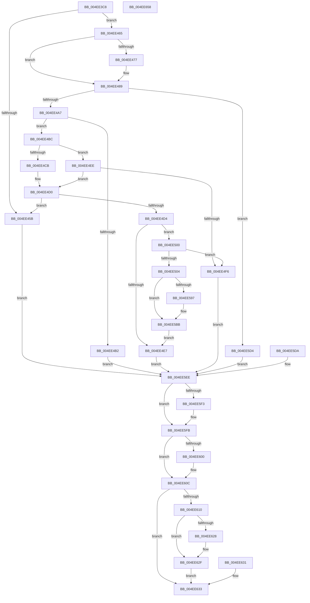

# MiQueryImageExtensionInformation

- RVA: `0x004EE3C8`–`0x004EE659` (길이 `657` bytes)
- VA: `0x00000001404EE3C8`
- 실행 섹션: `.text`
- PDB 이름 있음: `예`; PDB Function 태그: `아니요`
- unwind 정보 RVA: `0x000D8AA0`
- 디코드: `171`개 명령, `657/657` bytes 표시
- 미해석 바이트: `0` (있으면 어셈블리에 `.byte`로 보존)

> 이 문서는 커널 이미지의 기계어와 PDB 기호를 분석해 생성했습니다. 4번과 5번은 함수 원형과 자료형을 바이너리 사용 방식에서 추정한 C 해석이며 원본 소스 복구 결과는 아닙니다.

## 1. Dependencies

- 직접 호출 지점: **10**; 고유 호출 대상: **10**
- 직접 호출자로 확인된 함수: **1**
- RIP 상대 이미지 참조: **2**

### Outgoing calls
- `0x004EE47E` → [KiStackAttachProcess](../21/KiStackAttachProcess_function_00216820.md) (function, `0x00216820`)
- `0x004EE496` → [MiObtainReferencedVadEx](../31/MiObtainReferencedVadEx_function_00316690.md) (function, `0x00316690`)
- `0x004EE507` → [MiGetImageExtensionBaseAddress](../../page/A3/MiGetImageExtensionBaseAddress_function_00A3559C.md) (function, `0x00A3559C`)
- `0x004EE54B` → [MiLockWorkingSetShared](../27/MiLockWorkingSetShared_function_0027CBF0.md) (function, `0x0027CBF0`)
- `0x004EE566` → [MiMakeSystemAddressValid](../27/MiMakeSystemAddressValid_function_0027FF70.md) (function, `0x0027FF70`)
- `0x004EE5BE` → [MiUnlockPageTable](../21/MiUnlockPageTable_function_00216EC0.md) (function, `0x00216EC0`)
- `0x004EE5CA` → [MiUnlockWorkingSetShared](../27/MiUnlockWorkingSetShared_function_0027D690.md) (function, `0x0027D690`)
- `0x004EE5F6` → [MiUnlockAndDereferenceVadShared](../2A/MiUnlockAndDereferenceVadShared_function_002AEF10.md) (function, `0x002AEF10`)
- `0x004EE607` → [KiUnstackDetachProcess](../21/KiUnstackDetachProcess_function_00217D30.md) (function, `0x00217D30`)
- `0x004EE640` → [_security_check_cookie](../6A/_security_check_cookie_function_006AC640.md) (function, `0x006AC640`)

### Direct callers
- [MmQueryVirtualMemory](../../page/9D/MmQueryVirtualMemory_function_009D9280.md) at `0x009D97D4`

### Static image references
- `0x004EE3DB` → RVA `0x00E0A740` (`.data`; read)
- `0x004EE50F` → RVA `0x00E2D8A0` (`.data`; read)

## 2. Other-region calls and transfers

- 다른 실행 섹션으로 향하는 call: **1**
  - `0x004EE507` → [MiGetImageExtensionBaseAddress](../../page/A3/MiGetImageExtensionBaseAddress_function_00A3559C.md) (`.text` → `PAGE`)
- 별도 외부 분기/꼬리 이동을 확인하지 못했습니다.

## 3. Assembly (complete function range)

```asm
004EE3C8  40 53                           push rbx
004EE3CA  56                              push rsi
004EE3CB  57                              push rdi
004EE3CC  41 54                           push r12
004EE3CE  41 55                           push r13
004EE3D0  41 56                           push r14
004EE3D2  41 57                           push r15
004EE3D4  48 81 EC A0 00 00 00            sub rsp, 0xa0
004EE3DB  48 8B 05 5E C3 91 00            mov rax, qword ptr [rip + 0x91c35e]
004EE3E2  48 33 C4                        xor rax, rsp
004EE3E5  48 89 84 24 90 00 00 00         mov qword ptr [rsp + 0x90], rax
004EE3ED  49 8B D9                        mov rbx, r9
004EE3F0  48 8B F2                        mov rsi, rdx
004EE3F3  4C 8B E9                        mov r13, rcx
004EE3F6  48 89 54 24 50                  mov qword ptr [rsp + 0x50], rdx
004EE3FB  4C 8B B4 24 00 01 00 00         mov r14, qword ptr [rsp + 0x100]
004EE403  4C 89 74 24 58                  mov qword ptr [rsp + 0x58], r14
004EE408  83 64 24 24 00                  and dword ptr [rsp + 0x24], 0
004EE40D  0F 57 C0                        xorps xmm0, xmm0
004EE410  33 C0                           xor eax, eax
004EE412  0F 11 44 24 30                  movups xmmword ptr [rsp + 0x30], xmm0
004EE417  48 89 44 24 40                  mov qword ptr [rsp + 0x40], rax
004EE41C  0F 57 C9                        xorps xmm1, xmm1
004EE41F  0F 11 4C 24 60                  movups xmmword ptr [rsp + 0x60], xmm1
004EE424  0F 11 4C 24 70                  movups xmmword ptr [rsp + 0x70], xmm1
004EE429  0F 11 8C 24 80 00 00 00         movups xmmword ptr [rsp + 0x80], xmm1
004EE431  33 FF                           xor edi, edi
004EE433  48 89 7C 24 48                  mov qword ptr [rsp + 0x48], rdi
004EE438  45 33 FF                        xor r15d, r15d
004EE43B  0F 10 02                        movups xmm0, xmmword ptr [rdx]
004EE43E  0F 11 44 24 30                  movups xmmword ptr [rsp + 0x30], xmm0
004EE443  F2 0F 10 4A 10                  movsd xmm1, qword ptr [rdx + 0x10]
004EE448  F2 0F 11 4C 24 40               movsd qword ptr [rsp + 0x40], xmm1
004EE44E  48 8B 44 24 30                  mov rax, qword ptr [rsp + 0x30]
004EE453  48 C1 E8 20                     shr rax, 0x20
004EE457  85 C0                           test eax, eax
004EE459  74 0A                           je 0x1404ee465
004EE45B  BB 0D 00 00 C0                  mov ebx, 0xc000000d
004EE460  E9 89 01 00 00                  jmp 0x1404ee5ee
004EE465  65 48 8B 04 25 88 01 00 00      mov rax, qword ptr gs:[0x188]
004EE46E  4C 3B A8 B8 00 00 00            cmp r13, qword ptr [rax + 0xb8]
004EE475  74 12                           je 0x1404ee489
004EE477  4C 8D 44 24 60                  lea r8, [rsp + 0x60]
004EE47C  33 D2                           xor edx, edx
004EE47E  E8 9D 83 D2 FF                  call 0x140216820
004EE483  41 BF 01 00 00 00               mov r15d, 1
004EE489  4C 8D 44 24 24                  lea r8, [rsp + 0x24]
004EE48E  BA 02 00 00 00                  mov edx, 2
004EE493  48 8B CB                        mov rcx, rbx
004EE496  E8 F5 81 E2 FF                  call 0x140316690
004EE49B  48 8B F8                        mov rdi, rax
004EE49E  48 85 C0                        test rax, rax
004EE4A1  0F 84 2D 01 00 00               je 0x1404ee5d4
004EE4A7  8B 48 30                        mov ecx, dword ptr [rax + 0x30]
004EE4AA  80 E1 70                        and cl, 0x70
004EE4AD  80 F9 20                        cmp cl, 0x20
004EE4B0  74 0A                           je 0x1404ee4bc
004EE4B2  BB 41 01 00 C0                  mov ebx, 0xc0000141
004EE4B7  E9 32 01 00 00                  jmp 0x1404ee5ee
004EE4BC  BA 03 00 00 00                  mov edx, 3
004EE4C1  8B CA                           mov ecx, edx
004EE4C3  8B 44 24 30                     mov eax, dword ptr [rsp + 0x30]
004EE4C7  85 C0                           test eax, eax
004EE4C9  75 23                           jne 0x1404ee4ee
004EE4CB  33 C9                           xor ecx, ecx
004EE4CD  45 33 C0                        xor r8d, r8d
004EE4D0  3B CA                           cmp ecx, edx
004EE4D2  74 87                           je 0x1404ee45b
004EE4D4  48 83 64 24 38 00               and qword ptr [rsp + 0x38], 0
004EE4DA  48 83 64 24 40 00               and qword ptr [rsp + 0x40], 0
004EE4E0  8B 47 40                        mov eax, dword ptr [rdi + 0x40]
004EE4E3  A8 20                           test al, 0x20
004EE4E5  75 19                           jne 0x1404ee500
004EE4E7  33 DB                           xor ebx, ebx
004EE4E9  E9 00 01 00 00                  jmp 0x1404ee5ee
004EE4EE  4C 8B C2                        mov r8, rdx
004EE4F1  83 F8 01                        cmp eax, 1
004EE4F4  75 DA                           jne 0x1404ee4d0
004EE4F6  BB BB 00 00 C0                  mov ebx, 0xc00000bb
004EE4FB  E9 EE 00 00 00                  jmp 0x1404ee5ee
004EE500  85 C9                           test ecx, ecx
004EE502  75 F2                           jne 0x1404ee4f6
004EE504  48 8B CF                        mov rcx, rdi
004EE507  E8 90 70 54 00                  call 0x140a3559c
004EE50C  4C 8B E0                        mov r12, rax
004EE50F  48 8D 05 8A F3 93 00            lea rax, [rip + 0x93f38a]
004EE516  42 8B 0C 80                     mov ecx, dword ptr [rax + r8*4]
004EE51A  4C 03 E1                        add r12, rcx
004EE51D  49 8B DC                        mov rbx, r12
004EE520  48 C1 EB 09                     shr rbx, 9
004EE524  48 B8 F8 FF FF FF 7F 00 00 00   movabs rax, 0x7ffffffff8
004EE52E  48 23 D8                        and rbx, rax
004EE531  48 B8 00 00 00 00 80 F6 FF FF   movabs rax, 0xfffff68000000000
004EE53B  48 8B C8                        mov rcx, rax
004EE53E  48 03 D9                        add rbx, rcx
004EE541  49 81 C5 00 04 00 00            add r13, 0x400
004EE548  49 8B CD                        mov rcx, r13
004EE54B  E8 A0 E6 D8 FF                  call 0x14027cbf0
004EE550  88 44 24 20                     mov byte ptr [rsp + 0x20], al
004EE554  8B 57 30                        mov edx, dword ptr [rdi + 0x30]
004EE557  C1 EA 0C                        shr edx, 0xc
004EE55A  83 E2 7F                        and edx, 0x7f
004EE55D  45 33 C9                        xor r9d, r9d
004EE560  44 8A C0                        mov r8b, al
004EE563  48 8B CB                        mov rcx, rbx
004EE566  E8 05 1A D9 FF                  call 0x14027ff70
004EE56B  48 8B D3                        mov rdx, rbx
004EE56E  48 C1 EA 09                     shr rdx, 9
004EE572  48 B8 F8 FF FF FF 7F 00 00 00   movabs rax, 0x7ffffffff8
004EE57C  48 23 D0                        and rdx, rax
004EE57F  48 B8 00 00 00 00 80 F6 FF FF   movabs rax, 0xfffff68000000000
004EE589  48 8B C0                        mov rax, rax
004EE58C  48 03 D0                        add rdx, rax
004EE58F  48 8B 03                        mov rax, qword ptr [rbx]
004EE592  48 85 C0                        test rax, rax
004EE595  74 24                           je 0x1404ee5bb
004EE597  44 0F B6 47 20                  movzx r8d, byte ptr [rdi + 0x20]
004EE59C  49 C1 E0 20                     shl r8, 0x20
004EE5A0  8B 47 18                        mov eax, dword ptr [rdi + 0x18]
004EE5A3  4C 0B C0                        or r8, rax
004EE5A6  49 C1 E0 0C                     shl r8, 0xc
004EE5AA  4D 2B E0                        sub r12, r8
004EE5AD  4C 89 64 24 38                  mov qword ptr [rsp + 0x38], r12
004EE5B2  48 C7 44 24 40 00 10 00 00      mov qword ptr [rsp + 0x40], 0x1000
004EE5BB  49 8B CD                        mov rcx, r13
004EE5BE  E8 FD 88 D2 FF                  call 0x140216ec0
004EE5C3  8A 54 24 20                     mov dl, byte ptr [rsp + 0x20]
004EE5C7  49 8B CD                        mov rcx, r13
004EE5CA  E8 C1 F0 D8 FF                  call 0x14027d690
004EE5CF  E9 13 FF FF FF                  jmp 0x1404ee4e7
004EE5D4  8B 5C 24 24                     mov ebx, dword ptr [rsp + 0x24]
004EE5D8  EB 14                           jmp 0x1404ee5ee
004EE5DA  8B D8                           mov ebx, eax
004EE5DC  48 8B 7C 24 48                  mov rdi, qword ptr [rsp + 0x48]
004EE5E1  44 8B FF                        mov r15d, edi
004EE5E4  48 8B 74 24 50                  mov rsi, qword ptr [rsp + 0x50]
004EE5E9  4C 8B 74 24 58                  mov r14, qword ptr [rsp + 0x58]
004EE5EE  48 85 FF                        test rdi, rdi
004EE5F1  74 08                           je 0x1404ee5fb
004EE5F3  48 8B CF                        mov rcx, rdi
004EE5F6  E8 15 09 DC FF                  call 0x1402aef10
004EE5FB  45 85 FF                        test r15d, r15d
004EE5FE  74 0C                           je 0x1404ee60c
004EE600  33 D2                           xor edx, edx
004EE602  48 8D 4C 24 60                  lea rcx, [rsp + 0x60]
004EE607  E8 24 97 D2 FF                  call 0x140217d30
004EE60C  85 DB                           test ebx, ebx
004EE60E  78 23                           js 0x1404ee633
004EE610  0F 10 44 24 30                  movups xmm0, xmmword ptr [rsp + 0x30]
004EE615  0F 11 06                        movups xmmword ptr [rsi], xmm0
004EE618  F2 0F 10 4C 24 40               movsd xmm1, qword ptr [rsp + 0x40]
004EE61E  F2 0F 11 4E 10                  movsd qword ptr [rsi + 0x10], xmm1
004EE623  4D 85 F6                        test r14, r14
004EE626  74 07                           je 0x1404ee62f
004EE628  49 C7 06 18 00 00 00            mov qword ptr [r14], 0x18
004EE62F  EB 02                           jmp 0x1404ee633
004EE631  8B D8                           mov ebx, eax
004EE633  8B C3                           mov eax, ebx
004EE635  48 8B 8C 24 90 00 00 00         mov rcx, qword ptr [rsp + 0x90]
004EE63D  48 33 CC                        xor rcx, rsp
004EE640  E8 FB DF 1B 00                  call 0x1406ac640
004EE645  48 81 C4 A0 00 00 00            add rsp, 0xa0
004EE64C  41 5F                           pop r15
004EE64E  41 5E                           pop r14
004EE650  41 5D                           pop r13
004EE652  41 5C                           pop r12
004EE654  5F                              pop rdi
004EE655  5E                              pop rsi
004EE656  5B                              pop rbx
004EE657  C3                              ret
004EE658  CC                              int3
```

## 4. C-style interpretation (structured pseudocode)

```c
__int64 __fastcall MiQueryImageExtensionInformation(__int64 a1, __int64 a2, __int64 a3, __int64 a4, __int64 a5)
{
    __int64 result;
    __int64 v_r12;
    __int64 v_r13;
    __int64 v_r15;
    __int64 v_rbx;
    __int64 v_rdi;
    __int64 v_rsp;
    unsigned __int64 v_stack_m48;
    unsigned __int64 v_stack_m58;
    unsigned __int64 v_stack_m68;
    unsigned __int64 v_stack_m78;
    unsigned __int64 v_stack_m80;
    unsigned __int64 v_stack_m88;
    unsigned __int64 v_stack_m90;
    unsigned __int64 v_stack_m98;
    unsigned __int64 v_stack_mA0;
    unsigned __int64 v_stack_mA8;
    unsigned int v_stack_mB4;
    unsigned __int8 v_stack_mB8;

    v_rsp = (v_rsp) - (160);
    result = (*(unsigned __int64 *)(v_rip + 9552734)) ^ (v_rsp);
    v_stack_m48 = result;
    v_stack_m88 = a2;
    v_stack_m80 = a5;
    result = 0;
    v_stack_mA8 = v_xmm0;
    v_stack_m98 = 0;
    v_stack_m78 = v_xmm1;
    v_stack_m68 = v_xmm1;
    v_stack_m58 = v_xmm1;
    v_rdi = 0;
    v_stack_m90 = 0;
    v_r15 = 0;
    v_stack_mA8 = v_xmm0;
    v_stack_m98 = v_xmm1;
    result = (v_stack_mA8) >> (32);
    if ((unsigned int)(result) == 0) goto loc_004EE465;
loc_004EE45B:
    goto loc_004EE5EE;
loc_004EE465:
    result = *(unsigned __int64 *)(gs_base + (0 + 392));
    if (a1 != (*(unsigned __int64 *)(*(unsigned __int64 *)(gs_base + (0 + 392)) + 184))) {
        a3 = v_stack_m78;
        a2 = 0;
        result = KiStackAttachProcess(a1, a2, a3, a4);
        v_r15 = 1;
    }
    result = MiObtainReferencedVadEx((unsigned int)(0xC000000DULL), 2, v_stack_mB4, a4);
    if (result == 0) goto loc_004EE5D4;
    a1 = (unsigned __int8)(((unsigned int)(*(unsigned int *)(result + 48))) & (112));
    if (((unsigned __int8)(a1)) == 32) goto loc_004EE4BC;
    goto loc_004EE5EE;
loc_004EE4BC:
    if ((unsigned int)((unsigned int)(v_stack_mA8)) != 0) goto loc_004EE4EE;
    a1 = 0;
    a3 = 0;
loc_004EE4D0:
    if (0 == 3) goto loc_004EE45B;
    if ((((unsigned __int8)((unsigned int)(*(unsigned int *)(result + 64)))) & (32)) != 0) goto loc_004EE500;
loc_004EE4E7:
    v_rbx = 0;
    goto loc_004EE5EE;
loc_004EE4EE:
    if (((unsigned int)((unsigned int)(*(unsigned int *)(result + 64)))) != 1) goto loc_004EE4D0;
loc_004EE4F6:
    goto loc_004EE5EE;
loc_004EE500:
    if (0 != 0) goto loc_004EE4F6;
    result = MiGetImageExtensionBaseAddress(result, 3, 3, a4);
    v_r12 = (result) + ((unsigned int)(*(unsigned int *)(v_rip + 9696138 + 3 * 4)));
    v_rbx = (v_r12) >> (9);
    v_rbx = (v_rbx) & (v_rip + 9696138);
    v_rbx = (v_rbx) + (v_rip + 9696138);
    v_r13 = (a1) + (0x400ULL);
    result = MiLockWorkingSetShared(v_r13, 3, 3, a4);
    v_stack_mB8 = (unsigned __int8)(result);
    a2 = (unsigned int)(((unsigned int)(*(unsigned int *)(result + 48))) >> (12));
    a2 = (unsigned int)((a2) & (127));
    a4 = 0;
    result = MiMakeSystemAddressValid(v_rbx, a2, (unsigned __int8)(result), a4);
    a2 = (v_rbx) >> (9);
    a2 = (a2) & (result);
    a2 = (a2) + (result);
    result = *(unsigned __int64 *)(v_rbx);
    if (*(unsigned __int64 *)(v_rbx) != 0) {
        a3 = *(unsigned __int8 *)(result + 32);
        a3 = (a3) << (32);
        result = *(unsigned int *)(result + 24);
        a3 = (a3) | (result);
        a3 = (a3) << (12);
        v_r12 = (v_r12) - (a3);
        v_stack_mA0 = v_r12;
        v_stack_m98 = 0x1000ULL;
    }
    result = MiUnlockPageTable(v_r13, a2, a3, a4);
    result = MiUnlockWorkingSetShared(v_r13, v_stack_mB8, a3, a4);
    goto loc_004EE4E7;
loc_004EE5D4:
    goto loc_004EE5EE;
loc_004EE5EE:
    if (result != 0) {
        a1 = result;
        result = MiUnlockAndDereferenceVadShared(a1, v_stack_mB8, a3, a4);
    }
    if ((unsigned int)(v_r15) != 0) {
        a2 = 0;
        a1 = v_stack_m78;
        result = KiUnstackDetachProcess(a1, a2, a3, a4);
    }
    if (sign_flag) goto loc_004EE633;
    *(unsigned __int64 *)(a2) = v_xmm0;
    *(unsigned __int64 *)(a2 + 16) = v_xmm1;
    if (a5 != 0) {
        *(unsigned __int64 *)(a5) = 24;
    }
    goto loc_004EE633;
loc_004EE633:
    a1 = (v_stack_m48) ^ (v_rsp);
    result = _security_check_cookie(a1, a2, a3, a4);
    v_rsp = (v_rsp) + (160);
    return result;
}
```

## 5. (Beta) C Style

```c
int64_t MiQueryImageExtensionInformation(int64_t Arg1, void *Arg2, int64_t Arg3, int64_t Arg4, int64_t Arg5)
{
    uint8_t *arg2 = (uint8_t *)Arg2;

    int64_t result;
    int64_t local_r12;
    int64_t local_r13;
    int64_t local_r15;
    int64_t local_rbx;
    int64_t local_rdi;
    int64_t local_rsp;
    uint64_t v_stack_m48;
    uint64_t v_stack_m58;
    uint64_t v_stack_m68;
    uint64_t v_stack_m78;
    uint64_t v_stack_m80;
    uint64_t v_stack_m88;
    uint64_t v_stack_m90;
    uint64_t v_stack_m98;
    uint64_t v_stack_mA0;
    uint64_t v_stack_mA8;
    uint32_t v_stack_mB4;
    uint8_t v_stack_mB8;

    local_rsp = (local_rsp) - (160);
    result = (*(uint64_t *)(v_rip + 0x91C35E)) ^ (local_rsp);
    v_stack_m48 = result;
    v_stack_m88 = Arg2;
    v_stack_m80 = Arg5;
    result = 0;
    v_stack_mA8 = v_xmm0;
    v_stack_m98 = 0;
    v_stack_m78 = v_xmm1;
    v_stack_m68 = v_xmm1;
    v_stack_m58 = v_xmm1;
    local_rdi = 0;
    v_stack_m90 = 0;
    local_r15 = 0;
    v_stack_mA8 = v_xmm0;
    v_stack_m98 = v_xmm1;
    result = (v_stack_mA8) >> (32);
    if ((uint32_t)(result) == 0) goto loc_004EE465;
loc_004EE45B:
    goto loc_004EE5EE;
loc_004EE465:
    result = *(uint64_t *)(gs_base + (0 + 0x188));
    if (Arg1 != (*(uint64_t *)(*(uint64_t *)(gs_base + (0 + 0x188)) + 0xB8))) {
        Arg3 = v_stack_m78;
        Arg2 = 0;
        result = KiStackAttachProcess(Arg1, Arg2, Arg3, Arg4);
        local_r15 = 1;
    }
    result = MiObtainReferencedVadEx((uint32_t)(0xC000000DULL), 2, v_stack_mB4, Arg4);
    if (result == 0) goto loc_004EE5D4;
    Arg1 = (uint8_t)(((uint32_t)(*(uint32_t *)(result + 0x30))) & (112));
    if (((uint8_t)(Arg1)) == 32) goto loc_004EE4BC;
    goto loc_004EE5EE;
loc_004EE4BC:
    if ((uint32_t)((uint32_t)(v_stack_mA8)) != 0) goto loc_004EE4EE;
    Arg1 = 0;
    Arg3 = 0;
loc_004EE4D0:
    if (0 == 3) goto loc_004EE45B;
    if ((((uint8_t)((uint32_t)(*(uint32_t *)(result + 0x40)))) & (32)) != 0) goto loc_004EE500;
loc_004EE4E7:
    local_rbx = 0;
    goto loc_004EE5EE;
loc_004EE4EE:
    if (((uint32_t)((uint32_t)(*(uint32_t *)(result + 0x40)))) != 1) goto loc_004EE4D0;
loc_004EE4F6:
    goto loc_004EE5EE;
loc_004EE500:
    if (0 != 0) goto loc_004EE4F6;
    result = MiGetImageExtensionBaseAddress(result, 3, 3, Arg4);
    local_r12 = (result) + ((uint32_t)(*(uint32_t *)(v_rip + 0x93F38A + 0x3 * 4)));
    local_rbx = (local_r12) >> (9);
    local_rbx = (local_rbx) & (v_rip + 9696138);
    local_rbx = (local_rbx) + (v_rip + 9696138);
    local_r13 = (Arg1) + (0x400ULL);
    result = MiLockWorkingSetShared(local_r13, 3, 3, Arg4);
    v_stack_mB8 = (uint8_t)(result);
    Arg2 = (uint32_t)(((uint32_t)(*(uint32_t *)(result + 0x30))) >> (12));
    Arg2 = (uint32_t)((Arg2) & (127));
    Arg4 = 0;
    result = MiMakeSystemAddressValid(local_rbx, Arg2, (uint8_t)(result), Arg4);
    Arg2 = (local_rbx) >> (9);
    Arg2 = (Arg2) & (result);
    Arg2 = (Arg2) + (result);
    result = *(uint64_t *)(local_rbx);
    if (*(uint64_t *)(local_rbx) != 0) {
        Arg3 = *(uint8_t *)(result + 0x20);
        Arg3 = (Arg3) << (32);
        result = *(uint32_t *)(result + 0x18);
        Arg3 = (Arg3) | (result);
        Arg3 = (Arg3) << (12);
        local_r12 = (local_r12) - (Arg3);
        v_stack_mA0 = local_r12;
        v_stack_m98 = 0x1000ULL;
    }
    result = MiUnlockPageTable(local_r13, Arg2, Arg3, Arg4);
    result = MiUnlockWorkingSetShared(local_r13, v_stack_mB8, Arg3, Arg4);
    goto loc_004EE4E7;
loc_004EE5D4:
    goto loc_004EE5EE;
loc_004EE5EE:
    if (result != 0) {
        Arg1 = result;
        result = MiUnlockAndDereferenceVadShared(Arg1, v_stack_mB8, Arg3, Arg4);
    }
    if ((uint32_t)(local_r15) != 0) {
        Arg2 = 0;
        Arg1 = v_stack_m78;
        result = KiUnstackDetachProcess(Arg1, Arg2, Arg3, Arg4);
    }
    if (sign_flag) goto loc_004EE633;
    *(uint64_t *)(arg2) = v_xmm0;
    *(uint64_t *)(arg2 + 0x10) = v_xmm1;
    if (Arg5 != 0) {
        *(uint64_t *)(Arg5) = 24;
    }
    goto loc_004EE633;
loc_004EE633:
    Arg1 = (v_stack_m48) ^ (local_rsp);
    result = _security_check_cookie(Arg1, Arg2, Arg3, Arg4);
    local_rsp = (local_rsp) + (160);
    return result;
}
```

### 관측된 메모리 오프셋

구조체 형식이 확인되지 않은 접근은 인자 기준의 오프셋으로만 기록했습니다.

| 기준 인자 | 오프셋 표현 | 폭 (bit) | 접근 |
|---|---:|---:|---|
| `Arg2` | `+ 0x0` | `128` | `R` |
| `Arg2` | `+ 0x10` | `64` | `R` |
| `Arg2` | `+ 0x10` | `64` | `W` |

## 6. Execution-region graph

[열기: 2D/3D 그래프와 함수 탐색 컨트롤 패널](../../../control-panel.html?section=text&rva=0x004EE3C8&view=graph)

- 2D 그래프는 위에서 아래로 흐르고, 3D 그래프는 빈 공간을 드래그해 회전합니다. Shift+드래그는 이동, 휠은 확대·축소, 함수 노드 선택은 대상 보고서 이동입니다.

### Static fallback


