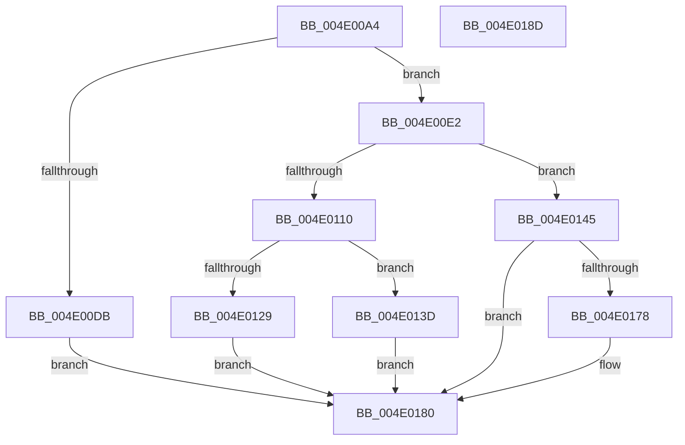

# MiReferenceAweHandle

- RVA: `0x004E00A4`–`0x004E018E` (길이 `234` bytes)
- VA: `0x00000001404E00A4`
- 실행 섹션: `.text`
- PDB 이름 있음: `예`; PDB Function 태그: `아니요`
- unwind 정보 RVA: `0x000BEF64`
- 디코드: `62`개 명령, `234/234` bytes 표시
- 미해석 바이트: `0` (있으면 어셈블리에 `.byte`로 보존)

> 이 문서는 커널 이미지의 기계어와 PDB 기호를 분석해 생성했습니다. 4번과 5번은 함수 원형과 자료형을 바이너리 사용 방식에서 추정한 C 해석이며 원본 소스 복구 결과는 아닙니다.

## 1. Dependencies

- 직접 호출 지점: **5**; 고유 호출 대상: **4**
- 직접 호출자로 확인된 함수: **3**
- RIP 상대 이미지 참조: **2**

### Outgoing calls
- `0x004E0104` → [ObReferenceObjectByHandleWithTag](../../page/86/ObReferenceObjectByHandleWithTag_function_00869610.md) (function, `0x00869610`)
- `0x004E0118` → [MiSectionControlArea](../29/MiSectionControlArea_function_00294CB0.md) (function, `0x00294CB0`)
- `0x004E0120` → [MiAweControlArea](../44/MiAweControlArea_function_00447720.md) (function, `0x00447720`)
- `0x004E0131` → [ObfDereferenceObjectWithTag](../2F/ObfDereferenceObjectWithTag_function_002F78E0.md) (function, `0x002F78E0`)
- `0x004E016F` → [ObReferenceObjectByHandleWithTag](../../page/86/ObReferenceObjectByHandleWithTag_function_00869610.md) (function, `0x00869610`)

### Direct callers
- [MiAllocateUserPhysicalPages](../../page/80/MiAllocateUserPhysicalPages_function_00809828.md) at `0x00809A64`
- [NtFreeUserPhysicalPages](../../page/80/NtFreeUserPhysicalPages_function_0080AF30.md) at `0x0080B049`
- [MiCreateUserPhysicalView](../../page/AD/MiCreateUserPhysicalView_function_00ADA4B4.md) at `0x00ADA537`

### Static image references
- `0x004E00ED` → RVA `0x00FC6BD8` (`ALMOSTRO`; read)
- `0x004E0150` → RVA `0x00FC6A98` (`ALMOSTRO`; read)

## 2. Other-region calls and transfers

- 다른 실행 섹션으로 향하는 call: **2**
  - `0x004E0104` → [ObReferenceObjectByHandleWithTag](../../page/86/ObReferenceObjectByHandleWithTag_function_00869610.md) (`.text` → `PAGE`)
  - `0x004E016F` → [ObReferenceObjectByHandleWithTag](../../page/86/ObReferenceObjectByHandleWithTag_function_00869610.md) (`.text` → `PAGE`)
- 별도 외부 분기/꼬리 이동을 확인하지 못했습니다.

## 3. Assembly (complete function range)

```asm
004E00A4  48 89 5C 24 10                  mov qword ptr [rsp + 0x10], rbx
004E00A9  55                              push rbp
004E00AA  56                              push rsi
004E00AB  57                              push rdi
004E00AC  48 83 EC 40                     sub rsp, 0x40
004E00B0  49 83 21 00                     and qword ptr [r9], 0
004E00B4  49 8B F9                        mov rdi, r9
004E00B7  48 8B 9C 24 80 00 00 00         mov rbx, qword ptr [rsp + 0x80]
004E00BF  41 8A E8                        mov bpl, r8b
004E00C2  48 83 64 24 78 00               and qword ptr [rsp + 0x78], 0
004E00C8  48 8B F1                        mov rsi, rcx
004E00CB  48 83 64 24 60 00               and qword ptr [rsp + 0x60], 0
004E00D1  48 83 23 00                     and qword ptr [rbx], 0
004E00D5  48 83 F9 FF                     cmp rcx, -1
004E00D9  75 07                           jne 0x1404e00e2
004E00DB  33 C0                           xor eax, eax
004E00DD  E9 9E 00 00 00                  jmp 0x1404e0180
004E00E2  48 83 64 24 30 00               and qword ptr [rsp + 0x30], 0
004E00E8  48 8D 44 24 60                  lea rax, [rsp + 0x60]
004E00ED  4C 8B 05 E4 6A AE 00            mov r8, qword ptr [rip + 0xae6ae4]
004E00F4  44 8A CD                        mov r9b, bpl
004E00F7  48 89 44 24 28                  mov qword ptr [rsp + 0x28], rax
004E00FC  C7 44 24 20 4D 6D 50 68         mov dword ptr [rsp + 0x20], 0x68506d4d
004E0104  E8 07 95 38 00                  call 0x140869610
004E0109  44 8B C8                        mov r9d, eax
004E010C  85 C0                           test eax, eax
004E010E  78 35                           js 0x1404e0145
004E0110  4C 8B 44 24 60                  mov r8, qword ptr [rsp + 0x60]
004E0115  49 8B C8                        mov rcx, r8
004E0118  E8 93 4B DB FF                  call 0x140294cb0
004E011D  48 8B C8                        mov rcx, rax
004E0120  E8 FB 75 F6 FF                  call 0x140447720
004E0125  85 C0                           test eax, eax
004E0127  75 14                           jne 0x1404e013d
004E0129  BA 4D 6D 50 68                  mov edx, 0x68506d4d
004E012E  49 8B C8                        mov rcx, r8
004E0131  E8 AA 77 E1 FF                  call 0x1402f78e0
004E0136  B8 08 00 00 C0                  mov eax, 0xc0000008
004E013B  EB 43                           jmp 0x1404e0180
004E013D  4C 89 03                        mov qword ptr [rbx], r8
004E0140  41 8B C1                        mov eax, r9d
004E0143  EB 3B                           jmp 0x1404e0180
004E0145  48 83 64 24 30 00               and qword ptr [rsp + 0x30], 0
004E014B  48 8D 44 24 78                  lea rax, [rsp + 0x78]
004E0150  4C 8B 05 41 69 AE 00            mov r8, qword ptr [rip + 0xae6941]
004E0157  44 8A CD                        mov r9b, bpl
004E015A  48 89 44 24 28                  mov qword ptr [rsp + 0x28], rax
004E015F  BA 08 00 00 00                  mov edx, 8
004E0164  48 8B CE                        mov rcx, rsi
004E0167  C7 44 24 20 4D 6D 50 68         mov dword ptr [rsp + 0x20], 0x68506d4d
004E016F  E8 9C 94 38 00                  call 0x140869610
004E0174  85 C0                           test eax, eax
004E0176  78 08                           js 0x1404e0180
004E0178  48 8B 4C 24 78                  mov rcx, qword ptr [rsp + 0x78]
004E017D  48 89 0F                        mov qword ptr [rdi], rcx
004E0180  48 8B 5C 24 68                  mov rbx, qword ptr [rsp + 0x68]
004E0185  48 83 C4 40                     add rsp, 0x40
004E0189  5F                              pop rdi
004E018A  5E                              pop rsi
004E018B  5D                              pop rbp
004E018C  C3                              ret
004E018D  CC                              int3
```

## 4. C-style interpretation (structured pseudocode)

```c
__int64 __fastcall MiReferenceAweHandle(__int64 a1, __int64 a2, unsigned __int8 a3, __int64 a4, __int64 a5)
{
    __int64 result;
    __int64 v_rsp;
    unsigned __int64 v_stack_m28;
    unsigned __int64 v_stack_m30;
    unsigned int v_stack_m38;
    unsigned __int64 v_stack_p10;
    unsigned __int64 v_stack_p20;
    unsigned __int64 v_stack_p8;

    v_stack_p10 = v_rbx;
    v_rsp = (v_rsp) - (64);
    if (a1 != -1) goto loc_004E00E2;
    result = 0;
    goto loc_004E0180;
loc_004E00E2:
    v_stack_m30 = v_stack_p8;
    v_stack_m38 = 0x68506D4DULL;
    result = ObReferenceObjectByHandleWithTag(a1, a2, *(unsigned __int64 *)(v_rip + 11430628), a3);
    if (sign_flag) goto loc_004E0145;
    result = MiSectionControlArea(v_stack_p8, a2, v_stack_p8, (unsigned int)((unsigned int)(result)));
    result = MiAweControlArea(result, a2, v_stack_p8, (unsigned int)((unsigned int)(result)));
    if ((unsigned int)(result) != 0) goto loc_004E013D;
    result = ObfDereferenceObjectWithTag(v_stack_p8, (unsigned int)(0x68506D4DULL), v_stack_p8, (unsigned int)((unsigned int)(result)));
    goto loc_004E0180;
loc_004E013D:
    *(unsigned __int64 *)(a5) = v_stack_p8;
    goto loc_004E0180;
loc_004E0145:
    v_stack_m30 = v_stack_p20;
    v_stack_m38 = 0x68506D4DULL;
    result = ObReferenceObjectByHandleWithTag(a1, 8, *(unsigned __int64 *)(v_rip + 11430209), a3);
    if (!(sign_flag)) {
        a1 = v_stack_p20;
        *(unsigned __int64 *)(a4) = a1;
    }
    v_rsp = (v_rsp) + (64);
    return result;
}
```

## 5. (Beta) C Style

```c
int64_t MiReferenceAweHandle(int64_t Arg1, int64_t Arg2, uint8_t Arg3, void *Arg4, void *Arg5)
{
    uint8_t *arg4 = (uint8_t *)Arg4;
    uint8_t *arg5 = (uint8_t *)Arg5;

    int64_t result;
    int64_t local_rsp;
    uint64_t v_stack_m28;
    uint64_t v_stack_m30;
    uint32_t v_stack_m38;
    uint64_t v_stack_p10;
    uint64_t v_stack_p20;
    uint64_t v_stack_p8;

    v_stack_p10 = local_rbx;
    local_rsp = (local_rsp) - (64);
    if (Arg1 != -1) goto loc_004E00E2;
    result = 0;
    goto loc_004E0180;
loc_004E00E2:
    v_stack_m30 = v_stack_p8;
    v_stack_m38 = 0x68506D4DULL;
    result = ObReferenceObjectByHandleWithTag(Arg1, Arg2, *(uint64_t *)(v_rip + 0xAE6AE4), Arg3);
    if (sign_flag) goto loc_004E0145;
    result = MiSectionControlArea(v_stack_p8, Arg2, v_stack_p8, (uint32_t)((uint32_t)(result)));
    result = MiAweControlArea(result, Arg2, v_stack_p8, (uint32_t)((uint32_t)(result)));
    if ((uint32_t)(result) != 0) goto loc_004E013D;
    result = ObfDereferenceObjectWithTag(v_stack_p8, (uint32_t)(0x68506D4DULL), v_stack_p8, (uint32_t)((uint32_t)(result)));
    goto loc_004E0180;
loc_004E013D:
    *(uint64_t *)(arg5) = v_stack_p8;
    goto loc_004E0180;
loc_004E0145:
    v_stack_m30 = v_stack_p20;
    v_stack_m38 = 0x68506D4DULL;
    result = ObReferenceObjectByHandleWithTag(Arg1, 8, *(uint64_t *)(v_rip + 0xAE6941), Arg3);
    if (!(sign_flag)) {
        Arg1 = v_stack_p20;
        *(uint64_t *)(arg4) = Arg1;
    }
    local_rsp = (local_rsp) + (64);
    return result;
}
```

### 관측된 메모리 오프셋

구조체 형식이 확인되지 않은 접근은 인자 기준의 오프셋으로만 기록했습니다.

| 기준 인자 | 오프셋 표현 | 폭 (bit) | 접근 |
|---|---:|---:|---|
| `Arg4` | `+ 0x0` | `64` | `R/W` |
| `Arg4` | `+ 0x0` | `64` | `W` |
| `Arg5` | `+ 0x0` | `64` | `R/W` |
| `Arg5` | `+ 0x0` | `64` | `W` |

## 6. Execution-region graph

[열기: 2D/3D 그래프와 함수 탐색 컨트롤 패널](../../../control-panel.html?section=text&rva=0x004E00A4&view=graph)

- 2D 그래프는 위에서 아래로 흐르고, 3D 그래프는 빈 공간을 드래그해 회전합니다. Shift+드래그는 이동, 휠은 확대·축소, 함수 노드 선택은 대상 보고서 이동입니다.

### Static fallback


