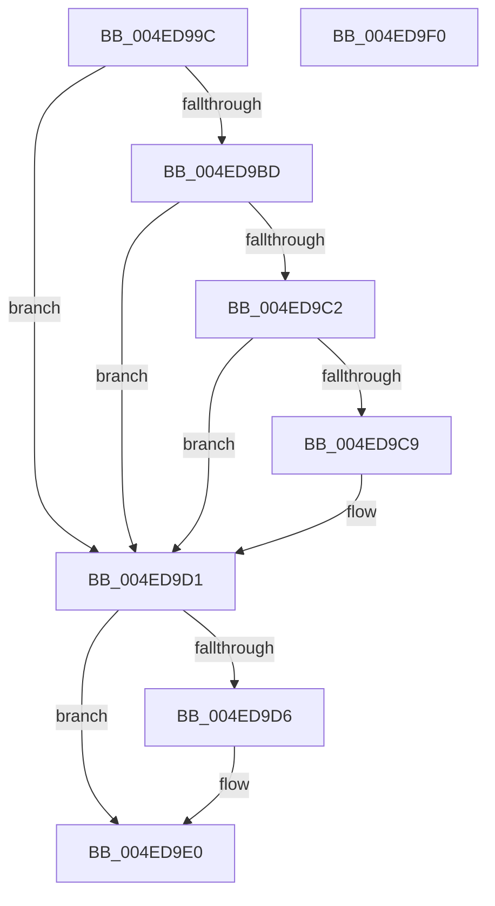

# MiRemoveUnusedSegments

- RVA: `0x004ED99C`–`0x004ED9F1` (길이 `85` bytes)
- VA: `0x00000001404ED99C`
- 실행 섹션: `.text`
- PDB 이름 있음: `예`; PDB Function 태그: `아니요`
- unwind 정보 RVA: `0x00060BC4`
- 디코드: `27`개 명령, `85/85` bytes 표시
- 미해석 바이트: `0` (있으면 어셈블리에 `.byte`로 보존)

> 이 문서는 커널 이미지의 기계어와 PDB 기호를 분석해 생성했습니다. 4번과 5번은 함수 원형과 자료형을 바이너리 사용 방식에서 추정한 C 해석이며 원본 소스 복구 결과는 아닙니다.

## 1. Dependencies

- 직접 호출 지점: **3**; 고유 호출 대상: **3**
- 직접 호출자로 확인된 함수: **1**
- RIP 상대 이미지 참조: **0**

### Outgoing calls
- `0x004ED9B4` → [MiDeleteCachedEntries](../67/MiDeleteCachedEntries_function_00677A28.md) (function, `0x00677A28`)
- `0x004ED9CC` → [MiReduceSystemCache](../67/MiReduceSystemCache_function_006784F4.md) (function, `0x006784F4`)
- `0x004ED9DB` → [MiWakeCommitRequest](../48/MiWakeCommitRequest_function_00481C58.md) (function, `0x00481C58`)

### Direct callers
- [MiSegmentDereferenceWorker](../46/MiSegmentDereferenceWorker_function_00464D40.md) at `0x00464DE9`

### Static image references
- 디코드된 RIP-relative 메모리 참조가 없습니다.

## 2. Other-region calls and transfers

- 다른 실행 섹션으로 향하는 call: **0**
- 별도 외부 분기/꼬리 이동을 확인하지 못했습니다.

## 3. Assembly (complete function range)

```asm
004ED99C  48 89 5C 24 08                  mov qword ptr [rsp + 8], rbx
004ED9A1  48 89 74 24 10                  mov qword ptr [rsp + 0x10], rsi
004ED9A6  57                              push rdi
004ED9A7  48 83 EC 20                     sub rsp, 0x20
004ED9AB  8B 72 38                        mov esi, dword ptr [rdx + 0x38]
004ED9AE  48 8B FA                        mov rdi, rdx
004ED9B1  48 8B D9                        mov rbx, rcx
004ED9B4  E8 6F A0 18 00                  call 0x140677a28
004ED9B9  85 C0                           test eax, eax
004ED9BB  75 14                           jne 0x1404ed9d1
004ED9BD  39 43 5C                        cmp dword ptr [rbx + 0x5c], eax
004ED9C0  75 0F                           jne 0x1404ed9d1
004ED9C2  48 83 7F 10 01                  cmp qword ptr [rdi + 0x10], 1
004ED9C7  75 08                           jne 0x1404ed9d1
004ED9C9  48 8B CB                        mov rcx, rbx
004ED9CC  E8 23 AB 18 00                  call 0x1406784f4
004ED9D1  83 FE 02                        cmp esi, 2
004ED9D4  75 0A                           jne 0x1404ed9e0
004ED9D6  33 D2                           xor edx, edx
004ED9D8  48 8B CB                        mov rcx, rbx
004ED9DB  E8 78 42 F9 FF                  call 0x140481c58
004ED9E0  48 8B 5C 24 30                  mov rbx, qword ptr [rsp + 0x30]
004ED9E5  48 8B 74 24 38                  mov rsi, qword ptr [rsp + 0x38]
004ED9EA  48 83 C4 20                     add rsp, 0x20
004ED9EE  5F                              pop rdi
004ED9EF  C3                              ret
004ED9F0  CC                              int3
```

## 4. C-style interpretation (structured pseudocode)

```c
__int64 __fastcall MiRemoveUnusedSegments(__int64 a1, __int64 a2)
{
    __int64 result;
    __int64 v_rsp;
    unsigned __int64 v_stack_p10;
    unsigned __int64 v_stack_p8;

    v_stack_p8 = v_rbx;
    v_stack_p10 = v_rsi;
    v_rsp = (v_rsp) - (32);
    result = MiDeleteCachedEntries(a1, a2, a3, a4);
    if ((unsigned int)(result) != 0) goto loc_004ED9D1;
    if ((*(unsigned int *)(a1 + 92)) != ((unsigned int)(result))) goto loc_004ED9D1;
    if ((*(unsigned __int64 *)(a2 + 16)) == 1) {
        a1 = a1;
        result = MiReduceSystemCache(a1, a2, a3, a4);
    }
    if (((unsigned int)((unsigned int)(*(unsigned int *)(a2 + 56)))) == 2) {
        a2 = 0;
        a1 = a1;
        result = MiWakeCommitRequest(a1, a2, a3, a4);
    }
    v_rsp = (v_rsp) + (32);
    return result;
}
```

## 5. (Beta) C Style

```c
int64_t MiRemoveUnusedSegments(void *Arg1, void *Arg2)
{
    uint8_t *arg1 = (uint8_t *)Arg1;
    uint8_t *arg2 = (uint8_t *)Arg2;

    int64_t result;
    int64_t local_rsp;
    uint64_t v_stack_p10;
    uint64_t v_stack_p8;

    v_stack_p8 = local_rbx;
    v_stack_p10 = local_rsi;
    local_rsp = (local_rsp) - (32);
    result = MiDeleteCachedEntries(Arg1, Arg2, a3, a4);
    if ((uint32_t)(result) != 0) goto loc_004ED9D1;
    if ((*(uint32_t *)(arg1 + 0x5C)) != ((uint32_t)(result))) goto loc_004ED9D1;
    if ((*(uint64_t *)(arg2 + 0x10)) == 1) {
        Arg1 = Arg1;
        result = MiReduceSystemCache(Arg1, Arg2, a3, a4);
    }
    if (((uint32_t)((uint32_t)(*(uint32_t *)(arg2 + 0x38)))) == 2) {
        Arg2 = 0;
        Arg1 = Arg1;
        result = MiWakeCommitRequest(Arg1, Arg2, a3, a4);
    }
    local_rsp = (local_rsp) + (32);
    return result;
}
```

### 관측된 메모리 오프셋

구조체 형식이 확인되지 않은 접근은 인자 기준의 오프셋으로만 기록했습니다.

| 기준 인자 | 오프셋 표현 | 폭 (bit) | 접근 |
|---|---:|---:|---|
| `Arg1` | `+ 0x5C` | `32` | `R` |
| `Arg2` | `+ 0x10` | `64` | `R` |
| `Arg2` | `+ 0x38` | `32` | `R` |

## 6. Execution-region graph

[열기: 2D/3D 그래프와 함수 탐색 컨트롤 패널](../../../control-panel.html?section=text&rva=0x004ED99C&view=graph)

- 2D 그래프는 위에서 아래로 흐르고, 3D 그래프는 빈 공간을 드래그해 회전합니다. Shift+드래그는 이동, 휠은 확대·축소, 함수 노드 선택은 대상 보고서 이동입니다.

### Static fallback


