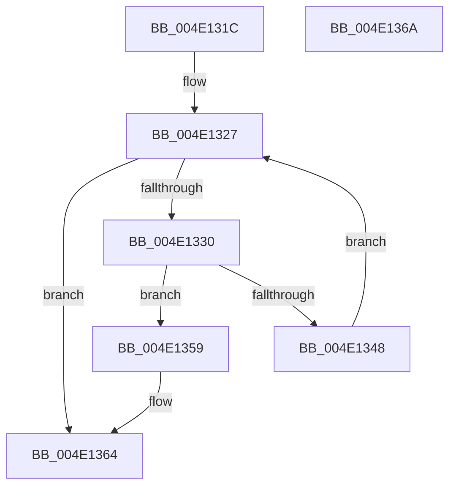

# MiReplenishTransitionPageHeatList

- RVA: `0x004E131C`–`0x004E136B` (길이 `79` bytes)
- VA: `0x00000001404E131C`
- 실행 섹션: `.text`
- PDB 이름 있음: `예`; PDB Function 태그: `아니요`
- unwind 정보 RVA: `0x0005CF00`
- 디코드: `21`개 명령, `79/79` bytes 표시
- 미해석 바이트: `0` (있으면 어셈블리에 `.byte`로 보존)

> 이 문서는 커널 이미지의 기계어와 PDB 기호를 분석해 생성했습니다. 4번과 5번은 함수 원형과 자료형을 바이너리 사용 방식에서 추정한 C 해석이며 원본 소스 복구 결과는 아닙니다.

## 1. Dependencies

- 직접 호출 지점: **2**; 고유 호출 대상: **2**
- 직접 호출자로 확인된 함수: **3**
- RIP 상대 이미지 참조: **2**

### Outgoing calls
- `0x004E133E` → [MiAllocatePool](../35/MiAllocatePool_function_0035B540.md) (function, `0x0035B540`)
- `0x004E1352` → [ExpInterlockedPushEntrySList](../6B/ExpInterlockedPushEntrySList_function_006BA5B0.md) (function, `0x006BA5B0`)

### Direct callers
- [sub_0027F528](../27/Unknown_function_0027F528.md) at `0x0027F532`
- [MmCopyToCachedPage](../34/MmCopyToCachedPage_function_00347B44.md) at `0x00348001`
- [sub_006DF29A](../6D/Unknown_function_006DF29A.md) at `0x006DF2E2`

### Static image references
- `0x004E1327` → RVA `0x00E35D40` (`.data`; read)
- `0x004E135E` → RVA `0x00E35D50` (`.data`; read/write)

## 2. Other-region calls and transfers

- 다른 실행 섹션으로 향하는 call: **0**
- 별도 외부 분기/꼬리 이동을 확인하지 못했습니다.

## 3. Assembly (complete function range)

```asm
004E131C  40 53                           push rbx
004E131E  48 83 EC 20                     sub rsp, 0x20
004E1322  BB 40 00 00 00                  mov ebx, 0x40
004E1327  66 39 1D 12 4A 95 00            cmp word ptr [rip + 0x954a12], bx
004E132E  73 34                           jae 0x1404e1364
004E1330  BA 90 00 00 00                  mov edx, 0x90
004E1335  41 B8 4D 6D 48 6C               mov r8d, 0x6c486d4d
004E133B  48 8B CB                        mov rcx, rbx
004E133E  E8 FD A1 E7 FF                  call 0x14035b540
004E1343  48 85 C0                        test rax, rax
004E1346  74 11                           je 0x1404e1359
004E1348  48 8B D0                        mov rdx, rax
004E134B  48 8D 0D EE 49 95 00            lea rcx, [rip + 0x9549ee]
004E1352  E8 59 92 1D 00                  call 0x1406ba5b0
004E1357  EB CE                           jmp 0x1404e1327
004E1359  B8 20 00 00 00                  mov eax, 0x20
004E135E  87 05 EC 49 95 00               xchg dword ptr [rip + 0x9549ec], eax
004E1364  48 83 C4 20                     add rsp, 0x20
004E1368  5B                              pop rbx
004E1369  C3                              ret
004E136A  CC                              int3
```

## 4. C-style interpretation (structured pseudocode)

```c
__int64 __fastcall MiReplenishTransitionPageHeatList(void)
{
    __int64 result;
    __int64 v_rsp;

    v_rsp = (v_rsp) - (32);
loc_004E1327:
    if ((*(unsigned __int16 *)(v_rip + 9783826)) >= 64) goto loc_004E1364;
    result = MiAllocatePool(64, 144, (unsigned int)(0x6C486D4DULL), a4);
    if (result == 0) goto loc_004E1359;
    result = ExpInterlockedPushEntrySList(v_rip + 9783790, result, (unsigned int)(0x6C486D4DULL), a4);
    goto loc_004E1327;
loc_004E1359:
loc_004E1364:
    v_rsp = (v_rsp) + (32);
    return 32;
}
```

## 5. (Beta) C Style

```c
void MiReplenishTransitionPageHeatList(void)
{
    int64_t result;
    int64_t local_rsp;

    local_rsp = (local_rsp) - (32);
loc_004E1327:
    if ((*(uint16_t *)(v_rip + 0x954A12)) >= 64) goto loc_004E1364;
    result = MiAllocatePool(64, 144, (uint32_t)(0x6C486D4DULL), a4);
    if (result == 0) goto loc_004E1359;
    result = ExpInterlockedPushEntrySList(v_rip + 9783790, result, (uint32_t)(0x6C486D4DULL), a4);
    goto loc_004E1327;
loc_004E1359:
loc_004E1364:
    local_rsp = (local_rsp) + (32);
    return 32;
}
```

## 6. Execution-region graph

[열기: 2D/3D 그래프와 함수 탐색 컨트롤 패널](../../../control-panel.html?section=text&rva=0x004E131C&view=graph)

- 2D 그래프는 위에서 아래로 흐르고, 3D 그래프는 빈 공간을 드래그해 회전합니다. Shift+드래그는 이동, 휠은 확대·축소, 함수 노드 선택은 대상 보고서 이동입니다.

### Static fallback


