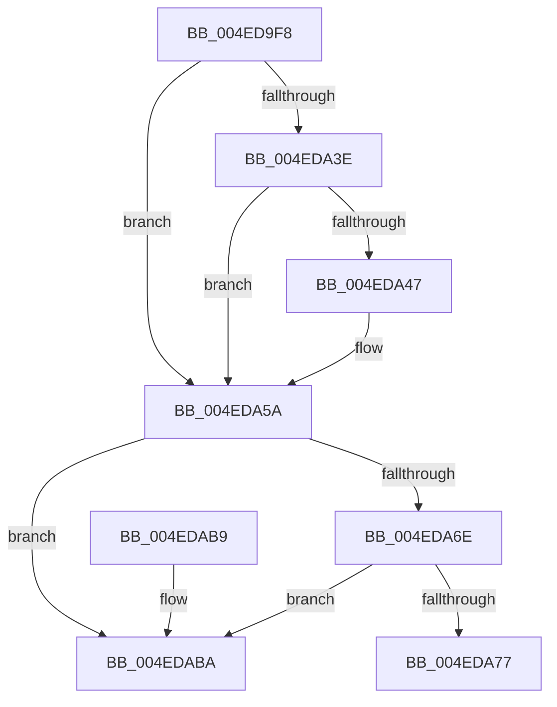

# MiUnlinkUnusedControlArea

- RVA: `0x004ED9F8`–`0x004EDAC1` (길이 `201` bytes)
- VA: `0x00000001404ED9F8`
- 실행 섹션: `.text`
- PDB 이름 있음: `예`; PDB Function 태그: `아니요`
- unwind 정보 RVA: `0x0006B020`
- 디코드: `51`개 명령, `201/201` bytes 표시
- 미해석 바이트: `0` (있으면 어셈블리에 `.byte`로 보존)

> 이 문서는 커널 이미지의 기계어와 PDB 기호를 분석해 생성했습니다. 4번과 5번은 함수 원형과 자료형을 바이너리 사용 방식에서 추정한 C 해석이며 원본 소스 복구 결과는 아닙니다.

## 1. Dependencies

- 직접 호출 지점: **3**; 고유 호출 대상: **3**
- 직접 호출자로 확인된 함수: **5**
- RIP 상대 이미지 참조: **2**

### Outgoing calls
- `0x004EDA30` → [MiComputePagedPoolSegmentBytes](../44/MiComputePagedPoolSegmentBytes_function_0044467C.md) (function, `0x0044467C`)
- `0x004EDA4E` → [KeCancelTimer](../23/KeCancelTimer_function_002327E0.md) (function, `0x002327E0`)
- `0x004EDA60` → [MiAdjustUnusedSegmentWalkers](../67/MiAdjustUnusedSegmentWalkers_function_006779FC.md) (function, `0x006779FC`)

### Direct callers
- [sub_00248F71](../24/Unknown_function_00248F71.md) at `0x00248FC2`
- [MiRemoveUnusedSegment](../2B/MiRemoveUnusedSegment_function_002BBE74.md) at `0x002BBEAE`
- [MiDeleteCachedEntries](../67/MiDeleteCachedEntries_function_00677A28.md) at `0x00677C11`
- [MiMakeUnusedSegmentDeleteOnClose](../67/MiMakeUnusedSegmentDeleteOnClose_function_00678078.md) at `0x0067812B`
- [MiProcessDeleteOnClose](../67/MiProcessDeleteOnClose_function_006783D8.md) at `0x0067848F`

### Static image references
- `0x004EDA19` → RVA `0x00E30088` (`.data`; read)
- `0x004EDA96` → RVA `0x00E2CD18` (`.data`; read/write)

## 2. Other-region calls and transfers

- 다른 실행 섹션으로 향하는 call: **0**
- 별도 외부 분기/꼬리 이동을 확인하지 못했습니다.

## 3. Assembly (complete function range)

```asm
004ED9F8  48 8B C4                        mov rax, rsp
004ED9FB  48 89 58 08                     mov qword ptr [rax + 8], rbx
004ED9FF  48 89 68 10                     mov qword ptr [rax + 0x10], rbp
004EDA03  48 89 70 18                     mov qword ptr [rax + 0x18], rsi
004EDA07  48 89 78 20                     mov qword ptr [rax + 0x20], rdi
004EDA0B  41 56                           push r14
004EDA0D  48 83 EC 20                     sub rsp, 0x20
004EDA11  0F B7 51 3C                     movzx edx, word ptr [rcx + 0x3c]
004EDA15  48 8D 71 08                     lea rsi, [rcx + 8]
004EDA19  48 8B 05 68 26 94 00            mov rax, qword ptr [rip + 0x942668]
004EDA20  81 E2 FF 03 00 00               and edx, 0x3ff
004EDA26  8B 59 38                        mov ebx, dword ptr [rcx + 0x38]
004EDA29  48 8B E9                        mov rbp, rcx
004EDA2C  48 8B 3C D0                     mov rdi, qword ptr [rax + rdx*8]
004EDA30  E8 47 6C F5 FF                  call 0x14044467c
004EDA35  4C 8B F0                        mov r14, rax
004EDA38  0F BA E3 12                     bt ebx, 0x12
004EDA3C  73 1C                           jae 0x1404eda5a
004EDA3E  83 87 C4 06 00 00 FF            add dword ptr [rdi + 0x6c4], -1
004EDA45  75 13                           jne 0x1404eda5a
004EDA47  48 8D 8F E8 07 00 00            lea rcx, [rdi + 0x7e8]
004EDA4E  E8 8D 4D D4 FF                  call 0x1402327e0
004EDA53  C6 87 28 08 00 00 00            mov byte ptr [rdi + 0x828], 0
004EDA5A  48 8B D6                        mov rdx, rsi
004EDA5D  48 8B CF                        mov rcx, rdi
004EDA60  E8 97 9F 18 00                  call 0x1406779fc
004EDA65  48 8B 16                        mov rdx, qword ptr [rsi]
004EDA68  48 39 72 08                     cmp qword ptr [rdx + 8], rsi
004EDA6C  75 4C                           jne 0x1404edaba
004EDA6E  48 8B 46 08                     mov rax, qword ptr [rsi + 8]
004EDA72  48 39 30                        cmp qword ptr [rax], rsi
004EDA75  75 43                           jne 0x1404edaba
004EDA77  48 89 10                        mov qword ptr [rax], rdx
004EDA7A  0F BA F3 1C                     btr ebx, 0x1c
004EDA7E  48 89 42 08                     mov qword ptr [rdx + 8], rax
004EDA82  89 5D 38                        mov dword ptr [rbp + 0x38], ebx
004EDA85  48 89 76 08                     mov qword ptr [rsi + 8], rsi
004EDA89  48 89 36                        mov qword ptr [rsi], rsi
004EDA8C  4C 29 B7 38 08 00 00            sub qword ptr [rdi + 0x838], r14
004EDA93  49 F7 DE                        neg r14
004EDA96  F0 4C 01 35 7A F2 93 00         lock add qword ptr [rip + 0x93f27a], r14
004EDA9E  48 8B 5C 24 30                  mov rbx, qword ptr [rsp + 0x30]
004EDAA3  48 8B 6C 24 38                  mov rbp, qword ptr [rsp + 0x38]
004EDAA8  48 8B 74 24 40                  mov rsi, qword ptr [rsp + 0x40]
004EDAAD  48 8B 7C 24 48                  mov rdi, qword ptr [rsp + 0x48]
004EDAB2  48 83 C4 20                     add rsp, 0x20
004EDAB6  41 5E                           pop r14
004EDAB8  C3                              ret
004EDAB9  CC                              int3
004EDABA  B9 03 00 00 00                  mov ecx, 3
004EDABF  CD 29                           int 0x29
```

## 4. C-style interpretation (structured pseudocode)

```c
__int64 __fastcall MiUnlinkUnusedControlArea(__int64 a1)
{
    __int64 result;
    __int64 v_r14;
    __int64 v_rsp;
    unsigned __int64 v_stack_p10;
    unsigned __int64 v_stack_p18;
    unsigned __int64 v_stack_p20;
    unsigned __int64 v_stack_p8;

    *(unsigned __int64 *)(v_rsp + 8) = v_rbx;
    *(unsigned __int64 *)(v_rsp + 16) = v_rbp;
    *(unsigned __int64 *)(v_rsp + 24) = v_rsi;
    *(unsigned __int64 *)(v_rsp + 32) = v_rdi;
    v_rsp = (v_rsp) - (32);
    a2 = (unsigned int)((*(unsigned __int16 *)(a1 + 60)) & (0x3FFULL));
    result = MiComputePagedPoolSegmentBytes(a1, a2, a3, a4);
    if (condition_is_above_or_equal) goto loc_004EDA5A;
    if (!(condition_is_not_equal)) {
        a1 = *(unsigned __int64 *)(*(unsigned __int64 *)(v_rip + 9709160) + a2 * 8) + 2024;
        result = KeCancelTimer(a1, a2, a3, a4);
        *(unsigned __int8 *)(*(unsigned __int64 *)(*(unsigned __int64 *)(v_rip + 9709160) + a2 * 8) + 2088) = 0;
    }
    result = MiAdjustUnusedSegmentWalkers(*(unsigned __int64 *)(*(unsigned __int64 *)(v_rip + 9709160) + a2 * 8), a1 + 8, a3, a4);
    if ((*(unsigned __int64 *)(*(unsigned __int64 *)(a1 + 8) + 8)) != (a1 + 8)) goto loc_004EDABA;
    if ((*(unsigned __int64 *)(*(unsigned __int64 *)(a1 + 8 + 8))) != (a1 + 8)) goto loc_004EDABA;
    *(unsigned __int64 *)(*(unsigned __int64 *)(a1 + 8 + 8)) = *(unsigned __int64 *)(a1 + 8);
    *(unsigned __int64 *)(*(unsigned __int64 *)(a1 + 8) + 8) = *(unsigned __int64 *)(a1 + 8 + 8);
    *(unsigned int *)(a1 + 56) = (unsigned int)((unsigned int)(*(unsigned int *)(a1 + 56)));
    *(unsigned __int64 *)(a1 + 8 + 8) = a1 + 8;
    *(unsigned __int64 *)(a1 + 8) = a1 + 8;
    v_r14 = -(result);
    v_rsp = (v_rsp) + (32);
    return *(unsigned __int64 *)(a1 + 8 + 8);
loc_004EDABA:
    return *(unsigned __int64 *)(a1 + 8 + 8);
}
```

## 5. (Beta) C Style

```c
int64_t MiUnlinkUnusedControlArea(void *Arg1)
{
    uint8_t *arg1 = (uint8_t *)Arg1;

    int64_t result;
    int64_t local_r14;
    int64_t local_rsp;
    uint64_t v_stack_p10;
    uint64_t v_stack_p18;
    uint64_t v_stack_p20;
    uint64_t v_stack_p8;

    *(uint64_t *)(local_rsp + 0x8) = local_rbx;
    *(uint64_t *)(local_rsp + 0x10) = local_rbp;
    *(uint64_t *)(local_rsp + 0x18) = local_rsi;
    *(uint64_t *)(local_rsp + 0x20) = local_rdi;
    local_rsp = (local_rsp) - (32);
    a2 = (uint32_t)((*(uint16_t *)(arg1 + 0x3C)) & (0x3FFULL));
    result = MiComputePagedPoolSegmentBytes(Arg1, a2, a3, a4);
    if (condition_is_above_or_equal) goto loc_004EDA5A;
    if (!(condition_is_not_equal)) {
        Arg1 = *(uint64_t *)(*(uint64_t *)(v_rip + 0x942668) + a2 * 8) + 2024;
        result = KeCancelTimer(Arg1, a2, a3, a4);
        *(uint8_t *)(*(uint64_t *)(*(uint64_t *)(v_rip + 0x942668) + a2 * 8) + 0x828) = 0;
    }
    result = MiAdjustUnusedSegmentWalkers(*(uint64_t *)(*(uint64_t *)(v_rip + 0x942668) + a2 * 8), Arg1 + 8, a3, a4);
    if ((*(uint64_t *)(*(uint64_t *)(arg1 + 0x8) + 0x8)) != (Arg1 + 8)) goto loc_004EDABA;
    if ((*(uint64_t *)(*(uint64_t *)(arg1 + 0x8 + 0x8))) != (Arg1 + 8)) goto loc_004EDABA;
    *(uint64_t *)(*(uint64_t *)(arg1 + 0x8 + 0x8)) = *(uint64_t *)(arg1 + 0x8);
    *(uint64_t *)(*(uint64_t *)(arg1 + 0x8) + 0x8) = *(uint64_t *)(arg1 + 0x8 + 0x8);
    *(uint32_t *)(arg1 + 0x38) = (uint32_t)((uint32_t)(*(uint32_t *)(arg1 + 0x38)));
    *(void **)(arg1 + 0x8 + 0x8) = Arg1 + 8;
    *(void **)(arg1 + 0x8) = Arg1 + 8;
    local_r14 = -(result);
    local_rsp = (local_rsp) + (32);
    return *(uint64_t *)(arg1 + 0x8 + 0x8);
loc_004EDABA:
    return *(uint64_t *)(arg1 + 0x8 + 0x8);
}
```

### 관측된 메모리 오프셋

구조체 형식이 확인되지 않은 접근은 인자 기준의 오프셋으로만 기록했습니다.

| 기준 인자 | 오프셋 표현 | 폭 (bit) | 접근 |
|---|---:|---:|---|
| `Arg1` | `+ 0x0` | `64` | `R` |
| `Arg1` | `+ 0x0` | `64` | `W` |
| `Arg1` | `+ 0x8` | `64` | `R` |
| `Arg1` | `+ 0x8` | `64` | `W` |
| `Arg1` | `+ 0x38` | `32` | `R` |
| `Arg1` | `+ 0x38` | `32` | `W` |
| `Arg1` | `+ 0x3C` | `16` | `R` |

## 6. Execution-region graph

[열기: 2D/3D 그래프와 함수 탐색 컨트롤 패널](../../../control-panel.html?section=text&rva=0x004ED9F8&view=graph)

- 2D 그래프는 위에서 아래로 흐르고, 3D 그래프는 빈 공간을 드래그해 회전합니다. Shift+드래그는 이동, 휠은 확대·축소, 함수 노드 선택은 대상 보고서 이동입니다.

### Static fallback


