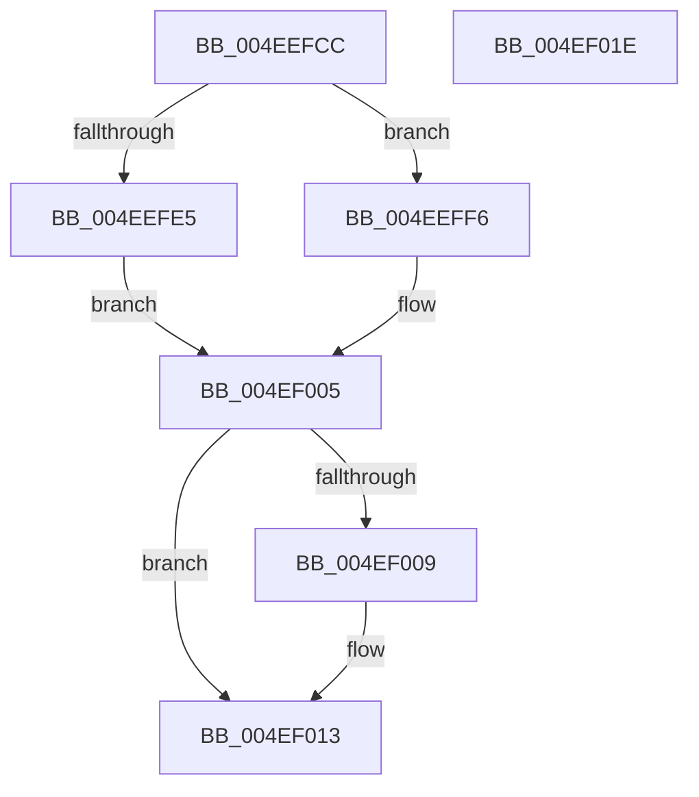

# MiUnlockAndDereferenceNestedVad

- RVA: `0x004EEFCC`–`0x004EF01F` (길이 `83` bytes)
- VA: `0x00000001404EEFCC`
- 실행 섹션: `.text`
- PDB 이름 있음: `예`; PDB Function 태그: `아니요`
- unwind 정보 RVA: `0x0005CAAC`
- 디코드: `27`개 명령, `83/83` bytes 표시
- 미해석 바이트: `0` (있으면 어셈블리에 `.byte`로 보존)

> 이 문서는 커널 이미지의 기계어와 PDB 기호를 분석해 생성했습니다. 4번과 5번은 함수 원형과 자료형을 바이너리 사용 방식에서 추정한 C 해석이며 원본 소스 복구 결과는 아닙니다.

## 1. Dependencies

- 직접 호출 지점: **6**; 고유 호출 대상: **4**
- 직접 호출자로 확인된 함수: **2**
- RIP 상대 이미지 참조: **0**

### Outgoing calls
- `0x004EEFD9` → [Feature_2429262139__private_IsEnabledNoReportingNoInline](../66/Feature_2429262139__private_IsEnabledNoReportingNoInline_function_0066E0A8.md) (function, `0x0066E0A8`)
- `0x004EEFE5` → [MiUnlockNestedVad](../../page/A2/MiUnlockNestedVad_function_00A26BC4.md) (function, `0x00A26BC4`)
- `0x004EEFED` → [MiDereferenceVad](../29/MiDereferenceVad_function_00295EE0.md) (function, `0x00295EE0`)
- `0x004EEFF6` → [MiDereferenceVad](../29/MiDereferenceVad_function_00295EE0.md) (function, `0x00295EE0`)
- `0x004EF000` → [MiUnlockNestedVad](../../page/A2/MiUnlockNestedVad_function_00A26BC4.md) (function, `0x00A26BC4`)
- `0x004EF00E` → [ExFreePoolWithTag](../../poolcode/B8/ExFreePoolWithTag_function_00B82870.md) (function, `0x00B82870`)

### Direct callers
- [MiReserveUserMemory](../../page/88/MiReserveUserMemory_function_00884498.md) at `0x00884C1A`
- [sub_00885634](../../page/88/Unknown_function_00885634.md) at `0x0088578A`

### Static image references
- 디코드된 RIP-relative 메모리 참조가 없습니다.

## 2. Other-region calls and transfers

- 다른 실행 섹션으로 향하는 call: **3**
  - `0x004EEFE5` → [MiUnlockNestedVad](../../page/A2/MiUnlockNestedVad_function_00A26BC4.md) (`.text` → `PAGE`)
  - `0x004EF000` → [MiUnlockNestedVad](../../page/A2/MiUnlockNestedVad_function_00A26BC4.md) (`.text` → `PAGE`)
  - `0x004EF00E` → [ExFreePoolWithTag](../../poolcode/B8/ExFreePoolWithTag_function_00B82870.md) (`.text` → `POOLCODE`)
- 별도 외부 분기/꼬리 이동을 확인하지 못했습니다.

## 3. Assembly (complete function range)

```asm
004EEFCC  48 89 5C 24 08                  mov qword ptr [rsp + 8], rbx
004EEFD1  57                              push rdi
004EEFD2  48 83 EC 20                     sub rsp, 0x20
004EEFD6  48 8B D9                        mov rbx, rcx
004EEFD9  E8 CA F0 17 00                  call 0x14066e0a8
004EEFDE  48 8B CB                        mov rcx, rbx
004EEFE1  85 C0                           test eax, eax
004EEFE3  74 11                           je 0x1404eeff6
004EEFE5  E8 DA 7B 53 00                  call 0x140a26bc4
004EEFEA  48 8B CB                        mov rcx, rbx
004EEFED  E8 EE 6E DA FF                  call 0x140295ee0
004EEFF2  8B F8                           mov edi, eax
004EEFF4  EB 0F                           jmp 0x1404ef005
004EEFF6  E8 E5 6E DA FF                  call 0x140295ee0
004EEFFB  48 8B CB                        mov rcx, rbx
004EEFFE  8B F8                           mov edi, eax
004EF000  E8 BF 7B 53 00                  call 0x140a26bc4
004EF005  85 FF                           test edi, edi
004EF007  74 0A                           je 0x1404ef013
004EF009  33 D2                           xor edx, edx
004EF00B  48 8B CB                        mov rcx, rbx
004EF00E  E8 5D 38 69 00                  call 0x140b82870
004EF013  48 8B 5C 24 30                  mov rbx, qword ptr [rsp + 0x30]
004EF018  48 83 C4 20                     add rsp, 0x20
004EF01C  5F                              pop rdi
004EF01D  C3                              ret
004EF01E  CC                              int3
```

## 4. C-style interpretation (structured pseudocode)

```c
__int64 __fastcall MiUnlockAndDereferenceNestedVad(__int64 a1, int a2)
{
    __int64 result;
    __int64 v_rsp;
    unsigned __int64 v_stack_p8;

    v_stack_p8 = v_rbx;
    v_rsp = (v_rsp) - (32);
    result = Feature_2429262139__private_IsEnabledNoReportingNoInline(a1, a2, a3, a4);
    if ((unsigned int)(result) == 0) goto loc_004EEFF6;
    result = MiUnlockNestedVad(a1, a2, a3, a4);
    result = MiDereferenceVad(a1, a2, a3, a4);
    goto loc_004EF005;
loc_004EEFF6:
    result = MiDereferenceVad(a1, a2, a3, a4);
    result = MiUnlockNestedVad(a1, a2, a3, a4);
loc_004EF005:
    if ((unsigned int)((unsigned int)((unsigned int)(result))) != 0) {
        a2 = 0;
        a1 = a1;
        result = ExFreePoolWithTag(a1, a2, a3, a4);
    }
    v_rsp = (v_rsp) + (32);
    return result;
}
```

## 5. (Beta) C Style

```c
int64_t MiUnlockAndDereferenceNestedVad(int64_t Arg1, int32_t Arg2)
{
    int64_t result;
    int64_t local_rsp;
    uint64_t v_stack_p8;

    v_stack_p8 = local_rbx;
    local_rsp = (local_rsp) - (32);
    result = Feature_2429262139__private_IsEnabledNoReportingNoInline(Arg1, Arg2, a3, a4);
    if ((uint32_t)(result) == 0) goto loc_004EEFF6;
    result = MiUnlockNestedVad(Arg1, Arg2, a3, a4);
    result = MiDereferenceVad(Arg1, Arg2, a3, a4);
    goto loc_004EF005;
loc_004EEFF6:
    result = MiDereferenceVad(Arg1, Arg2, a3, a4);
    result = MiUnlockNestedVad(Arg1, Arg2, a3, a4);
loc_004EF005:
    if ((uint32_t)((uint32_t)((uint32_t)(result))) != 0) {
        Arg2 = 0;
        Arg1 = Arg1;
        result = ExFreePoolWithTag(Arg1, Arg2, a3, a4);
    }
    local_rsp = (local_rsp) + (32);
    return result;
}
```

## 6. Execution-region graph

[열기: 2D/3D 그래프와 함수 탐색 컨트롤 패널](../../../control-panel.html?section=text&rva=0x004EEFCC&view=graph)

- 2D 그래프는 위에서 아래로 흐르고, 3D 그래프는 빈 공간을 드래그해 회전합니다. Shift+드래그는 이동, 휠은 확대·축소, 함수 노드 선택은 대상 보고서 이동입니다.

### Static fallback


