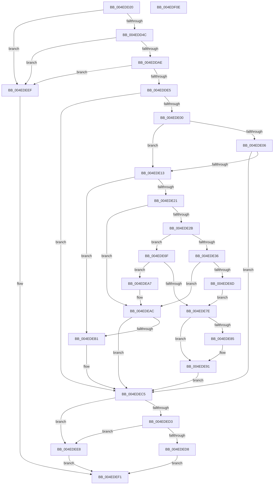

# MiUpdateOldPte

- RVA: `0x004EDD20`–`0x004EDF0F` (길이 `495` bytes)
- VA: `0x00000001404EDD20`
- 실행 섹션: `.text`
- PDB 이름 있음: `예`; PDB Function 태그: `아니요`
- unwind 정보 RVA: `0x0008C20C`
- 디코드: `130`개 명령, `495/495` bytes 표시
- 미해석 바이트: `0` (있으면 어셈블리에 `.byte`로 보존)

> 이 문서는 커널 이미지의 기계어와 PDB 기호를 분석해 생성했습니다. 4번과 5번은 함수 원형과 자료형을 바이너리 사용 방식에서 추정한 C 해석이며 원본 소스 복구 결과는 아닙니다.

## 1. Dependencies

- 직접 호출 지점: **6**; 고유 호출 대상: **6**
- 직접 호출자로 확인된 함수: **0**
- RIP 상대 이미지 참조: **0**

### Outgoing calls
- `0x004EDD56` → [MI_READ_PTE_LOCK_FREE](../28/MI_READ_PTE_LOCK_FREE_function_002828A0.md) (function, `0x002828A0`)
- `0x004EDDA1` → [MiWalkVaCheckCommon](../22/MiWalkVaCheckCommon_function_0022A960.md) (function, `0x0022A960`)
- `0x004EDDD4` → [MiGetVaAge](../24/MiGetVaAge_function_00240AC0.md) (function, `0x00240AC0`)
- `0x004EDE64` → [MiGetPagePrivilege](../28/MiGetPagePrivilege_function_00285420.md) (function, `0x00285420`)
- `0x004EDE8C` → [MiAcquirePrcbAgeTrimLists](../29/MiAcquirePrcbAgeTrimLists_function_002918B0.md) (function, `0x002918B0`)
- `0x004EDEBD` → [MiUpdateOldPteWorker](../49/MiUpdateOldPteWorker_function_0049CFD4.md) (function, `0x0049CFD4`)

### Direct callers
- 이 함수 시작 RVA로 연결되는 직접 call은 확인되지 않았습니다. 간접 호출은 완전히 역산할 수 없습니다.

### Static image references
- 디코드된 RIP-relative 메모리 참조가 없습니다.

## 2. Other-region calls and transfers

- 다른 실행 섹션으로 향하는 call: **0**
- 별도 외부 분기/꼬리 이동을 확인하지 못했습니다.

## 3. Assembly (complete function range)

```asm
004EDD20  48 89 5C 24 08                  mov qword ptr [rsp + 8], rbx
004EDD25  48 89 6C 24 10                  mov qword ptr [rsp + 0x10], rbp
004EDD2A  48 89 74 24 18                  mov qword ptr [rsp + 0x18], rsi
004EDD2F  57                              push rdi
004EDD30  41 54                           push r12
004EDD32  41 55                           push r13
004EDD34  41 56                           push r14
004EDD36  41 57                           push r15
004EDD38  48 83 EC 30                     sub rsp, 0x30
004EDD3C  4C 8B F2                        mov r14, rdx
004EDD3F  48 8B F9                        mov rdi, rcx
004EDD42  41 83 F8 01                     cmp r8d, 1
004EDD46  0F 8D A3 01 00 00               jge 0x1404edeef
004EDD4C  4C 8B 79 20                     mov r15, qword ptr [rcx + 0x20]
004EDD50  45 33 E4                        xor r12d, r12d
004EDD53  48 8B CA                        mov rcx, rdx
004EDD56  E8 45 4B D9 FF                  call 0x1402828a0
004EDD5B  48 89 44 24 78                  mov qword ptr [rsp + 0x78], rax
004EDD60  48 B9 FF FF FF FF FF 00 00 00   movabs rcx, 0xffffffffff
004EDD6A  48 C1 E8 0C                     shr rax, 0xc
004EDD6E  48 23 C1                        and rax, rcx
004EDD71  49 BD 00 00 00 00 00 DE FF FF   movabs r13, 0xffffde0000000000
004EDD7B  48 8D 2C 40                     lea rbp, [rax + rax*2]
004EDD7F  48 C1 E5 04                     shl rbp, 4
004EDD83  49 8B C5                        mov rax, r13
004EDD86  48 03 E8                        add rbp, rax
004EDD89  45 8D 4C 24 01                  lea r9d, [r12 + 1]
004EDD8E  48 8D 44 24 78                  lea rax, [rsp + 0x78]
004EDD93  4C 8B C5                        mov r8, rbp
004EDD96  49 8B D6                        mov rdx, r14
004EDD99  48 89 44 24 20                  mov qword ptr [rsp + 0x20], rax
004EDD9E  49 8B CF                        mov rcx, r15
004EDDA1  E8 BA CB D3 FF                  call 0x14022a960
004EDDA6  85 C0                           test eax, eax
004EDDA8  0F 84 41 01 00 00               je 0x1404edeef
004EDDAE  48 8B BF B8 00 00 00            mov rdi, qword ptr [rdi + 0xb8]
004EDDB5  49 8B F6                        mov rsi, r14
004EDDB8  48 C1 E6 19                     shl rsi, 0x19
004EDDBC  48 B8 00 00 00 00 80 F6 FF FF   movabs rax, 0xfffff68000000000
004EDDC6  48 C1 E0 19                     shl rax, 0x19
004EDDCA  48 2B F0                        sub rsi, rax
004EDDCD  48 C1 FE 10                     sar rsi, 0x10
004EDDD1  48 8B D6                        mov rdx, rsi
004EDDD4  E8 E7 2C D5 FF                  call 0x140240ac0
004EDDD9  0F B6 C0                        movzx eax, al
004EDDDC  3B 47 08                        cmp eax, dword ptr [rdi + 8]
004EDDDF  0F 82 0A 01 00 00               jb 0x1404edeef
004EDDE5  48 8B 45 18                     mov rax, qword ptr [rbp + 0x18]
004EDDE9  48 B9 FF FF FF FF FF FF FF 3F   movabs rcx, 0x3fffffffffffffff
004EDDF3  48 23 C1                        and rax, rcx
004EDDF6  48 83 F8 01                     cmp rax, 1
004EDDFA  0F 85 C5 00 00 00               jne 0x1404edec5
004EDE00  8B 07                           mov eax, dword ptr [rdi]
004EDE02  A8 01                           test al, 1
004EDE04  74 0D                           je 0x1404ede13
004EDE06  48 8B 45 28                     mov rax, qword ptr [rbp + 0x28]
004EDE0A  48 85 C0                        test rax, rax
004EDE0D  0F 88 B2 00 00 00               js 0x1404edec5
004EDE13  48 8B 5C 24 78                  mov rbx, qword ptr [rsp + 0x78]
004EDE18  F6 C3 20                        test bl, 0x20
004EDE1B  0F 84 90 00 00 00               je 0x1404edeb1
004EDE21  4C 39 67 40                     cmp qword ptr [rdi + 0x40], r12
004EDE25  0F 84 81 00 00 00               je 0x1404edeac
004EDE2B  41 8B 87 B8 00 00 00            mov eax, dword ptr [r15 + 0xb8]
004EDE32  A8 0F                           test al, 0xf
004EDE34  74 39                           je 0x1404ede6f
004EDE36  48 8B 5C 24 78                  mov rbx, qword ptr [rsp + 0x78]
004EDE3B  48 B9 FF FF FF FF FF 00 00 00   movabs rcx, 0xffffffffff
004EDE45  48 8B C3                        mov rax, rbx
004EDE48  48 C1 E8 0C                     shr rax, 0xc
004EDE4C  48 23 C1                        and rax, rcx
004EDE4F  48 8D 0C 40                     lea rcx, [rax + rax*2]
004EDE53  48 C1 E1 04                     shl rcx, 4
004EDE57  49 8B C5                        mov rax, r13
004EDE5A  45 33 C0                        xor r8d, r8d
004EDE5D  48 03 C8                        add rcx, rax
004EDE60  41 8D 50 02                     lea edx, [r8 + 2]
004EDE64  E8 B7 75 D9 FF                  call 0x140285420
004EDE69  A8 41                           test al, 0x41
004EDE6B  74 3F                           je 0x1404edeac
004EDE6D  EB 0F                           jmp 0x1404ede7e
004EDE6F  48 B8 FF FF FE FF FF 7F 00 00   movabs rax, 0x7ffffffeffff
004EDE79  48 3B F0                        cmp rsi, rax
004EDE7C  77 29                           ja 0x1404edea7
004EDE7E  48 83 7F 40 01                  cmp qword ptr [rdi + 0x40], 1
004EDE83  75 0C                           jne 0x1404ede91
004EDE85  48 8D 57 30                     lea rdx, [rdi + 0x30]
004EDE89  49 8B CF                        mov rcx, r15
004EDE8C  E8 1F 3A DA FF                  call 0x1402918b0
004EDE91  48 8B 4F 40                     mov rcx, qword ptr [rdi + 0x40]
004EDE95  48 81 E6 00 F0 FF FF            and rsi, 0xfffffffffffff000
004EDE9C  8B 01                           mov eax, dword ptr [rcx]
004EDE9E  48 89 74 C1 08                  mov qword ptr [rcx + rax*8 + 8], rsi
004EDEA3  FF 01                           inc dword ptr [rcx]
004EDEA5  EB 1E                           jmp 0x1404edec5
004EDEA7  48 8B 5C 24 78                  mov rbx, qword ptr [rsp + 0x78]
004EDEAC  F6 C3 20                        test bl, 0x20
004EDEAF  75 14                           jne 0x1404edec5
004EDEB1  4C 8B CF                        mov r9, rdi
004EDEB4  4C 8B C5                        mov r8, rbp
004EDEB7  49 8B D6                        mov rdx, r14
004EDEBA  49 8B CF                        mov rcx, r15
004EDEBD  E8 12 F1 FA FF                  call 0x14049cfd4
004EDEC2  44 8B E0                        mov r12d, eax
004EDEC5  48 FF 47 18                     inc qword ptr [rdi + 0x18]
004EDEC9  48 8B 4F 18                     mov rcx, qword ptr [rdi + 0x18]
004EDECD  48 3B 4F 10                     cmp rcx, qword ptr [rdi + 0x10]
004EDED1  73 15                           jae 0x1404edee8
004EDED3  45 85 E4                        test r12d, r12d
004EDED6  75 10                           jne 0x1404edee8
004EDED8  48 8B 47 20                     mov rax, qword ptr [rdi + 0x20]
004EDEDC  48 F7 D8                        neg rax
004EDEDF  1B C0                           sbb eax, eax
004EDEE1  F7 D0                           not eax
004EDEE3  83 E0 04                        and eax, 4
004EDEE6  EB 09                           jmp 0x1404edef1
004EDEE8  B8 04 00 00 00                  mov eax, 4
004EDEED  EB 02                           jmp 0x1404edef1
004EDEEF  33 C0                           xor eax, eax
004EDEF1  48 8B 5C 24 60                  mov rbx, qword ptr [rsp + 0x60]
004EDEF6  48 8B 6C 24 68                  mov rbp, qword ptr [rsp + 0x68]
004EDEFB  48 8B 74 24 70                  mov rsi, qword ptr [rsp + 0x70]
004EDF00  48 83 C4 30                     add rsp, 0x30
004EDF04  41 5F                           pop r15
004EDF06  41 5E                           pop r14
004EDF08  41 5D                           pop r13
004EDF0A  41 5C                           pop r12
004EDF0C  5F                              pop rdi
004EDF0D  C3                              ret
004EDF0E  CC                              int3
```

## 4. C-style interpretation (structured pseudocode)

```c
__int64 __fastcall MiUpdateOldPte(__int64 a1, __int64 a2, int a3)
{
    __int64 result;
    __int64 v_r12;
    __int64 v_rbp;
    __int64 v_rsi;
    __int64 v_rsp;
    unsigned __int64 v_stack_m38;
    unsigned __int64 v_stack_p10;
    unsigned __int64 v_stack_p18;
    unsigned __int64 v_stack_p20;
    unsigned __int64 v_stack_p8;

    v_stack_p8 = v_rbx;
    v_stack_p10 = v_rbp;
    v_stack_p18 = v_rsi;
    v_rsp = (v_rsp) - (48);
    if (a3 >= 1) goto loc_004EDEEF;
    v_r12 = 0;
    result = MI_READ_PTE_LOCK_FREE(a2, a2, a3, a4);
    v_stack_p20 = result;
    result = (result) >> (12);
    result = (result) & (a2);
    v_rbp = (result + result * 2) << (4);
    v_rbp = (v_rbp) + (v_r13);
    v_stack_m38 = v_stack_p20;
    result = MiWalkVaCheckCommon(*(unsigned __int64 *)(a1 + 32), a2, v_rbp, v_r12 + 1);
    if ((unsigned int)(result) == 0) goto loc_004EDEEF;
    v_rsi = (a2) << (25);
    result = (result) << (25);
    v_rsi = (v_rsi) - (result);
    v_rsi = (v_rsi) >> (16);
    result = MiGetVaAge(*(unsigned __int64 *)(a1 + 32), v_rsi, v_rbp, v_r12 + 1);
    if (((unsigned int)((unsigned __int8)(result))) < (*(unsigned int *)(*(unsigned __int64 *)(a1 + 184) + 8))) goto loc_004EDEEF;
    result = (*(unsigned __int64 *)(v_rbp + 24)) & (*(unsigned __int64 *)(a1 + 32));
    if (result != 1) goto loc_004EDEC5;
    if ((((unsigned __int8)((unsigned int)(*(unsigned int *)(*(unsigned __int64 *)(a1 + 184))))) & (1)) == 0) goto loc_004EDE13;
    if (sign_flag) goto loc_004EDEC5;
loc_004EDE13:
    if ((((unsigned __int8)(v_stack_p20)) & (32)) == 0) goto loc_004EDEB1;
    if ((*(unsigned __int64 *)(*(unsigned __int64 *)(a1 + 184) + 64)) == 0) goto loc_004EDEAC;
    if ((((unsigned __int8)((unsigned int)(*(unsigned int *)(*(unsigned __int64 *)(a1 + 32) + 184)))) & (15)) == 0) goto loc_004EDE6F;
    result = (v_stack_p20) >> (12);
    result = (result) & (*(unsigned __int64 *)(a1 + 32));
    a1 = (result + result * 2) << (4);
    a3 = 0;
    a1 = (a1) + (v_r13);
    result = MiGetPagePrivilege(a1, a3 + 2, a3, v_r12 + 1);
    if ((((unsigned __int8)(result)) & (65)) == 0) goto loc_004EDEAC;
    goto loc_004EDE7E;
loc_004EDE6F:
    if (v_rsi > result) goto loc_004EDEA7;
loc_004EDE7E:
    if ((*(unsigned __int64 *)(*(unsigned __int64 *)(a1 + 184) + 64)) == 1) {
        a2 = *(unsigned __int64 *)(a1 + 184) + 48;
        a1 = *(unsigned __int64 *)(a1 + 32);
        result = MiAcquirePrcbAgeTrimLists(a1, a2, a3, v_r12 + 1);
    }
    v_rsi = (v_rsi) & (0xFFFFFFFFFFFFF000ULL);
    *(unsigned __int64 *)(*(unsigned __int64 *)(*(unsigned __int64 *)(a1 + 184) + 64) + (unsigned int)(*(unsigned int *)(*(unsigned __int64 *)(*(unsigned __int64 *)(a1 + 184) + 64))) * 8 + 8) = v_rsi;
    goto loc_004EDEC5;
loc_004EDEA7:
loc_004EDEAC:
    result = (unsigned int)(*(unsigned int *)(*(unsigned __int64 *)(*(unsigned __int64 *)(a1 + 184) + 64)));
    if ((((unsigned __int8)(v_stack_p20)) & (32)) == 0) {
        a4 = *(unsigned __int64 *)(a1 + 184);
        a3 = v_rbp;
        a2 = a2;
        a1 = *(unsigned __int64 *)(a1 + 32);
        result = MiUpdateOldPteWorker(a1, a2, a3, a4);
        v_r12 = (unsigned int)(result);
    }
    if ((*(unsigned __int64 *)(*(unsigned __int64 *)(a1 + 184) + 24)) >= (*(unsigned __int64 *)(*(unsigned __int64 *)(a1 + 184) + 16))) goto loc_004EDEE8;
    if ((unsigned int)(v_r12) != 0) goto loc_004EDEE8;
    result = -(*(unsigned __int64 *)(*(unsigned __int64 *)(a1 + 184) + 32));
    result = (unsigned int)(~(result));
    result = (unsigned int)((result) & (4));
    goto loc_004EDEF1;
loc_004EDEE8:
    goto loc_004EDEF1;
loc_004EDEEF:
    result = 0;
loc_004EDEF1:
    v_rsp = (v_rsp) + (48);
    return result;
}
```

## 5. (Beta) C Style

```c
int64_t MiUpdateOldPte(void *Arg1, int64_t Arg2, int32_t Arg3)
{
    uint8_t *arg1 = (uint8_t *)Arg1;

    int64_t result;
    int64_t local_r12;
    int64_t local_rbp;
    int64_t local_rsi;
    int64_t local_rsp;
    uint64_t v_stack_m38;
    uint64_t v_stack_p10;
    uint64_t v_stack_p18;
    uint64_t v_stack_p20;
    uint64_t v_stack_p8;

    v_stack_p8 = local_rbx;
    v_stack_p10 = local_rbp;
    v_stack_p18 = local_rsi;
    local_rsp = (local_rsp) - (48);
    if (Arg3 >= 1) goto loc_004EDEEF;
    local_r12 = 0;
    result = MI_READ_PTE_LOCK_FREE(Arg2, Arg2, Arg3, a4);
    v_stack_p20 = result;
    result = (result) >> (12);
    result = (result) & (Arg2);
    local_rbp = (result + result * 2) << (4);
    local_rbp = (local_rbp) + (local_r13);
    v_stack_m38 = v_stack_p20;
    result = MiWalkVaCheckCommon(*(uint64_t *)(arg1 + 0x20), Arg2, local_rbp, local_r12 + 1);
    if ((uint32_t)(result) == 0) goto loc_004EDEEF;
    local_rsi = (Arg2) << (25);
    result = (result) << (25);
    local_rsi = (local_rsi) - (result);
    local_rsi = (local_rsi) >> (16);
    result = MiGetVaAge(*(uint64_t *)(arg1 + 0x20), local_rsi, local_rbp, local_r12 + 1);
    if (((uint32_t)((uint8_t)(result))) < (*(uint32_t *)(*(uint64_t *)(arg1 + 0xB8) + 0x8))) goto loc_004EDEEF;
    result = (*(uint64_t *)(local_rbp + 0x18)) & (*(uint64_t *)(arg1 + 0x20));
    if (result != 1) goto loc_004EDEC5;
    if ((((uint8_t)((uint32_t)(*(uint32_t *)(*(uint64_t *)(arg1 + 0xB8))))) & (1)) == 0) goto loc_004EDE13;
    if (sign_flag) goto loc_004EDEC5;
loc_004EDE13:
    if ((((uint8_t)(v_stack_p20)) & (32)) == 0) goto loc_004EDEB1;
    if ((*(uint64_t *)(*(uint64_t *)(arg1 + 0xB8) + 0x40)) == 0) goto loc_004EDEAC;
    if ((((uint8_t)((uint32_t)(*(uint32_t *)(*(uint64_t *)(arg1 + 0x20) + 0xB8)))) & (15)) == 0) goto loc_004EDE6F;
    result = (v_stack_p20) >> (12);
    result = (result) & (*(uint64_t *)(arg1 + 0x20));
    Arg1 = (result + result * 2) << (4);
    Arg3 = 0;
    Arg1 = (Arg1) + (local_r13);
    result = MiGetPagePrivilege(Arg1, Arg3 + 2, Arg3, local_r12 + 1);
    if ((((uint8_t)(result)) & (65)) == 0) goto loc_004EDEAC;
    goto loc_004EDE7E;
loc_004EDE6F:
    if (local_rsi > result) goto loc_004EDEA7;
loc_004EDE7E:
    if ((*(uint64_t *)(*(uint64_t *)(arg1 + 0xB8) + 0x40)) == 1) {
        Arg2 = *(uint64_t *)(arg1 + 0xB8) + 48;
        Arg1 = *(uint64_t *)(arg1 + 0x20);
        result = MiAcquirePrcbAgeTrimLists(Arg1, Arg2, Arg3, local_r12 + 1);
    }
    local_rsi = (local_rsi) & (0xFFFFFFFFFFFFF000ULL);
    *(uint64_t *)(*(uint64_t *)(*(uint64_t *)(arg1 + 0xB8) + 0x40) + (uint32_t)(*(uint32_t *)(*(uint64_t *)(*(uint64_t *)(arg1 + 0xB8) + 0x40))) * 8 + 0x8) = local_rsi;
    goto loc_004EDEC5;
loc_004EDEA7:
loc_004EDEAC:
    result = (uint32_t)(*(uint32_t *)(*(uint64_t *)(*(uint64_t *)(arg1 + 0xB8) + 0x40)));
    if ((((uint8_t)(v_stack_p20)) & (32)) == 0) {
        a4 = *(uint64_t *)(arg1 + 0xB8);
        Arg3 = local_rbp;
        Arg2 = Arg2;
        Arg1 = *(uint64_t *)(arg1 + 0x20);
        result = MiUpdateOldPteWorker(Arg1, Arg2, Arg3, a4);
        local_r12 = (uint32_t)(result);
    }
    if ((*(uint64_t *)(*(uint64_t *)(arg1 + 0xB8) + 0x18)) >= (*(uint64_t *)(*(uint64_t *)(arg1 + 0xB8) + 0x10))) goto loc_004EDEE8;
    if ((uint32_t)(local_r12) != 0) goto loc_004EDEE8;
    result = -(*(uint64_t *)(*(uint64_t *)(arg1 + 0xB8) + 0x20));
    result = (uint32_t)(~(result));
    result = (uint32_t)((result) & (4));
    goto loc_004EDEF1;
loc_004EDEE8:
    goto loc_004EDEF1;
loc_004EDEEF:
    result = 0;
loc_004EDEF1:
    local_rsp = (local_rsp) + (48);
    return result;
}
```

### 관측된 메모리 오프셋

구조체 형식이 확인되지 않은 접근은 인자 기준의 오프셋으로만 기록했습니다.

| 기준 인자 | 오프셋 표현 | 폭 (bit) | 접근 |
|---|---:|---:|---|
| `Arg1` | `+ 0x20` | `64` | `R` |
| `Arg1` | `+ 0xB8` | `64` | `R` |

## 6. Execution-region graph

[열기: 2D/3D 그래프와 함수 탐색 컨트롤 패널](../../../control-panel.html?section=text&rva=0x004EDD20&view=graph)

- 2D 그래프는 위에서 아래로 흐르고, 3D 그래프는 빈 공간을 드래그해 회전합니다. Shift+드래그는 이동, 휠은 확대·축소, 함수 노드 선택은 대상 보고서 이동입니다.

### Static fallback


