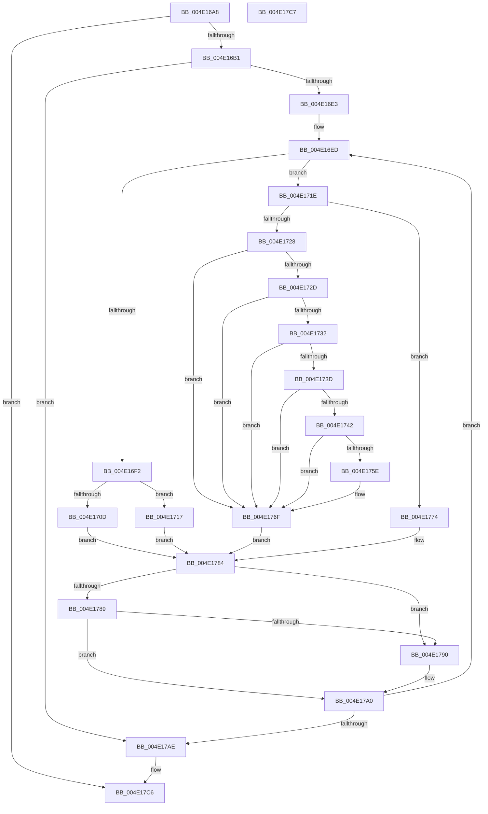

# MiWriteAweClusterPte

- RVA: `0x004E16A8`–`0x004E17C8` (길이 `288` bytes)
- VA: `0x00000001404E16A8`
- 실행 섹션: `.text`
- PDB 이름 있음: `예`; PDB Function 태그: `아니요`
- unwind 정보 RVA: `0x000BDCB4`
- 디코드: `78`개 명령, `288/288` bytes 표시
- 미해석 바이트: `0` (있으면 어셈블리에 `.byte`로 보존)

> 이 문서는 커널 이미지의 기계어와 PDB 기호를 분석해 생성했습니다. 4번과 5번은 함수 원형과 자료형을 바이너리 사용 방식에서 추정한 C 해석이며 원본 소스 복구 결과는 아닙니다.

## 1. Dependencies

- 직접 호출 지점: **4**; 고유 호출 대상: **4**
- 직접 호출자로 확인된 함수: **3**
- RIP 상대 이미지 참조: **1**

### Outgoing calls
- `0x004E1710` → [MiWriteValidPteNewPage](../37/MiWriteValidPteNewPage_function_00376068.md) (function, `0x00376068`)
- `0x004E1717` → [MiWriteValidPteNewProtection](../28/MiWriteValidPteNewProtection_function_00281810.md) (function, `0x00281810`)
- `0x004E176A` → [MiCheckLinearProtectedPteAccessedBit](../29/MiCheckLinearProtectedPteAccessedBit_function_00292D80.md) (function, `0x00292D80`)
- `0x004E177F` → [MiRewritePteWithLockBit](../32/MiRewritePteWithLockBit_function_00322FEC.md) (function, `0x00322FEC`)

### Direct callers
- [MiWriteAwePtes](../4C/MiWriteAwePtes_function_004C51E0.md) at `0x004C58D2`
- [MiApplyLazyStampToAwePtes](../68/MiApplyLazyStampToAwePtes_function_006879C8.md) at `0x00687C37`
- [MiZeroAndFlushAweLazyPtes](../68/MiZeroAndFlushAweLazyPtes_function_00689B1C.md) at `0x00689BFC`

### Static image references
- `0x004E1732` → RVA `0x00FC6A88` (`ALMOSTRO`; read)

## 2. Other-region calls and transfers

- 다른 실행 섹션으로 향하는 call: **0**
- 별도 외부 분기/꼬리 이동을 확인하지 못했습니다.

## 3. Assembly (complete function range)

```asm
004E16A8  45 85 C9                        test r9d, r9d
004E16AB  0F 84 15 01 00 00               je 0x1404e17c6
004E16B1  48 89 5C 24 08                  mov qword ptr [rsp + 8], rbx
004E16B6  48 89 6C 24 10                  mov qword ptr [rsp + 0x10], rbp
004E16BB  48 89 74 24 18                  mov qword ptr [rsp + 0x18], rsi
004E16C0  57                              push rdi
004E16C1  41 56                           push r14
004E16C3  41 57                           push r15
004E16C5  48 83 EC 20                     sub rsp, 0x20
004E16C9  48 8B 6C 24 60                  mov rbp, qword ptr [rsp + 0x60]
004E16CE  41 8B F1                        mov esi, r9d
004E16D1  49 8B D8                        mov rbx, r8
004E16D4  48 8B FA                        mov rdi, rdx
004E16D7  4C 8B F1                        mov r14, rcx
004E16DA  48 85 ED                        test rbp, rbp
004E16DD  0F 84 CB 00 00 00               je 0x1404e17ae
004E16E3  49 BF FF 0F 00 00 00 00 F0 FF   movabs r15, 0xfff0000000000fff
004E16ED  83 FE 01                        cmp esi, 1
004E16F0  75 2C                           jne 0x1404e171e
004E16F2  48 8B 07                        mov rax, qword ptr [rdi]
004E16F5  48 B9 00 F0 FF FF FF FF 0F 00   movabs rcx, 0xffffffffff000
004E16FF  48 33 C3                        xor rax, rbx
004E1702  48 8B D3                        mov rdx, rbx
004E1705  48 85 C1                        test rcx, rax
004E1708  48 8B CF                        mov rcx, rdi
004E170B  74 0A                           je 0x1404e1717
004E170D  44 8B C6                        mov r8d, esi
004E1710  E8 53 49 E9 FF                  call 0x140376068
004E1715  EB 6D                           jmp 0x1404e1784
004E1717  E8 F4 00 DA FF                  call 0x140281810
004E171C  EB 66                           jmp 0x1404e1784
004E171E  8D 46 FE                        lea eax, [rsi - 2]
004E1721  A9 FD FF FF FF                  test eax, 0xfffffffd
004E1726  74 4C                           je 0x1404e1774
004E1728  83 FE 03                        cmp esi, 3
004E172B  74 42                           je 0x1404e176f
004E172D  83 FE 06                        cmp esi, 6
004E1730  74 3D                           je 0x1404e176f
004E1732  48 0F BA 25 4D 53 AE 00 24      bt qword ptr [rip + 0xae534d], 0x24
004E173B  73 32                           jae 0x1404e176f
004E173D  F6 C3 20                        test bl, 0x20
004E1740  75 2D                           jne 0x1404e176f
004E1742  48 B8 00 00 00 00 80 F6 FF FF   movabs rax, 0xfffff68000000000
004E174C  48 B9 00 00 00 00 40 00 00 00   movabs rcx, 0x4000000000
004E1756  48 03 C1                        add rax, rcx
004E1759  48 3B F8                        cmp rdi, rax
004E175C  72 11                           jb 0x1404e176f
004E175E  41 B8 80 00 00 00               mov r8d, 0x80
004E1764  48 8B D3                        mov rdx, rbx
004E1767  48 8B CF                        mov rcx, rdi
004E176A  E8 11 16 DB FF                  call 0x140292d80
004E176F  48 89 1F                        mov qword ptr [rdi], rbx
004E1772  EB 10                           jmp 0x1404e1784
004E1774  4C 8B CB                        mov r9, rbx
004E1777  4C 8B C7                        mov r8, rdi
004E177A  33 D2                           xor edx, edx
004E177C  49 8B CE                        mov rcx, r14
004E177F  E8 68 18 E4 FF                  call 0x140322fec
004E1784  F6 C3 01                        test bl, 1
004E1787  75 07                           jne 0x1404e1790
004E1789  48 0F BA E3 0A                  bt rbx, 0xa
004E178E  73 10                           jae 0x1404e17a0
004E1790  48 8D 8B 00 10 00 00            lea rcx, [rbx + 0x1000]
004E1797  48 33 D9                        xor rbx, rcx
004E179A  49 23 DF                        and rbx, r15
004E179D  48 33 D9                        xor rbx, rcx
004E17A0  48 83 C7 08                     add rdi, 8
004E17A4  48 83 ED 01                     sub rbp, 1
004E17A8  0F 85 3F FF FF FF               jne 0x1404e16ed
004E17AE  48 8B 5C 24 40                  mov rbx, qword ptr [rsp + 0x40]
004E17B3  48 8B 6C 24 48                  mov rbp, qword ptr [rsp + 0x48]
004E17B8  48 8B 74 24 50                  mov rsi, qword ptr [rsp + 0x50]
004E17BD  48 83 C4 20                     add rsp, 0x20
004E17C1  41 5F                           pop r15
004E17C3  41 5E                           pop r14
004E17C5  5F                              pop rdi
004E17C6  C3                              ret
004E17C7  CC                              int3
```

## 4. C-style interpretation (structured pseudocode)

```c
__int64 __fastcall MiWriteAweClusterPte(__int64 a1, __int64 a2, __int64 a3, int a4, __int64 a5)
{
    __int64 result;
    __int64 v_rbp;
    __int64 v_rbx;
    __int64 v_rdi;
    __int64 v_rsp;
    unsigned __int64 v_stack_p10;
    unsigned __int64 v_stack_p18;
    unsigned __int64 v_stack_p8;

    if (a4 == 0) goto loc_004E17C6;
    v_stack_p8 = v_rbx;
    v_stack_p10 = v_rbp;
    v_stack_p18 = v_rsi;
    v_rsp = (v_rsp) - (32);
    if (a5 == 0) goto loc_004E17AE;
loc_004E16ED:
    if (((unsigned int)((unsigned int)(a4))) != 1) goto loc_004E171E;
    result = (*(unsigned __int64 *)(a2)) ^ (a3);
    if (((a1) & (result)) == 0) goto loc_004E1717;
    result = MiWriteValidPteNewPage(a2, a3, (unsigned int)((unsigned int)((unsigned int)(a4))), a4);
    goto loc_004E1784;
loc_004E1717:
    result = MiWriteValidPteNewProtection(a2, a3, (unsigned int)((unsigned int)((unsigned int)(a4))), a4);
    goto loc_004E1784;
loc_004E171E:
    if ((((unsigned int)((unsigned int)(a4) - 2)) & (0xFFFFFFFDULL)) == 0) goto loc_004E1774;
    if (((unsigned int)((unsigned int)(a4))) == 3) goto loc_004E176F;
    if (((unsigned int)((unsigned int)(a4))) == 6) goto loc_004E176F;
    if (((unsigned int)((unsigned int)(a4))) >= 6) goto loc_004E176F;
    if ((((unsigned __int8)(a3)) & (32)) != 0) goto loc_004E176F;
    result = ((unsigned int)(a4) - 2) + (a2);
    if (a2 >= result) {
        a3 = 128;
        a2 = a3;
        a1 = a2;
        result = MiCheckLinearProtectedPteAccessedBit(a1, a2, a3, a4);
    }
    *(unsigned __int64 *)(a2) = a3;
    goto loc_004E1784;
loc_004E1774:
    a2 = 0;
    result = MiRewritePteWithLockBit(a1, a2, a2, a3);
loc_004E1784:
    if ((((unsigned __int8)(a3)) & (1)) != 0) goto loc_004E1790;
    v_rbx = a3;
    if (!(condition_is_above_or_equal)) {
        a1 = a3 + 4096;
        v_rbx = (a3) ^ (a1);
        v_rbx = (v_rbx) & (v_r15);
        v_rbx = (v_rbx) ^ (a1);
    }
    v_rdi = (a2) + (8);
    v_rbp = (a5) - (1);
    if (condition_is_not_equal) goto loc_004E16ED;
loc_004E17AE:
    v_rsp = (v_rsp) + (32);
loc_004E17C6:
    return result;
}
```

## 5. (Beta) C Style

```c
int64_t MiWriteAweClusterPte(int64_t Arg1, int64_t Arg2, int64_t Arg3, int32_t Arg4, int64_t Arg5)
{
    int64_t result;
    int64_t local_rbp;
    int64_t local_rbx;
    int64_t local_rdi;
    int64_t local_rsp;
    uint64_t v_stack_p10;
    uint64_t v_stack_p18;
    uint64_t v_stack_p8;

    if (Arg4 == 0) goto loc_004E17C6;
    v_stack_p8 = local_rbx;
    v_stack_p10 = local_rbp;
    v_stack_p18 = local_rsi;
    local_rsp = (local_rsp) - (32);
    if (Arg5 == 0) goto loc_004E17AE;
loc_004E16ED:
    if (((uint32_t)((uint32_t)(Arg4))) != 1) goto loc_004E171E;
    result = (*(uint64_t *)(Arg2)) ^ (Arg3);
    if (((Arg1) & (result)) == 0) goto loc_004E1717;
    result = MiWriteValidPteNewPage(Arg2, Arg3, (uint32_t)((uint32_t)((uint32_t)(Arg4))), Arg4);
    goto loc_004E1784;
loc_004E1717:
    result = MiWriteValidPteNewProtection(Arg2, Arg3, (uint32_t)((uint32_t)((uint32_t)(Arg4))), Arg4);
    goto loc_004E1784;
loc_004E171E:
    if ((((uint32_t)((uint32_t)(Arg4) - 2)) & (0xFFFFFFFDULL)) == 0) goto loc_004E1774;
    if (((uint32_t)((uint32_t)(Arg4))) == 3) goto loc_004E176F;
    if (((uint32_t)((uint32_t)(Arg4))) == 6) goto loc_004E176F;
    if (((uint32_t)((uint32_t)(Arg4))) >= 6) goto loc_004E176F;
    if ((((uint8_t)(Arg3)) & (32)) != 0) goto loc_004E176F;
    result = ((uint32_t)(Arg4) - 2) + (Arg2);
    if (Arg2 >= result) {
        Arg3 = 128;
        Arg2 = Arg3;
        Arg1 = Arg2;
        result = MiCheckLinearProtectedPteAccessedBit(Arg1, Arg2, Arg3, Arg4);
    }
    *(uint64_t *)(Arg2) = Arg3;
    goto loc_004E1784;
loc_004E1774:
    Arg2 = 0;
    result = MiRewritePteWithLockBit(Arg1, Arg2, Arg2, Arg3);
loc_004E1784:
    if ((((uint8_t)(Arg3)) & (1)) != 0) goto loc_004E1790;
    local_rbx = Arg3;
    if (!(condition_is_above_or_equal)) {
        Arg1 = Arg3 + 4096;
        local_rbx = (Arg3) ^ (Arg1);
        local_rbx = (local_rbx) & (local_r15);
        local_rbx = (local_rbx) ^ (Arg1);
    }
    local_rdi = (Arg2) + (8);
    local_rbp = (Arg5) - (1);
    if (condition_is_not_equal) goto loc_004E16ED;
loc_004E17AE:
    local_rsp = (local_rsp) + (32);
loc_004E17C6:
    return result;
}
```

## 6. Execution-region graph

[열기: 2D/3D 그래프와 함수 탐색 컨트롤 패널](../../../control-panel.html?section=text&rva=0x004E16A8&view=graph)

- 2D 그래프는 위에서 아래로 흐르고, 3D 그래프는 빈 공간을 드래그해 회전합니다. Shift+드래그는 이동, 휠은 확대·축소, 함수 노드 선택은 대상 보고서 이동입니다.

### Static fallback


