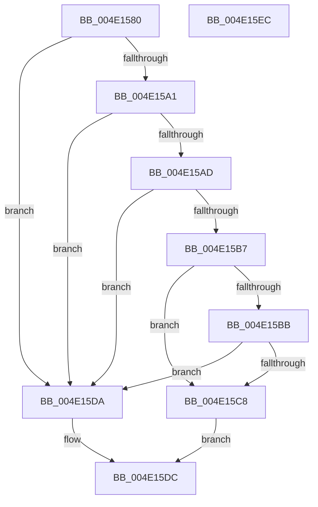

# MmSetPageProtection

- RVA: `0x004E1580`–`0x004E15ED` (길이 `109` bytes)
- VA: `0x00000001404E1580`
- 실행 섹션: `.text`
- PDB 이름 있음: `예`; PDB Function 태그: `아니요`
- unwind 정보 RVA: `0x00060BC4`
- 디코드: `35`개 명령, `109/109` bytes 표시
- 미해석 바이트: `0` (있으면 어셈블리에 `.byte`로 보존)

> 이 문서는 커널 이미지의 기계어와 PDB 기호를 분석해 생성했습니다. 4번과 5번은 함수 원형과 자료형을 바이너리 사용 방식에서 추정한 C 해석이며 원본 소스 복구 결과는 아닙니다.

## 1. Dependencies

- 직접 호출 지점: **3**; 고유 호출 대상: **3**
- 직접 호출자로 확인된 함수: **7**
- RIP 상대 이미지 참조: **1**

### Outgoing calls
- `0x004E1598` → [MI_IS_PHYSICAL_ADDRESS](../23/MI_IS_PHYSICAL_ADDRESS_function_0023B3A0.md) (function, `0x0023B3A0`)
- `0x004E15A3` → [MiMakeProtectionMask](../32/MiMakeProtectionMask_function_00329480.md) (function, `0x00329480`)
- `0x004E15D1` → [MiSetPageProtection](../67/MiSetPageProtection_function_00674BDC.md) (function, `0x00674BDC`)

### Direct callers
- [sub_0051AE30](../51/Unknown_function_0051AE30.md) at `0x0051AF27`
- [KiAllocateProcessorStacks](../5B/KiAllocateProcessorStacks_function_005B6D74.md) at `0x005B6EF8`
- [KiFreeProcessorStacks](../5B/KiFreeProcessorStacks_function_005B7F84.md) at `0x005B8048`
- [HvpProtectBinPartial](../../page/9B/HvpProtectBinPartial_function_009B5D84.md) at `0x009B5DD3`
- [KeWriteProtectProcessorState](../../pagelk/B6/KeWriteProtectProcessorState_function_00B66BB0.md) at `0x00B66BFB`
- [KeWriteProtectProcessorState](../../pagelk/B6/KeWriteProtectProcessorState_function_00B66BB0.md) at `0x00B66C15`
- [KeWriteProtectProcessorState](../../pagelk/B6/KeWriteProtectProcessorState_function_00B66BB0.md) at `0x00B66C2E`
- [sub_00BF16D0](../../init/BF/Unknown_function_00BF16D0.md) at `0x00C15B76`
- [VslpIumPhase0Initialize](../../init/C2/VslpIumPhase0Initialize_function_00C2A0A4.md) at `0x00C2A1F7`

### Static image references
- `0x004E15BB` → RVA `0x00FC6A88` (`ALMOSTRO`; read)

## 2. Other-region calls and transfers

- 다른 실행 섹션으로 향하는 call: **0**
- 별도 외부 분기/꼬리 이동을 확인하지 못했습니다.

## 3. Assembly (complete function range)

```asm
004E1580  48 89 5C 24 08                  mov qword ptr [rsp + 8], rbx
004E1585  48 89 74 24 10                  mov qword ptr [rsp + 0x10], rsi
004E158A  57                              push rdi
004E158B  48 83 EC 20                     sub rsp, 0x20
004E158F  41 8B F8                        mov edi, r8d
004E1592  48 8B F2                        mov rsi, rdx
004E1595  48 8B D9                        mov rbx, rcx
004E1598  E8 03 9E D5 FF                  call 0x14023b3a0
004E159D  85 C0                           test eax, eax
004E159F  75 39                           jne 0x1404e15da
004E15A1  8B CF                           mov ecx, edi
004E15A3  E8 D8 7E E4 FF                  call 0x140329480
004E15A8  83 F8 07                        cmp eax, 7
004E15AB  77 2D                           ja 0x1404e15da
004E15AD  8B D0                           mov edx, eax
004E15AF  83 E2 05                        and edx, 5
004E15B2  80 FA 05                        cmp dl, 5
004E15B5  74 23                           je 0x1404e15da
004E15B7  A8 02                           test al, 2
004E15B9  74 0D                           je 0x1404e15c8
004E15BB  48 F7 05 C2 54 AE 00 00 80 00 00  test qword ptr [rip + 0xae54c2], 0x8000
004E15C6  75 12                           jne 0x1404e15da
004E15C8  44 8B C0                        mov r8d, eax
004E15CB  48 8B D6                        mov rdx, rsi
004E15CE  48 8B CB                        mov rcx, rbx
004E15D1  E8 06 36 19 00                  call 0x140674bdc
004E15D6  B0 01                           mov al, 1
004E15D8  EB 02                           jmp 0x1404e15dc
004E15DA  32 C0                           xor al, al
004E15DC  48 8B 5C 24 30                  mov rbx, qword ptr [rsp + 0x30]
004E15E1  48 8B 74 24 38                  mov rsi, qword ptr [rsp + 0x38]
004E15E6  48 83 C4 20                     add rsp, 0x20
004E15EA  5F                              pop rdi
004E15EB  C3                              ret
004E15EC  CC                              int3
```

## 4. C-style interpretation (structured pseudocode)

```c
__int64 __fastcall MmSetPageProtection(__int64 a1, __int64 a2, int a3)
{
    __int64 result;
    __int64 v_rsp;
    unsigned __int64 v_stack_p10;
    unsigned __int64 v_stack_p8;

    v_stack_p8 = v_rbx;
    v_stack_p10 = v_rsi;
    v_rsp = (v_rsp) - (32);
    result = MI_IS_PHYSICAL_ADDRESS(a1, a2, a3, a4);
    if ((unsigned int)(result) != 0) goto loc_004E15DA;
    result = MiMakeProtectionMask((unsigned int)((unsigned int)((unsigned int)(a3))), a2, a3, a4);
    if (((unsigned int)(result)) > 7) goto loc_004E15DA;
    a2 = (unsigned int)(((unsigned int)((unsigned int)(result))) & (5));
    if (((unsigned __int8)(a2)) == 5) goto loc_004E15DA;
    if ((((unsigned __int8)(result)) & (2)) == 0) goto loc_004E15C8;
    if (((*(unsigned __int64 *)(v_rip + 11424962)) & (0x8000ULL)) != 0) goto loc_004E15DA;
loc_004E15C8:
    result = MiSetPageProtection(a1, a2, (unsigned int)((unsigned int)(result)), a4);
    goto loc_004E15DC;
loc_004E15DA:
    result = 0;
loc_004E15DC:
    v_rsp = (v_rsp) + (32);
    return result;
}
```

## 5. (Beta) C Style

```c
int64_t MmSetPageProtection(int64_t Arg1, int64_t Arg2, int32_t Arg3)
{
    int64_t result;
    int64_t local_rsp;
    uint64_t v_stack_p10;
    uint64_t v_stack_p8;

    v_stack_p8 = local_rbx;
    v_stack_p10 = local_rsi;
    local_rsp = (local_rsp) - (32);
    result = MI_IS_PHYSICAL_ADDRESS(Arg1, Arg2, Arg3, a4);
    if ((uint32_t)(result) != 0) goto loc_004E15DA;
    result = MiMakeProtectionMask((uint32_t)((uint32_t)((uint32_t)(Arg3))), Arg2, Arg3, a4);
    if (((uint32_t)(result)) > 7) goto loc_004E15DA;
    Arg2 = (uint32_t)(((uint32_t)((uint32_t)(result))) & (5));
    if (((uint8_t)(Arg2)) == 5) goto loc_004E15DA;
    if ((((uint8_t)(result)) & (2)) == 0) goto loc_004E15C8;
    if (((*(uint64_t *)(v_rip + 0xAE54C2)) & (0x8000ULL)) != 0) goto loc_004E15DA;
loc_004E15C8:
    result = MiSetPageProtection(Arg1, Arg2, (uint32_t)((uint32_t)(result)), a4);
    goto loc_004E15DC;
loc_004E15DA:
    result = 0;
loc_004E15DC:
    local_rsp = (local_rsp) + (32);
    return result;
}
```

## 6. Execution-region graph

[열기: 2D/3D 그래프와 함수 탐색 컨트롤 패널](../../../control-panel.html?section=text&rva=0x004E1580&view=graph)

- 2D 그래프는 위에서 아래로 흐르고, 3D 그래프는 빈 공간을 드래그해 회전합니다. Shift+드래그는 이동, 휠은 확대·축소, 함수 노드 선택은 대상 보고서 이동입니다.

### Static fallback


