# MmUpdateOldWorkingSetPages

- RVA: `0x004EDF18`–`0x004EE16E` (길이 `598` bytes)
- VA: `0x00000001404EDF18`
- 실행 섹션: `.text`
- PDB 이름 있음: `예`; PDB Function 태그: `아니요`
- unwind 정보 RVA: `0x000CD93C`
- 디코드: `163`개 명령, `598/598` bytes 표시
- 미해석 바이트: `0` (있으면 어셈블리에 `.byte`로 보존)

> 이 문서는 커널 이미지의 기계어와 PDB 기호를 분석해 생성했습니다. 4번과 5번은 함수 원형과 자료형을 바이너리 사용 방식에서 추정한 C 해석이며 원본 소스 복구 결과는 아닙니다.

## 1. Dependencies

- 직접 호출 지점: **9**; 고유 호출 대상: **8**
- 직접 호출자로 확인된 함수: **2**
- RIP 상대 이미지 참조: **4**

### Outgoing calls
- `0x004EDF6F` → [memset](../6C/memset_function_006C6C40.md) (function, `0x006C6C40`)
- `0x004EDF80` → [memset](../6C/memset_function_006C6C40.md) (function, `0x006C6C40`)
- `0x004EDFA8` → [KiStackAttachProcess](../21/KiStackAttachProcess_function_00216820.md) (function, `0x00216820`)
- `0x004EE094` → [MiLockWorkingSetShared](../27/MiLockWorkingSetShared_function_0027CBF0.md) (function, `0x0027CBF0`)
- `0x004EE0EE` → [MiWalkPageTables](../2C/MiWalkPageTables_function_002C2710.md) (function, `0x002C2710`)
- `0x004EE0F9` → [MiUnlockWorkingSetShared](../27/MiUnlockWorkingSetShared_function_0027D690.md) (function, `0x0027D690`)
- `0x004EE126` → [MiLogUpdateOldPagesInWs](../67/MiLogUpdateOldPagesInWs_function_0067EB40.md) (function, `0x0067EB40`)
- `0x004EE136` → [KiUnstackDetachProcess](../21/KiUnstackDetachProcess_function_00217D30.md) (function, `0x00217D30`)
- `0x004EE154` → [_security_check_cookie](../6A/_security_check_cookie_function_006AC640.md) (function, `0x006AC640`)

### Direct callers
- [SmProcessSystemStoreTrimRequest](../../page/A7/SmProcessSystemStoreTrimRequest_function_00A784E0.md) at `0x00A78717`
- [PfpDeprioritizeOldPagesInWs](../../page/AD/PfpDeprioritizeOldPagesInWs_function_00ADF310.md) at `0x00ADF431`

### Static image references
- `0x004EDF34` → RVA `0x00E0A740` (`.data`; read)
- `0x004EE027` → RVA `0x00FC6A88` (`ALMOSTRO`; read)
- `0x004EE06A` → RVA `0x004EDD20` (`MiUpdateOldPte`; read)
- `0x004EE075` → RVA `0x00428C00` (`MiUpdateOldWorkingSetPagesTail`; read)

## 2. Other-region calls and transfers

- 다른 실행 섹션으로 향하는 call: **0**
- 별도 외부 분기/꼬리 이동을 확인하지 못했습니다.

## 3. Assembly (complete function range)

```asm
004EDF18  40 55                           push rbp
004EDF1A  53                              push rbx
004EDF1B  56                              push rsi
004EDF1C  57                              push rdi
004EDF1D  41 54                           push r12
004EDF1F  41 55                           push r13
004EDF21  41 56                           push r14
004EDF23  41 57                           push r15
004EDF25  48 8D AC 24 58 FF FF FF         lea rbp, [rsp - 0xa8]
004EDF2D  48 81 EC A8 01 00 00            sub rsp, 0x1a8
004EDF34  48 8B 05 05 C8 91 00            mov rax, qword ptr [rip + 0x91c805]
004EDF3B  48 33 C4                        xor rax, rsp
004EDF3E  48 89 85 90 00 00 00            mov qword ptr [rbp + 0x90], rax
004EDF45  0F 57 C0                        xorps xmm0, xmm0
004EDF48  89 54 24 40                     mov dword ptr [rsp + 0x40], edx
004EDF4C  33 D2                           xor edx, edx
004EDF4E  41 8B F0                        mov esi, r8d
004EDF51  4C 8B E9                        mov r13, rcx
004EDF54  4D 8B F1                        mov r14, r9
004EDF57  48 8D 4C 24 50                  lea rcx, [rsp + 0x50]
004EDF5C  0F 11 45 60                     movups xmmword ptr [rbp + 0x60], xmm0
004EDF60  44 8D 42 48                     lea r8d, [rdx + 0x48]
004EDF64  0F 11 45 70                     movups xmmword ptr [rbp + 0x70], xmm0
004EDF68  0F 11 85 80 00 00 00            movups xmmword ptr [rbp + 0x80], xmm0
004EDF6F  E8 CC 8C 1D 00                  call 0x1406c6c40
004EDF74  33 D2                           xor edx, edx
004EDF76  48 8D 4D A0                     lea rcx, [rbp - 0x60]
004EDF7A  41 B8 C0 00 00 00               mov r8d, 0xc0
004EDF80  E8 BB 8C 1D 00                  call 0x1406c6c40
004EDF85  65 48 8B 04 25 88 01 00 00      mov rax, qword ptr gs:[0x188]
004EDF8E  BA 01 00 00 00                  mov edx, 1
004EDF93  4C 39 A8 B8 00 00 00            cmp qword ptr [rax + 0xb8], r13
004EDF9A  74 16                           je 0x1404edfb2
004EDF9C  44 8B E2                        mov r12d, edx
004EDF9F  4C 8D 45 60                     lea r8, [rbp + 0x60]
004EDFA3  33 D2                           xor edx, edx
004EDFA5  49 8B CD                        mov rcx, r13
004EDFA8  E8 73 88 D2 FF                  call 0x140216820
004EDFAD  41 8B D4                        mov edx, r12d
004EDFB0  EB 03                           jmp 0x1404edfb5
004EDFB2  45 33 E4                        xor r12d, r12d
004EDFB5  49 83 C8 FF                     or r8, 0xffffffffffffffff
004EDFB9  49 8D 9D 00 04 00 00            lea rbx, [r13 + 0x400]
004EDFC0  33 FF                           xor edi, edi
004EDFC2  4C 89 44 24 70                  mov qword ptr [rsp + 0x70], r8
004EDFC7  45 33 FF                        xor r15d, r15d
004EDFCA  4D 85 F6                        test r14, r14
004EDFCD  74 12                           je 0x1404edfe1
004EDFCF  4D 8B 3E                        mov r15, qword ptr [r14]
004EDFD2  49 8B C0                        mov rax, r8
004EDFD5  4D 85 FF                        test r15, r15
004EDFD8  49 0F 45 C7                     cmovne rax, r15
004EDFDC  48 89 44 24 70                  mov qword ptr [rsp + 0x70], rax
004EDFE1  F6 85 10 01 00 00 02            test byte ptr [rbp + 0x110], 2
004EDFE8  8B 44 24 50                     mov eax, dword ptr [rsp + 0x50]
004EDFEC  74 06                           je 0x1404edff4
004EDFEE  0B C2                           or eax, edx
004EDFF0  89 44 24 50                     mov dword ptr [rsp + 0x50], eax
004EDFF4  84 95 10 01 00 00               test byte ptr [rbp + 0x110], dl
004EDFFA  74 07                           je 0x1404ee003
004EDFFC  83 C8 02                        or eax, 2
004EDFFF  89 44 24 50                     mov dword ptr [rsp + 0x50], eax
004EE003  8B 44 24 40                     mov eax, dword ptr [rsp + 0x40]
004EE007  89 44 24 54                     mov dword ptr [rsp + 0x54], eax
004EE00B  8B 83 B8 00 00 00               mov eax, dword ptr [rbx + 0xb8]
004EE011  89 74 24 58                     mov dword ptr [rsp + 0x58], esi
004EE015  A8 0F                           test al, 0xf
004EE017  75 0E                           jne 0x1404ee027
004EE019  33 C9                           xor ecx, ecx
004EE01B  48 39 8B 70 02 00 00            cmp qword ptr [rbx + 0x270], rcx
004EE022  0F 95 C1                        setne cl
004EE025  EB 19                           jmp 0x1404ee040
004EE027  48 0F BA 25 58 8A AD 00 24      bt qword ptr [rip + 0xad8a58], 0x24
004EE030  73 1C                           jae 0x1404ee04e
004EE032  8B 8B B8 00 00 00               mov ecx, dword ptr [rbx + 0xb8]
004EE038  C1 E9 08                        shr ecx, 8
004EE03B  C1 E9 03                        shr ecx, 3
004EE03E  23 CA                           and ecx, edx
004EE040  48 8B 45 90                     mov rax, qword ptr [rbp - 0x70]
004EE044  85 C9                           test ecx, ecx
004EE046  48 0F 45 C2                     cmovne rax, rdx
004EE04A  48 89 45 90                     mov qword ptr [rbp - 0x70], rax
004EE04E  48 8D 44 24 50                  lea rax, [rsp + 0x50]
004EE053  C7 45 A0 06 00 00 00            mov dword ptr [rbp - 0x60], 6
004EE05A  48 89 45 58                     mov qword ptr [rbp + 0x58], rax
004EE05E  8B CE                           mov ecx, esi
004EE060  83 E1 0F                        and ecx, 0xf
004EE063  48 89 5D C0                     mov qword ptr [rbp - 0x40], rbx
004EE067  C1 E1 0C                        shl ecx, 0xc
004EE06A  48 8D 05 AF FC FF FF            lea rax, [rip - 0x351]
004EE071  48 89 45 48                     mov qword ptr [rbp + 0x48], rax
004EE075  48 8D 05 84 AB F3 FF            lea rax, [rip - 0xc547c]
004EE07C  48 89 45 50                     mov qword ptr [rbp + 0x50], rax
004EE080  8B 45 A4                        mov eax, dword ptr [rbp - 0x5c]
004EE083  25 FF 0F FF FF                  and eax, 0xffff0fff
004EE088  4C 89 45 D0                     mov qword ptr [rbp - 0x30], r8
004EE08C  0B C8                           or ecx, eax
004EE08E  89 4D A4                        mov dword ptr [rbp - 0x5c], ecx
004EE091  48 8B CB                        mov rcx, rbx
004EE094  E8 57 EB D8 FF                  call 0x14027cbf0
004EE099  88 45 A9                        mov byte ptr [rbp - 0x57], al
004EE09C  41 8B 85 F4 01 00 00            mov eax, dword ptr [r13 + 0x1f4]
004EE0A3  A8 20                           test al, 0x20
004EE0A5  74 07                           je 0x1404ee0ae
004EE0A7  BF 0A 01 00 C0                  mov edi, 0xc000010a
004EE0AC  EB 45                           jmp 0x1404ee0f3
004EE0AE  83 FE 08                        cmp esi, 8
004EE0B1  73 2D                           jae 0x1404ee0e0
004EE0B3  48 8D 56 05                     lea rdx, [rsi + 5]
004EE0B7  41 B8 08 00 00 00               mov r8d, 8
004EE0BD  48 8D 14 D3                     lea rdx, [rbx + rdx*8]
004EE0C1  44 2B C6                        sub r8d, esi
004EE0C4  48 8B 02                        mov rax, qword ptr [rdx]
004EE0C7  48 8D 52 08                     lea rdx, [rdx + 8]
004EE0CB  48 8B 4C 24 60                  mov rcx, qword ptr [rsp + 0x60]
004EE0D0  48 03 C8                        add rcx, rax
004EE0D3  48 89 4C 24 60                  mov qword ptr [rsp + 0x60], rcx
004EE0D8  49 83 E8 01                     sub r8, 1
004EE0DC  75 E6                           jne 0x1404ee0c4
004EE0DE  EB 05                           jmp 0x1404ee0e5
004EE0E0  48 8B 4C 24 60                  mov rcx, qword ptr [rsp + 0x60]
004EE0E5  48 85 C9                        test rcx, rcx
004EE0E8  74 09                           je 0x1404ee0f3
004EE0EA  48 8D 4D A0                     lea rcx, [rbp - 0x60]
004EE0EE  E8 1D 46 DD FF                  call 0x1402c2710
004EE0F3  8A 55 A9                        mov dl, byte ptr [rbp - 0x57]
004EE0F6  48 8B CB                        mov rcx, rbx
004EE0F9  E8 92 F5 D8 FF                  call 0x14027d690
004EE0FE  8B 44 24 58                     mov eax, dword ptr [rsp + 0x58]
004EE102  49 8B D7                        mov rdx, r15
004EE105  4C 8B 4C 24 78                  mov r9, qword ptr [rsp + 0x78]
004EE10A  48 8B CB                        mov rcx, rbx
004EE10D  4C 8B 44 24 68                  mov r8, qword ptr [rsp + 0x68]
004EE112  89 44 24 30                     mov dword ptr [rsp + 0x30], eax
004EE116  8B 44 24 50                     mov eax, dword ptr [rsp + 0x50]
004EE11A  89 44 24 28                     mov dword ptr [rsp + 0x28], eax
004EE11E  8B 44 24 54                     mov eax, dword ptr [rsp + 0x54]
004EE122  89 44 24 20                     mov dword ptr [rsp + 0x20], eax
004EE126  E8 15 0A 19 00                  call 0x14067eb40
004EE12B  45 85 E4                        test r12d, r12d
004EE12E  74 0B                           je 0x1404ee13b
004EE130  33 D2                           xor edx, edx
004EE132  48 8D 4D 60                     lea rcx, [rbp + 0x60]
004EE136  E8 F5 9B D2 FF                  call 0x140217d30
004EE13B  4D 85 F6                        test r14, r14
004EE13E  74 08                           je 0x1404ee148
004EE140  48 8B 4C 24 78                  mov rcx, qword ptr [rsp + 0x78]
004EE145  49 89 0E                        mov qword ptr [r14], rcx
004EE148  8B C7                           mov eax, edi
004EE14A  48 8B 8D 90 00 00 00            mov rcx, qword ptr [rbp + 0x90]
004EE151  48 33 CC                        xor rcx, rsp
004EE154  E8 E7 E4 1B 00                  call 0x1406ac640
004EE159  48 81 C4 A8 01 00 00            add rsp, 0x1a8
004EE160  41 5F                           pop r15
004EE162  41 5E                           pop r14
004EE164  41 5D                           pop r13
004EE166  41 5C                           pop r12
004EE168  5F                              pop rdi
004EE169  5E                              pop rsi
004EE16A  5B                              pop rbx
004EE16B  5D                              pop rbp
004EE16C  C3                              ret
004EE16D  CC                              int3
```

## 4. C-style interpretation (structured pseudocode)

```c
__int64 __fastcall MmUpdateOldWorkingSetPages(__int64 a1, int a2, int a3, __int64 a4, unsigned __int8 a5)
{
    __int64 result;
    __int64 v_r12;
    __int64 v_r15;
    __int64 v_rdi;
    __int64 v_rsp;
    unsigned __int64 v_stack_m118;
    unsigned __int64 v_stack_m128;
    unsigned __int8 v_stack_m13F;
    unsigned int v_stack_m144;
    unsigned __int64 v_stack_m148;
    unsigned __int64 v_stack_m158;
    unsigned __int64 v_stack_m170;
    unsigned __int64 v_stack_m178;
    unsigned __int64 v_stack_m180;
    unsigned __int64 v_stack_m188;
    unsigned int v_stack_m190;
    unsigned int v_stack_m194;
    unsigned __int64 v_stack_m198;
    unsigned int v_stack_m1A8;
    unsigned int v_stack_m1B8;
    unsigned int v_stack_m1C0;
    unsigned int v_stack_m1C8;
    unsigned __int64 v_stack_m58;
    unsigned __int64 v_stack_m68;
    unsigned __int64 v_stack_m78;
    unsigned __int64 v_stack_m88;
    unsigned __int64 v_stack_m90;
    unsigned __int64 v_stack_m98;
    unsigned __int64 v_stack_mA0;
    unsigned __int64 v_stack_mE8;
    unsigned __int8 v_stack_p28;

    v_rsp = (v_rsp) - (424);
    result = (*(unsigned __int64 *)(v_rip + 9553925)) ^ (v_rsp);
    v_stack_m58 = result;
    v_stack_m1A8 = a2;
    a2 = 0;
    v_stack_m88 = v_xmm0;
    v_stack_m78 = v_xmm0;
    v_stack_m68 = v_xmm0;
    result = memset(v_stack_m198, a2, a2 + 72, a4);
    a2 = 0;
    result = memset(v_stack_m148, a2, 192, a4);
    if ((*(unsigned __int64 *)(*(unsigned __int64 *)(gs_base + (0 + 392)) + 184)) == a1) goto loc_004EDFB2;
    a2 = 0;
    result = KiStackAttachProcess(a1, a2, v_stack_m88, a4);
    goto loc_004EDFB5;
loc_004EDFB2:
    v_r12 = 0;
loc_004EDFB5:
    a3 = (v_stack_m88) | (-1);
    v_rdi = 0;
    v_stack_m178 = a3;
    v_r15 = 0;
    if (a4 != 0) {
        v_r15 = *(unsigned __int64 *)(a4);
        result = a3;
        if (v_r15 != 0) { result = v_r15; }
        v_stack_m178 = result;
    }
    result = (unsigned int)(v_stack_m198);
    if (((a5) & (2)) != 0) {
        result = (unsigned int)(((unsigned int)(v_stack_m198)) | (1));
        v_stack_m198 = (unsigned int)(result);
    }
    if (((v_stack_p28) & (1)) != 0) {
        result = (unsigned int)((result) | (2));
        v_stack_m198 = (unsigned int)(result);
    }
    v_stack_m194 = (unsigned int)((unsigned int)(v_stack_m1A8));
    v_stack_m190 = (unsigned int)((unsigned int)(a3));
    if ((((unsigned __int8)((unsigned int)(*(unsigned int *)(a1 + 1024 + 184)))) & (15)) != 0) goto loc_004EE027;
    a1 = 0;
    a1 = ((*(unsigned __int64 *)(a1 + 1024 + 624)) != 0) ? 1 : 0;
    goto loc_004EE040;
loc_004EE027:
    if ((*(unsigned __int64 *)(a1 + 1024 + 624)) >= 0) goto loc_004EE04E;
    a1 = (unsigned int)(((unsigned int)(*(unsigned int *)(a1 + 1024 + 184))) >> (8));
    a1 = (unsigned int)((a1) >> (3));
    a1 = (unsigned int)((a1) & (1));
loc_004EE040:
    result = v_stack_m158;
    if ((unsigned int)(a1) != 0) { result = 1; }
    v_stack_m158 = result;
loc_004EE04E:
    v_stack_m148 = 6;
    v_stack_m90 = v_stack_m198;
    a1 = (unsigned int)(((unsigned int)((unsigned int)((unsigned int)(a3)))) & (15));
    v_stack_m128 = a1 + 1024;
    a1 = (unsigned int)((a1) << (12));
    v_stack_mA0 = v_rip - 849;
    v_stack_m98 = v_rip - 808060;
    result = (unsigned int)(((unsigned int)(v_stack_m144)) & (0xFFFF0FFFULL));
    v_stack_m118 = a3;
    a1 = (unsigned int)((a1) | ((unsigned int)(result)));
    v_stack_m144 = (unsigned int)(a1);
    result = MiLockWorkingSetShared(a1 + 1024, 1, a3, a4);
    v_stack_m13F = (unsigned __int8)(result);
    if ((((unsigned __int8)((unsigned int)(*(unsigned int *)(a1 + 500)))) & (32)) == 0) goto loc_004EE0AE;
    goto loc_004EE0F3;
loc_004EE0AE:
    if (((unsigned int)((unsigned int)(a3))) >= 8) goto loc_004EE0E0;
    a3 = (unsigned int)((8) - ((unsigned int)((unsigned int)(a3))));
loc_004EE0C4:
    a1 = (v_stack_m188) + (*(unsigned __int64 *)(a1 + 1024 + (unsigned int)(a3) + 5 * 8));
    v_stack_m188 = a1;
    a3 = (a3) - (1);
    if (condition_is_not_equal) goto loc_004EE0C4;
    goto loc_004EE0E5;
loc_004EE0E0:
loc_004EE0E5:
    result = *(unsigned __int64 *)(a1 + 1024 + (unsigned int)(a3) + 5 * 8);
    if (v_stack_m188 != 0) {
        a1 = v_stack_m148;
        result = MiWalkPageTables(a1, a1 + 1024 + (unsigned int)(a3) + 5 * 8 + 8, a3, a4);
    }
    result = MiUnlockWorkingSetShared(a1 + 1024, v_stack_m13F, a3, a4);
    v_stack_m1B8 = (unsigned int)((unsigned int)(v_stack_m190));
    v_stack_m1C0 = (unsigned int)((unsigned int)(v_stack_m198));
    v_stack_m1C8 = (unsigned int)((unsigned int)(v_stack_m194));
    result = MiLogUpdateOldPagesInWs(a1 + 1024, v_r15, v_stack_m180, v_stack_m170);
    if (0 != 0) {
        a2 = 0;
        a1 = v_stack_m88;
        result = KiUnstackDetachProcess(a1, a2, v_stack_m180, v_stack_m170);
    }
    if (a4 != 0) {
        a1 = v_stack_m170;
        *(unsigned __int64 *)(a4) = a1;
    }
    a1 = (v_stack_m58) ^ (v_rsp);
    result = _security_check_cookie(a1, a2, v_stack_m180, v_stack_m170);
    v_rsp = (v_rsp) + (424);
    return result;
}
```

## 5. (Beta) C Style

```c
int64_t MmUpdateOldWorkingSetPages(void *Arg1, int32_t Arg2, int32_t Arg3, int64_t Arg4, uint8_t Arg5)
{
    uint8_t *arg1 = (uint8_t *)Arg1;

    int64_t result;
    int64_t local_r12;
    int64_t local_r15;
    int64_t local_rdi;
    int64_t local_rsp;
    uint64_t v_stack_m118;
    uint64_t v_stack_m128;
    uint8_t v_stack_m13F;
    uint32_t v_stack_m144;
    uint64_t v_stack_m148;
    uint64_t v_stack_m158;
    uint64_t v_stack_m170;
    uint64_t v_stack_m178;
    uint64_t v_stack_m180;
    uint64_t v_stack_m188;
    uint32_t v_stack_m190;
    uint32_t v_stack_m194;
    uint64_t v_stack_m198;
    uint32_t v_stack_m1A8;
    uint32_t v_stack_m1B8;
    uint32_t v_stack_m1C0;
    uint32_t v_stack_m1C8;
    uint64_t v_stack_m58;
    uint64_t v_stack_m68;
    uint64_t v_stack_m78;
    uint64_t v_stack_m88;
    uint64_t v_stack_m90;
    uint64_t v_stack_m98;
    uint64_t v_stack_mA0;
    uint64_t v_stack_mE8;
    uint8_t v_stack_p28;

    local_rsp = (local_rsp) - (424);
    result = (*(uint64_t *)(v_rip + 0x91C805)) ^ (local_rsp);
    v_stack_m58 = result;
    v_stack_m1A8 = Arg2;
    Arg2 = 0;
    v_stack_m88 = v_xmm0;
    v_stack_m78 = v_xmm0;
    v_stack_m68 = v_xmm0;
    result = memset(v_stack_m198, Arg2, Arg2 + 72, Arg4);
    Arg2 = 0;
    result = memset(v_stack_m148, Arg2, 192, Arg4);
    if ((*(uint64_t *)(*(uint64_t *)(gs_base + (0 + 0x188)) + 0xB8)) == Arg1) goto loc_004EDFB2;
    Arg2 = 0;
    result = KiStackAttachProcess(Arg1, Arg2, v_stack_m88, Arg4);
    goto loc_004EDFB5;
loc_004EDFB2:
    local_r12 = 0;
loc_004EDFB5:
    Arg3 = (v_stack_m88) | (-1);
    local_rdi = 0;
    v_stack_m178 = Arg3;
    local_r15 = 0;
    if (Arg4 != 0) {
        local_r15 = *(uint64_t *)(Arg4);
        result = Arg3;
        if (local_r15 != 0) { result = local_r15; }
        v_stack_m178 = result;
    }
    result = (uint32_t)(v_stack_m198);
    if (((Arg5) & (2)) != 0) {
        result = (uint32_t)(((uint32_t)(v_stack_m198)) | (1));
        v_stack_m198 = (uint32_t)(result);
    }
    if (((v_stack_p28) & (1)) != 0) {
        result = (uint32_t)((result) | (2));
        v_stack_m198 = (uint32_t)(result);
    }
    v_stack_m194 = (uint32_t)((uint32_t)(v_stack_m1A8));
    v_stack_m190 = (uint32_t)((uint32_t)(Arg3));
    if ((((uint8_t)((uint32_t)(*(uint32_t *)(arg1 + 0x400 + 0xB8)))) & (15)) != 0) goto loc_004EE027;
    Arg1 = 0;
    Arg1 = ((*(uint64_t *)(arg1 + 0x400 + 0x270)) != 0) ? 1 : 0;
    goto loc_004EE040;
loc_004EE027:
    if ((*(uint64_t *)(arg1 + 0x400 + 0x270)) >= 0) goto loc_004EE04E;
    Arg1 = (uint32_t)(((uint32_t)(*(uint32_t *)(arg1 + 0x400 + 0xB8))) >> (8));
    Arg1 = (uint32_t)((Arg1) >> (3));
    Arg1 = (uint32_t)((Arg1) & (1));
loc_004EE040:
    result = v_stack_m158;
    if ((uint32_t)(Arg1) != 0) { result = 1; }
    v_stack_m158 = result;
loc_004EE04E:
    v_stack_m148 = 6;
    v_stack_m90 = v_stack_m198;
    Arg1 = (uint32_t)(((uint32_t)((uint32_t)((uint32_t)(Arg3)))) & (15));
    v_stack_m128 = Arg1 + 1024;
    Arg1 = (uint32_t)((Arg1) << (12));
    v_stack_mA0 = v_rip - 849;
    v_stack_m98 = v_rip - 808060;
    result = (uint32_t)(((uint32_t)(v_stack_m144)) & (0xFFFF0FFFULL));
    v_stack_m118 = Arg3;
    Arg1 = (uint32_t)((Arg1) | ((uint32_t)(result)));
    v_stack_m144 = (uint32_t)(Arg1);
    result = MiLockWorkingSetShared(Arg1 + 1024, 1, Arg3, Arg4);
    v_stack_m13F = (uint8_t)(result);
    if ((((uint8_t)((uint32_t)(*(uint32_t *)(arg1 + 0x1F4)))) & (32)) == 0) goto loc_004EE0AE;
    goto loc_004EE0F3;
loc_004EE0AE:
    if (((uint32_t)((uint32_t)(Arg3))) >= 8) goto loc_004EE0E0;
    Arg3 = (uint32_t)((8) - ((uint32_t)((uint32_t)(Arg3))));
loc_004EE0C4:
    Arg1 = (v_stack_m188) + (*(uint64_t *)(arg1 + 0x400 + (uint32_t)(Arg3) + 0x5 * 8));
    v_stack_m188 = Arg1;
    Arg3 = (Arg3) - (1);
    if (condition_is_not_equal) goto loc_004EE0C4;
    goto loc_004EE0E5;
loc_004EE0E0:
loc_004EE0E5:
    result = *(uint64_t *)(arg1 + 0x400 + (uint32_t)(Arg3) + 0x5 * 8);
    if (v_stack_m188 != 0) {
        Arg1 = v_stack_m148;
        result = MiWalkPageTables(Arg1, Arg1 + 1024 + (uint32_t)(Arg3) + 5 * 8 + 8, Arg3, Arg4);
    }
    result = MiUnlockWorkingSetShared(Arg1 + 1024, v_stack_m13F, Arg3, Arg4);
    v_stack_m1B8 = (uint32_t)((uint32_t)(v_stack_m190));
    v_stack_m1C0 = (uint32_t)((uint32_t)(v_stack_m198));
    v_stack_m1C8 = (uint32_t)((uint32_t)(v_stack_m194));
    result = MiLogUpdateOldPagesInWs(Arg1 + 1024, local_r15, v_stack_m180, v_stack_m170);
    if (0 != 0) {
        Arg2 = 0;
        Arg1 = v_stack_m88;
        result = KiUnstackDetachProcess(Arg1, Arg2, v_stack_m180, v_stack_m170);
    }
    if (Arg4 != 0) {
        Arg1 = v_stack_m170;
        *(void **)(Arg4) = Arg1;
    }
    Arg1 = (v_stack_m58) ^ (local_rsp);
    result = _security_check_cookie(Arg1, Arg2, v_stack_m180, v_stack_m170);
    local_rsp = (local_rsp) + (424);
    return result;
}
```

### 관측된 메모리 오프셋

구조체 형식이 확인되지 않은 접근은 인자 기준의 오프셋으로만 기록했습니다.

| 기준 인자 | 오프셋 표현 | 폭 (bit) | 접근 |
|---|---:|---:|---|
| `Arg1` | `+ 0x0` | `64` | `R` |
| `Arg1` | `+ 0x0 + rdx*8` | `64` | `R` |
| `Arg1` | `+ 0x8` | `64` | `R` |
| `Arg1` | `+ 0xB8` | `32` | `R` |
| `Arg1` | `+ 0x1F4` | `32` | `R` |
| `Arg1` | `+ 0x270` | `64` | `R` |
| `Arg1` | `+ 0x400` | `64` | `R` |

## 6. Execution-region graph

[열기: 2D/3D 그래프와 함수 탐색 컨트롤 패널](../../../control-panel.html?section=text&rva=0x004EDF18&view=graph)

- 2D 그래프는 위에서 아래로 흐르고, 3D 그래프는 빈 공간을 드래그해 회전합니다. Shift+드래그는 이동, 휠은 확대·축소, 함수 노드 선택은 대상 보고서 이동입니다.

### Static fallback

```mermaid
flowchart TD
  bb_004EDF18[BB_004EDF18]
  bb_004EDF9C[BB_004EDF9C]
  bb_004EDFB2[BB_004EDFB2]
  bb_004EDFB5[BB_004EDFB5]
  bb_004EDFCF[BB_004EDFCF]
  bb_004EDFE1[BB_004EDFE1]
  bb_004EDFEE[BB_004EDFEE]
  bb_004EDFF4[BB_004EDFF4]
  bb_004EDFFC[BB_004EDFFC]
  bb_004EE003[BB_004EE003]
  bb_004EE019[BB_004EE019]
  bb_004EE027[BB_004EE027]
  bb_004EE032[BB_004EE032]
  bb_004EE040[BB_004EE040]
  bb_004EE04E[BB_004EE04E]
  bb_004EE0A7[BB_004EE0A7]
  bb_004EE0AE[BB_004EE0AE]
  bb_004EE0B3[BB_004EE0B3]
  bb_004EE0C4[BB_004EE0C4]
  bb_004EE0DE[BB_004EE0DE]
  bb_004EE0E0[BB_004EE0E0]
  bb_004EE0E5[BB_004EE0E5]
  bb_004EE0EA[BB_004EE0EA]
  bb_004EE0F3[BB_004EE0F3]
  bb_004EE130[BB_004EE130]
  bb_004EE13B[BB_004EE13B]
  bb_004EE140[BB_004EE140]
  bb_004EE148[BB_004EE148]
  bb_004EE16D[BB_004EE16D]
  bb_004EDF18 -->|branch| bb_004EDFB2
  bb_004EDF18 -->|fallthrough| bb_004EDF9C
  bb_004EDF9C -->|branch| bb_004EDFB5
  bb_004EDFB2 -->|flow| bb_004EDFB5
  bb_004EDFB5 -->|branch| bb_004EDFE1
  bb_004EDFB5 -->|fallthrough| bb_004EDFCF
  bb_004EDFCF -->|flow| bb_004EDFE1
  bb_004EDFE1 -->|branch| bb_004EDFF4
  bb_004EDFE1 -->|fallthrough| bb_004EDFEE
  bb_004EDFEE -->|flow| bb_004EDFF4
  bb_004EDFF4 -->|branch| bb_004EE003
  bb_004EDFF4 -->|fallthrough| bb_004EDFFC
  bb_004EDFFC -->|flow| bb_004EE003
  bb_004EE003 -->|branch| bb_004EE027
  bb_004EE003 -->|fallthrough| bb_004EE019
  bb_004EE019 -->|branch| bb_004EE040
  bb_004EE027 -->|branch| bb_004EE04E
  bb_004EE027 -->|fallthrough| bb_004EE032
  bb_004EE032 -->|flow| bb_004EE040
  bb_004EE040 -->|flow| bb_004EE04E
  bb_004EE04E -->|branch| bb_004EE0AE
  bb_004EE04E -->|fallthrough| bb_004EE0A7
  bb_004EE0A7 -->|branch| bb_004EE0F3
  bb_004EE0AE -->|branch| bb_004EE0E0
  bb_004EE0AE -->|fallthrough| bb_004EE0B3
  bb_004EE0B3 -->|flow| bb_004EE0C4
  bb_004EE0C4 -->|branch| bb_004EE0C4
  bb_004EE0C4 -->|fallthrough| bb_004EE0DE
  bb_004EE0DE -->|branch| bb_004EE0E5
  bb_004EE0E0 -->|flow| bb_004EE0E5
  bb_004EE0E5 -->|branch| bb_004EE0F3
  bb_004EE0E5 -->|fallthrough| bb_004EE0EA
  bb_004EE0EA -->|flow| bb_004EE0F3
  bb_004EE0F3 -->|branch| bb_004EE13B
  bb_004EE0F3 -->|fallthrough| bb_004EE130
  bb_004EE130 -->|flow| bb_004EE13B
  bb_004EE13B -->|branch| bb_004EE148
  bb_004EE13B -->|fallthrough| bb_004EE140
  bb_004EE140 -->|flow| bb_004EE148
```


