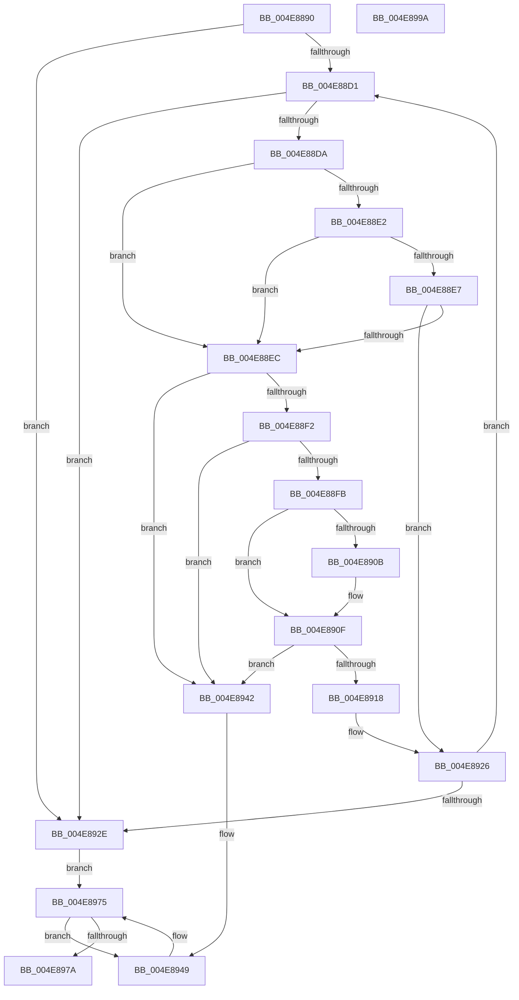

# PiCollapseEnumRequests

- RVA: `0x004E8890`–`0x004E899B` (길이 `267` bytes)
- VA: `0x00000001404E8890`
- 실행 섹션: `.text`
- PDB 이름 있음: `예`; PDB Function 태그: `아니요`
- unwind 정보 RVA: `0x00060300`
- 디코드: `77`개 명령, `267/267` bytes 표시
- 미해석 바이트: `0` (있으면 어셈블리에 `.byte`로 보존)

> 이 문서는 커널 이미지의 기계어와 PDB 기호를 분석해 생성했습니다. 4번과 5번은 함수 원형과 자료형을 바이너리 사용 방식에서 추정한 C 해석이며 원본 소스 복구 결과는 아닙니다.

## 1. Dependencies

- 직접 호출 지점: **5**; 고유 호출 대상: **5**
- 직접 호출자로 확인된 함수: **1**
- RIP 상대 이미지 참조: **2**

### Outgoing calls
- `0x004E88B2` → [KeAcquireSpinLockRaiseToDpc](../20/KeAcquireSpinLockRaiseToDpc_function_00208470.md) (function, `0x00208470`)
- `0x004E8902` → [Feature_KernelPnP_ActionDoubleDequeueFix__private_IsEnabledDeviceUsageNoInline](../5A/Feature_KernelPnP_ActionDoubleDequeueFix__private_IsEnabledDeviceUsageNoInline_function_005A6BA4.md) (function, `0x005A6BA4`)
- `0x004E8938` → [KeReleaseSpinLock](../39/KeReleaseSpinLock_function_00392BA0.md) (function, `0x00392BA0`)
- `0x004E895A` → [PiMarkDeviceTreeForReenumeration](../../page/A5/PiMarkDeviceTreeForReenumeration_function_00A518E0.md) (function, `0x00A518E0`)
- `0x004E8968` → [ObfDereferenceObjectWithTag](../2F/ObfDereferenceObjectWithTag_function_002F78E0.md) (function, `0x002F78E0`)

### Direct callers
- [PipProcessDevNodeTree](../../page/8F/PipProcessDevNodeTree_function_008F9068.md) at `0x008F90CF`

### Static image references
- `0x004E88AB` → RVA `0x00F8AD90` (`.data`; read)
- `0x004E88B7` → RVA `0x00F8AD80` (`.data`; read)

## 2. Other-region calls and transfers

- 다른 실행 섹션으로 향하는 call: **1**
  - `0x004E895A` → [PiMarkDeviceTreeForReenumeration](../../page/A5/PiMarkDeviceTreeForReenumeration_function_00A518E0.md) (`.text` → `PAGE`)
- 별도 외부 분기/꼬리 이동을 확인하지 못했습니다.

## 3. Assembly (complete function range)

```asm
004E8890  48 89 5C 24 08                  mov qword ptr [rsp + 8], rbx
004E8895  48 89 6C 24 10                  mov qword ptr [rsp + 0x10], rbp
004E889A  48 89 74 24 18                  mov qword ptr [rsp + 0x18], rsi
004E889F  57                              push rdi
004E88A0  41 56                           push r14
004E88A2  41 57                           push r15
004E88A4  48 83 EC 20                     sub rsp, 0x20
004E88A8  48 8B F9                        mov rdi, rcx
004E88AB  48 8D 0D DE 24 AA 00            lea rcx, [rip + 0xaa24de]
004E88B2  E8 B9 FB D1 FF                  call 0x140208470
004E88B7  48 8B 1D C2 24 AA 00            mov rbx, qword ptr [rip + 0xaa24c2]
004E88BE  4C 8D 3D BB 24 AA 00            lea r15, [rip + 0xaa24bb]
004E88C5  4C 8B 77 08                     mov r14, qword ptr [rdi + 8]
004E88C9  40 8A E8                        mov bpl, al
004E88CC  49 3B DF                        cmp rbx, r15
004E88CF  74 5D                           je 0x1404e892e
004E88D1  80 7B 1C 00                     cmp byte ptr [rbx + 0x1c], 0
004E88D5  48 8B 33                        mov rsi, qword ptr [rbx]
004E88D8  75 54                           jne 0x1404e892e
004E88DA  8B 4B 18                        mov ecx, dword ptr [rbx + 0x18]
004E88DD  83 E9 09                        sub ecx, 9
004E88E0  74 0A                           je 0x1404e88ec
004E88E2  83 E9 01                        sub ecx, 1
004E88E5  74 05                           je 0x1404e88ec
004E88E7  83 F9 04                        cmp ecx, 4
004E88EA  75 3A                           jne 0x1404e8926
004E88EC  48 39 5E 08                     cmp qword ptr [rsi + 8], rbx
004E88F0  75 50                           jne 0x1404e8942
004E88F2  48 8B 43 08                     mov rax, qword ptr [rbx + 8]
004E88F6  48 39 18                        cmp qword ptr [rax], rbx
004E88F9  75 47                           jne 0x1404e8942
004E88FB  48 89 30                        mov qword ptr [rax], rsi
004E88FE  48 89 46 08                     mov qword ptr [rsi + 8], rax
004E8902  E8 9D E2 0B 00                  call 0x1405a6ba4
004E8907  85 C0                           test eax, eax
004E8909  74 04                           je 0x1404e890f
004E890B  C6 43 54 01                     mov byte ptr [rbx + 0x54], 1
004E890F  48 8B 47 08                     mov rax, qword ptr [rdi + 8]
004E8913  48 39 38                        cmp qword ptr [rax], rdi
004E8916  75 2A                           jne 0x1404e8942
004E8918  48 89 3B                        mov qword ptr [rbx], rdi
004E891B  48 89 43 08                     mov qword ptr [rbx + 8], rax
004E891F  48 89 18                        mov qword ptr [rax], rbx
004E8922  48 89 5F 08                     mov qword ptr [rdi + 8], rbx
004E8926  48 8B DE                        mov rbx, rsi
004E8929  49 3B F7                        cmp rsi, r15
004E892C  75 A3                           jne 0x1404e88d1
004E892E  40 8A D5                        mov dl, bpl
004E8931  48 8D 0D 58 24 AA 00            lea rcx, [rip + 0xaa2458]
004E8938  E8 63 A2 EA FF                  call 0x140392ba0
004E893D  49 8B 1E                        mov rbx, qword ptr [r14]
004E8940  EB 33                           jmp 0x1404e8975
004E8942  B9 03 00 00 00                  mov ecx, 3
004E8947  CD 29                           int 0x29
004E8949  48 8B 43 10                     mov rax, qword ptr [rbx + 0x10]
004E894D  B2 01                           mov dl, 1
004E894F  48 8B 88 38 01 00 00            mov rcx, qword ptr [rax + 0x138]
004E8956  48 8B 49 28                     mov rcx, qword ptr [rcx + 0x28]
004E895A  E8 81 8F 56 00                  call 0x140a518e0
004E895F  48 8B 4B 10                     mov rcx, qword ptr [rbx + 0x10]
004E8963  BA 44 66 6C 74                  mov edx, 0x746c6644
004E8968  E8 73 EF E0 FF                  call 0x1402f78e0
004E896D  48 83 63 10 00                  and qword ptr [rbx + 0x10], 0
004E8972  48 8B 1B                        mov rbx, qword ptr [rbx]
004E8975  48 3B DF                        cmp rbx, rdi
004E8978  75 CF                           jne 0x1404e8949
004E897A  4C 3B 77 08                     cmp r14, qword ptr [rdi + 8]
004E897E  48 8B 5C 24 40                  mov rbx, qword ptr [rsp + 0x40]
004E8983  48 8B 6C 24 48                  mov rbp, qword ptr [rsp + 0x48]
004E8988  0F 95 C0                        setne al
004E898B  48 8B 74 24 50                  mov rsi, qword ptr [rsp + 0x50]
004E8990  48 83 C4 20                     add rsp, 0x20
004E8994  41 5F                           pop r15
004E8996  41 5E                           pop r14
004E8998  5F                              pop rdi
004E8999  C3                              ret
004E899A  CC                              int3
```

## 4. C-style interpretation (structured pseudocode)

```c
__int64 __fastcall PiCollapseEnumRequests(__int64 a1)
{
    __int64 result;
    __int64 v_rsp;
    unsigned __int64 v_stack_p10;
    unsigned __int64 v_stack_p18;
    unsigned __int64 v_stack_p8;

    v_stack_p8 = v_rbx;
    v_stack_p10 = v_rbp;
    v_stack_p18 = v_rsi;
    v_rsp = (v_rsp) - (32);
    result = KeAcquireSpinLockRaiseToDpc(v_rip + 11150558, a2, a3, a4);
    if ((*(unsigned __int64 *)(v_rip + 11150530)) == (v_rip + 11150523)) goto loc_004E892E;
loc_004E88D1:
    if ((*(unsigned __int8 *)(*(unsigned __int64 *)(v_rip + 11150530) + 28)) != 0) goto loc_004E892E;
    a1 = (unsigned int)(((unsigned int)(*(unsigned int *)(*(unsigned __int64 *)(v_rip + 11150530) + 24))) - (9));
    if (condition_is_equal) goto loc_004E88EC;
    a1 = (unsigned int)((a1) - (1));
    if (condition_is_equal) goto loc_004E88EC;
    if (((unsigned int)(a1)) != 4) goto loc_004E8926;
loc_004E88EC:
    if ((*(unsigned __int64 *)(*(unsigned __int64 *)(*(unsigned __int64 *)(v_rip + 11150530)) + 8)) != (*(unsigned __int64 *)(v_rip + 11150530))) goto loc_004E8942;
    if ((*(unsigned __int64 *)(*(unsigned __int64 *)(*(unsigned __int64 *)(v_rip + 11150530) + 8))) != (*(unsigned __int64 *)(v_rip + 11150530))) goto loc_004E8942;
    *(unsigned __int64 *)(*(unsigned __int64 *)(*(unsigned __int64 *)(v_rip + 11150530) + 8)) = *(unsigned __int64 *)(*(unsigned __int64 *)(v_rip + 11150530));
    *(unsigned __int64 *)(*(unsigned __int64 *)(*(unsigned __int64 *)(v_rip + 11150530)) + 8) = *(unsigned __int64 *)(*(unsigned __int64 *)(v_rip + 11150530) + 8);
    result = Feature_KernelPnP_ActionDoubleDequeueFix__private_IsEnabledDeviceUsageNoInline(a1, a2, a3, a4);
    if ((unsigned int)(result) != 0) {
        *(unsigned __int8 *)(*(unsigned __int64 *)(v_rip + 11150530) + 84) = 1;
    }
    if ((*(unsigned __int64 *)(*(unsigned __int64 *)(a1 + 8))) != a1) goto loc_004E8942;
    *(unsigned __int64 *)(*(unsigned __int64 *)(v_rip + 11150530)) = a1;
    *(unsigned __int64 *)(*(unsigned __int64 *)(v_rip + 11150530) + 8) = *(unsigned __int64 *)(a1 + 8);
    *(unsigned __int64 *)(*(unsigned __int64 *)(a1 + 8)) = *(unsigned __int64 *)(v_rip + 11150530);
    *(unsigned __int64 *)(a1 + 8) = *(unsigned __int64 *)(v_rip + 11150530);
loc_004E8926:
    if ((*(unsigned __int64 *)(*(unsigned __int64 *)(v_rip + 11150530))) != (v_rip + 11150523)) goto loc_004E88D1;
loc_004E892E:
    result = KeReleaseSpinLock(v_rip + 11150424, (unsigned __int8)((unsigned __int8)(result)), a3, a4);
    goto loc_004E8975;
loc_004E8942:
loc_004E8949:
    result = PiMarkDeviceTreeForReenumeration(*(unsigned __int64 *)(*(unsigned __int64 *)(*(unsigned __int64 *)(*(unsigned __int64 *)(*(unsigned __int64 *)(a1 + 8)) + 16) + 312) + 40), 1, a3, a4);
    result = ObfDereferenceObjectWithTag(*(unsigned __int64 *)(*(unsigned __int64 *)(*(unsigned __int64 *)(a1 + 8)) + 16), (unsigned int)(0x746C6644ULL), a3, a4);
loc_004E8975:
    if ((*(unsigned __int64 *)(*(unsigned __int64 *)(*(unsigned __int64 *)(a1 + 8)))) != a1) goto loc_004E8949;
    result = ((*(unsigned __int64 *)(a1 + 8)) != (*(unsigned __int64 *)(a1 + 8))) ? 1 : 0;
    v_rsp = (v_rsp) + (32);
    return result;
}
```

## 5. (Beta) C Style

```c
int64_t PiCollapseEnumRequests(void *Arg1)
{
    uint8_t *arg1 = (uint8_t *)Arg1;

    int64_t result;
    int64_t local_rsp;
    uint64_t v_stack_p10;
    uint64_t v_stack_p18;
    uint64_t v_stack_p8;

    v_stack_p8 = local_rbx;
    v_stack_p10 = local_rbp;
    v_stack_p18 = local_rsi;
    local_rsp = (local_rsp) - (32);
    result = KeAcquireSpinLockRaiseToDpc(v_rip + 11150558, a2, a3, a4);
    if ((*(uint64_t *)(v_rip + 0xAA24C2)) == (v_rip + 11150523)) goto loc_004E892E;
loc_004E88D1:
    if ((*(uint8_t *)(*(uint64_t *)(v_rip + 0xAA24C2) + 0x1C)) != 0) goto loc_004E892E;
    Arg1 = (uint32_t)(((uint32_t)(*(uint32_t *)(*(uint64_t *)(v_rip + 0xAA24C2) + 0x18))) - (9));
    if (condition_is_equal) goto loc_004E88EC;
    Arg1 = (uint32_t)((Arg1) - (1));
    if (condition_is_equal) goto loc_004E88EC;
    if (((uint32_t)(Arg1)) != 4) goto loc_004E8926;
loc_004E88EC:
    if ((*(uint64_t *)(*(uint64_t *)(*(uint64_t *)(v_rip + 0xAA24C2)) + 0x8)) != (*(uint64_t *)(v_rip + 0xAA24C2))) goto loc_004E8942;
    if ((*(uint64_t *)(*(uint64_t *)(*(uint64_t *)(v_rip + 0xAA24C2) + 0x8))) != (*(uint64_t *)(v_rip + 0xAA24C2))) goto loc_004E8942;
    *(uint64_t *)(*(uint64_t *)(*(uint64_t *)(v_rip + 0xAA24C2) + 0x8)) = *(uint64_t *)(*(uint64_t *)(v_rip + 0xAA24C2));
    *(uint64_t *)(*(uint64_t *)(*(uint64_t *)(v_rip + 0xAA24C2)) + 0x8) = *(uint64_t *)(*(uint64_t *)(v_rip + 0xAA24C2) + 0x8);
    result = Feature_KernelPnP_ActionDoubleDequeueFix__private_IsEnabledDeviceUsageNoInline(Arg1, a2, a3, a4);
    if ((uint32_t)(result) != 0) {
        *(uint8_t *)(*(uint64_t *)(v_rip + 0xAA24C2) + 0x54) = 1;
    }
    if ((*(uint64_t *)(*(uint64_t *)(arg1 + 0x8))) != Arg1) goto loc_004E8942;
    *(void **)(*(uint64_t *)(v_rip + 0xAA24C2)) = Arg1;
    *(uint64_t *)(*(uint64_t *)(v_rip + 0xAA24C2) + 0x8) = *(uint64_t *)(arg1 + 0x8);
    *(uint64_t *)(*(uint64_t *)(arg1 + 0x8)) = *(uint64_t *)(v_rip + 0xAA24C2);
    *(uint64_t *)(arg1 + 0x8) = *(uint64_t *)(v_rip + 0xAA24C2);
loc_004E8926:
    if ((*(uint64_t *)(*(uint64_t *)(v_rip + 0xAA24C2))) != (v_rip + 11150523)) goto loc_004E88D1;
loc_004E892E:
    result = KeReleaseSpinLock(v_rip + 11150424, (uint8_t)((uint8_t)(result)), a3, a4);
    goto loc_004E8975;
loc_004E8942:
loc_004E8949:
    result = PiMarkDeviceTreeForReenumeration(*(uint64_t *)(*(uint64_t *)(*(uint64_t *)(*(uint64_t *)(*(uint64_t *)(arg1 + 0x8)) + 0x10) + 0x138) + 0x28), 1, a3, a4);
    result = ObfDereferenceObjectWithTag(*(uint64_t *)(*(uint64_t *)(*(uint64_t *)(arg1 + 0x8)) + 0x10), (uint32_t)(0x746C6644ULL), a3, a4);
loc_004E8975:
    if ((*(uint64_t *)(*(uint64_t *)(*(uint64_t *)(arg1 + 0x8)))) != Arg1) goto loc_004E8949;
    result = ((*(uint64_t *)(arg1 + 0x8)) != (*(uint64_t *)(arg1 + 0x8))) ? 1 : 0;
    local_rsp = (local_rsp) + (32);
    return result;
}
```

### 관측된 메모리 오프셋

구조체 형식이 확인되지 않은 접근은 인자 기준의 오프셋으로만 기록했습니다.

| 기준 인자 | 오프셋 표현 | 폭 (bit) | 접근 |
|---|---:|---:|---|
| `Arg1` | `+ 0x8` | `64` | `R` |
| `Arg1` | `+ 0x8` | `64` | `W` |

## 6. Execution-region graph

[열기: 2D/3D 그래프와 함수 탐색 컨트롤 패널](../../../control-panel.html?section=text&rva=0x004E8890&view=graph)

- 2D 그래프는 위에서 아래로 흐르고, 3D 그래프는 빈 공간을 드래그해 회전합니다. Shift+드래그는 이동, 휠은 확대·축소, 함수 노드 선택은 대상 보고서 이동입니다.

### Static fallback


