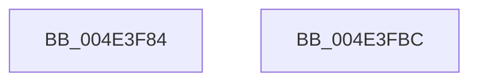

# PiDrvDbUnloadNodeReset

- RVA: `0x004E3F84`–`0x004E3FBD` (길이 `57` bytes)
- VA: `0x00000001404E3F84`
- 실행 섹션: `.text`
- PDB 이름 있음: `예`; PDB Function 태그: `아니요`
- unwind 정보 RVA: `0x0005CAAC`
- 디코드: `16`개 명령, `57/57` bytes 표시
- 미해석 바이트: `0` (있으면 어셈블리에 `.byte`로 보존)

> 이 문서는 커널 이미지의 기계어와 PDB 기호를 분석해 생성했습니다. 4번과 5번은 함수 원형과 자료형을 바이너리 사용 방식에서 추정한 C 해석이며 원본 소스 복구 결과는 아닙니다.

## 1. Dependencies

- 직접 호출 지점: **2**; 고유 호출 대상: **2**
- 직접 호출자로 확인된 함수: **1**
- RIP 상대 이미지 참조: **0**

### Outgoing calls
- `0x004E3F9B` → [KeAcquireSpinLockRaiseToDpc](../20/KeAcquireSpinLockRaiseToDpc_function_00208470.md) (function, `0x00208470`)
- `0x004E3FAC` → [KeReleaseSpinLock](../39/KeReleaseSpinLock_function_00392BA0.md) (function, `0x00392BA0`)

### Direct callers
- [PiDrvDbUnloadNodeWorkerCallback](../../page/AA/PiDrvDbUnloadNodeWorkerCallback_function_00AAE570.md) at `0x00AAE582`

### Static image references
- 디코드된 RIP-relative 메모리 참조가 없습니다.

## 2. Other-region calls and transfers

- 다른 실행 섹션으로 향하는 call: **0**
- 별도 외부 분기/꼬리 이동을 확인하지 못했습니다.

## 3. Assembly (complete function range)

```asm
004E3F84  48 89 5C 24 08                  mov qword ptr [rsp + 8], rbx
004E3F89  57                              push rdi
004E3F8A  48 83 EC 20                     sub rsp, 0x20
004E3F8E  48 8D B9 A8 01 00 00            lea rdi, [rcx + 0x1a8]
004E3F95  48 8B D9                        mov rbx, rcx
004E3F98  48 8B CF                        mov rcx, rdi
004E3F9B  E8 D0 44 D2 FF                  call 0x140208470
004E3FA0  8A D0                           mov dl, al
004E3FA2  C6 83 B0 01 00 00 00            mov byte ptr [rbx + 0x1b0], 0
004E3FA9  48 8B CF                        mov rcx, rdi
004E3FAC  E8 EF EB EA FF                  call 0x140392ba0
004E3FB1  48 8B 5C 24 30                  mov rbx, qword ptr [rsp + 0x30]
004E3FB6  48 83 C4 20                     add rsp, 0x20
004E3FBA  5F                              pop rdi
004E3FBB  C3                              ret
004E3FBC  CC                              int3
```

## 4. C-style interpretation (structured pseudocode)

```c
__int64 __fastcall PiDrvDbUnloadNodeReset(__int64 a1)
{
    __int64 result;
    __int64 v_rsp;
    unsigned __int64 v_stack_p8;

    v_stack_p8 = v_rbx;
    v_rsp = (v_rsp) - (32);
    result = KeAcquireSpinLockRaiseToDpc(a1 + 424, a2, a3, a4);
    *(unsigned __int8 *)(a1 + 432) = 0;
    result = KeReleaseSpinLock(a1 + 424, (unsigned __int8)(result), a3, a4);
    v_rsp = (v_rsp) + (32);
    return result;
}
```

## 5. (Beta) C Style

```c
int64_t PiDrvDbUnloadNodeReset(void *Arg1)
{
    uint8_t *arg1 = (uint8_t *)Arg1;

    int64_t result;
    int64_t local_rsp;
    uint64_t v_stack_p8;

    v_stack_p8 = local_rbx;
    local_rsp = (local_rsp) - (32);
    result = KeAcquireSpinLockRaiseToDpc(Arg1 + 424, a2, a3, a4);
    *(uint8_t *)(arg1 + 0x1B0) = 0;
    result = KeReleaseSpinLock(Arg1 + 424, (uint8_t)(result), a3, a4);
    local_rsp = (local_rsp) + (32);
    return result;
}
```

### 관측된 메모리 오프셋

구조체 형식이 확인되지 않은 접근은 인자 기준의 오프셋으로만 기록했습니다.

| 기준 인자 | 오프셋 표현 | 폭 (bit) | 접근 |
|---|---:|---:|---|
| `Arg1` | `+ 0x1A8` | `64` | `R` |
| `Arg1` | `+ 0x1B0` | `8` | `W` |

## 6. Execution-region graph

[열기: 2D/3D 그래프와 함수 탐색 컨트롤 패널](../../../control-panel.html?section=text&rva=0x004E3F84&view=graph)

- 2D 그래프는 위에서 아래로 흐르고, 3D 그래프는 빈 공간을 드래그해 회전합니다. Shift+드래그는 이동, 휠은 확대·축소, 함수 노드 선택은 대상 보고서 이동입니다.

### Static fallback


