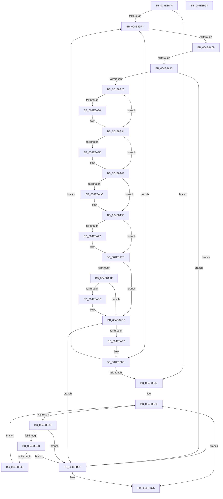

# PnpRemoveDeviceActionRequests

- RVA: `0x004E89A4`–`0x004E8B94` (길이 `496` bytes)
- VA: `0x00000001404E89A4`
- 실행 섹션: `.text`
- PDB 이름 있음: `예`; PDB Function 태그: `아니요`
- unwind 정보 RVA: `0x000C8D58`
- 디코드: `121`개 명령, `496/496` bytes 표시
- 미해석 바이트: `0` (있으면 어셈블리에 `.byte`로 보존)

> 이 문서는 커널 이미지의 기계어와 PDB 기호를 분석해 생성했습니다. 4번과 5번은 함수 원형과 자료형을 바이너리 사용 방식에서 추정한 C 해석이며 원본 소스 복구 결과는 아닙니다.

## 1. Dependencies

- 직접 호출 지점: **11**; 고유 호출 대상: **7**
- 직접 호출자로 확인된 함수: **1**
- RIP 상대 이미지 참조: **11**

### Outgoing calls
- `0x004E89DD` → [KeAcquireSpinLockRaiseToDpc](../20/KeAcquireSpinLockRaiseToDpc_function_00208470.md) (function, `0x00208470`)
- `0x004E8A27` → [Feature_KernelPnP_ActionDoubleDequeueFix__private_IsEnabledDeviceUsageNoInline](../5A/Feature_KernelPnP_ActionDoubleDequeueFix__private_IsEnabledDeviceUsageNoInline_function_005A6BA4.md) (function, `0x005A6BA4`)
- `0x004E8A51` → [KeSetEvent](../33/KeSetEvent_function_0033F310.md) (function, `0x0033F310`)
- `0x004E8A61` → [KeAcquireSpinLockRaiseToDpc](../20/KeAcquireSpinLockRaiseToDpc_function_00208470.md) (function, `0x00208470`)
- `0x004E8A77` → [PopDirectedDripsClearDisengageReason](../47/PopDirectedDripsClearDisengageReason_function_00477EA4.md) (function, `0x00477EA4`)
- `0x004E8A86` → [KeReleaseSpinLock](../39/KeReleaseSpinLock_function_00392BA0.md) (function, `0x00392BA0`)
- `0x004E8A92` → [KeAcquireSpinLockRaiseToDpc](../20/KeAcquireSpinLockRaiseToDpc_function_00208470.md) (function, `0x00208470`)
- `0x004E8AE0` → [KeReleaseSpinLock](../39/KeReleaseSpinLock_function_00392BA0.md) (function, `0x00392BA0`)
- `0x004E8B21` → [KeReleaseSpinLock](../39/KeReleaseSpinLock_function_00392BA0.md) (function, `0x00392BA0`)
- `0x004E8B5A` → [ObfDereferenceObjectWithTag](../2F/ObfDereferenceObjectWithTag_function_002F78E0.md) (function, `0x002F78E0`)
- `0x004E8B67` → [PnpDeleteDeviceActionRequest](../../page/95/PnpDeleteDeviceActionRequest_function_00955284.md) (function, `0x00955284`)

### Direct callers
- [PipSetDevNodeState](../47/PipSetDevNodeState_function_00470708.md) at `0x00470849`

### Static image references
- `0x004E89CE` → RVA `0x00F8AD90` (`.data`; read)
- `0x004E89E2` → RVA `0x00F8AD80` (`.data`; read)
- `0x004E8A5A` → RVA `0x00F0ED00` (`.data`; read)
- `0x004E8A66` → RVA `0x00F0ED08` (`.data`; read/write)
- `0x004E8A8B` → RVA `0x00F07450` (`.data`; read)
- `0x004E8AA6` → RVA `0x00F07458` (`.data`; read/write)
- `0x004E8AAF` → RVA `0x00F074D0` (`.data`; read)
- `0x004E8AB8` → RVA `0x00F074E0` (`.data`; read)
- `0x004E8ABF` → RVA `0x00F074D8` (`.data`; read/write)
- `0x004E8AC6` → RVA `0x00F074E0` (`.data`; read/write)
- `0x004E8ACE` → RVA `0x00F07460` (`.data`; read)

## 2. Other-region calls and transfers

- 다른 실행 섹션으로 향하는 call: **1**
  - `0x004E8B67` → [PnpDeleteDeviceActionRequest](../../page/95/PnpDeleteDeviceActionRequest_function_00955284.md) (`.text` → `PAGE`)
- 별도 외부 분기/꼬리 이동을 확인하지 못했습니다.

## 3. Assembly (complete function range)

```asm
004E89A4  48 8B C4                        mov rax, rsp
004E89A7  48 89 58 08                     mov qword ptr [rax + 8], rbx
004E89AB  48 89 70 10                     mov qword ptr [rax + 0x10], rsi
004E89AF  48 89 78 18                     mov qword ptr [rax + 0x18], rdi
004E89B3  4C 89 60 20                     mov qword ptr [rax + 0x20], r12
004E89B7  55                              push rbp
004E89B8  41 56                           push r14
004E89BA  41 57                           push r15
004E89BC  48 8B EC                        mov rbp, rsp
004E89BF  48 83 EC 30                     sub rsp, 0x30
004E89C3  48 8D 45 F0                     lea rax, [rbp - 0x10]
004E89C7  4C 8B E1                        mov r12, rcx
004E89CA  48 89 45 F8                     mov qword ptr [rbp - 8], rax
004E89CE  48 8D 0D BB 23 AA 00            lea rcx, [rip + 0xaa23bb]
004E89D5  48 8D 45 F0                     lea rax, [rbp - 0x10]
004E89D9  48 89 45 F0                     mov qword ptr [rbp - 0x10], rax
004E89DD  E8 8E FA D1 FF                  call 0x140208470
004E89E2  48 8B 1D 97 23 AA 00            mov rbx, qword ptr [rip + 0xaa2397]
004E89E9  44 8A F8                        mov r15b, al
004E89EC  48 8D 05 8D 23 AA 00            lea rax, [rip + 0xaa238d]
004E89F3  48 3B D8                        cmp rbx, rax
004E89F6  0F 84 1B 01 00 00               je 0x1404e8b17
004E89FC  48 8B 3B                        mov rdi, qword ptr [rbx]
004E89FF  4C 39 63 10                     cmp qword ptr [rbx + 0x10], r12
004E8A03  0F 85 02 01 00 00               jne 0x1404e8b0b
004E8A09  48 39 5F 08                     cmp qword ptr [rdi + 8], rbx
004E8A0D  0F 85 5B 01 00 00               jne 0x1404e8b6e
004E8A13  48 8B 43 08                     mov rax, qword ptr [rbx + 8]
004E8A17  48 39 18                        cmp qword ptr [rax], rbx
004E8A1A  0F 85 4E 01 00 00               jne 0x1404e8b6e
004E8A20  48 89 38                        mov qword ptr [rax], rdi
004E8A23  48 89 47 08                     mov qword ptr [rdi + 8], rax
004E8A27  E8 78 E1 0B 00                  call 0x1405a6ba4
004E8A2C  85 C0                           test eax, eax
004E8A2E  74 04                           je 0x1404e8a34
004E8A30  C6 43 54 01                     mov byte ptr [rbx + 0x54], 1
004E8A34  48 8B 43 38                     mov rax, qword ptr [rbx + 0x38]
004E8A38  48 85 C0                        test rax, rax
004E8A3B  74 06                           je 0x1404e8a43
004E8A3D  C7 00 0E 00 00 C0               mov dword ptr [rax], 0xc000000e
004E8A43  48 8B 4B 30                     mov rcx, qword ptr [rbx + 0x30]
004E8A47  48 85 C9                        test rcx, rcx
004E8A4A  74 0A                           je 0x1404e8a56
004E8A4C  45 33 C0                        xor r8d, r8d
004E8A4F  33 D2                           xor edx, edx
004E8A51  E8 BA 68 E5 FF                  call 0x14033f310
004E8A56  44 8B 73 18                     mov r14d, dword ptr [rbx + 0x18]
004E8A5A  48 8D 0D 9F 62 A2 00            lea rcx, [rip + 0xa2629f]
004E8A61  E8 0A FA D1 FF                  call 0x140208470
004E8A66  83 05 9B 62 A2 00 FF            add dword ptr [rip + 0xa2629b], -1
004E8A6D  40 8A F0                        mov sil, al
004E8A70  75 0A                           jne 0x1404e8a7c
004E8A72  B9 04 00 00 00                  mov ecx, 4
004E8A77  E8 28 F4 F8 FF                  call 0x140477ea4
004E8A7C  40 8A D6                        mov dl, sil
004E8A7F  48 8D 0D 7A 62 A2 00            lea rcx, [rip + 0xa2627a]
004E8A86  E8 15 A1 EA FF                  call 0x140392ba0
004E8A8B  48 8D 0D BE E9 A1 00            lea rcx, [rip + 0xa1e9be]
004E8A92  E8 D9 F9 D1 FF                  call 0x140208470
004E8A97  48 B9 08 00 00 00 80 F7 FF FF   movabs rcx, 0xfffff78000000008
004E8AA1  8A D0                           mov dl, al
004E8AA3  48 8B 09                        mov rcx, qword ptr [rcx]
004E8AA6  83 05 AB E9 A1 00 FF            add dword ptr [rip + 0xa1e9ab], -1
004E8AAD  75 1F                           jne 0x1404e8ace
004E8AAF  80 3D 1A EA A1 00 00            cmp byte ptr [rip + 0xa1ea1a], 0
004E8AB6  74 16                           je 0x1404e8ace
004E8AB8  48 2B 0D 21 EA A1 00            sub rcx, qword ptr [rip + 0xa1ea21]
004E8ABF  48 01 0D 12 EA A1 00            add qword ptr [rip + 0xa1ea12], rcx
004E8AC6  48 83 25 12 EA A1 00 00         and qword ptr [rip + 0xa1ea12], 0
004E8ACE  48 8D 0D 8B E9 A1 00            lea rcx, [rip + 0xa1e98b]
004E8AD5  42 FF 0C B1                     dec dword ptr [rcx + r14*4]
004E8AD9  48 8D 0D 70 E9 A1 00            lea rcx, [rip + 0xa1e970]
004E8AE0  E8 BB A0 EA FF                  call 0x140392ba0
004E8AE5  48 8B 45 F8                     mov rax, qword ptr [rbp - 8]
004E8AE9  48 8D 4D F0                     lea rcx, [rbp - 0x10]
004E8AED  48 39 08                        cmp qword ptr [rax], rcx
004E8AF0  75 7C                           jne 0x1404e8b6e
004E8AF2  48 89 43 08                     mov qword ptr [rbx + 8], rax
004E8AF6  48 8D 55 F0                     lea rdx, [rbp - 0x10]
004E8AFA  48 89 13                        mov qword ptr [rbx], rdx
004E8AFD  48 89 18                        mov qword ptr [rax], rbx
004E8B00  48 8D 05 79 22 AA 00            lea rax, [rip + 0xaa2279]
004E8B07  48 89 5D F8                     mov qword ptr [rbp - 8], rbx
004E8B0B  48 8B DF                        mov rbx, rdi
004E8B0E  48 3B F8                        cmp rdi, rax
004E8B11  0F 85 E5 FE FF FF               jne 0x1404e89fc
004E8B17  41 8A D7                        mov dl, r15b
004E8B1A  48 8D 0D 6F 22 AA 00            lea rcx, [rip + 0xaa226f]
004E8B21  E8 7A A0 EA FF                  call 0x140392ba0
004E8B26  48 8D 45 F0                     lea rax, [rbp - 0x10]
004E8B2A  48 39 45 F0                     cmp qword ptr [rbp - 0x10], rax
004E8B2E  74 45                           je 0x1404e8b75
004E8B30  48 8B 5D F8                     mov rbx, qword ptr [rbp - 8]
004E8B34  48 8D 45 F0                     lea rax, [rbp - 0x10]
004E8B38  48 39 03                        cmp qword ptr [rbx], rax
004E8B3B  75 31                           jne 0x1404e8b6e
004E8B3D  48 8B 43 08                     mov rax, qword ptr [rbx + 8]
004E8B41  48 39 18                        cmp qword ptr [rax], rbx
004E8B44  75 28                           jne 0x1404e8b6e
004E8B46  48 89 45 F8                     mov qword ptr [rbp - 8], rax
004E8B4A  48 8D 4D F0                     lea rcx, [rbp - 0x10]
004E8B4E  48 89 08                        mov qword ptr [rax], rcx
004E8B51  BA 44 66 6C 74                  mov edx, 0x746c6644
004E8B56  48 8B 4B 10                     mov rcx, qword ptr [rbx + 0x10]
004E8B5A  E8 81 ED E0 FF                  call 0x1402f78e0
004E8B5F  48 83 63 10 00                  and qword ptr [rbx + 0x10], 0
004E8B64  48 8B CB                        mov rcx, rbx
004E8B67  E8 18 C7 46 00                  call 0x140955284
004E8B6C  EB B8                           jmp 0x1404e8b26
004E8B6E  B9 03 00 00 00                  mov ecx, 3
004E8B73  CD 29                           int 0x29
004E8B75  48 8B 5C 24 50                  mov rbx, qword ptr [rsp + 0x50]
004E8B7A  48 8B 74 24 58                  mov rsi, qword ptr [rsp + 0x58]
004E8B7F  48 8B 7C 24 60                  mov rdi, qword ptr [rsp + 0x60]
004E8B84  4C 8B 64 24 68                  mov r12, qword ptr [rsp + 0x68]
004E8B89  48 83 C4 30                     add rsp, 0x30
004E8B8D  41 5F                           pop r15
004E8B8F  41 5E                           pop r14
004E8B91  5D                              pop rbp
004E8B92  C3                              ret
004E8B93  CC                              int3
```

## 4. C-style interpretation (structured pseudocode)

```c
__int64 __fastcall PnpRemoveDeviceActionRequests(__int64 a1, int a2, int a3)
{
    __int64 result;
    __int64 v_rsp;
    unsigned __int64 v_stack_m20;
    unsigned __int64 v_stack_m28;
    unsigned __int64 v_stack_p10;
    unsigned __int64 v_stack_p18;
    unsigned __int64 v_stack_p20;
    unsigned __int64 v_stack_p8;

    *(unsigned __int64 *)(v_rsp + 8) = v_rbx;
    *(unsigned __int64 *)(v_rsp + 16) = v_rsi;
    *(unsigned __int64 *)(v_rsp + 24) = v_rdi;
    *(unsigned __int64 *)(v_rsp + 32) = v_r12;
    v_rsp = (v_rsp) - (48);
    v_stack_m20 = v_stack_m28;
    v_stack_m28 = v_stack_m28;
    result = KeAcquireSpinLockRaiseToDpc(v_rip + 11150267, a2, a3, a4);
    if ((*(unsigned __int64 *)(v_rip + 11150231)) == (v_rip + 11150221)) goto loc_004E8B17;
loc_004E89FC:
    if ((*(unsigned __int64 *)(*(unsigned __int64 *)(v_rip + 11150231) + 16)) != a1) goto loc_004E8B0B;
    if ((*(unsigned __int64 *)(*(unsigned __int64 *)(*(unsigned __int64 *)(v_rip + 11150231)) + 8)) != (*(unsigned __int64 *)(v_rip + 11150231))) goto loc_004E8B6E;
    if ((*(unsigned __int64 *)(*(unsigned __int64 *)(*(unsigned __int64 *)(v_rip + 11150231) + 8))) != (*(unsigned __int64 *)(v_rip + 11150231))) goto loc_004E8B6E;
    *(unsigned __int64 *)(*(unsigned __int64 *)(*(unsigned __int64 *)(v_rip + 11150231) + 8)) = *(unsigned __int64 *)(*(unsigned __int64 *)(v_rip + 11150231));
    *(unsigned __int64 *)(*(unsigned __int64 *)(*(unsigned __int64 *)(v_rip + 11150231)) + 8) = *(unsigned __int64 *)(*(unsigned __int64 *)(v_rip + 11150231) + 8);
    result = Feature_KernelPnP_ActionDoubleDequeueFix__private_IsEnabledDeviceUsageNoInline(v_rip + 11150267, a2, a3, a4);
    if ((unsigned int)(result) != 0) {
        *(unsigned __int8 *)(*(unsigned __int64 *)(v_rip + 11150231) + 84) = 1;
    }
    if (*(unsigned __int64 *)(*(unsigned __int64 *)(v_rip + 11150231) + 56) != 0) {
        *(unsigned int *)(*(unsigned __int64 *)(*(unsigned __int64 *)(v_rip + 11150231) + 56)) = 0xC000000EULL;
    }
    result = *(unsigned __int64 *)(*(unsigned __int64 *)(v_rip + 11150231) + 56);
    if (*(unsigned __int64 *)(*(unsigned __int64 *)(v_rip + 11150231) + 48) != 0) {
        a3 = 0;
        a2 = 0;
        result = KeSetEvent(*(unsigned __int64 *)(*(unsigned __int64 *)(v_rip + 11150231) + 48), a2, a3, a4);
    }
    result = KeAcquireSpinLockRaiseToDpc(v_rip + 10642079, a2, a3, a4);
    if (!(condition_is_not_equal)) {
        a1 = 4;
        result = PopDirectedDripsClearDisengageReason(a1, a2, a3, a4);
    }
    result = KeReleaseSpinLock(v_rip + 10642042, (unsigned __int8)((unsigned __int8)(result)), a3, a4);
    result = KeAcquireSpinLockRaiseToDpc(v_rip + 10611134, (unsigned __int8)((unsigned __int8)(result)), a3, a4);
    if (condition_is_not_equal) goto loc_004E8ACE;
    if ((*(unsigned __int8 *)(v_rip + 10611226)) != 0) {
        a1 = (*(unsigned __int64 *)(v_rip + 10611134)) - (*(unsigned __int64 *)(v_rip + 10611233));
    }
    result = KeReleaseSpinLock(v_rip + 10611056, (unsigned __int8)(result), a3, a4);
    if ((*(unsigned __int64 *)(v_stack_m20)) != v_stack_m28) goto loc_004E8B6E;
    *(unsigned __int64 *)(*(unsigned __int64 *)(v_rip + 11150231) + 8) = v_stack_m20;
    *(unsigned __int64 *)(*(unsigned __int64 *)(v_rip + 11150231)) = v_stack_m28;
    *(unsigned __int64 *)(v_stack_m20) = *(unsigned __int64 *)(v_rip + 11150231);
    v_stack_m20 = *(unsigned __int64 *)(v_rip + 11150231);
loc_004E8B0B:
    if ((*(unsigned __int64 *)(*(unsigned __int64 *)(v_rip + 11150231))) != (v_rip + 11149945)) goto loc_004E89FC;
loc_004E8B17:
    result = KeReleaseSpinLock(v_rip + 11149935, (unsigned __int8)((unsigned __int8)(result)), a3, a4);
loc_004E8B26:
    if (v_stack_m28 == v_stack_m28) goto loc_004E8B75;
    if ((*(unsigned __int64 *)(v_stack_m20)) != v_stack_m28) goto loc_004E8B6E;
    if ((*(unsigned __int64 *)(*(unsigned __int64 *)(v_stack_m20 + 8))) != v_stack_m20) goto loc_004E8B6E;
    v_stack_m20 = *(unsigned __int64 *)(v_stack_m20 + 8);
    *(unsigned __int64 *)(*(unsigned __int64 *)(v_stack_m20 + 8)) = v_stack_m28;
    result = ObfDereferenceObjectWithTag(*(unsigned __int64 *)(v_stack_m20 + 16), (unsigned int)(0x746C6644ULL), a3, a4);
    result = PnpDeleteDeviceActionRequest(v_stack_m20, (unsigned int)(0x746C6644ULL), a3, a4);
    goto loc_004E8B26;
loc_004E8B6E:
loc_004E8B75:
    v_rsp = (v_rsp) + (48);
    return result;
}
```

## 5. (Beta) C Style

```c
int64_t PnpRemoveDeviceActionRequests(int64_t Arg1, int32_t Arg2, int32_t Arg3)
{
    int64_t result;
    int64_t local_rsp;
    uint64_t v_stack_m20;
    uint64_t v_stack_m28;
    uint64_t v_stack_p10;
    uint64_t v_stack_p18;
    uint64_t v_stack_p20;
    uint64_t v_stack_p8;

    *(uint64_t *)(local_rsp + 0x8) = local_rbx;
    *(uint64_t *)(local_rsp + 0x10) = local_rsi;
    *(uint64_t *)(local_rsp + 0x18) = local_rdi;
    *(uint64_t *)(local_rsp + 0x20) = local_r12;
    local_rsp = (local_rsp) - (48);
    v_stack_m20 = v_stack_m28;
    v_stack_m28 = v_stack_m28;
    result = KeAcquireSpinLockRaiseToDpc(v_rip + 11150267, Arg2, Arg3, a4);
    if ((*(uint64_t *)(v_rip + 0xAA2397)) == (v_rip + 11150221)) goto loc_004E8B17;
loc_004E89FC:
    if ((*(uint64_t *)(*(uint64_t *)(v_rip + 0xAA2397) + 0x10)) != Arg1) goto loc_004E8B0B;
    if ((*(uint64_t *)(*(uint64_t *)(*(uint64_t *)(v_rip + 0xAA2397)) + 0x8)) != (*(uint64_t *)(v_rip + 0xAA2397))) goto loc_004E8B6E;
    if ((*(uint64_t *)(*(uint64_t *)(*(uint64_t *)(v_rip + 0xAA2397) + 0x8))) != (*(uint64_t *)(v_rip + 0xAA2397))) goto loc_004E8B6E;
    *(uint64_t *)(*(uint64_t *)(*(uint64_t *)(v_rip + 0xAA2397) + 0x8)) = *(uint64_t *)(*(uint64_t *)(v_rip + 0xAA2397));
    *(uint64_t *)(*(uint64_t *)(*(uint64_t *)(v_rip + 0xAA2397)) + 0x8) = *(uint64_t *)(*(uint64_t *)(v_rip + 0xAA2397) + 0x8);
    result = Feature_KernelPnP_ActionDoubleDequeueFix__private_IsEnabledDeviceUsageNoInline(v_rip + 11150267, Arg2, Arg3, a4);
    if ((uint32_t)(result) != 0) {
        *(uint8_t *)(*(uint64_t *)(v_rip + 0xAA2397) + 0x54) = 1;
    }
    if (*(uint64_t *)(*(uint64_t *)(v_rip + 0xAA2397) + 0x38) != 0) {
        *(uint32_t *)(*(uint64_t *)(*(uint64_t *)(v_rip + 0xAA2397) + 0x38)) = 0xC000000EULL;
    }
    result = *(uint64_t *)(*(uint64_t *)(v_rip + 0xAA2397) + 0x38);
    if (*(uint64_t *)(*(uint64_t *)(v_rip + 0xAA2397) + 0x30) != 0) {
        Arg3 = 0;
        Arg2 = 0;
        result = KeSetEvent(*(uint64_t *)(*(uint64_t *)(v_rip + 0xAA2397) + 0x30), Arg2, Arg3, a4);
    }
    result = KeAcquireSpinLockRaiseToDpc(v_rip + 10642079, Arg2, Arg3, a4);
    if (!(condition_is_not_equal)) {
        Arg1 = 4;
        result = PopDirectedDripsClearDisengageReason(Arg1, Arg2, Arg3, a4);
    }
    result = KeReleaseSpinLock(v_rip + 10642042, (uint8_t)((uint8_t)(result)), Arg3, a4);
    result = KeAcquireSpinLockRaiseToDpc(v_rip + 10611134, (uint8_t)((uint8_t)(result)), Arg3, a4);
    if (condition_is_not_equal) goto loc_004E8ACE;
    if ((*(uint8_t *)(v_rip + 0xA1EA1A)) != 0) {
        Arg1 = (*(uint64_t *)(v_rip + 0xA1E9BE)) - (*(uint64_t *)(v_rip + 0xA1EA21));
    }
    result = KeReleaseSpinLock(v_rip + 10611056, (uint8_t)(result), Arg3, a4);
    if ((*(uint64_t *)(v_stack_m20)) != v_stack_m28) goto loc_004E8B6E;
    *(uint64_t *)(*(uint64_t *)(v_rip + 0xAA2397) + 0x8) = v_stack_m20;
    *(uint64_t *)(*(uint64_t *)(v_rip + 0xAA2397)) = v_stack_m28;
    *(uint64_t *)(v_stack_m20) = *(uint64_t *)(v_rip + 0xAA2397);
    v_stack_m20 = *(uint64_t *)(v_rip + 0xAA2397);
loc_004E8B0B:
    if ((*(uint64_t *)(*(uint64_t *)(v_rip + 0xAA2397))) != (v_rip + 11149945)) goto loc_004E89FC;
loc_004E8B17:
    result = KeReleaseSpinLock(v_rip + 11149935, (uint8_t)((uint8_t)(result)), Arg3, a4);
loc_004E8B26:
    if (v_stack_m28 == v_stack_m28) goto loc_004E8B75;
    if ((*(uint64_t *)(v_stack_m20)) != v_stack_m28) goto loc_004E8B6E;
    if ((*(uint64_t *)(*(uint64_t *)(v_stack_m20 + 0x8))) != v_stack_m20) goto loc_004E8B6E;
    v_stack_m20 = *(uint64_t *)(v_stack_m20 + 0x8);
    *(uint64_t *)(*(uint64_t *)(v_stack_m20 + 0x8)) = v_stack_m28;
    result = ObfDereferenceObjectWithTag(*(uint64_t *)(v_stack_m20 + 0x10), (uint32_t)(0x746C6644ULL), Arg3, a4);
    result = PnpDeleteDeviceActionRequest(v_stack_m20, (uint32_t)(0x746C6644ULL), Arg3, a4);
    goto loc_004E8B26;
loc_004E8B6E:
loc_004E8B75:
    local_rsp = (local_rsp) + (48);
    return result;
}
```

## 6. Execution-region graph

[열기: 2D/3D 그래프와 함수 탐색 컨트롤 패널](../../../control-panel.html?section=text&rva=0x004E89A4&view=graph)

- 2D 그래프는 위에서 아래로 흐르고, 3D 그래프는 빈 공간을 드래그해 회전합니다. Shift+드래그는 이동, 휠은 확대·축소, 함수 노드 선택은 대상 보고서 이동입니다.

### Static fallback


