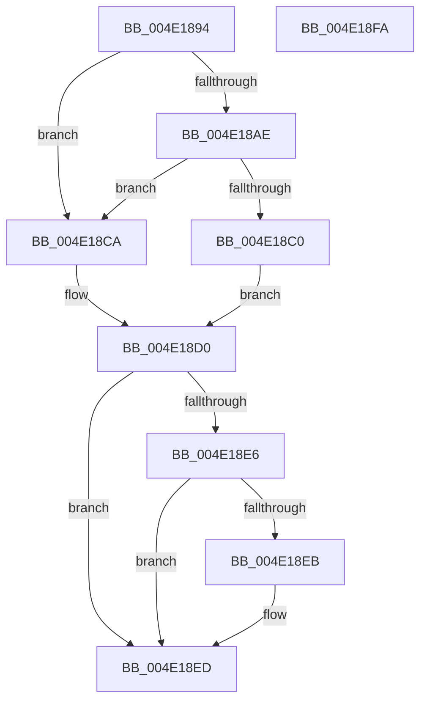

# PnpStringToDwordValue

- RVA: `0x004E1894`–`0x004E18FB` (길이 `103` bytes)
- VA: `0x00000001404E1894`
- 실행 섹션: `.text`
- PDB 이름 있음: `예`; PDB Function 태그: `아니요`
- unwind 정보 RVA: `0x00068D5C`
- 디코드: `32`개 명령, `103/103` bytes 표시
- 미해석 바이트: `0` (있으면 어셈블리에 `.byte`로 보존)

> 이 문서는 커널 이미지의 기계어와 PDB 기호를 분석해 생성했습니다. 4번과 5번은 함수 원형과 자료형을 바이너리 사용 방식에서 추정한 C 해석이며 원본 소스 복구 결과는 아닙니다.

## 1. Dependencies

- 직접 호출 지점: **1**; 고유 호출 대상: **1**
- 직접 호출자로 확인된 함수: **3**
- RIP 상대 이미지 참조: **0**

### Outgoing calls
- `0x004E18D5` → [wcstoul](../50/wcstoul_function_005024A0.md) (function, `0x005024A0`)

### Direct callers
- [PiDevCfgParsePropertyKeyName](../5A/PiDevCfgParsePropertyKeyName_function_005A7E70.md) at `0x005A7F46`
- [PiDevCfgParsePropertyKeyName](../5A/PiDevCfgParsePropertyKeyName_function_005A7E70.md) at `0x005A7F6A`
- [PiDevCfgResolveVariable](../../page/A8/PiDevCfgResolveVariable_function_00A81AB8.md) at `0x00A81D1B`
- [PiDevCfgResolveVariableExpression](../../page/AA/PiDevCfgResolveVariableExpression_function_00AA8C00.md) at `0x00AA8F4B`

### Static image references
- 디코드된 RIP-relative 메모리 참조가 없습니다.

## 2. Other-region calls and transfers

- 다른 실행 섹션으로 향하는 call: **0**
- 별도 외부 분기/꼬리 이동을 확인하지 못했습니다.

## 3. Assembly (complete function range)

```asm
004E1894  48 89 5C 24 10                  mov qword ptr [rsp + 0x10], rbx
004E1899  57                              push rdi
004E189A  48 83 EC 20                     sub rsp, 0x20
004E189E  33 DB                           xor ebx, ebx
004E18A0  48 8B FA                        mov rdi, rdx
004E18A3  66 83 39 30                     cmp word ptr [rcx], 0x30
004E18A7  48 89 5C 24 30                  mov qword ptr [rsp + 0x30], rbx
004E18AC  75 1C                           jne 0x1404e18ca
004E18AE  0F B7 41 02                     movzx eax, word ptr [rcx + 2]
004E18B2  BA DF FF 00 00                  mov edx, 0xffdf
004E18B7  66 83 E8 58                     sub ax, 0x58
004E18BB  66 85 C2                        test dx, ax
004E18BE  75 0A                           jne 0x1404e18ca
004E18C0  48 83 C1 04                     add rcx, 4
004E18C4  44 8D 43 10                     lea r8d, [rbx + 0x10]
004E18C8  EB 06                           jmp 0x1404e18d0
004E18CA  41 B8 0A 00 00 00               mov r8d, 0xa
004E18D0  48 8D 54 24 30                  lea rdx, [rsp + 0x30]
004E18D5  E8 C6 0B 02 00                  call 0x1405024a0
004E18DA  89 07                           mov dword ptr [rdi], eax
004E18DC  48 8B 44 24 30                  mov rax, qword ptr [rsp + 0x30]
004E18E1  48 85 C0                        test rax, rax
004E18E4  74 07                           je 0x1404e18ed
004E18E6  66 39 18                        cmp word ptr [rax], bx
004E18E9  75 02                           jne 0x1404e18ed
004E18EB  B3 01                           mov bl, 1
004E18ED  8A C3                           mov al, bl
004E18EF  48 8B 5C 24 38                  mov rbx, qword ptr [rsp + 0x38]
004E18F4  48 83 C4 20                     add rsp, 0x20
004E18F8  5F                              pop rdi
004E18F9  C3                              ret
004E18FA  CC                              int3
```

## 4. C-style interpretation (structured pseudocode)

```c
__int64 __fastcall PnpStringToDwordValue(__int64 a1, __int64 a2)
{
    __int64 result;
    __int64 v_rbx;
    __int64 v_rsp;
    unsigned __int64 v_stack_p10;
    unsigned __int64 v_stack_p8;

    v_stack_p10 = v_rbx;
    v_rsp = (v_rsp) - (32);
    v_rbx = 0;
    v_stack_p8 = 0;
    if ((*(unsigned __int16 *)(a1)) != 48) goto loc_004E18CA;
    result = (unsigned __int16)((*(unsigned __int16 *)(a1 + 2)) - (88));
    if ((((unsigned __int16)((unsigned int)(0xFFDFULL))) & ((unsigned __int16)(result))) != 0) goto loc_004E18CA;
    a1 = (a1) + (4);
    goto loc_004E18D0;
loc_004E18CA:
loc_004E18D0:
    result = wcstoul(a1, v_stack_p8, 10, a4);
    *(unsigned int *)(a2) = (unsigned int)(result);
    if (v_stack_p8 == 0) goto loc_004E18ED;
    if ((*(unsigned __int16 *)(v_stack_p8)) == 0) {
        v_rbx = 1;
    }
    v_rsp = (v_rsp) + (32);
    return (unsigned __int8)(v_rbx);
}
```

## 5. (Beta) C Style

```c
int64_t PnpStringToDwordValue(void *Arg1, void *Arg2)
{
    uint8_t *arg1 = (uint8_t *)Arg1;
    uint8_t *arg2 = (uint8_t *)Arg2;

    int64_t result;
    int64_t local_rbx;
    int64_t local_rsp;
    uint64_t v_stack_p10;
    uint64_t v_stack_p8;

    v_stack_p10 = local_rbx;
    local_rsp = (local_rsp) - (32);
    local_rbx = 0;
    v_stack_p8 = 0;
    if ((*(uint16_t *)(arg1)) != 48) goto loc_004E18CA;
    result = (uint16_t)((*(uint16_t *)(arg1 + 0x2)) - (88));
    if ((((uint16_t)((uint32_t)(0xFFDFULL))) & ((uint16_t)(result))) != 0) goto loc_004E18CA;
    Arg1 = (Arg1) + (4);
    goto loc_004E18D0;
loc_004E18CA:
loc_004E18D0:
    result = wcstoul(Arg1, v_stack_p8, 10, a4);
    *(uint32_t *)(arg2) = (uint32_t)(result);
    if (v_stack_p8 == 0) goto loc_004E18ED;
    if ((*(uint16_t *)(v_stack_p8)) == 0) {
        local_rbx = 1;
    }
    local_rsp = (local_rsp) + (32);
    return (uint8_t)(local_rbx);
}
```

### 관측된 메모리 오프셋

구조체 형식이 확인되지 않은 접근은 인자 기준의 오프셋으로만 기록했습니다.

| 기준 인자 | 오프셋 표현 | 폭 (bit) | 접근 |
|---|---:|---:|---|
| `Arg1` | `+ 0x0` | `16` | `R` |
| `Arg1` | `+ 0x2` | `16` | `R` |
| `Arg2` | `+ 0x0` | `32` | `W` |

## 6. Execution-region graph

[열기: 2D/3D 그래프와 함수 탐색 컨트롤 패널](../../../control-panel.html?section=text&rva=0x004E1894&view=graph)

- 2D 그래프는 위에서 아래로 흐르고, 3D 그래프는 빈 공간을 드래그해 회전합니다. Shift+드래그는 이동, 휠은 확대·축소, 함수 노드 선택은 대상 보고서 이동입니다.

### Static fallback


