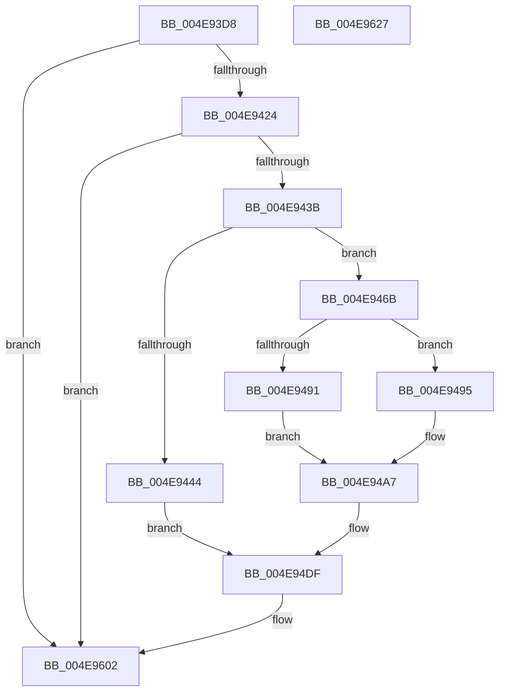

# PopBatteryTraceSystemBatteryStatus

- RVA: `0x004E93D8`–`0x004E9628` (길이 `592` bytes)
- VA: `0x00000001404E93D8`
- 실행 섹션: `.text`
- PDB 이름 있음: `예`; PDB Function 태그: `아니요`
- unwind 정보 RVA: `0x000CCF64`
- 디코드: `125`개 명령, `592/592` bytes 표시
- 미해석 바이트: `0` (있으면 어셈블리에 `.byte`로 보존)

> 이 문서는 커널 이미지의 기계어와 PDB 기호를 분석해 생성했습니다. 4번과 5번은 함수 원형과 자료형을 바이너리 사용 방식에서 추정한 C 해석이며 원본 소스 복구 결과는 아닙니다.

## 1. Dependencies

- 직접 호출 지점: **3**; 고유 호출 대상: **3**
- 직접 호출자로 확인된 함수: **2**
- RIP 상대 이미지 참조: **18**

### Outgoing calls
- `0x004E942E` → [EtwEventEnabled](../39/EtwEventEnabled_function_00392450.md) (function, `0x00392450`)
- `0x004E95FD` → [EtwWriteEx](../25/EtwWriteEx_function_0025F0D0.md) (function, `0x0025F0D0`)
- `0x004E9609` → [_security_check_cookie](../6A/_security_check_cookie_function_006AC640.md) (function, `0x006AC640`)

### Direct callers
- [PopBatteryEtwCallback](../../page/76/PopBatteryEtwCallback_function_00766800.md) at `0x00766817`
- [PopBatteryApplyCompositeState](../../page/AE/PopBatteryApplyCompositeState_function_00AE0CD0.md) at `0x00AE10B9`

### Static image references
- `0x004E93F3` → RVA `0x00E0A740` (`.data`; read)
- `0x004E9403` → RVA `0x0002A830` (`.rdata`; read)
- `0x004E940C` → RVA `0x0002A820` (`.rdata`; read)
- `0x004E9417` → RVA `0x00E678A8` (`.data`; read)
- `0x004E9424` → RVA `0x00F09050` (`.data`; read)
- `0x004E943B` → RVA `0x00F0C249` (`.data`; read)
- `0x004E946B` → RVA `0x00F0C060` (`.data`; read)
- `0x004E9471` → RVA `0x00F0C250` (`.data`; read)
- `0x004E947B` → RVA `0x00F0C064` (`.data`; read)
- `0x004E9495` → RVA `0x00F0C254` (`.data`; read)
- `0x004E94A7` → RVA `0x00F0C27C` (`.data`; read)
- `0x004E94AD` → RVA `0x00F0C278` (`.data`; read)
- `0x004E94B3` → RVA `0x00F0C274` (`.data`; read)
- `0x004E94BA` → RVA `0x00F0C270` (`.data`; read)
- `0x004E94C1` → RVA `0x00F0C26C` (`.data`; read)
- `0x004E94C8` → RVA `0x00F0C268` (`.data`; read)
- `0x004E94CF` → RVA `0x00F0C258` (`.data`; read)
- `0x004E94D9` → RVA `0x00F0C280` (`.data`; read)

## 2. Other-region calls and transfers

- 다른 실행 섹션으로 향하는 call: **0**
- 별도 외부 분기/꼬리 이동을 확인하지 못했습니다.

## 3. Assembly (complete function range)

```asm
004E93D8  48 8B C4                        mov rax, rsp
004E93DB  48 89 58 08                     mov qword ptr [rax + 8], rbx
004E93DF  48 89 70 10                     mov qword ptr [rax + 0x10], rsi
004E93E3  48 89 78 18                     mov qword ptr [rax + 0x18], rdi
004E93E7  55                              push rbp
004E93E8  48 8D 68 B8                     lea rbp, [rax - 0x48]
004E93EC  48 81 EC 40 01 00 00            sub rsp, 0x140
004E93F3  48 8B 05 46 13 92 00            mov rax, qword ptr [rip + 0x921346]
004E93FA  48 33 C4                        xor rax, rsp
004E93FD  48 89 45 30                     mov qword ptr [rbp + 0x30], rax
004E9401  33 F6                           xor esi, esi
004E9403  48 8D 05 26 14 B4 FF            lea rax, [rip - 0x4bebda]
004E940A  84 C9                           test cl, cl
004E940C  48 8D 1D 0D 14 B4 FF            lea rbx, [rip - 0x4bebf3]
004E9413  48 0F 45 D8                     cmovne rbx, rax
004E9417  40 38 35 8A E4 97 00            cmp byte ptr [rip + 0x97e48a], sil
004E941E  0F 84 DE 01 00 00               je 0x1404e9602
004E9424  48 8B 0D 25 FC A1 00            mov rcx, qword ptr [rip + 0xa1fc25]
004E942B  48 8B D3                        mov rdx, rbx
004E942E  E8 1D 90 EA FF                  call 0x140392450
004E9433  84 C0                           test al, al
004E9435  0F 84 C7 01 00 00               je 0x1404e9602
004E943B  40 38 35 07 2E A2 00            cmp byte ptr [rip + 0xa22e07], sil
004E9442  75 27                           jne 0x1404e946b
004E9444  83 C8 FF                        or eax, 0xffffffff
004E9447  89 74 24 40                     mov dword ptr [rsp + 0x40], esi
004E944B  8B C8                           mov ecx, eax
004E944D  89 74 24 44                     mov dword ptr [rsp + 0x44], esi
004E9451  8B D0                           mov edx, eax
004E9453  89 74 24 48                     mov dword ptr [rsp + 0x48], esi
004E9457  44 8B C0                        mov r8d, eax
004E945A  89 74 24 4C                     mov dword ptr [rsp + 0x4c], esi
004E945E  44 8B C8                        mov r9d, eax
004E9461  44 8B D0                        mov r10d, eax
004E9464  44 8B D8                        mov r11d, eax
004E9467  8B FE                           mov edi, esi
004E9469  EB 74                           jmp 0x1404e94df
004E946B  8B 05 EF 2B A2 00               mov eax, dword ptr [rip + 0xa22bef]
004E9471  8B 0D D9 2D A2 00               mov ecx, dword ptr [rip + 0xa22dd9]
004E9477  89 44 24 44                     mov dword ptr [rsp + 0x44], eax
004E947B  8B 05 E3 2B A2 00               mov eax, dword ptr [rip + 0xa22be3]
004E9481  89 44 24 48                     mov dword ptr [rsp + 0x48], eax
004E9485  C7 44 24 40 01 00 00 00         mov dword ptr [rsp + 0x40], 1
004E948D  85 C9                           test ecx, ecx
004E948F  75 04                           jne 0x1404e9495
004E9491  8B C6                           mov eax, esi
004E9493  EB 12                           jmp 0x1404e94a7
004E9495  8B 05 B9 2D A2 00               mov eax, dword ptr [rip + 0xa22db9]
004E949B  33 D2                           xor edx, edx
004E949D  48 69 C0 A0 86 01 00            imul rax, rax, 0x186a0
004E94A4  48 F7 F1                        div rcx
004E94A7  8B 0D CF 2D A2 00               mov ecx, dword ptr [rip + 0xa22dcf]
004E94AD  8B 15 C5 2D A2 00               mov edx, dword ptr [rip + 0xa22dc5]
004E94B3  44 8B 05 BA 2D A2 00            mov r8d, dword ptr [rip + 0xa22dba]
004E94BA  44 8B 0D AF 2D A2 00            mov r9d, dword ptr [rip + 0xa22daf]
004E94C1  44 8B 15 A4 2D A2 00            mov r10d, dword ptr [rip + 0xa22da4]
004E94C8  44 8B 1D 99 2D A2 00            mov r11d, dword ptr [rip + 0xa22d99]
004E94CF  8B 3D 83 2D A2 00               mov edi, dword ptr [rip + 0xa22d83]
004E94D5  89 44 24 4C                     mov dword ptr [rsp + 0x4c], eax
004E94D9  8B 05 A1 2D A2 00               mov eax, dword ptr [rip + 0xa22da1]
004E94DF  89 44 24 6C                     mov dword ptr [rsp + 0x6c], eax
004E94E3  48 8D 44 24 40                  lea rax, [rsp + 0x40]
004E94E8  48 89 44 24 70                  mov qword ptr [rsp + 0x70], rax
004E94ED  48 8D 44 24 44                  lea rax, [rsp + 0x44]
004E94F2  48 89 45 80                     mov qword ptr [rbp - 0x80], rax
004E94F6  48 8D 44 24 48                  lea rax, [rsp + 0x48]
004E94FB  48 89 45 90                     mov qword ptr [rbp - 0x70], rax
004E94FF  48 8D 44 24 4C                  lea rax, [rsp + 0x4c]
004E9504  48 89 45 A0                     mov qword ptr [rbp - 0x60], rax
004E9508  48 8D 44 24 50                  lea rax, [rsp + 0x50]
004E950D  48 89 45 B0                     mov qword ptr [rbp - 0x50], rax
004E9511  48 8D 44 24 54                  lea rax, [rsp + 0x54]
004E9516  48 89 45 C0                     mov qword ptr [rbp - 0x40], rax
004E951A  48 8D 44 24 58                  lea rax, [rsp + 0x58]
004E951F  48 89 45 D0                     mov qword ptr [rbp - 0x30], rax
004E9523  48 8D 44 24 5C                  lea rax, [rsp + 0x5c]
004E9528  48 89 45 E0                     mov qword ptr [rbp - 0x20], rax
004E952C  48 8D 44 24 60                  lea rax, [rsp + 0x60]
004E9531  48 89 45 F0                     mov qword ptr [rbp - 0x10], rax
004E9535  48 8D 44 24 64                  lea rax, [rsp + 0x64]
004E953A  48 89 45 00                     mov qword ptr [rbp], rax
004E953E  48 8D 44 24 68                  lea rax, [rsp + 0x68]
004E9543  48 89 45 10                     mov qword ptr [rbp + 0x10], rax
004E9547  48 8D 44 24 6C                  lea rax, [rsp + 0x6c]
004E954C  48 89 45 20                     mov qword ptr [rbp + 0x20], rax
004E9550  48 8D 44 24 70                  lea rax, [rsp + 0x70]
004E9555  48 89 44 24 38                  mov qword ptr [rsp + 0x38], rax
004E955A  C7 44 24 30 0C 00 00 00         mov dword ptr [rsp + 0x30], 0xc
004E9562  44 89 4C 24 5C                  mov dword ptr [rsp + 0x5c], r9d
004E9567  45 33 C9                        xor r9d, r9d
004E956A  44 89 44 24 60                  mov dword ptr [rsp + 0x60], r8d
004E956F  45 33 C0                        xor r8d, r8d
004E9572  89 54 24 64                     mov dword ptr [rsp + 0x64], edx
004E9576  48 8B D3                        mov rdx, rbx
004E9579  89 4C 24 68                     mov dword ptr [rsp + 0x68], ecx
004E957D  48 8B 0D CC FA A1 00            mov rcx, qword ptr [rip + 0xa1facc]
004E9584  48 89 74 24 28                  mov qword ptr [rsp + 0x28], rsi
004E9589  48 89 74 24 20                  mov qword ptr [rsp + 0x20], rsi
004E958E  89 7C 24 50                     mov dword ptr [rsp + 0x50], edi
004E9592  44 89 5C 24 54                  mov dword ptr [rsp + 0x54], r11d
004E9597  44 89 54 24 58                  mov dword ptr [rsp + 0x58], r10d
004E959C  48 C7 44 24 78 04 00 00 00      mov qword ptr [rsp + 0x78], 4
004E95A5  48 C7 45 88 04 00 00 00         mov qword ptr [rbp - 0x78], 4
004E95AD  48 C7 45 98 04 00 00 00         mov qword ptr [rbp - 0x68], 4
004E95B5  48 C7 45 A8 04 00 00 00         mov qword ptr [rbp - 0x58], 4
004E95BD  48 C7 45 B8 04 00 00 00         mov qword ptr [rbp - 0x48], 4
004E95C5  48 C7 45 C8 04 00 00 00         mov qword ptr [rbp - 0x38], 4
004E95CD  48 C7 45 D8 04 00 00 00         mov qword ptr [rbp - 0x28], 4
004E95D5  48 C7 45 E8 04 00 00 00         mov qword ptr [rbp - 0x18], 4
004E95DD  48 C7 45 F8 04 00 00 00         mov qword ptr [rbp - 8], 4
004E95E5  48 C7 45 08 04 00 00 00         mov qword ptr [rbp + 8], 4
004E95ED  48 C7 45 18 04 00 00 00         mov qword ptr [rbp + 0x18], 4
004E95F5  48 C7 45 28 04 00 00 00         mov qword ptr [rbp + 0x28], 4
004E95FD  E8 CE 5A D7 FF                  call 0x14025f0d0
004E9602  48 8B 4D 30                     mov rcx, qword ptr [rbp + 0x30]
004E9606  48 33 CC                        xor rcx, rsp
004E9609  E8 32 30 1C 00                  call 0x1406ac640
004E960E  4C 8D 9C 24 40 01 00 00         lea r11, [rsp + 0x140]
004E9616  49 8B 5B 10                     mov rbx, qword ptr [r11 + 0x10]
004E961A  49 8B 73 18                     mov rsi, qword ptr [r11 + 0x18]
004E961E  49 8B 7B 20                     mov rdi, qword ptr [r11 + 0x20]
004E9622  49 8B E3                        mov rsp, r11
004E9625  5D                              pop rbp
004E9626  C3                              ret
004E9627  CC                              int3
```

## 4. C-style interpretation (structured pseudocode)

```c
__int64 __fastcall PopBatteryTraceSystemBatteryStatus(unsigned __int8 a1)
{
    __int64 result;
    __int64 v_rbx;
    __int64 v_rsi;
    __int64 v_rsp;
    unsigned int v_stack_m100;
    unsigned int v_stack_m104;
    unsigned int v_stack_m108;
    unsigned __int64 v_stack_m110;
    unsigned int v_stack_m118;
    unsigned __int64 v_stack_m120;
    unsigned __int64 v_stack_m128;
    unsigned __int64 v_stack_m8;
    unsigned __int64 v_stack_mD0;
    unsigned __int64 v_stack_mD8;
    unsigned int v_stack_mDC;
    unsigned __int64 v_stack_mE0;
    unsigned __int64 v_stack_mE4;
    unsigned __int64 v_stack_mE8;
    unsigned __int64 v_stack_mEC;
    unsigned __int64 v_stack_mF0;
    unsigned __int64 v_stack_mF4;
    unsigned __int64 v_stack_mF8;
    unsigned int v_stack_mFC;

    *(unsigned __int64 *)(v_rsp + 8) = v_rbx;
    *(unsigned __int64 *)(v_rsp + 16) = v_rsi;
    *(unsigned __int64 *)(v_rsp + 24) = v_rdi;
    v_rsp = (v_rsp) - (320);
    result = (*(unsigned __int64 *)(v_rip + 9573190)) ^ (v_rsp);
    *(unsigned __int64 *)(v_rsp - 72 + 48) = result;
    v_rsi = 0;
    v_rbx = v_rip - 4975603;
    if (a1 != 0) { v_rbx = v_rip - 4975578; }
    if ((*(unsigned __int8 *)(v_rip + 9954442)) == 0) goto loc_004E9602;
    result = EtwEventEnabled(*(unsigned __int64 *)(v_rip + 10615845), v_rbx, a3, a4);
    if ((unsigned __int8)(result) == 0) goto loc_004E9602;
    if ((*(unsigned __int8 *)(v_rip + 10628615)) != 0) goto loc_004E946B;
    result = (unsigned int)((result) | (0xFFFFFFFFULL));
    v_stack_m108 = 0;
    v_stack_m104 = 0;
    v_stack_m100 = 0;
    v_stack_mFC = 0;
    goto loc_004E94DF;
loc_004E946B:
    v_stack_m104 = (unsigned int)((unsigned int)(*(unsigned int *)(v_rip + 10628079)));
    v_stack_m100 = (unsigned int)((unsigned int)(*(unsigned int *)(v_rip + 10628067)));
    v_stack_m108 = 1;
    if ((unsigned int)((unsigned int)(*(unsigned int *)(v_rip + 10628569))) != 0) goto loc_004E9495;
    goto loc_004E94A7;
loc_004E9495:
    a2 = 0;
    result = ((unsigned int)(*(unsigned int *)(v_rip + 10628537))) * ((unsigned int)(*(unsigned int *)(v_rip + 10628537)));
loc_004E94A7:
    v_stack_mFC = (unsigned int)(result);
loc_004E94DF:
    v_stack_mDC = (unsigned int)((unsigned int)(*(unsigned int *)(v_rip + 10628513)));
    v_stack_mD8 = v_stack_m108;
    *(unsigned __int64 *)(v_rsp - 72 - 128) = v_stack_m104;
    *(unsigned __int64 *)(v_rsp - 72 - 112) = v_stack_m100;
    *(unsigned __int64 *)(v_rsp - 72 - 96) = v_stack_mFC;
    *(unsigned __int64 *)(v_rsp - 72 - 80) = v_stack_mF8;
    *(unsigned __int64 *)(v_rsp - 72 - 64) = v_stack_mF4;
    *(unsigned __int64 *)(v_rsp - 72 - 48) = v_stack_mF0;
    *(unsigned __int64 *)(v_rsp - 72 - 32) = v_stack_mEC;
    *(unsigned __int64 *)(v_rsp - 72 - 16) = v_stack_mE8;
    *(unsigned __int64 *)(v_rsp - 72) = v_stack_mE4;
    *(unsigned __int64 *)(v_rsp - 72 + 16) = v_stack_mE0;
    *(unsigned __int64 *)(v_rsp - 72 + 32) = v_stack_mDC;
    v_stack_m110 = v_stack_mD8;
    v_stack_m118 = 12;
    v_stack_mEC = (unsigned int)((unsigned int)(*(unsigned int *)(v_rip + 10628527)));
    a4 = 0;
    v_stack_mE8 = (unsigned int)((unsigned int)(*(unsigned int *)(v_rip + 10628538)));
    a3 = 0;
    v_stack_mE4 = (unsigned int)((unsigned int)(*(unsigned int *)(v_rip + 10628549)));
    v_stack_mE0 = (unsigned int)((unsigned int)(*(unsigned int *)(v_rip + 10628559)));
    v_stack_m120 = 0;
    v_stack_m128 = 0;
    v_stack_mF8 = (unsigned int)((unsigned int)(*(unsigned int *)(v_rip + 10628483)));
    v_stack_mF4 = (unsigned int)((unsigned int)(*(unsigned int *)(v_rip + 10628505)));
    v_stack_mF0 = (unsigned int)((unsigned int)(*(unsigned int *)(v_rip + 10628516)));
    v_stack_mD0 = 4;
    *(unsigned __int64 *)(v_rsp - 72 - 120) = 4;
    *(unsigned __int64 *)(v_rsp - 72 - 104) = 4;
    *(unsigned __int64 *)(v_rsp - 72 - 88) = 4;
    *(unsigned __int64 *)(v_rsp - 72 - 72) = 4;
    *(unsigned __int64 *)(v_rsp - 72 - 56) = 4;
    *(unsigned __int64 *)(v_rsp - 72 - 40) = 4;
    *(unsigned __int64 *)(v_rsp - 72 - 24) = 4;
    *(unsigned __int64 *)(v_rsp - 72 - 8) = 4;
    *(unsigned __int64 *)(v_rsp - 72 + 8) = 4;
    *(unsigned __int64 *)(v_rsp - 72 + 24) = 4;
    *(unsigned __int64 *)(v_rsp - 72 + 40) = 4;
    result = EtwWriteEx(*(unsigned __int64 *)(v_rip + 10615500), v_rbx, a3, a4);
loc_004E9602:
    a1 = (*(unsigned __int64 *)(v_rsp - 72 + 48)) ^ (v_rsp);
    result = _security_check_cookie(a1, v_rbx, a3, a4);
    return result;
}
```

## 5. (Beta) C Style

```c
int64_t PopBatteryTraceSystemBatteryStatus(uint8_t Arg1)
{
    int64_t result;
    int64_t local_rbx;
    int64_t local_rsi;
    int64_t local_rsp;
    uint32_t v_stack_m100;
    uint32_t v_stack_m104;
    uint32_t v_stack_m108;
    uint64_t v_stack_m110;
    uint32_t v_stack_m118;
    uint64_t v_stack_m120;
    uint64_t v_stack_m128;
    uint64_t v_stack_m8;
    uint64_t v_stack_mD0;
    uint64_t v_stack_mD8;
    uint32_t v_stack_mDC;
    uint64_t v_stack_mE0;
    uint64_t v_stack_mE4;
    uint64_t v_stack_mE8;
    uint64_t v_stack_mEC;
    uint64_t v_stack_mF0;
    uint64_t v_stack_mF4;
    uint64_t v_stack_mF8;
    uint32_t v_stack_mFC;

    *(uint64_t *)(local_rsp + 0x8) = local_rbx;
    *(uint64_t *)(local_rsp + 0x10) = local_rsi;
    *(uint64_t *)(local_rsp + 0x18) = local_rdi;
    local_rsp = (local_rsp) - (320);
    result = (*(uint64_t *)(v_rip + 0x921346)) ^ (local_rsp);
    *(uint64_t *)(local_rsp - 0x48 + 0x30) = result;
    local_rsi = 0;
    local_rbx = v_rip - 4975603;
    if (Arg1 != 0) { local_rbx = v_rip - 4975578; }
    if ((*(uint8_t *)(v_rip + 0x97E48A)) == 0) goto loc_004E9602;
    result = EtwEventEnabled(*(uint64_t *)(v_rip + 0xA1FC25), local_rbx, a3, a4);
    if ((uint8_t)(result) == 0) goto loc_004E9602;
    if ((*(uint8_t *)(v_rip + 0xA22E07)) != 0) goto loc_004E946B;
    result = (uint32_t)((result) | (0xFFFFFFFFULL));
    v_stack_m108 = 0;
    v_stack_m104 = 0;
    v_stack_m100 = 0;
    v_stack_mFC = 0;
    goto loc_004E94DF;
loc_004E946B:
    v_stack_m104 = (uint32_t)((uint32_t)(*(uint32_t *)(v_rip + 0xA22BEF)));
    v_stack_m100 = (uint32_t)((uint32_t)(*(uint32_t *)(v_rip + 0xA22BE3)));
    v_stack_m108 = 1;
    if ((uint32_t)((uint32_t)(*(uint32_t *)(v_rip + 0xA22DD9))) != 0) goto loc_004E9495;
    goto loc_004E94A7;
loc_004E9495:
    a2 = 0;
    result = ((uint32_t)(*(uint32_t *)(v_rip + 0xA22DB9))) * ((uint32_t)(*(uint32_t *)(v_rip + 0xA22DB9)));
loc_004E94A7:
    v_stack_mFC = (uint32_t)(result);
loc_004E94DF:
    v_stack_mDC = (uint32_t)((uint32_t)(*(uint32_t *)(v_rip + 0xA22DA1)));
    v_stack_mD8 = v_stack_m108;
    *(uint64_t *)(local_rsp - 0x48 - 0x80) = v_stack_m104;
    *(uint64_t *)(local_rsp - 0x48 - 0x70) = v_stack_m100;
    *(uint64_t *)(local_rsp - 0x48 - 0x60) = v_stack_mFC;
    *(uint64_t *)(local_rsp - 0x48 - 0x50) = v_stack_mF8;
    *(uint64_t *)(local_rsp - 0x48 - 0x40) = v_stack_mF4;
    *(uint64_t *)(local_rsp - 0x48 - 0x30) = v_stack_mF0;
    *(uint64_t *)(local_rsp - 0x48 - 0x20) = v_stack_mEC;
    *(uint64_t *)(local_rsp - 0x48 - 0x10) = v_stack_mE8;
    *(uint64_t *)(local_rsp - 0x48) = v_stack_mE4;
    *(uint64_t *)(local_rsp - 0x48 + 0x10) = v_stack_mE0;
    *(uint64_t *)(local_rsp - 0x48 + 0x20) = v_stack_mDC;
    v_stack_m110 = v_stack_mD8;
    v_stack_m118 = 12;
    v_stack_mEC = (uint32_t)((uint32_t)(*(uint32_t *)(v_rip + 0xA22DAF)));
    a4 = 0;
    v_stack_mE8 = (uint32_t)((uint32_t)(*(uint32_t *)(v_rip + 0xA22DBA)));
    a3 = 0;
    v_stack_mE4 = (uint32_t)((uint32_t)(*(uint32_t *)(v_rip + 0xA22DC5)));
    v_stack_mE0 = (uint32_t)((uint32_t)(*(uint32_t *)(v_rip + 0xA22DCF)));
    v_stack_m120 = 0;
    v_stack_m128 = 0;
    v_stack_mF8 = (uint32_t)((uint32_t)(*(uint32_t *)(v_rip + 0xA22D83)));
    v_stack_mF4 = (uint32_t)((uint32_t)(*(uint32_t *)(v_rip + 0xA22D99)));
    v_stack_mF0 = (uint32_t)((uint32_t)(*(uint32_t *)(v_rip + 0xA22DA4)));
    v_stack_mD0 = 4;
    *(uint64_t *)(local_rsp - 0x48 - 0x78) = 4;
    *(uint64_t *)(local_rsp - 0x48 - 0x68) = 4;
    *(uint64_t *)(local_rsp - 0x48 - 0x58) = 4;
    *(uint64_t *)(local_rsp - 0x48 - 0x48) = 4;
    *(uint64_t *)(local_rsp - 0x48 - 0x38) = 4;
    *(uint64_t *)(local_rsp - 0x48 - 0x28) = 4;
    *(uint64_t *)(local_rsp - 0x48 - 0x18) = 4;
    *(uint64_t *)(local_rsp - 0x48 - 0x8) = 4;
    *(uint64_t *)(local_rsp - 0x48 + 0x8) = 4;
    *(uint64_t *)(local_rsp - 0x48 + 0x18) = 4;
    *(uint64_t *)(local_rsp - 0x48 + 0x28) = 4;
    result = EtwWriteEx(*(uint64_t *)(v_rip + 0xA1FACC), local_rbx, a3, a4);
loc_004E9602:
    Arg1 = (*(uint64_t *)(local_rsp - 0x48 + 0x30)) ^ (local_rsp);
    result = _security_check_cookie(Arg1, local_rbx, a3, a4);
    return result;
}
```

## 6. Execution-region graph

[열기: 2D/3D 그래프와 함수 탐색 컨트롤 패널](../../../control-panel.html?section=text&rva=0x004E93D8&view=graph)

- 2D 그래프는 위에서 아래로 흐르고, 3D 그래프는 빈 공간을 드래그해 회전합니다. Shift+드래그는 이동, 휠은 확대·축소, 함수 노드 선택은 대상 보고서 이동입니다.

### Static fallback


