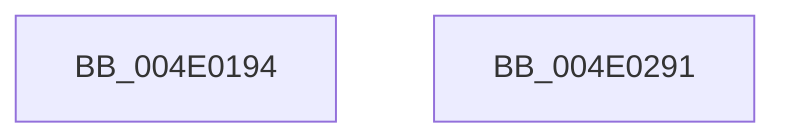

# PopDiagTraceCsResiliencyEnter

- RVA: `0x004E0194`–`0x004E0292` (길이 `254` bytes)
- VA: `0x00000001404E0194`
- 실행 섹션: `.text`
- PDB 이름 있음: `예`; PDB Function 태그: `아니요`
- unwind 정보 RVA: `0x0005E6B4`
- 디코드: `52`개 명령, `254/254` bytes 표시
- 미해석 바이트: `0` (있으면 어셈블리에 `.byte`로 보존)

> 이 문서는 커널 이미지의 기계어와 PDB 기호를 분석해 생성했습니다. 4번과 5번은 함수 원형과 자료형을 바이너리 사용 방식에서 추정한 C 해석이며 원본 소스 복구 결과는 아닙니다.

## 1. Dependencies

- 직접 호출 지점: **4**; 고유 호출 대상: **4**
- 직접 호출자로 확인된 함수: **1**
- RIP 상대 이미지 참조: **22**

### Outgoing calls
- `0x004E01B6` → [PopIsRemoteDesktopEnabled](../../page/AD/PopIsRemoteDesktopEnabled_function_00AD6E64.md) (function, `0x00AD6E64`)
- `0x004E01C4` → [KeAcquireSpinLockRaiseToDpc](../20/KeAcquireSpinLockRaiseToDpc_function_00208470.md) (function, `0x00208470`)
- `0x004E01DB` → [memset](../6C/memset_function_006C6C40.md) (function, `0x006C6C40`)
- `0x004E0271` → [KeReleaseSpinLock](../39/KeReleaseSpinLock_function_00392BA0.md) (function, `0x00392BA0`)

### Direct callers
- [PopSleepstudyCaptureResiliencyStatistics](../../page/AD/PopSleepstudyCaptureResiliencyStatistics_function_00AD6B74.md) at `0x00AD6C00`

### Static image references
- `0x004E01BB` → RVA `0x00F0CA58` (`.data`; read)
- `0x004E01CB` → RVA `0x00F0C740` (`.data`; read)
- `0x004E01E0` → RVA `0x00F0CE64` (`.data`; read)
- `0x004E01E6` → RVA `0x00F08888` (`.data`; read)
- `0x004E01EC` → RVA `0x00F0C7C8` (`.data`; read/write)
- `0x004E01F4` → RVA `0x00E678E0` (`.data`; read)
- `0x004E01FA` → RVA `0x00F0CE0C` (`.data`; read)
- `0x004E0201` → RVA `0x00F0C771` (`.data`; write)
- `0x004E0207` → RVA `0x00E67A2C` (`.data`; read)
- `0x004E020D` → RVA `0x00F0C741` (`.data`; write)
- `0x004E0214` → RVA `0x00F0C760` (`.data`; write)
- `0x004E021A` → RVA `0x00E67A08` (`.data`; read)
- `0x004E0220` → RVA `0x00F0C742` (`.data`; write)
- `0x004E0226` → RVA `0x00F0CE65` (`.data`; read)
- `0x004E022C` → RVA `0x00F0C764` (`.data`; write)
- `0x004E0235` → RVA `0x00F0C743` (`.data`; write)
- `0x004E0242` → RVA `0x00F0C76C` (`.data`; write)
- `0x004E024B` → RVA `0x00F0C744` (`.data`; write)
- `0x004E0251` → RVA `0x00F0C740` (`.data`; write)
- `0x004E0258` → RVA `0x00F0C770` (`.data`; write)
- `0x004E025E` → RVA `0x00F0C748` (`.data`; write)
- `0x004E0269` → RVA `0x00F0C750` (`.data`; write)

## 2. Other-region calls and transfers

- 다른 실행 섹션으로 향하는 call: **1**
  - `0x004E01B6` → [PopIsRemoteDesktopEnabled](../../page/AD/PopIsRemoteDesktopEnabled_function_00AD6E64.md) (`.text` → `PAGE`)
- 별도 외부 분기/꼬리 이동을 확인하지 못했습니다.

## 3. Assembly (complete function range)

```asm
004E0194  48 8B C4                        mov rax, rsp
004E0197  48 89 58 08                     mov qword ptr [rax + 8], rbx
004E019B  48 89 68 10                     mov qword ptr [rax + 0x10], rbp
004E019F  48 89 70 18                     mov qword ptr [rax + 0x18], rsi
004E01A3  48 89 78 20                     mov qword ptr [rax + 0x20], rdi
004E01A7  41 56                           push r14
004E01A9  48 83 EC 20                     sub rsp, 0x20
004E01AD  4D 8B F0                        mov r14, r8
004E01B0  40 8A EA                        mov bpl, dl
004E01B3  48 8B F1                        mov rsi, rcx
004E01B6  E8 A9 6C 5F 00                  call 0x140ad6e64
004E01BB  48 8D 0D 96 C8 A2 00            lea rcx, [rip + 0xa2c896]
004E01C2  8A D8                           mov bl, al
004E01C4  E8 A7 82 D2 FF                  call 0x140208470
004E01C9  33 D2                           xor edx, edx
004E01CB  48 8D 0D 6E C5 A2 00            lea rcx, [rip + 0xa2c56e]
004E01D2  41 B8 50 01 00 00               mov r8d, 0x150
004E01D8  40 8A F8                        mov dil, al
004E01DB  E8 60 6A 1E 00                  call 0x1406c6c40
004E01E0  8A 0D 7E CC A2 00               mov cl, byte ptr [rip + 0xa2cc7e]
004E01E6  8A 05 9C 86 A2 00               mov al, byte ptr [rip + 0xa2869c]
004E01EC  48 83 0D D4 C5 A2 00 FF         or qword ptr [rip + 0xa2c5d4], 0xffffffffffffffff
004E01F4  8B 15 E6 76 98 00               mov edx, dword ptr [rip + 0x9876e6]
004E01FA  83 3D 0B CC A2 00 00            cmp dword ptr [rip + 0xa2cc0b], 0
004E0201  88 05 6A C5 A2 00               mov byte ptr [rip + 0xa2c56a], al
004E0207  8B 05 1F 78 98 00               mov eax, dword ptr [rip + 0x98781f]
004E020D  0F 94 05 2D C5 A2 00            sete byte ptr [rip + 0xa2c52d]
004E0214  89 05 46 C5 A2 00               mov dword ptr [rip + 0xa2c546], eax
004E021A  8B 05 E8 77 98 00               mov eax, dword ptr [rip + 0x9877e8]
004E0220  88 0D 1C C5 A2 00               mov byte ptr [rip + 0xa2c51c], cl
004E0226  8A 0D 39 CC A2 00               mov cl, byte ptr [rip + 0xa2cc39]
004E022C  89 05 32 C5 A2 00               mov dword ptr [rip + 0xa2c532], eax
004E0232  8B 46 0C                        mov eax, dword ptr [rsi + 0xc]
004E0235  88 0D 08 C5 A2 00               mov byte ptr [rip + 0xa2c508], cl
004E023B  48 8D 0D 16 C8 A2 00            lea rcx, [rip + 0xa2c816]
004E0242  89 15 24 C5 A2 00               mov dword ptr [rip + 0xa2c524], edx
004E0248  40 8A D7                        mov dl, dil
004E024B  89 05 F3 C4 A2 00               mov dword ptr [rip + 0xa2c4f3], eax
004E0251  C6 05 E8 C4 A2 00 01            mov byte ptr [rip + 0xa2c4e8], 1
004E0258  88 1D 12 C5 A2 00               mov byte ptr [rip + 0xa2c512], bl
004E025E  40 88 2D E3 C4 A2 00            mov byte ptr [rip + 0xa2c4e3], bpl
004E0265  41 0F 10 06                     movups xmm0, xmmword ptr [r14]
004E0269  F3 0F 7F 05 DF C4 A2 00         movdqu xmmword ptr [rip + 0xa2c4df], xmm0
004E0271  E8 2A 29 EB FF                  call 0x140392ba0
004E0276  48 8B 5C 24 30                  mov rbx, qword ptr [rsp + 0x30]
004E027B  48 8B 6C 24 38                  mov rbp, qword ptr [rsp + 0x38]
004E0280  48 8B 74 24 40                  mov rsi, qword ptr [rsp + 0x40]
004E0285  48 8B 7C 24 48                  mov rdi, qword ptr [rsp + 0x48]
004E028A  48 83 C4 20                     add rsp, 0x20
004E028E  41 5E                           pop r14
004E0290  C3                              ret
004E0291  CC                              int3
```

## 4. C-style interpretation (structured pseudocode)

```c
__int64 __fastcall PopDiagTraceCsResiliencyEnter(__int64 a1, int a2, __int64 a3)
{
    __int64 result;
    __int64 v_rsp;
    unsigned __int64 v_stack_p10;
    unsigned __int64 v_stack_p18;
    unsigned __int64 v_stack_p20;
    unsigned __int64 v_stack_p8;

    *(unsigned __int64 *)(v_rsp + 8) = v_rbx;
    *(unsigned __int64 *)(v_rsp + 16) = v_rbp;
    *(unsigned __int64 *)(v_rsp + 24) = v_rsi;
    *(unsigned __int64 *)(v_rsp + 32) = v_rdi;
    v_rsp = (v_rsp) - (32);
    result = PopIsRemoteDesktopEnabled(a1, a2, a3, a4);
    result = KeAcquireSpinLockRaiseToDpc(v_rip + 10668182, a2, a3, a4);
    a2 = 0;
    result = memset(v_rip + 10667374, a2, 336, a4);
    *(unsigned __int8 *)(v_rip + 10667370) = (unsigned __int8)(*(unsigned __int8 *)(v_rip + 10651292));
    *(unsigned int *)(v_rip + 10667334) = (unsigned int)((unsigned int)(*(unsigned int *)(v_rip + 9992223)));
    *(unsigned __int8 *)(v_rip + 10667292) = (unsigned __int8)(*(unsigned __int8 *)(v_rip + 10669182));
    *(unsigned int *)(v_rip + 10667314) = (unsigned int)((unsigned int)(*(unsigned int *)(v_rip + 9992168)));
    *(unsigned __int8 *)(v_rip + 10667272) = (unsigned __int8)(*(unsigned __int8 *)(v_rip + 10669113));
    *(unsigned int *)(v_rip + 10667300) = (unsigned int)((unsigned int)(*(unsigned int *)(v_rip + 9991910)));
    *(unsigned int *)(v_rip + 10667251) = (unsigned int)((unsigned int)(*(unsigned int *)(a1 + 12)));
    *(unsigned __int8 *)(v_rip + 10667240) = 1;
    *(unsigned __int8 *)(v_rip + 10667282) = (unsigned __int8)((unsigned __int8)(result));
    *(unsigned __int8 *)(v_rip + 10667235) = (unsigned __int8)((unsigned __int8)(a2));
    *(unsigned __int64 *)(v_rip + 10667231) = v_xmm0;
    result = KeReleaseSpinLock(v_rip + 10668054, (unsigned __int8)((unsigned __int8)(result)), 336, a4);
    v_rsp = (v_rsp) + (32);
    return result;
}
```

## 5. (Beta) C Style

```c
int64_t PopDiagTraceCsResiliencyEnter(void *Arg1, int32_t Arg2, void *Arg3)
{
    uint8_t *arg1 = (uint8_t *)Arg1;
    uint8_t *arg3 = (uint8_t *)Arg3;

    int64_t result;
    int64_t local_rsp;
    uint64_t v_stack_p10;
    uint64_t v_stack_p18;
    uint64_t v_stack_p20;
    uint64_t v_stack_p8;

    *(uint64_t *)(local_rsp + 0x8) = local_rbx;
    *(uint64_t *)(local_rsp + 0x10) = local_rbp;
    *(uint64_t *)(local_rsp + 0x18) = local_rsi;
    *(uint64_t *)(local_rsp + 0x20) = local_rdi;
    local_rsp = (local_rsp) - (32);
    result = PopIsRemoteDesktopEnabled(Arg1, Arg2, Arg3, a4);
    result = KeAcquireSpinLockRaiseToDpc(v_rip + 10668182, Arg2, Arg3, a4);
    Arg2 = 0;
    result = memset(v_rip + 10667374, Arg2, 336, a4);
    *(uint8_t *)(v_rip + 0xA2C56A) = (uint8_t)(*(uint8_t *)(v_rip + 0xA2869C));
    *(uint32_t *)(v_rip + 0xA2C546) = (uint32_t)((uint32_t)(*(uint32_t *)(v_rip + 0x98781F)));
    *(uint8_t *)(v_rip + 0xA2C51C) = (uint8_t)(*(uint8_t *)(v_rip + 0xA2CC7E));
    *(uint32_t *)(v_rip + 0xA2C532) = (uint32_t)((uint32_t)(*(uint32_t *)(v_rip + 0x9877E8)));
    *(uint8_t *)(v_rip + 0xA2C508) = (uint8_t)(*(uint8_t *)(v_rip + 0xA2CC39));
    *(uint32_t *)(v_rip + 0xA2C524) = (uint32_t)((uint32_t)(*(uint32_t *)(v_rip + 0x9876E6)));
    *(uint32_t *)(v_rip + 0xA2C4F3) = (uint32_t)((uint32_t)(*(uint32_t *)(arg1 + 0xC)));
    *(uint8_t *)(v_rip + 0xA2C4E8) = 1;
    *(uint8_t *)(v_rip + 0xA2C512) = (uint8_t)((uint8_t)(result));
    *(uint8_t *)(v_rip + 0xA2C4E3) = (uint8_t)((uint8_t)(Arg2));
    *(uint64_t *)(v_rip + 0xA2C4DF) = v_xmm0;
    result = KeReleaseSpinLock(v_rip + 10668054, (uint8_t)((uint8_t)(result)), 336, a4);
    local_rsp = (local_rsp) + (32);
    return result;
}
```

### 관측된 메모리 오프셋

구조체 형식이 확인되지 않은 접근은 인자 기준의 오프셋으로만 기록했습니다.

| 기준 인자 | 오프셋 표현 | 폭 (bit) | 접근 |
|---|---:|---:|---|
| `Arg1` | `+ 0xC` | `32` | `R` |
| `Arg3` | `+ 0x0` | `128` | `R` |

## 6. Execution-region graph

[열기: 2D/3D 그래프와 함수 탐색 컨트롤 패널](../../../control-panel.html?section=text&rva=0x004E0194&view=graph)

- 2D 그래프는 위에서 아래로 흐르고, 3D 그래프는 빈 공간을 드래그해 회전합니다. Shift+드래그는 이동, 휠은 확대·축소, 함수 노드 선택은 대상 보고서 이동입니다.

### Static fallback


