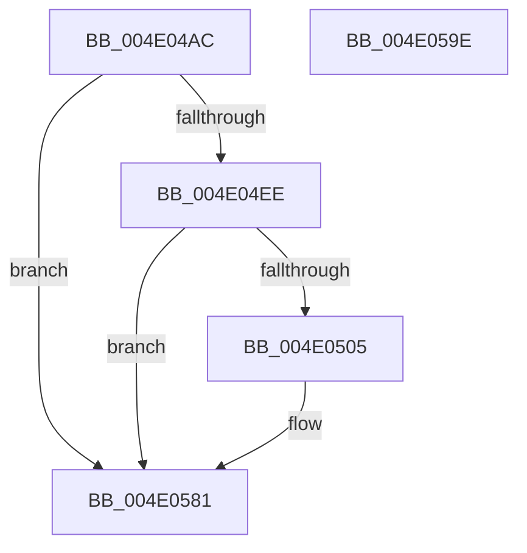

# PopDiagTraceFxDeviceDirectedCompletion

- RVA: `0x004E04AC`–`0x004E059F` (길이 `243` bytes)
- VA: `0x00000001404E04AC`
- 실행 섹션: `.text`
- PDB 이름 있음: `예`; PDB Function 태그: `아니요`
- unwind 정보 RVA: `0x000BF008`
- 디코드: `55`개 명령, `243/243` bytes 표시
- 미해석 바이트: `0` (있으면 어셈블리에 `.byte`로 보존)

> 이 문서는 커널 이미지의 기계어와 PDB 기호를 분석해 생성했습니다. 4번과 5번은 함수 원형과 자료형을 바이너리 사용 방식에서 추정한 C 해석이며 원본 소스 복구 결과는 아닙니다.

## 1. Dependencies

- 직접 호출 지점: **4**; 고유 호출 대상: **4**
- 직접 호출자로 확인된 함수: **1**
- RIP 상대 이미지 참조: **4**

### Outgoing calls
- `0x004E04DC` → [PopFxAddLogEntry](../39/PopFxAddLogEntry_function_00390B94.md) (function, `0x00390B94`)
- `0x004E04FC` → [EtwEventEnabled](../39/EtwEventEnabled_function_00392450.md) (function, `0x00392450`)
- `0x004E057C` → [EtwWriteEx](../25/EtwWriteEx_function_0025F0D0.md) (function, `0x0025F0D0`)
- `0x004E0588` → [_security_check_cookie](../6A/_security_check_cookie_function_006AC640.md) (function, `0x006AC640`)

### Direct callers
- [PopFxCompleteDirectedPowerTransition](../4F/PopFxCompleteDirectedPowerTransition_function_004FB330.md) at `0x004FB427`

### Static image references
- `0x004E04BE` → RVA `0x00E0A740` (`.data`; read)
- `0x004E04E1` → RVA `0x00E67858` (`.data`; read)
- `0x004E04EE` → RVA `0x00F0B408` (`.data`; read)
- `0x004E04F5` → RVA `0x00021178` (`.rdata`; read)

## 2. Other-region calls and transfers

- 다른 실행 섹션으로 향하는 call: **0**
- 별도 외부 분기/꼬리 이동을 확인하지 못했습니다.

## 3. Assembly (complete function range)

```asm
004E04AC  48 89 5C 24 10                  mov qword ptr [rsp + 0x10], rbx
004E04B1  55                              push rbp
004E04B2  48 8D 6C 24 A9                  lea rbp, [rsp - 0x57]
004E04B7  48 81 EC 90 00 00 00            sub rsp, 0x90
004E04BE  48 8B 05 7B A2 92 00            mov rax, qword ptr [rip + 0x92a27b]
004E04C5  48 33 C4                        xor rax, rsp
004E04C8  48 89 45 47                     mov qword ptr [rbp + 0x47], rax
004E04CC  0F B6 DA                        movzx ebx, dl
004E04CF  33 D2                           xor edx, edx
004E04D1  44 8B CB                        mov r9d, ebx
004E04D4  48 89 4D 0F                     mov qword ptr [rbp + 0xf], rcx
004E04D8  44 8D 42 1A                     lea r8d, [rdx + 0x1a]
004E04DC  E8 B3 06 EB FF                  call 0x140390b94
004E04E1  80 3D 70 73 98 00 00            cmp byte ptr [rip + 0x987370], 0
004E04E8  0F 84 93 00 00 00               je 0x1404e0581
004E04EE  48 8B 0D 13 AF A2 00            mov rcx, qword ptr [rip + 0xa2af13]
004E04F5  48 8D 15 7C 0C B4 FF            lea rdx, [rip - 0x4bf384]
004E04FC  E8 4F 1F EB FF                  call 0x140392450
004E0501  84 C0                           test al, al
004E0503  74 7C                           je 0x1404e0581
004E0505  48 8B 45 0F                     mov rax, qword ptr [rbp + 0xf]
004E0509  48 8D 15 68 0C B4 FF            lea rdx, [rip - 0x4bf398]
004E0510  45 33 C9                        xor r9d, r9d
004E0513  45 33 C0                        xor r8d, r8d
004E0516  8B 88 9C 00 00 00               mov ecx, dword ptr [rax + 0x9c]
004E051C  48 8D 45 0F                     lea rax, [rbp + 0xf]
004E0520  83 65 23 00                     and dword ptr [rbp + 0x23], 0
004E0524  83 65 33 00                     and dword ptr [rbp + 0x33], 0
004E0528  83 65 43 00                     and dword ptr [rbp + 0x43], 0
004E052C  48 89 45 17                     mov qword ptr [rbp + 0x17], rax
004E0530  48 8D 45 07                     lea rax, [rbp + 7]
004E0534  48 89 45 27                     mov qword ptr [rbp + 0x27], rax
004E0538  48 8D 45 0B                     lea rax, [rbp + 0xb]
004E053C  89 4D 0B                        mov dword ptr [rbp + 0xb], ecx
004E053F  B9 04 00 00 00                  mov ecx, 4
004E0544  48 89 45 37                     mov qword ptr [rbp + 0x37], rax
004E0548  48 8D 45 17                     lea rax, [rbp + 0x17]
004E054C  48 89 44 24 38                  mov qword ptr [rsp + 0x38], rax
004E0551  C7 44 24 30 03 00 00 00         mov dword ptr [rsp + 0x30], 3
004E0559  48 83 64 24 28 00               and qword ptr [rsp + 0x28], 0
004E055F  48 83 64 24 20 00               and qword ptr [rsp + 0x20], 0
004E0565  89 4D 2F                        mov dword ptr [rbp + 0x2f], ecx
004E0568  89 4D 3F                        mov dword ptr [rbp + 0x3f], ecx
004E056B  48 8B 0D 96 AE A2 00            mov rcx, qword ptr [rip + 0xa2ae96]
004E0572  89 5D 07                        mov dword ptr [rbp + 7], ebx
004E0575  C7 45 1F 08 00 00 00            mov dword ptr [rbp + 0x1f], 8
004E057C  E8 4F EB D7 FF                  call 0x14025f0d0
004E0581  48 8B 4D 47                     mov rcx, qword ptr [rbp + 0x47]
004E0585  48 33 CC                        xor rcx, rsp
004E0588  E8 B3 C0 1C 00                  call 0x1406ac640
004E058D  48 8B 9C 24 A8 00 00 00         mov rbx, qword ptr [rsp + 0xa8]
004E0595  48 81 C4 90 00 00 00            add rsp, 0x90
004E059C  5D                              pop rbp
004E059D  C3                              ret
004E059E  CC                              int3
```

## 4. C-style interpretation (structured pseudocode)

```c
__int64 __fastcall PopDiagTraceFxDeviceDirectedCompletion(__int64 a1, int a2)
{
    __int64 result;
    __int64 v_rsp;
    unsigned __int64 v_stack_m18;
    unsigned int v_stack_m1C;
    unsigned int v_stack_m20;
    unsigned __int64 v_stack_m28;
    unsigned int v_stack_m2C;
    unsigned int v_stack_m30;
    unsigned __int64 v_stack_m38;
    unsigned int v_stack_m3C;
    unsigned int v_stack_m40;
    unsigned __int64 v_stack_m48;
    unsigned __int64 v_stack_m50;
    unsigned __int64 v_stack_m54;
    unsigned __int64 v_stack_m58;
    unsigned __int64 v_stack_m5F;
    unsigned __int64 v_stack_m60;
    unsigned int v_stack_m68;
    unsigned __int64 v_stack_m70;
    unsigned __int64 v_stack_m78;
    unsigned __int64 v_stack_p10;

    v_stack_p10 = v_rbx;
    v_rsp = (v_rsp) - (144);
    result = (*(unsigned __int64 *)(v_rip + 9609851)) ^ (v_rsp);
    v_stack_m18 = result;
    a2 = 0;
    v_stack_m50 = a1;
    result = PopFxAddLogEntry(a1, a2, a2 + 26, (unsigned int)((unsigned int)((unsigned __int8)(a2))));
    if ((*(unsigned __int8 *)(v_rip + 9991024)) == 0) goto loc_004E0581;
    result = EtwEventEnabled(*(unsigned __int64 *)(v_rip + 10661651), v_rip - 4977540, a2 + 26, (unsigned int)((unsigned int)((unsigned __int8)(a2))));
    if ((unsigned __int8)(result) != 0) {
        result = v_stack_m50;
        a2 = v_rip - 4977560;
        a4 = 0;
        a3 = 0;
        a1 = *(unsigned int *)(result + 156);
        result = v_stack_m50;
        v_stack_m48 = result;
        result = v_stack_m58;
        v_stack_m38 = result;
        result = v_stack_m54;
        v_stack_m54 = (unsigned int)(a1);
        a1 = 4;
        v_stack_m28 = result;
        result = v_stack_m48;
        v_stack_m60 = result;
        v_stack_m68 = 3;
        v_stack_m30 = (unsigned int)(a1);
        v_stack_m20 = (unsigned int)(a1);
        a1 = *(unsigned __int64 *)(v_rip + 10661526);
        v_stack_m58 = (unsigned int)((unsigned __int8)(a2));
        v_stack_m40 = 8;
        result = EtwWriteEx(a1, a2, a3, a4);
    }
    a1 = (v_stack_m18) ^ (v_rsp);
    result = _security_check_cookie(a1, a2, a3, a4);
    v_rsp = (v_rsp) + (144);
    return result;
}
```

## 5. (Beta) C Style

```c
int64_t PopDiagTraceFxDeviceDirectedCompletion(int64_t Arg1, int32_t Arg2)
{
    int64_t result;
    int64_t local_rsp;
    uint64_t v_stack_m18;
    uint32_t v_stack_m1C;
    uint32_t v_stack_m20;
    uint64_t v_stack_m28;
    uint32_t v_stack_m2C;
    uint32_t v_stack_m30;
    uint64_t v_stack_m38;
    uint32_t v_stack_m3C;
    uint32_t v_stack_m40;
    uint64_t v_stack_m48;
    uint64_t v_stack_m50;
    uint64_t v_stack_m54;
    uint64_t v_stack_m58;
    uint64_t v_stack_m5F;
    uint64_t v_stack_m60;
    uint32_t v_stack_m68;
    uint64_t v_stack_m70;
    uint64_t v_stack_m78;
    uint64_t v_stack_p10;

    v_stack_p10 = local_rbx;
    local_rsp = (local_rsp) - (144);
    result = (*(uint64_t *)(v_rip + 0x92A27B)) ^ (local_rsp);
    v_stack_m18 = result;
    Arg2 = 0;
    v_stack_m50 = Arg1;
    result = PopFxAddLogEntry(Arg1, Arg2, Arg2 + 26, (uint32_t)((uint32_t)((uint8_t)(Arg2))));
    if ((*(uint8_t *)(v_rip + 0x987370)) == 0) goto loc_004E0581;
    result = EtwEventEnabled(*(uint64_t *)(v_rip + 0xA2AF13), v_rip - 4977540, Arg2 + 26, (uint32_t)((uint32_t)((uint8_t)(Arg2))));
    if ((uint8_t)(result) != 0) {
        result = v_stack_m50;
        Arg2 = v_rip - 4977560;
        a4 = 0;
        a3 = 0;
        Arg1 = *(uint32_t *)(result + 0x9C);
        result = v_stack_m50;
        v_stack_m48 = result;
        result = v_stack_m58;
        v_stack_m38 = result;
        result = v_stack_m54;
        v_stack_m54 = (uint32_t)(Arg1);
        Arg1 = 4;
        v_stack_m28 = result;
        result = v_stack_m48;
        v_stack_m60 = result;
        v_stack_m68 = 3;
        v_stack_m30 = (uint32_t)(Arg1);
        v_stack_m20 = (uint32_t)(Arg1);
        Arg1 = *(uint64_t *)(v_rip + 0xA2AE96);
        v_stack_m58 = (uint32_t)((uint8_t)(Arg2));
        v_stack_m40 = 8;
        result = EtwWriteEx(Arg1, Arg2, a3, a4);
    }
    Arg1 = (v_stack_m18) ^ (local_rsp);
    result = _security_check_cookie(Arg1, Arg2, a3, a4);
    local_rsp = (local_rsp) + (144);
    return result;
}
```

## 6. Execution-region graph

[열기: 2D/3D 그래프와 함수 탐색 컨트롤 패널](../../../control-panel.html?section=text&rva=0x004E04AC&view=graph)

- 2D 그래프는 위에서 아래로 흐르고, 3D 그래프는 빈 공간을 드래그해 회전합니다. Shift+드래그는 이동, 휠은 확대·축소, 함수 노드 선택은 대상 보고서 이동입니다.

### Static fallback


