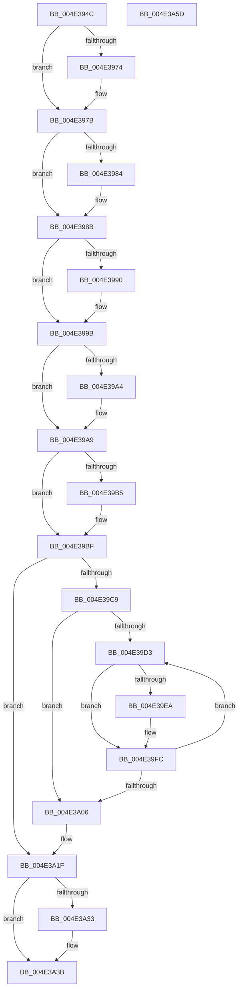

# PopFxDestroyDeviceDpm

- RVA: `0x004E394C`–`0x004E3A5E` (길이 `274` bytes)
- VA: `0x00000001404E394C`
- 실행 섹션: `.text`
- PDB 이름 있음: `예`; PDB Function 태그: `아니요`
- unwind 정보 RVA: `0x0005C954`
- 디코드: `68`개 명령, `274/274` bytes 표시
- 미해석 바이트: `0` (있으면 어셈블리에 `.byte`로 보존)

> 이 문서는 커널 이미지의 기계어와 PDB 기호를 분석해 생성했습니다. 4번과 5번은 함수 원형과 자료형을 바이너리 사용 방식에서 추정한 C 해석이며 원본 소스 복구 결과는 아닙니다.

## 1. Dependencies

- 직접 호출 지점: **8**; 고유 호출 대상: **4**
- 직접 호출자로 확인된 함수: **2**
- RIP 상대 이미지 참조: **0**

### Outgoing calls
- `0x004E3976` → [ObfDereferenceObjectWithTag](../2F/ObfDereferenceObjectWithTag_function_002F78E0.md) (function, `0x002F78E0`)
- `0x004E3986` → [ObfDereferenceObjectWithTag](../2F/ObfDereferenceObjectWithTag_function_002F78E0.md) (function, `0x002F78E0`)
- `0x004E3996` → [ObfDereferenceObjectWithTag](../2F/ObfDereferenceObjectWithTag_function_002F78E0.md) (function, `0x002F78E0`)
- `0x004E39A4` → [IoFreeIrp](../24/IoFreeIrp_function_0024DF70.md) (function, `0x0024DF70`)
- `0x004E39BA` → [ExFreePoolWithTag](../../poolcode/B8/ExFreePoolWithTag_function_00B82870.md) (function, `0x00B82870`)
- `0x004E39EF` → [ExFreePoolWithTag](../../poolcode/B8/ExFreePoolWithTag_function_00B82870.md) (function, `0x00B82870`)
- `0x004E3A12` → [ExFreePoolWithTag](../../poolcode/B8/ExFreePoolWithTag_function_00B82870.md) (function, `0x00B82870`)
- `0x004E3A43` → [PopFxDestroyDeviceCommon](../4F/PopFxDestroyDeviceCommon_function_004FC26C.md) (function, `0x004FC26C`)

### Direct callers
- [PoFxUnregisterDevice](../../page/A8/PoFxUnregisterDevice_function_00A8AB20.md) at `0x00A8AB4B`
- [PopFxUnregisterDevice](../../page/A8/PopFxUnregisterDevice_function_00A8AE84.md) at `0x00A8B024`

### Static image references
- 디코드된 RIP-relative 메모리 참조가 없습니다.

## 2. Other-region calls and transfers

- 다른 실행 섹션으로 향하는 call: **3**
  - `0x004E39BA` → [ExFreePoolWithTag](../../poolcode/B8/ExFreePoolWithTag_function_00B82870.md) (`.text` → `POOLCODE`)
  - `0x004E39EF` → [ExFreePoolWithTag](../../poolcode/B8/ExFreePoolWithTag_function_00B82870.md) (`.text` → `POOLCODE`)
  - `0x004E3A12` → [ExFreePoolWithTag](../../poolcode/B8/ExFreePoolWithTag_function_00B82870.md) (`.text` → `POOLCODE`)
- 별도 외부 분기/꼬리 이동을 확인하지 못했습니다.

## 3. Assembly (complete function range)

```asm
004E394C  48 89 5C 24 08                  mov qword ptr [rsp + 8], rbx
004E3951  48 89 6C 24 10                  mov qword ptr [rsp + 0x10], rbp
004E3956  48 89 74 24 18                  mov qword ptr [rsp + 0x18], rsi
004E395B  57                              push rdi
004E395C  48 83 EC 20                     sub rsp, 0x20
004E3960  48 8B F9                        mov rdi, rcx
004E3963  48 8B DA                        mov rbx, rdx
004E3966  48 8B 4A 68                     mov rcx, qword ptr [rdx + 0x68]
004E396A  BE 50 6F 46 78                  mov esi, 0x78466f50
004E396F  48 85 C9                        test rcx, rcx
004E3972  74 07                           je 0x1404e397b
004E3974  8B D6                           mov edx, esi
004E3976  E8 65 3F E1 FF                  call 0x1402f78e0
004E397B  48 8B 4B 60                     mov rcx, qword ptr [rbx + 0x60]
004E397F  48 85 C9                        test rcx, rcx
004E3982  74 07                           je 0x1404e398b
004E3984  8B D6                           mov edx, esi
004E3986  E8 55 3F E1 FF                  call 0x1402f78e0
004E398B  48 85 FF                        test rdi, rdi
004E398E  74 0B                           je 0x1404e399b
004E3990  48 8B 4F 20                     mov rcx, qword ptr [rdi + 0x20]
004E3994  8B D6                           mov edx, esi
004E3996  E8 45 3F E1 FF                  call 0x1402f78e0
004E399B  48 8B 4B 10                     mov rcx, qword ptr [rbx + 0x10]
004E399F  48 85 C9                        test rcx, rcx
004E39A2  74 05                           je 0x1404e39a9
004E39A4  E8 C7 A5 D6 FF                  call 0x14024df70
004E39A9  48 8B 8B D8 04 00 00            mov rcx, qword ptr [rbx + 0x4d8]
004E39B0  48 85 C9                        test rcx, rcx
004E39B3  74 0A                           je 0x1404e39bf
004E39B5  BA 50 46 58 4D                  mov edx, 0x4d584650
004E39BA  E8 B1 EE 69 00                  call 0x140b82870
004E39BF  48 83 BB 68 03 00 00 00         cmp qword ptr [rbx + 0x368], 0
004E39C7  74 56                           je 0x1404e3a1f
004E39C9  33 F6                           xor esi, esi
004E39CB  39 B3 64 03 00 00               cmp dword ptr [rbx + 0x364], esi
004E39D1  76 33                           jbe 0x1404e3a06
004E39D3  48 8B 83 68 03 00 00            mov rax, qword ptr [rbx + 0x368]
004E39DA  48 8B 2C F0                     mov rbp, qword ptr [rax + rsi*8]
004E39DE  48 8B 8D A8 01 00 00            mov rcx, qword ptr [rbp + 0x1a8]
004E39E5  48 85 C9                        test rcx, rcx
004E39E8  74 12                           je 0x1404e39fc
004E39EA  BA 50 46 58 4D                  mov edx, 0x4d584650
004E39EF  E8 7C EE 69 00                  call 0x140b82870
004E39F4  48 83 A5 A8 01 00 00 00         and qword ptr [rbp + 0x1a8], 0
004E39FC  FF C6                           inc esi
004E39FE  3B B3 64 03 00 00               cmp esi, dword ptr [rbx + 0x364]
004E3A04  72 CD                           jb 0x1404e39d3
004E3A06  48 8B 8B 68 03 00 00            mov rcx, qword ptr [rbx + 0x368]
004E3A0D  BA 50 46 58 4D                  mov edx, 0x4d584650
004E3A12  E8 59 EE 69 00                  call 0x140b82870
004E3A17  48 83 A3 68 03 00 00 00         and qword ptr [rbx + 0x368], 0
004E3A1F  48 83 63 38 00                  and qword ptr [rbx + 0x38], 0
004E3A24  48 83 63 40 00                  and qword ptr [rbx + 0x40], 0
004E3A29  48 83 63 48 00                  and qword ptr [rbx + 0x48], 0
004E3A2E  48 85 FF                        test rdi, rdi
004E3A31  74 08                           je 0x1404e3a3b
004E3A33  F0 83 A7 28 01 00 00 BF         lock and dword ptr [rdi + 0x128], 0xffffffbf
004E3A3B  BA 01 00 00 00                  mov edx, 1
004E3A40  48 8B CB                        mov rcx, rbx
004E3A43  E8 24 88 01 00                  call 0x1404fc26c
004E3A48  48 8B 5C 24 30                  mov rbx, qword ptr [rsp + 0x30]
004E3A4D  48 8B 6C 24 38                  mov rbp, qword ptr [rsp + 0x38]
004E3A52  48 8B 74 24 40                  mov rsi, qword ptr [rsp + 0x40]
004E3A57  48 83 C4 20                     add rsp, 0x20
004E3A5B  5F                              pop rdi
004E3A5C  C3                              ret
004E3A5D  CC                              int3
```

## 4. C-style interpretation (structured pseudocode)

```c
__int64 __fastcall PopFxDestroyDeviceDpm(__int64 a1, __int64 a2)
{
    __int64 result;
    __int64 v_rsi;
    __int64 v_rsp;
    unsigned __int64 v_stack_p10;
    unsigned __int64 v_stack_p18;
    unsigned __int64 v_stack_p8;

    v_stack_p8 = v_rbx;
    v_stack_p10 = v_rbp;
    v_stack_p18 = v_rsi;
    v_rsp = (v_rsp) - (32);
    if (*(unsigned __int64 *)(a2 + 104) != 0) {
        a2 = (unsigned int)((unsigned int)(0x78466F50ULL));
        result = ObfDereferenceObjectWithTag(*(unsigned __int64 *)(a2 + 104), a2, a3, a4);
    }
    if (*(unsigned __int64 *)(a2 + 96) != 0) {
        a2 = (unsigned int)((unsigned int)(0x78466F50ULL));
        result = ObfDereferenceObjectWithTag(*(unsigned __int64 *)(a2 + 96), a2, a3, a4);
    }
    if (a1 != 0) {
        a1 = *(unsigned __int64 *)(a1 + 32);
        a2 = (unsigned int)((unsigned int)(0x78466F50ULL));
        result = ObfDereferenceObjectWithTag(a1, a2, a3, a4);
    }
    if (*(unsigned __int64 *)(a2 + 16) != 0) {
        result = IoFreeIrp(*(unsigned __int64 *)(a2 + 16), a2, a3, a4);
    }
    if (*(unsigned __int64 *)(a2 + 1240) != 0) {
        a2 = 0x4D584650ULL;
        result = ExFreePoolWithTag(*(unsigned __int64 *)(a2 + 1240), a2, a3, a4);
    }
    if ((*(unsigned __int64 *)(a2 + 872)) == 0) goto loc_004E3A1F;
    v_rsi = 0;
    if ((*(unsigned int *)(a2 + 868)) <= 0) goto loc_004E3A06;
loc_004E39D3:
    result = *(unsigned __int64 *)(a2 + 872);
    if (*(unsigned __int64 *)(*(unsigned __int64 *)(*(unsigned __int64 *)(a2 + 872) + v_rsi * 8) + 424) != 0) {
        a2 = 0x4D584650ULL;
        result = ExFreePoolWithTag(*(unsigned __int64 *)(*(unsigned __int64 *)(*(unsigned __int64 *)(a2 + 872) + v_rsi * 8) + 424), a2, a3, a4);
    }
    v_rsi = (unsigned int)((v_rsi) + 1);
    if (((unsigned int)(v_rsi)) < (*(unsigned int *)(a2 + 868))) goto loc_004E39D3;
loc_004E3A06:
    result = ExFreePoolWithTag(*(unsigned __int64 *)(a2 + 872), (unsigned int)(0x4D584650ULL), a3, a4);
loc_004E3A1F:
    if (a1 != 0) {
    }
    result = PopFxDestroyDeviceCommon(a2, 1, a3, a4);
    v_rsp = (v_rsp) + (32);
    return result;
}
```

## 5. (Beta) C Style

```c
int64_t PopFxDestroyDeviceDpm(int64_t Arg1, void *Arg2)
{
    uint8_t *arg2 = (uint8_t *)Arg2;

    int64_t result;
    int64_t local_rsi;
    int64_t local_rsp;
    uint64_t v_stack_p10;
    uint64_t v_stack_p18;
    uint64_t v_stack_p8;

    v_stack_p8 = local_rbx;
    v_stack_p10 = local_rbp;
    v_stack_p18 = local_rsi;
    local_rsp = (local_rsp) - (32);
    if (*(uint64_t *)(arg2 + 0x68) != 0) {
        Arg2 = (uint32_t)((uint32_t)(0x78466F50ULL));
        result = ObfDereferenceObjectWithTag(*(uint64_t *)(arg2 + 0x68), Arg2, a3, a4);
    }
    if (*(uint64_t *)(arg2 + 0x60) != 0) {
        Arg2 = (uint32_t)((uint32_t)(0x78466F50ULL));
        result = ObfDereferenceObjectWithTag(*(uint64_t *)(arg2 + 0x60), Arg2, a3, a4);
    }
    if (Arg1 != 0) {
        Arg1 = *(uint64_t *)(Arg1 + 0x20);
        Arg2 = (uint32_t)((uint32_t)(0x78466F50ULL));
        result = ObfDereferenceObjectWithTag(Arg1, Arg2, a3, a4);
    }
    if (*(uint64_t *)(arg2 + 0x10) != 0) {
        result = IoFreeIrp(*(uint64_t *)(arg2 + 0x10), Arg2, a3, a4);
    }
    if (*(uint64_t *)(arg2 + 0x4D8) != 0) {
        Arg2 = 0x4D584650ULL;
        result = ExFreePoolWithTag(*(uint64_t *)(arg2 + 0x4D8), Arg2, a3, a4);
    }
    if ((*(uint64_t *)(arg2 + 0x368)) == 0) goto loc_004E3A1F;
    local_rsi = 0;
    if ((*(uint32_t *)(arg2 + 0x364)) <= 0) goto loc_004E3A06;
loc_004E39D3:
    result = *(uint64_t *)(arg2 + 0x368);
    if (*(uint64_t *)(*(uint64_t *)(*(uint64_t *)(arg2 + 0x368) + local_rsi * 8) + 0x1A8) != 0) {
        Arg2 = 0x4D584650ULL;
        result = ExFreePoolWithTag(*(uint64_t *)(*(uint64_t *)(*(uint64_t *)(arg2 + 0x368) + local_rsi * 8) + 0x1A8), Arg2, a3, a4);
    }
    local_rsi = (uint32_t)((local_rsi) + 1);
    if (((uint32_t)(local_rsi)) < (*(uint32_t *)(arg2 + 0x364))) goto loc_004E39D3;
loc_004E3A06:
    result = ExFreePoolWithTag(*(uint64_t *)(arg2 + 0x368), (uint32_t)(0x4D584650ULL), a3, a4);
loc_004E3A1F:
    if (Arg1 != 0) {
    }
    result = PopFxDestroyDeviceCommon(Arg2, 1, a3, a4);
    local_rsp = (local_rsp) + (32);
    return result;
}
```

### 관측된 메모리 오프셋

구조체 형식이 확인되지 않은 접근은 인자 기준의 오프셋으로만 기록했습니다.

| 기준 인자 | 오프셋 표현 | 폭 (bit) | 접근 |
|---|---:|---:|---|
| `Arg2` | `+ 0x10` | `64` | `R` |
| `Arg2` | `+ 0x38` | `64` | `R/W` |
| `Arg2` | `+ 0x40` | `64` | `R/W` |
| `Arg2` | `+ 0x48` | `64` | `R/W` |
| `Arg2` | `+ 0x60` | `64` | `R` |
| `Arg2` | `+ 0x68` | `64` | `R` |
| `Arg2` | `+ 0x364` | `32` | `R` |
| `Arg2` | `+ 0x368` | `64` | `R` |
| `Arg2` | `+ 0x368` | `64` | `R/W` |
| `Arg2` | `+ 0x4D8` | `64` | `R` |

## 6. Execution-region graph

[열기: 2D/3D 그래프와 함수 탐색 컨트롤 패널](../../../control-panel.html?section=text&rva=0x004E394C&view=graph)

- 2D 그래프는 위에서 아래로 흐르고, 3D 그래프는 빈 공간을 드래그해 회전합니다. Shift+드래그는 이동, 휠은 확대·축소, 함수 노드 선택은 대상 보고서 이동입니다.

### Static fallback


