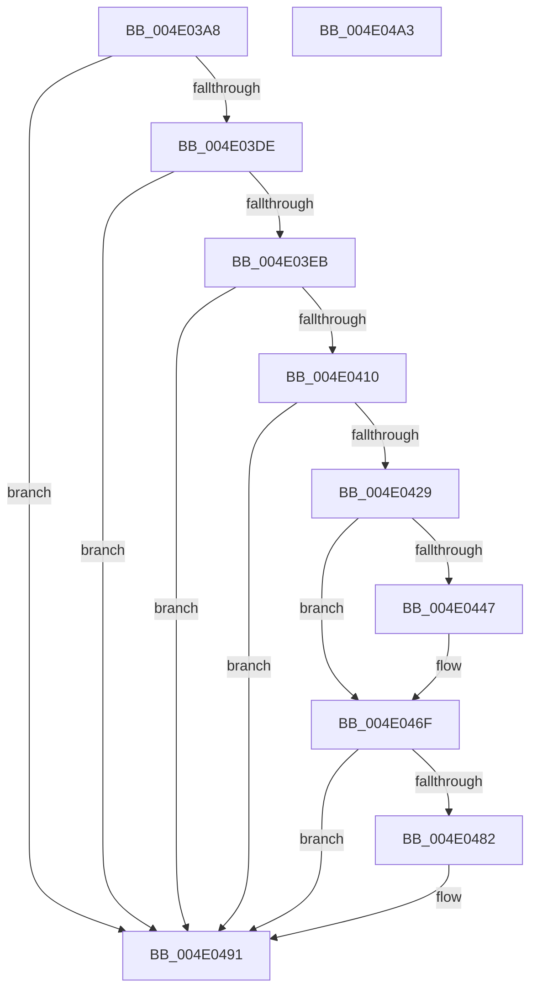

# PopIdleArmAoAcDozeS4Timer

- RVA: `0x004E03A8`–`0x004E04A4` (길이 `252` bytes)
- VA: `0x00000001404E03A8`
- 실행 섹션: `.text`
- PDB 이름 있음: `예`; PDB Function 태그: `아니요`
- unwind 정보 RVA: `0x000AB1F8`
- 디코드: `58`개 명령, `252/252` bytes 표시
- 미해석 바이트: `0` (있으면 어셈블리에 `.byte`로 보존)

> 이 문서는 커널 이미지의 기계어와 PDB 기호를 분석해 생성했습니다. 4번과 5번은 함수 원형과 자료형을 바이너리 사용 방식에서 추정한 C 해석이며 원본 소스 복구 결과는 아닙니다.

## 1. Dependencies

- 직접 호출 지점: **8**; 고유 호출 대상: **8**
- 직접 호출자로 확인된 함수: **4**
- RIP 상대 이미지 참조: **8**

### Outgoing calls
- `0x004E03CB` → [memset](../6C/memset_function_006C6C40.md) (function, `0x006C6C40`)
- `0x004E03F7` → [PopFilterCapabilities](../../page/91/PopFilterCapabilities_function_0091141C.md) (function, `0x0091141C`)
- `0x004E0403` → [PopIsDozeSupported](../../page/AA/PopIsDozeSupported_function_00AA3DC0.md) (function, `0x00AA3DC0`)
- `0x004E0420` → [PopIdleChooseDozeS4Time](../5D/PopIdleChooseDozeS4Time_function_005D98AC.md) (function, `0x005D98AC`)
- `0x004E0430` → [KeAcquireSpinLockRaiseToDpc](../20/KeAcquireSpinLockRaiseToDpc_function_00208470.md) (function, `0x00208470`)
- `0x004E045C` → [KeSetTimer2](../3A/KeSetTimer2_function_003A08E0.md) (function, `0x003A08E0`)
- `0x004E0479` → [KeReleaseSpinLock](../39/KeReleaseSpinLock_function_00392BA0.md) (function, `0x00392BA0`)
- `0x004E048C` → [PopTraceSystemIdleS0LowPowerDozeTimerArmed](../../page/76/PopTraceSystemIdleS0LowPowerDozeTimerArmed_function_00763EA8.md) (function, `0x00763EA8`)

### Direct callers
- [PopPowerAggregatorDozeTimerWorker](../../page/76/PopPowerAggregatorDozeTimerWorker_function_00764490.md) at `0x007645BD`
- [PopUpdateSmartUserPresencePredictions](../../page/76/PopUpdateSmartUserPresencePredictions_function_0076894C.md) at `0x007689BE`
- [PopUpdateSystemIdleContext](../../page/91/PopUpdateSystemIdleContext_function_00911BB4.md) at `0x00911D1D`
- [PopIdleCsStateChanged](../../page/AD/PopIdleCsStateChanged_function_00AD9DE0.md) at `0x00AD9E25`

### Static image references
- `0x004E03D0` → RVA `0x00E673A0` (`.data`; read)
- `0x004E03DE` → RVA `0x00E6739C` (`.data`; read)
- `0x004E03F0` → RVA `0x00F0CEC0` (`.data`; read)
- `0x004E0429` → RVA `0x00F08EA8` (`.data`; read)
- `0x004E0435` → RVA `0x00F0BC94` (`.data`; read)
- `0x004E044F` → RVA `0x00F08EE0` (`.data`; read)
- `0x004E0463` → RVA `0x00F0BC98` (`.data`; write)
- `0x004E0469` → RVA `0x00F0BC94` (`.data`; write)

## 2. Other-region calls and transfers

- 다른 실행 섹션으로 향하는 call: **3**
  - `0x004E03F7` → [PopFilterCapabilities](../../page/91/PopFilterCapabilities_function_0091141C.md) (`.text` → `PAGE`)
  - `0x004E0403` → [PopIsDozeSupported](../../page/AA/PopIsDozeSupported_function_00AA3DC0.md) (`.text` → `PAGE`)
  - `0x004E048C` → [PopTraceSystemIdleS0LowPowerDozeTimerArmed](../../page/76/PopTraceSystemIdleS0LowPowerDozeTimerArmed_function_00763EA8.md) (`.text` → `PAGE`)
- 별도 외부 분기/꼬리 이동을 확인하지 못했습니다.

## 3. Assembly (complete function range)

```asm
004E03A8  48 8B C4                        mov rax, rsp
004E03AB  48 89 58 18                     mov qword ptr [rax + 0x18], rbx
004E03AF  48 89 70 20                     mov qword ptr [rax + 0x20], rsi
004E03B3  57                              push rdi
004E03B4  48 83 EC 70                     sub rsp, 0x70
004E03B8  48 83 60 10 00                  and qword ptr [rax + 0x10], 0
004E03BD  48 8D 48 A8                     lea rcx, [rax - 0x58]
004E03C1  83 60 08 00                     and dword ptr [rax + 8], 0
004E03C5  33 D2                           xor edx, edx
004E03C7  44 8D 42 4C                     lea r8d, [rdx + 0x4c]
004E03CB  E8 70 68 1E 00                  call 0x1406c6c40
004E03D0  8B 05 CA 6F 98 00               mov eax, dword ptr [rip + 0x986fca]
004E03D6  85 C0                           test eax, eax
004E03D8  0F 84 B3 00 00 00               je 0x1404e0491
004E03DE  80 3D B7 6F 98 00 00            cmp byte ptr [rip + 0x986fb7], 0
004E03E5  0F 84 A6 00 00 00               je 0x1404e0491
004E03EB  48 8D 54 24 20                  lea rdx, [rsp + 0x20]
004E03F0  48 8D 0D C9 CA A2 00            lea rcx, [rip + 0xa2cac9]
004E03F7  E8 20 10 43 00                  call 0x14091141c
004E03FC  48 8D 4C 24 20                  lea rcx, [rsp + 0x20]
004E0401  32 DB                           xor bl, bl
004E0403  E8 B8 39 5C 00                  call 0x140aa3dc0
004E0408  84 C0                           test al, al
004E040A  0F 84 81 00 00 00               je 0x1404e0491
004E0410  48 8D 94 24 80 00 00 00         lea rdx, [rsp + 0x80]
004E0418  48 8D 8C 24 88 00 00 00         lea rcx, [rsp + 0x88]
004E0420  E8 87 94 0F 00                  call 0x1405d98ac
004E0425  84 C0                           test al, al
004E0427  74 68                           je 0x1404e0491
004E0429  48 8D 0D 78 8A A2 00            lea rcx, [rip + 0xa28a78]
004E0430  E8 3B 80 D2 FF                  call 0x140208470
004E0435  38 1D 59 B8 A2 00               cmp byte ptr [rip + 0xa2b859], bl
004E043B  40 8A F0                        mov sil, al
004E043E  8B BC 24 80 00 00 00            mov edi, dword ptr [rsp + 0x80]
004E0445  75 28                           jne 0x1404e046f
004E0447  48 8B 94 24 88 00 00 00         mov rdx, qword ptr [rsp + 0x88]
004E044F  48 8D 0D 8A 8A A2 00            lea rcx, [rip + 0xa28a8a]
004E0456  45 33 C9                        xor r9d, r9d
004E0459  45 33 C0                        xor r8d, r8d
004E045C  E8 7F 04 EC FF                  call 0x1403a08e0
004E0461  B3 01                           mov bl, 1
004E0463  89 3D 2F B8 A2 00               mov dword ptr [rip + 0xa2b82f], edi
004E0469  88 1D 25 B8 A2 00               mov byte ptr [rip + 0xa2b825], bl
004E046F  40 8A D6                        mov dl, sil
004E0472  48 8D 0D 2F 8A A2 00            lea rcx, [rip + 0xa28a2f]
004E0479  E8 22 27 EB FF                  call 0x140392ba0
004E047E  84 DB                           test bl, bl
004E0480  74 0F                           je 0x1404e0491
004E0482  48 8B 94 24 88 00 00 00         mov rdx, qword ptr [rsp + 0x88]
004E048A  8B CF                           mov ecx, edi
004E048C  E8 17 3A 28 00                  call 0x140763ea8
004E0491  4C 8D 5C 24 70                  lea r11, [rsp + 0x70]
004E0496  49 8B 5B 20                     mov rbx, qword ptr [r11 + 0x20]
004E049A  49 8B 73 28                     mov rsi, qword ptr [r11 + 0x28]
004E049E  49 8B E3                        mov rsp, r11
004E04A1  5F                              pop rdi
004E04A2  C3                              ret
004E04A3  CC                              int3
```

## 4. C-style interpretation (structured pseudocode)

```c
__int64 __fastcall PopIdleArmAoAcDozeS4Timer(__int64 a1, int a2, __int64 a3, int a4)
{
    __int64 result;
    __int64 v_rbx;
    __int64 v_rsp;
    unsigned __int64 v_stack_m58;
    unsigned __int64 v_stack_m8;
    unsigned __int64 v_stack_p10;
    unsigned __int64 v_stack_p8;

    *(unsigned __int64 *)(v_rsp + 24) = v_rbx;
    *(unsigned __int64 *)(v_rsp + 32) = v_rsi;
    v_rsp = (v_rsp) - (112);
    a2 = 0;
    result = memset(v_rsp - 88, a2, a2 + 76, a4);
    if ((unsigned int)((unsigned int)(*(unsigned int *)(v_rip + 9990090))) == 0) goto loc_004E0491;
    if ((*(unsigned __int8 *)(v_rip + 9990071)) == 0) goto loc_004E0491;
    result = PopFilterCapabilities(v_rip + 10668745, v_stack_m58, a2 + 76, a4);
    v_rbx = 0;
    result = PopIsDozeSupported(v_stack_m58, v_stack_m58, a2 + 76, a4);
    if ((unsigned __int8)(result) == 0) goto loc_004E0491;
    result = PopIdleChooseDozeS4Time(v_stack_p10, v_stack_p8, a2 + 76, a4);
    if ((unsigned __int8)(result) == 0) goto loc_004E0491;
    result = KeAcquireSpinLockRaiseToDpc(v_rip + 10652280, v_stack_p8, a2 + 76, a4);
    if ((*(unsigned __int8 *)(v_rip + 10664025)) == 0) {
        a2 = v_stack_p10;
        a1 = v_rip + 10652298;
        a4 = 0;
        a3 = 0;
        result = KeSetTimer2(a1, a2, a3, a4);
        v_rbx = 1;
        *(unsigned int *)(v_rip + 10663983) = (unsigned int)((unsigned int)(v_stack_p8));
        *(unsigned __int8 *)(v_rip + 10663973) = (unsigned __int8)(v_rbx);
    }
    result = KeReleaseSpinLock(v_rip + 10652207, (unsigned __int8)((unsigned __int8)(result)), a3, a4);
    if ((unsigned __int8)(v_rbx) != 0) {
        a2 = v_stack_p10;
        a1 = (unsigned int)((unsigned int)(v_stack_p8));
        result = PopTraceSystemIdleS0LowPowerDozeTimerArmed(a1, a2, a3, a4);
    }
    return result;
}
```

## 5. (Beta) C Style

```c
int64_t PopIdleArmAoAcDozeS4Timer(int64_t Arg1, int32_t Arg2, int64_t Arg3, int32_t Arg4)
{
    int64_t result;
    int64_t local_rbx;
    int64_t local_rsp;
    uint64_t v_stack_m58;
    uint64_t v_stack_m8;
    uint64_t v_stack_p10;
    uint64_t v_stack_p8;

    *(uint64_t *)(local_rsp + 0x18) = local_rbx;
    *(uint64_t *)(local_rsp + 0x20) = local_rsi;
    local_rsp = (local_rsp) - (112);
    Arg2 = 0;
    result = memset(local_rsp - 88, Arg2, Arg2 + 76, Arg4);
    if ((uint32_t)((uint32_t)(*(uint32_t *)(v_rip + 0x986FCA))) == 0) goto loc_004E0491;
    if ((*(uint8_t *)(v_rip + 0x986FB7)) == 0) goto loc_004E0491;
    result = PopFilterCapabilities(v_rip + 10668745, v_stack_m58, Arg2 + 76, Arg4);
    local_rbx = 0;
    result = PopIsDozeSupported(v_stack_m58, v_stack_m58, Arg2 + 76, Arg4);
    if ((uint8_t)(result) == 0) goto loc_004E0491;
    result = PopIdleChooseDozeS4Time(v_stack_p10, v_stack_p8, Arg2 + 76, Arg4);
    if ((uint8_t)(result) == 0) goto loc_004E0491;
    result = KeAcquireSpinLockRaiseToDpc(v_rip + 10652280, v_stack_p8, Arg2 + 76, Arg4);
    if ((*(uint8_t *)(v_rip + 0xA2B859)) == 0) {
        Arg2 = v_stack_p10;
        Arg1 = v_rip + 10652298;
        Arg4 = 0;
        Arg3 = 0;
        result = KeSetTimer2(Arg1, Arg2, Arg3, Arg4);
        local_rbx = 1;
        *(uint32_t *)(v_rip + 0xA2B82F) = (uint32_t)((uint32_t)(v_stack_p8));
        *(uint8_t *)(v_rip + 0xA2B825) = (uint8_t)(local_rbx);
    }
    result = KeReleaseSpinLock(v_rip + 10652207, (uint8_t)((uint8_t)(result)), Arg3, Arg4);
    if ((uint8_t)(local_rbx) != 0) {
        Arg2 = v_stack_p10;
        Arg1 = (uint32_t)((uint32_t)(v_stack_p8));
        result = PopTraceSystemIdleS0LowPowerDozeTimerArmed(Arg1, Arg2, Arg3, Arg4);
    }
    return result;
}
```

## 6. Execution-region graph

[열기: 2D/3D 그래프와 함수 탐색 컨트롤 패널](../../../control-panel.html?section=text&rva=0x004E03A8&view=graph)

- 2D 그래프는 위에서 아래로 흐르고, 3D 그래프는 빈 공간을 드래그해 회전합니다. Shift+드래그는 이동, 휠은 확대·축소, 함수 노드 선택은 대상 보고서 이동입니다.

### Static fallback


