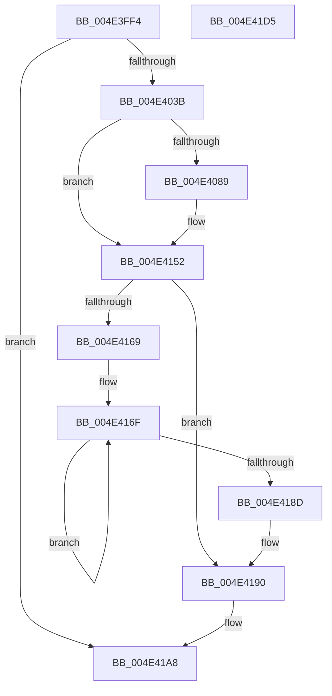

# PopPlUnregisterDevice

- RVA: `0x004E3FF4`–`0x004E41D6` (길이 `482` bytes)
- VA: `0x00000001404E3FF4`
- 실행 섹션: `.text`
- PDB 이름 있음: `예`; PDB Function 태그: `아니요`
- unwind 정보 RVA: `0x000BF614`
- 디코드: `113`개 명령, `482/482` bytes 표시
- 미해석 바이트: `0` (있으면 어셈블리에 `.byte`로 보존)

> 이 문서는 커널 이미지의 기계어와 PDB 기호를 분석해 생성했습니다. 4번과 5번은 함수 원형과 자료형을 바이너리 사용 방식에서 추정한 C 해석이며 원본 소스 복구 결과는 아닙니다.

## 1. Dependencies

- 직접 호출 지점: **7**; 고유 호출 대상: **7**
- 직접 호출자로 확인된 함수: **1**
- RIP 상대 이미지 참조: **3**

### Outgoing calls
- `0x004E4043` → [KeAcquireSpinLockRaiseToDpc](../20/KeAcquireSpinLockRaiseToDpc_function_00208470.md) (function, `0x00208470`)
- `0x004E406C` → [PopPlCalculateDevicePowerDraw](../5D/PopPlCalculateDevicePowerDraw_function_005DD934.md) (function, `0x005DD934`)
- `0x004E414D` → [tlgWriteTransfer_EtwWriteTransfer](../42/tlgWriteTransfer_EtwWriteTransfer_function_004260E0.md) (function, `0x004260E0`)
- `0x004E4158` → [PopPlPublishSystemPowerChange](../5D/PopPlPublishSystemPowerChange_function_005DDD0C.md) (function, `0x005DDD0C`)
- `0x004E417A` → [PopPlUnregisterComponent](../5D/PopPlUnregisterComponent_function_005DE2E4.md) (function, `0x005DE2E4`)
- `0x004E41A3` → [KeReleaseSpinLock](../39/KeReleaseSpinLock_function_00392BA0.md) (function, `0x00392BA0`)
- `0x004E41AF` → [_security_check_cookie](../6A/_security_check_cookie_function_006AC640.md) (function, `0x006AC640`)

### Direct callers
- [PopFxUnregisterDevice](../../page/A8/PopFxUnregisterDevice_function_00A8AE84.md) at `0x00A8AFFC`

### Static image references
- `0x004E4017` → RVA `0x00E0A740` (`.data`; read)
- `0x004E407C` → RVA `0x00E07748` (`.data`; read)
- `0x004E4096` → RVA `0x00050775` (`.rdata`; read)

## 2. Other-region calls and transfers

- 다른 실행 섹션으로 향하는 call: **0**
- 별도 외부 분기/꼬리 이동을 확인하지 못했습니다.

## 3. Assembly (complete function range)

```asm
004E3FF4  48 8B C4                        mov rax, rsp
004E3FF7  48 89 58 10                     mov qword ptr [rax + 0x10], rbx
004E3FFB  48 89 70 18                     mov qword ptr [rax + 0x18], rsi
004E3FFF  48 89 78 20                     mov qword ptr [rax + 0x20], rdi
004E4003  55                              push rbp
004E4004  41 54                           push r12
004E4006  41 55                           push r13
004E4008  41 56                           push r14
004E400A  41 57                           push r15
004E400C  48 8D 68 A1                     lea rbp, [rax - 0x5f]
004E4010  48 81 EC F0 00 00 00            sub rsp, 0xf0
004E4017  48 8B 05 22 67 92 00            mov rax, qword ptr [rip + 0x926722]
004E401E  48 33 C4                        xor rax, rsp
004E4021  48 89 45 27                     mov qword ptr [rbp + 0x27], rax
004E4025  48 8B B1 C8 04 00 00            mov rsi, qword ptr [rcx + 0x4c8]
004E402C  45 33 ED                        xor r13d, r13d
004E402F  48 8B F9                        mov rdi, rcx
004E4032  48 85 F6                        test rsi, rsi
004E4035  0F 84 6D 01 00 00               je 0x1404e41a8
004E403B  4C 8B 76 10                     mov r14, qword ptr [rsi + 0x10]
004E403F  49 8D 4E 10                     lea rcx, [r14 + 0x10]
004E4043  E8 28 44 D2 FF                  call 0x140208470
004E4048  41 88 46 18                     mov byte ptr [r14 + 0x18], al
004E404C  4C 8D 44 24 30                  lea r8, [rsp + 0x30]
004E4051  8B 5E 20                        mov ebx, dword ptr [rsi + 0x20]
004E4054  41 8D 45 01                     lea eax, [r13 + 1]
004E4058  45 33 C9                        xor r9d, r9d
004E405B  89 44 24 34                     mov dword ptr [rsp + 0x34], eax
004E405F  48 8D 54 24 34                  lea rdx, [rsp + 0x34]
004E4064  44 89 6C 24 30                  mov dword ptr [rsp + 0x30], r13d
004E4069  48 8B CF                        mov rcx, rdi
004E406C  E8 C3 98 0F 00                  call 0x1405dd934
004E4071  44 8B F8                        mov r15d, eax
004E4074  89 46 20                        mov dword ptr [rsi + 0x20], eax
004E4077  44 2B FB                        sub r15d, ebx
004E407A  8B C8                           mov ecx, eax
004E407C  83 3D C5 36 92 00 05            cmp dword ptr [rip + 0x9236c5], 5
004E4083  0F 86 C9 00 00 00               jbe 0x1404e4152
004E4089  89 4C 24 38                     mov dword ptr [rsp + 0x38], ecx
004E408D  41 8D 45 01                     lea eax, [r13 + 1]
004E4091  66 89 44 24 30                  mov word ptr [rsp + 0x30], ax
004E4096  48 8D 15 D8 C6 B6 FF            lea rdx, [rip - 0x493928]
004E409D  48 8D 44 24 30                  lea rax, [rsp + 0x30]
004E40A2  48 C7 45 BF 02 00 00 00         mov qword ptr [rbp - 0x41], 2
004E40AA  48 89 45 B7                     mov qword ptr [rbp - 0x49], rax
004E40AE  45 33 C9                        xor r9d, r9d
004E40B1  48 8D 45 DF                     lea rax, [rbp - 0x21]
004E40B5  48 C7 45 CF 02 00 00 00         mov qword ptr [rbp - 0x31], 2
004E40BD  48 89 45 C7                     mov qword ptr [rbp - 0x39], rax
004E40C1  45 33 C0                        xor r8d, r8d
004E40C4  48 8B 87 E0 00 00 00            mov rax, qword ptr [rdi + 0xe0]
004E40CB  48 89 45 D7                     mov qword ptr [rbp - 0x29], rax
004E40CF  0F B7 87 D8 00 00 00            movzx eax, word ptr [rdi + 0xd8]
004E40D6  89 45 DF                        mov dword ptr [rbp - 0x21], eax
004E40D9  48 8D 44 24 34                  lea rax, [rsp + 0x34]
004E40DE  48 89 45 E7                     mov qword ptr [rbp - 0x19], rax
004E40E2  48 8D 44 24 38                  lea rax, [rsp + 0x38]
004E40E7  48 89 45 F7                     mov qword ptr [rbp - 9], rax
004E40EB  48 8D 45 83                     lea rax, [rbp - 0x7d]
004E40EF  48 89 45 07                     mov qword ptr [rbp + 7], rax
004E40F3  48 8B 46 10                     mov rax, qword ptr [rsi + 0x10]
004E40F7  44 89 6D E3                     mov dword ptr [rbp - 0x1d], r13d
004E40FB  44 89 7C 24 34                  mov dword ptr [rsp + 0x34], r15d
004E4100  48 C7 45 EF 04 00 00 00         mov qword ptr [rbp - 0x11], 4
004E4108  48 C7 45 FF 04 00 00 00         mov qword ptr [rbp - 1], 4
004E4110  44 89 7D 83                     mov dword ptr [rbp - 0x7d], r15d
004E4114  48 C7 45 0F 04 00 00 00         mov qword ptr [rbp + 0xf], 4
004E411C  8B 48 1C                        mov ecx, dword ptr [rax + 0x1c]
004E411F  48 8D 45 87                     lea rax, [rbp - 0x79]
004E4123  41 03 CF                        add ecx, r15d
004E4126  48 89 45 17                     mov qword ptr [rbp + 0x17], rax
004E412A  48 8D 45 97                     lea rax, [rbp - 0x69]
004E412E  89 4D 87                        mov dword ptr [rbp - 0x79], ecx
004E4131  48 89 44 24 28                  mov qword ptr [rsp + 0x28], rax
004E4136  48 8D 0D 0B 36 92 00            lea rcx, [rip + 0x92360b]
004E413D  C7 44 24 20 09 00 00 00         mov dword ptr [rsp + 0x20], 9
004E4145  48 C7 45 1F 04 00 00 00         mov qword ptr [rbp + 0x1f], 4
004E414D  E8 8E 1F F4 FF                  call 0x1404260e0
004E4152  41 8B D7                        mov edx, r15d
004E4155  49 8B CE                        mov rcx, r14
004E4158  E8 AF 9B 0F 00                  call 0x1405ddd0c
004E415D  49 8B DD                        mov rbx, r13
004E4160  44 39 AF 64 03 00 00            cmp dword ptr [rdi + 0x364], r13d
004E4167  76 27                           jbe 0x1404e4190
004E4169  41 BD 01 00 00 00               mov r13d, 1
004E416F  48 8B 8F 68 03 00 00            mov rcx, qword ptr [rdi + 0x368]
004E4176  48 8B 0C D9                     mov rcx, qword ptr [rcx + rbx*8]
004E417A  E8 65 A1 0F 00                  call 0x1405de2e4
004E417F  8B 87 64 03 00 00               mov eax, dword ptr [rdi + 0x364]
004E4185  49 03 DD                        add rbx, r13
004E4188  48 3B D8                        cmp rbx, rax
004E418B  72 E2                           jb 0x1404e416f
004E418D  45 33 ED                        xor r13d, r13d
004E4190  4C 89 6E 18                     mov qword ptr [rsi + 0x18], r13
004E4194  49 8D 4E 10                     lea rcx, [r14 + 0x10]
004E4198  4C 89 AF C8 04 00 00            mov qword ptr [rdi + 0x4c8], r13
004E419F  41 8A 56 18                     mov dl, byte ptr [r14 + 0x18]
004E41A3  E8 F8 E9 EA FF                  call 0x140392ba0
004E41A8  48 8B 4D 27                     mov rcx, qword ptr [rbp + 0x27]
004E41AC  48 33 CC                        xor rcx, rsp
004E41AF  E8 8C 84 1C 00                  call 0x1406ac640
004E41B4  4C 8D 9C 24 F0 00 00 00         lea r11, [rsp + 0xf0]
004E41BC  49 8B 5B 38                     mov rbx, qword ptr [r11 + 0x38]
004E41C0  49 8B 73 40                     mov rsi, qword ptr [r11 + 0x40]
004E41C4  49 8B 7B 48                     mov rdi, qword ptr [r11 + 0x48]
004E41C8  49 8B E3                        mov rsp, r11
004E41CB  41 5F                           pop r15
004E41CD  41 5E                           pop r14
004E41CF  41 5D                           pop r13
004E41D1  41 5C                           pop r12
004E41D3  5D                              pop rbp
004E41D4  C3                              ret
004E41D5  CC                              int3
```

## 4. C-style interpretation (structured pseudocode)

```c
__int64 __fastcall PopPlUnregisterDevice(__int64 a1, __int64 a2, __int64 a3, int a4)
{
    __int64 result;
    __int64 v_r13;
    __int64 v_r15;
    __int64 v_rbx;
    __int64 v_rsp;
    unsigned __int64 v_stack_m28;
    unsigned int v_stack_mE0;
    unsigned int v_stack_mE4;
    unsigned __int64 v_stack_mE8;
    unsigned __int64 v_stack_mF0;
    unsigned int v_stack_mF8;

    *(unsigned __int64 *)(v_rsp + 16) = v_rbx;
    *(unsigned __int64 *)(v_rsp + 24) = v_rsi;
    *(unsigned __int64 *)(v_rsp + 32) = v_rdi;
    v_rsp = (v_rsp) - (240);
    result = (*(unsigned __int64 *)(v_rip + 9594658)) ^ (v_rsp);
    *(unsigned __int64 *)(v_rsp - 95 + 39) = result;
    v_r13 = 0;
    if (*(unsigned __int64 *)(a1 + 1224) == 0) goto loc_004E41A8;
    result = KeAcquireSpinLockRaiseToDpc(*(unsigned __int64 *)(*(unsigned __int64 *)(a1 + 1224) + 16) + 16, a2, a3, a4);
    *(unsigned __int8 *)(*(unsigned __int64 *)(*(unsigned __int64 *)(a1 + 1224) + 16) + 24) = (unsigned __int8)(result);
    a4 = 0;
    v_stack_mE4 = (unsigned int)(v_r13 + 1);
    v_stack_mE8 = 0;
    result = PopPlCalculateDevicePowerDraw(a1, v_stack_mE4, v_stack_mE8, a4);
    *(unsigned int *)(*(unsigned __int64 *)(a1 + 1224) + 32) = (unsigned int)(result);
    v_r15 = (unsigned int)(((unsigned int)((unsigned int)(result))) - ((unsigned int)((unsigned int)(*(unsigned int *)(*(unsigned __int64 *)(a1 + 1224) + 32)))));
    if ((*(unsigned int *)(v_rip + 9582277)) >= = 5) {
        v_stack_mE0 = (unsigned int)((unsigned int)((unsigned int)(result)));
        result = v_r13 + 1;
        v_stack_mE8 = (unsigned __int16)(result);
        a2 = v_rip - 4798760;
        result = v_stack_mE8;
        *(unsigned __int64 *)(v_rsp - 95 - 65) = 2;
        *(unsigned __int64 *)(v_rsp - 95 - 73) = result;
        a4 = 0;
        result = v_rsp - 95 - 33;
        *(unsigned __int64 *)(v_rsp - 95 - 49) = 2;
        *(unsigned __int64 *)(v_rsp - 95 - 57) = result;
        a3 = 0;
        result = *(unsigned __int64 *)(a1 + 224);
        *(unsigned __int64 *)(v_rsp - 95 - 41) = result;
        result = *(unsigned __int16 *)(a1 + 216);
        *(unsigned int *)(v_rsp - 95 - 33) = (unsigned int)(result);
        result = v_stack_mE4;
        *(unsigned __int64 *)(v_rsp - 95 - 25) = result;
        result = v_stack_mE0;
        *(unsigned __int64 *)(v_rsp - 95 - 9) = result;
        result = v_rsp - 95 - 125;
        *(unsigned __int64 *)(v_rsp - 95 + 7) = result;
        result = *(unsigned __int64 *)(*(unsigned __int64 *)(a1 + 1224) + 16);
        *(unsigned int *)(v_rsp - 95 - 29) = 0;
        v_stack_mE4 = (unsigned int)(v_r15);
        *(unsigned __int64 *)(v_rsp - 95 - 17) = 4;
        *(unsigned __int64 *)(v_rsp - 95 - 1) = 4;
        *(unsigned int *)(v_rsp - 95 - 125) = (unsigned int)(v_r15);
        *(unsigned __int64 *)(v_rsp - 95 + 15) = 4;
        a1 = *(unsigned int *)(result + 28);
        result = v_rsp - 95 - 121;
        a1 = (unsigned int)((a1) + ((unsigned int)(v_r15)));
        *(unsigned __int64 *)(v_rsp - 95 + 23) = result;
        result = v_rsp - 95 - 105;
        *(unsigned int *)(v_rsp - 95 - 121) = (unsigned int)(a1);
        v_stack_mF0 = result;
        a1 = v_rip + 9582091;
        v_stack_mF8 = 9;
        *(unsigned __int64 *)(v_rsp - 95 + 31) = 4;
        result = tlgWriteTransfer_EtwWriteTransfer(a1, a2, a3, a4);
    }
    result = PopPlPublishSystemPowerChange(*(unsigned __int64 *)(*(unsigned __int64 *)(a1 + 1224) + 16), (unsigned int)((unsigned int)(v_r15)), a3, a4);
    if ((*(unsigned int *)(a1 + 868)) <= 0) goto loc_004E4190;
loc_004E416F:
    result = PopPlUnregisterComponent(*(unsigned __int64 *)(*(unsigned __int64 *)(a1 + 872) + 0 * 8), (unsigned int)((unsigned int)(v_r15)), a3, a4);
    v_rbx = (0) + (1);
    if (v_rbx < ((unsigned int)(*(unsigned int *)(a1 + 868)))) goto loc_004E416F;
    v_r13 = 0;
loc_004E4190:
    *(unsigned __int64 *)(*(unsigned __int64 *)(a1 + 1224) + 24) = 0;
    *(unsigned __int64 *)(a1 + 1224) = 0;
    result = KeReleaseSpinLock(*(unsigned __int64 *)(*(unsigned __int64 *)(a1 + 1224) + 16) + 16, *(unsigned __int8 *)(*(unsigned __int64 *)(*(unsigned __int64 *)(a1 + 1224) + 16) + 24), a3, a4);
loc_004E41A8:
    a1 = (*(unsigned __int64 *)(v_rsp - 95 + 39)) ^ (v_rsp);
    result = _security_check_cookie(a1, *(unsigned __int8 *)(*(unsigned __int64 *)(*(unsigned __int64 *)(a1 + 1224) + 16) + 24), a3, a4);
    return result;
}
```

## 5. (Beta) C Style

```c
int64_t PopPlUnregisterDevice(void *Arg1, int64_t Arg2, int64_t Arg3, int32_t Arg4)
{
    uint8_t *arg1 = (uint8_t *)Arg1;

    int64_t result;
    int64_t local_r13;
    int64_t local_r15;
    int64_t local_rbx;
    int64_t local_rsp;
    uint64_t v_stack_m28;
    uint32_t v_stack_mE0;
    uint32_t v_stack_mE4;
    uint64_t v_stack_mE8;
    uint64_t v_stack_mF0;
    uint32_t v_stack_mF8;

    *(uint64_t *)(local_rsp + 0x10) = local_rbx;
    *(uint64_t *)(local_rsp + 0x18) = local_rsi;
    *(uint64_t *)(local_rsp + 0x20) = local_rdi;
    local_rsp = (local_rsp) - (240);
    result = (*(uint64_t *)(v_rip + 0x926722)) ^ (local_rsp);
    *(uint64_t *)(local_rsp - 0x5F + 0x27) = result;
    local_r13 = 0;
    if (*(uint64_t *)(arg1 + 0x4C8) == 0) goto loc_004E41A8;
    result = KeAcquireSpinLockRaiseToDpc(*(uint64_t *)(*(uint64_t *)(arg1 + 0x4C8) + 0x10) + 16, Arg2, Arg3, Arg4);
    *(uint8_t *)(*(uint64_t *)(*(uint64_t *)(arg1 + 0x4C8) + 0x10) + 0x18) = (uint8_t)(result);
    Arg4 = 0;
    v_stack_mE4 = (uint32_t)(local_r13 + 1);
    v_stack_mE8 = 0;
    result = PopPlCalculateDevicePowerDraw(Arg1, v_stack_mE4, v_stack_mE8, Arg4);
    *(uint32_t *)(*(uint64_t *)(arg1 + 0x4C8) + 0x20) = (uint32_t)(result);
    local_r15 = (uint32_t)(((uint32_t)((uint32_t)(result))) - ((uint32_t)((uint32_t)(*(uint32_t *)(*(uint64_t *)(arg1 + 0x4C8) + 0x20)))));
    if ((*(uint32_t *)(v_rip + 0x9236C5)) >= = 5) {
        v_stack_mE0 = (uint32_t)((uint32_t)((uint32_t)(result)));
        result = local_r13 + 1;
        v_stack_mE8 = (uint16_t)(result);
        Arg2 = v_rip - 4798760;
        result = v_stack_mE8;
        *(uint64_t *)(local_rsp - 0x5F - 0x41) = 2;
        *(uint64_t *)(local_rsp - 0x5F - 0x49) = result;
        Arg4 = 0;
        result = local_rsp - 95 - 33;
        *(uint64_t *)(local_rsp - 0x5F - 0x31) = 2;
        *(uint64_t *)(local_rsp - 0x5F - 0x39) = result;
        Arg3 = 0;
        result = *(uint64_t *)(arg1 + 0xE0);
        *(uint64_t *)(local_rsp - 0x5F - 0x29) = result;
        result = *(uint16_t *)(arg1 + 0xD8);
        *(uint32_t *)(local_rsp - 0x5F - 0x21) = (uint32_t)(result);
        result = v_stack_mE4;
        *(uint64_t *)(local_rsp - 0x5F - 0x19) = result;
        result = v_stack_mE0;
        *(uint64_t *)(local_rsp - 0x5F - 0x9) = result;
        result = local_rsp - 95 - 125;
        *(uint64_t *)(local_rsp - 0x5F + 0x7) = result;
        result = *(uint64_t *)(*(uint64_t *)(arg1 + 0x4C8) + 0x10);
        *(uint32_t *)(local_rsp - 0x5F - 0x1D) = 0;
        v_stack_mE4 = (uint32_t)(local_r15);
        *(uint64_t *)(local_rsp - 0x5F - 0x11) = 4;
        *(uint64_t *)(local_rsp - 0x5F - 0x1) = 4;
        *(uint32_t *)(local_rsp - 0x5F - 0x7D) = (uint32_t)(local_r15);
        *(uint64_t *)(local_rsp - 0x5F + 0xF) = 4;
        Arg1 = *(uint32_t *)(result + 0x1C);
        result = local_rsp - 95 - 121;
        Arg1 = (uint32_t)((Arg1) + ((uint32_t)(local_r15)));
        *(uint64_t *)(local_rsp - 0x5F + 0x17) = result;
        result = local_rsp - 95 - 105;
        *(uint32_t *)(local_rsp - 0x5F - 0x79) = (uint32_t)(Arg1);
        v_stack_mF0 = result;
        Arg1 = v_rip + 9582091;
        v_stack_mF8 = 9;
        *(uint64_t *)(local_rsp - 0x5F + 0x1F) = 4;
        result = tlgWriteTransfer_EtwWriteTransfer(Arg1, Arg2, Arg3, Arg4);
    }
    result = PopPlPublishSystemPowerChange(*(uint64_t *)(*(uint64_t *)(arg1 + 0x4C8) + 0x10), (uint32_t)((uint32_t)(local_r15)), Arg3, Arg4);
    if ((*(uint32_t *)(arg1 + 0x364)) <= 0) goto loc_004E4190;
loc_004E416F:
    result = PopPlUnregisterComponent(*(uint64_t *)(*(uint64_t *)(arg1 + 0x368) + 0x0 * 8), (uint32_t)((uint32_t)(local_r15)), Arg3, Arg4);
    local_rbx = (0) + (1);
    if (local_rbx < ((uint32_t)(*(uint32_t *)(arg1 + 0x364)))) goto loc_004E416F;
    local_r13 = 0;
loc_004E4190:
    *(uint64_t *)(*(uint64_t *)(arg1 + 0x4C8) + 0x18) = 0;
    *(uint64_t *)(arg1 + 0x4C8) = 0;
    result = KeReleaseSpinLock(*(uint64_t *)(*(uint64_t *)(arg1 + 0x4C8) + 0x10) + 16, *(uint8_t *)(*(uint64_t *)(*(uint64_t *)(arg1 + 0x4C8) + 0x10) + 0x18), Arg3, Arg4);
loc_004E41A8:
    Arg1 = (*(uint64_t *)(local_rsp - 0x5F + 0x27)) ^ (local_rsp);
    result = _security_check_cookie(Arg1, *(uint8_t *)(*(uint64_t *)(*(uint64_t *)(arg1 + 0x4C8) + 0x10) + 0x18), Arg3, Arg4);
    return result;
}
```

### 관측된 메모리 오프셋

구조체 형식이 확인되지 않은 접근은 인자 기준의 오프셋으로만 기록했습니다.

| 기준 인자 | 오프셋 표현 | 폭 (bit) | 접근 |
|---|---:|---:|---|
| `Arg1` | `+ 0xD8` | `16` | `R` |
| `Arg1` | `+ 0xE0` | `64` | `R` |
| `Arg1` | `+ 0x364` | `32` | `R` |
| `Arg1` | `+ 0x368` | `64` | `R` |
| `Arg1` | `+ 0x4C8` | `64` | `R` |
| `Arg1` | `+ 0x4C8` | `64` | `W` |

## 6. Execution-region graph

[열기: 2D/3D 그래프와 함수 탐색 컨트롤 패널](../../../control-panel.html?section=text&rva=0x004E3FF4&view=graph)

- 2D 그래프는 위에서 아래로 흐르고, 3D 그래프는 빈 공간을 드래그해 회전합니다. Shift+드래그는 이동, 휠은 확대·축소, 함수 노드 선택은 대상 보고서 이동입니다.

### Static fallback


