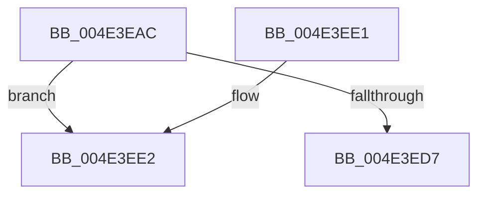

# PopPluginAbandonDevice

- RVA: `0x004E3EAC`–`0x004E3EF7` (길이 `75` bytes)
- VA: `0x00000001404E3EAC`
- 실행 섹션: `.text`
- PDB 이름 있음: `예`; PDB Function 태그: `아니요`
- unwind 정보 RVA: `0x000BF598`
- 디코드: `22`개 명령, `75/75` bytes 표시
- 미해석 바이트: `0` (있으면 어셈블리에 `.byte`로 보존)

> 이 문서는 커널 이미지의 기계어와 PDB 기호를 분석해 생성했습니다. 4번과 5번은 함수 원형과 자료형을 바이너리 사용 방식에서 추정한 C 해석이며 원본 소스 복구 결과는 아닙니다.

## 1. Dependencies

- 직접 호출 지점: **2**; 고유 호출 대상: **2**
- 직접 호출자로 확인된 함수: **1**
- RIP 상대 이미지 참조: **0**

### Outgoing calls
- `0x004E3ECE` → [guard_dispatch_icall](../6B/guard_dispatch_icall_function_006BAAD0.md) (function, `0x006BAAD0`)
- `0x004E3EF1` → [PopFxBugCheck](../2B/PopFxBugCheck_function_002BFC6C.md) (function, `0x002BFC6C`)

### Direct callers
- [PoFxAbandonDevice](../../page/A8/PoFxAbandonDevice_function_00A8AB64.md) at `0x00A8AC19`

### Static image references
- 디코드된 RIP-relative 메모리 참조가 없습니다.

## 2. Other-region calls and transfers

- 다른 실행 섹션으로 향하는 call: **0**
- 별도 외부 분기/꼬리 이동을 확인하지 못했습니다.

## 3. Assembly (complete function range)

```asm
004E3EAC  40 53                           push rbx
004E3EAE  48 83 EC 30                     sub rsp, 0x30
004E3EB2  48 8B 41 60                     mov rax, qword ptr [rcx + 0x60]
004E3EB6  48 8B D9                        mov rbx, rcx
004E3EB9  48 83 64 24 28 00               and qword ptr [rsp + 0x28], 0
004E3EBF  B9 02 00 00 00                  mov ecx, 2
004E3EC4  48 89 54 24 20                  mov qword ptr [rsp + 0x20], rdx
004E3EC9  48 8D 54 24 20                  lea rdx, [rsp + 0x20]
004E3ECE  E8 FD 6B 1D 00                  call 0x1406baad0
004E3ED3  84 C0                           test al, al
004E3ED5  74 0B                           je 0x1404e3ee2
004E3ED7  8A 44 24 28                     mov al, byte ptr [rsp + 0x28]
004E3EDB  48 83 C4 30                     add rsp, 0x30
004E3EDF  5B                              pop rbx
004E3EE0  C3                              ret
004E3EE1  CC                              int3
004E3EE2  45 33 C9                        xor r9d, r9d
004E3EE5  4C 8B C3                        mov r8, rbx
004E3EE8  B9 05 06 00 00                  mov ecx, 0x605
004E3EED  41 8D 51 02                     lea edx, [r9 + 2]
004E3EF1  E8 76 BD DD FF                  call 0x1402bfc6c
004E3EF6  CC                              int3
```

## 4. C-style interpretation (structured pseudocode)

```c
__int64 __fastcall PopPluginAbandonDevice(__int64 a1, __int64 a2, __int64 a3, int a4)
{
    __int64 result;
    __int64 v_rsp;
    unsigned __int64 v_stack_m10;
    unsigned __int64 v_stack_m18;

    v_rsp = (v_rsp) - (48);
    v_stack_m18 = a2;
    result = guard_dispatch_icall(2, v_stack_m18, a3, a4);
    if ((unsigned __int8)(result) == 0) goto loc_004E3EE2;
    v_rsp = (v_rsp) + (48);
    return v_stack_m10;
loc_004E3EE2:
    a4 = 0;
    result = PopFxBugCheck((unsigned int)(0x605ULL), a4 + 2, a1, a4);
    return result;
}
```

## 5. (Beta) C Style

```c
int64_t PopPluginAbandonDevice(void *Arg1, int64_t Arg2, int64_t Arg3, int32_t Arg4)
{
    uint8_t *arg1 = (uint8_t *)Arg1;

    int64_t result;
    int64_t local_rsp;
    uint64_t v_stack_m10;
    uint64_t v_stack_m18;

    local_rsp = (local_rsp) - (48);
    v_stack_m18 = Arg2;
    result = guard_dispatch_icall(2, v_stack_m18, Arg3, Arg4);
    if ((uint8_t)(result) == 0) goto loc_004E3EE2;
    local_rsp = (local_rsp) + (48);
    return v_stack_m10;
loc_004E3EE2:
    Arg4 = 0;
    result = PopFxBugCheck((uint32_t)(0x605ULL), Arg4 + 2, Arg1, Arg4);
    return result;
}
```

### 관측된 메모리 오프셋

구조체 형식이 확인되지 않은 접근은 인자 기준의 오프셋으로만 기록했습니다.

| 기준 인자 | 오프셋 표현 | 폭 (bit) | 접근 |
|---|---:|---:|---|
| `Arg1` | `+ 0x60` | `64` | `R` |

## 6. Execution-region graph

[열기: 2D/3D 그래프와 함수 탐색 컨트롤 패널](../../../control-panel.html?section=text&rva=0x004E3EAC&view=graph)

- 2D 그래프는 위에서 아래로 흐르고, 3D 그래프는 빈 공간을 드래그해 회전합니다. Shift+드래그는 이동, 휠은 확대·축소, 함수 노드 선택은 대상 보고서 이동입니다.

### Static fallback


