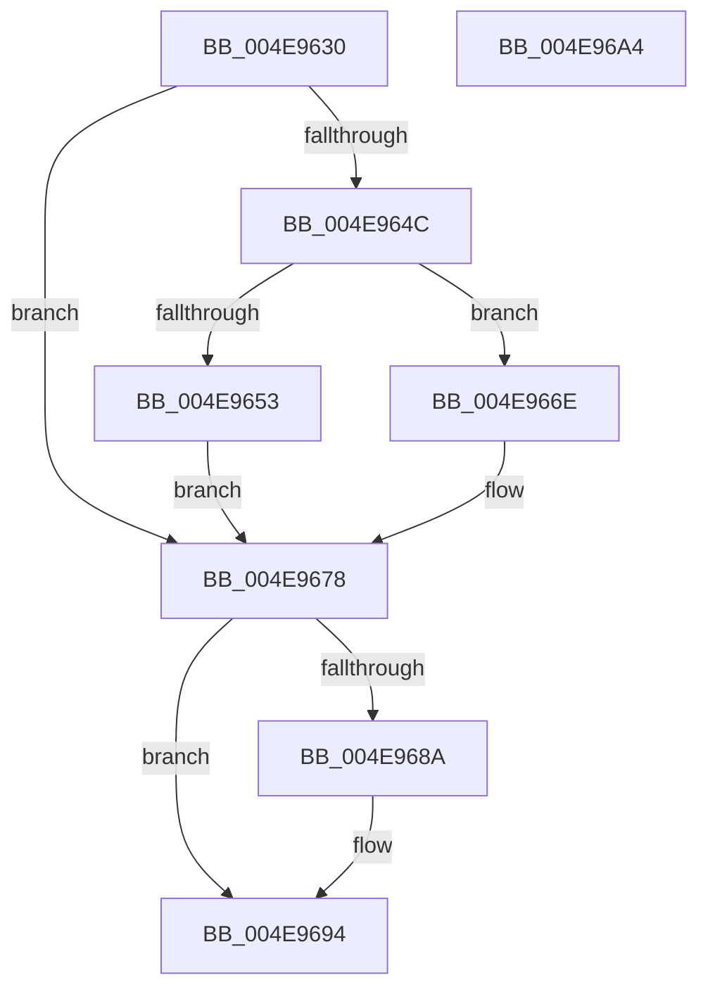

# PopPowerAdapterIrpComplete

- RVA: `0x004E9630`–`0x004E96A5` (길이 `117` bytes)
- VA: `0x00000001404E9630`
- 실행 섹션: `.text`
- PDB 이름 있음: `예`; PDB Function 태그: `아니요`
- unwind 정보 RVA: `0x0005CAAC`
- 디코드: `33`개 명령, `117/117` bytes 표시
- 미해석 바이트: `0` (있으면 어셈블리에 `.byte`로 보존)

> 이 문서는 커널 이미지의 기계어와 PDB 기호를 분석해 생성했습니다. 4번과 5번은 함수 원형과 자료형을 바이너리 사용 방식에서 추정한 C 해석이며 원본 소스 복구 결과는 아닙니다.

## 1. Dependencies

- 직접 호출 지점: **3**; 고유 호출 대상: **3**
- 직접 호출자로 확인된 함수: **0**
- RIP 상대 이미지 참조: **0**

### Outgoing calls
- `0x004E9661` → [PopPowerAdapterTraceFailure](../../page/76/PopPowerAdapterTraceFailure_function_007682B8.md) (function, `0x007682B8`)
- `0x004E9681` → [KeSetEvent](../33/KeSetEvent_function_0033F310.md) (function, `0x0033F310`)
- `0x004E968F` → [PopBatteryQueueWork](../4A/PopBatteryQueueWork_function_004AE3DC.md) (function, `0x004AE3DC`)

### Direct callers
- 이 함수 시작 RVA로 연결되는 직접 call은 확인되지 않았습니다. 간접 호출은 완전히 역산할 수 없습니다.

### Static image references
- 디코드된 RIP-relative 메모리 참조가 없습니다.

## 2. Other-region calls and transfers

- 다른 실행 섹션으로 향하는 call: **1**
  - `0x004E9661` → [PopPowerAdapterTraceFailure](../../page/76/PopPowerAdapterTraceFailure_function_007682B8.md) (`.text` → `PAGE`)
- 별도 외부 분기/꼬리 이동을 확인하지 못했습니다.

## 3. Assembly (complete function range)

```asm
004E9630  48 89 5C 24 08                  mov qword ptr [rsp + 8], rbx
004E9635  57                              push rdi
004E9636  48 83 EC 20                     sub rsp, 0x20
004E963A  49 8B F8                        mov rdi, r8
004E963D  32 DB                           xor bl, bl
004E963F  44 8B 42 30                     mov r8d, dword ptr [rdx + 0x30]
004E9643  41 81 F8 20 01 00 C0            cmp r8d, 0xc0000120
004E964A  74 2C                           je 0x1404e9678
004E964C  B3 01                           mov bl, 1
004E964E  45 85 C0                        test r8d, r8d
004E9651  79 1B                           jns 0x1404e966e
004E9653  8B 9F 80 00 00 00               mov ebx, dword ptr [rdi + 0x80]
004E9659  BA 02 00 00 00                  mov edx, 2
004E965E  48 8B CF                        mov rcx, rdi
004E9661  E8 52 EC 27 00                  call 0x1407682b8
004E9666  83 FB 02                        cmp ebx, 2
004E9669  0F 95 C3                        setne bl
004E966C  EB 0A                           jmp 0x1404e9678
004E966E  C7 87 80 00 00 00 01 00 00 00   mov dword ptr [rdi + 0x80], 1
004E9678  48 8D 4F 68                     lea rcx, [rdi + 0x68]
004E967C  45 33 C0                        xor r8d, r8d
004E967F  33 D2                           xor edx, edx
004E9681  E8 8A 5C E5 FF                  call 0x14033f310
004E9686  84 DB                           test bl, bl
004E9688  74 0A                           je 0x1404e9694
004E968A  B9 01 00 00 00                  mov ecx, 1
004E968F  E8 48 4D FC FF                  call 0x1404ae3dc
004E9694  48 8B 5C 24 30                  mov rbx, qword ptr [rsp + 0x30]
004E9699  B8 16 00 00 C0                  mov eax, 0xc0000016
004E969E  48 83 C4 20                     add rsp, 0x20
004E96A2  5F                              pop rdi
004E96A3  C3                              ret
004E96A4  CC                              int3
```

## 4. C-style interpretation (structured pseudocode)

```c
__int64 __fastcall PopPowerAdapterIrpComplete(__int64 a1, __int64 a2, __int64 a3)
{
    __int64 result;
    __int64 v_rbx;
    __int64 v_rsp;
    unsigned __int64 v_stack_p8;

    v_stack_p8 = v_rbx;
    v_rsp = (v_rsp) - (32);
    v_rbx = 0;
    if (((unsigned int)((unsigned int)(*(unsigned int *)(a2 + 48)))) == 0xC0000120ULL) goto loc_004E9678;
    if (!sign_flag) goto loc_004E966E;
    result = PopPowerAdapterTraceFailure(a3, 2, (unsigned int)(*(unsigned int *)(a2 + 48)), a4);
    v_rbx = (((unsigned int)((unsigned int)(*(unsigned int *)(a3 + 128)))) != 2) ? 1 : 0;
    goto loc_004E9678;
loc_004E966E:
    *(unsigned int *)(a3 + 128) = 1;
loc_004E9678:
    a3 = 0;
    a2 = 0;
    result = KeSetEvent(a3 + 104, a2, a3, a4);
    if ((unsigned __int8)(v_rbx) != 0) {
        a1 = 1;
        result = PopBatteryQueueWork(a1, a2, a3, a4);
    }
    v_rsp = (v_rsp) + (32);
    return (unsigned int)(0xC0000016ULL);
}
```

## 5. (Beta) C Style

```c
int64_t PopPowerAdapterIrpComplete(int64_t Arg1, void *Arg2, void *Arg3)
{
    uint8_t *arg2 = (uint8_t *)Arg2;
    uint8_t *arg3 = (uint8_t *)Arg3;

    int64_t result;
    int64_t local_rbx;
    int64_t local_rsp;
    uint64_t v_stack_p8;

    v_stack_p8 = local_rbx;
    local_rsp = (local_rsp) - (32);
    local_rbx = 0;
    if (((uint32_t)((uint32_t)(*(uint32_t *)(arg2 + 0x30)))) == 0xC0000120ULL) goto loc_004E9678;
    if (!sign_flag) goto loc_004E966E;
    result = PopPowerAdapterTraceFailure(Arg3, 2, (uint32_t)(*(uint32_t *)(arg2 + 0x30)), a4);
    local_rbx = (((uint32_t)((uint32_t)(*(uint32_t *)(arg3 + 0x80)))) != 2) ? 1 : 0;
    goto loc_004E9678;
loc_004E966E:
    *(uint32_t *)(arg3 + 0x80) = 1;
loc_004E9678:
    Arg3 = 0;
    Arg2 = 0;
    result = KeSetEvent(Arg3 + 104, Arg2, Arg3, a4);
    if ((uint8_t)(local_rbx) != 0) {
        Arg1 = 1;
        result = PopBatteryQueueWork(Arg1, Arg2, Arg3, a4);
    }
    local_rsp = (local_rsp) + (32);
    return (uint32_t)(0xC0000016ULL);
}
```

### 관측된 메모리 오프셋

구조체 형식이 확인되지 않은 접근은 인자 기준의 오프셋으로만 기록했습니다.

| 기준 인자 | 오프셋 표현 | 폭 (bit) | 접근 |
|---|---:|---:|---|
| `Arg2` | `+ 0x30` | `32` | `R` |
| `Arg3` | `+ 0x68` | `64` | `R` |
| `Arg3` | `+ 0x80` | `32` | `R` |
| `Arg3` | `+ 0x80` | `32` | `W` |

## 6. Execution-region graph

[열기: 2D/3D 그래프와 함수 탐색 컨트롤 패널](../../../control-panel.html?section=text&rva=0x004E9630&view=graph)

- 2D 그래프는 위에서 아래로 흐르고, 3D 그래프는 빈 공간을 드래그해 회전합니다. Shift+드래그는 이동, 휠은 확대·축소, 함수 노드 선택은 대상 보고서 이동입니다.

### Static fallback


