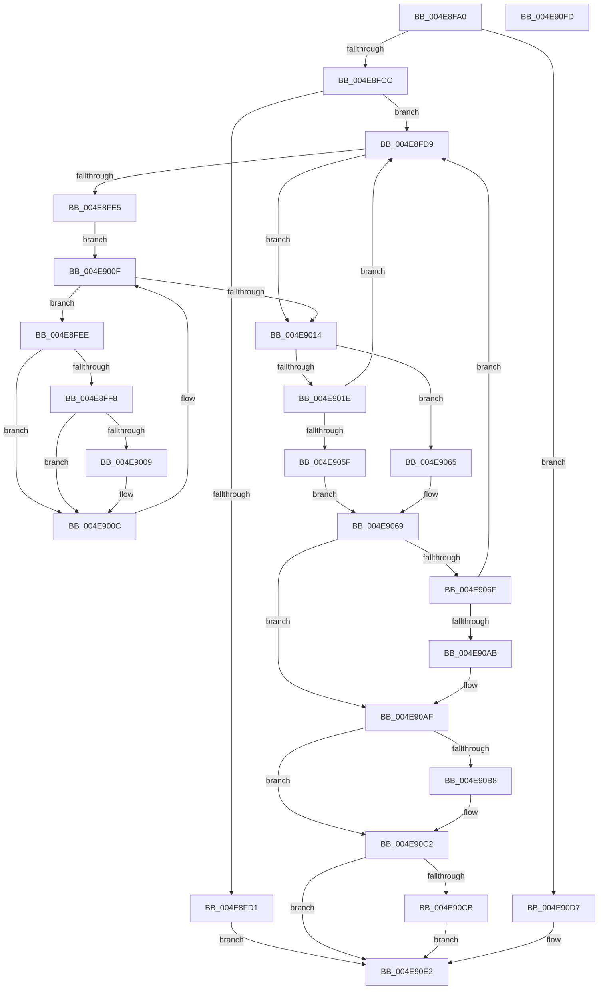

# PopPropogateCoolingChange

- RVA: `0x004E8FA0`–`0x004E90FE` (길이 `350` bytes)
- VA: `0x00000001404E8FA0`
- 실행 섹션: `.text`
- PDB 이름 있음: `예`; PDB Function 태그: `아니요`
- unwind 정보 RVA: `0x0005E6B4`
- 디코드: `97`개 명령, `350/350` bytes 표시
- 미해석 바이트: `0` (있으면 어셈블리에 `.byte`로 보존)

> 이 문서는 커널 이미지의 기계어와 PDB 기호를 분석해 생성했습니다. 4번과 5번은 함수 원형과 자료형을 바이너리 사용 방식에서 추정한 C 해석이며 원본 소스 복구 결과는 아닙니다.

## 1. Dependencies

- 직접 호출 지점: **12**; 고유 호출 대상: **8**
- 직접 호출자로 확인된 함수: **6**
- RIP 상대 이미지 참조: **0**

### Outgoing calls
- `0x004E8FBF` → [Feature_Servicing_CoolingFrameworkDeviceCleanupFix__private_IsEnabledDeviceUsageNoInline](../5D/Feature_Servicing_CoolingFrameworkDeviceCleanupFix__private_IsEnabledDeviceUsageNoInline_function_005D1004.md) (function, `0x005D1004`)
- `0x004E9029` → [PopReleaseRwLock](../2D/PopReleaseRwLock_function_002DFBBC.md) (function, `0x002DFBBC`)
- `0x004E9031` → [PopDiagTraceCoolingExtensionPassiveUpdate](../../page/AA/PopDiagTraceCoolingExtensionPassiveUpdate_function_00AAE490.md) (function, `0x00AAE490`)
- `0x004E9048` → [guard_dispatch_icall](../6B/guard_dispatch_icall_function_006BAAD0.md) (function, `0x006BAAD0`)
- `0x004E9050` → [PopAcquireRwLockExclusive](../43/PopAcquireRwLockExclusive_function_00430B44.md) (function, `0x00430B44`)
- `0x004E907A` → [PopReleaseRwLock](../2D/PopReleaseRwLock_function_002DFBBC.md) (function, `0x002DFBBC`)
- `0x004E9082` → [PopDiagTraceCoolingExtensionActiveUpdate](../../page/76/PopDiagTraceCoolingExtensionActiveUpdate_function_00760FFC.md) (function, `0x00760FFC`)
- `0x004E9094` → [guard_dispatch_icall](../6B/guard_dispatch_icall_function_006BAAD0.md) (function, `0x006BAAD0`)
- `0x004E909C` → [PopAcquireRwLockExclusive](../43/PopAcquireRwLockExclusive_function_00430B44.md) (function, `0x00430B44`)
- `0x004E90BD` → [KeSetEvent](../33/KeSetEvent_function_0033F310.md) (function, `0x0033F310`)
- `0x004E90D0` → [KeSetEvent](../33/KeSetEvent_function_0033F310.md) (function, `0x0033F310`)
- `0x004E90DD` → [PopPropogateCoolingChangeV2](../5D/PopPropogateCoolingChangeV2_function_005D1058.md) (function, `0x005D1058`)

### Direct callers
- [PoSetThermalActiveCooling](../../page/75/PoSetThermalActiveCooling_function_00756D40.md) at `0x00756DB6`
- [PopCoolingExtensionPnpNotification](../../page/75/PopCoolingExtensionPnpNotification_function_00757110.md) at `0x007571F1`
- [PopDisableCoolingExtension](../../page/75/PopDisableCoolingExtension_function_00757208.md) at `0x00757269`
- [PopDisableCoolingExtension](../../page/75/PopDisableCoolingExtension_function_00757208.md) at `0x007572A5`
- [PopHandleCancelQueryRemove](../../page/75/PopHandleCancelQueryRemove_function_0075730C.md) at `0x007573B3`
- [PoSetThermalPassiveCooling](../../page/AA/PoSetThermalPassiveCooling_function_00AA1540.md) at `0x00AA15CA`
- [PopDeactiveThermalRequest](../../page/AD/PopDeactiveThermalRequest_function_00ADF634.md) at `0x00ADF6D6`

### Static image references
- 디코드된 RIP-relative 메모리 참조가 없습니다.

## 2. Other-region calls and transfers

- 다른 실행 섹션으로 향하는 call: **2**
  - `0x004E9031` → [PopDiagTraceCoolingExtensionPassiveUpdate](../../page/AA/PopDiagTraceCoolingExtensionPassiveUpdate_function_00AAE490.md) (`.text` → `PAGE`)
  - `0x004E9082` → [PopDiagTraceCoolingExtensionActiveUpdate](../../page/76/PopDiagTraceCoolingExtensionActiveUpdate_function_00760FFC.md) (`.text` → `PAGE`)
- 별도 외부 분기/꼬리 이동을 확인하지 못했습니다.

## 3. Assembly (complete function range)

```asm
004E8FA0  48 8B C4                        mov rax, rsp
004E8FA3  48 89 58 08                     mov qword ptr [rax + 8], rbx
004E8FA7  48 89 68 10                     mov qword ptr [rax + 0x10], rbp
004E8FAB  48 89 70 18                     mov qword ptr [rax + 0x18], rsi
004E8FAF  48 89 78 20                     mov qword ptr [rax + 0x20], rdi
004E8FB3  41 56                           push r14
004E8FB5  48 83 EC 20                     sub rsp, 0x20
004E8FB9  40 8A FA                        mov dil, dl
004E8FBC  48 8B D9                        mov rbx, rcx
004E8FBF  E8 40 80 0E 00                  call 0x1405d1004
004E8FC4  85 C0                           test eax, eax
004E8FC6  0F 85 0B 01 00 00               jne 0x1404e90d7
004E8FCC  38 43 53                        cmp byte ptr [rbx + 0x53], al
004E8FCF  74 08                           je 0x1404e8fd9
004E8FD1  88 43 53                        mov byte ptr [rbx + 0x53], al
004E8FD4  E9 09 01 00 00                  jmp 0x1404e90e2
004E8FD9  40 32 F6                        xor sil, sil
004E8FDC  40 B7 64                        mov dil, 0x64
004E8FDF  40 38 73 50                     cmp byte ptr [rbx + 0x50], sil
004E8FE3  74 2F                           je 0x1404e9014
004E8FE5  48 8D 53 10                     lea rdx, [rbx + 0x10]
004E8FE9  48 8B 0A                        mov rcx, qword ptr [rdx]
004E8FEC  EB 21                           jmp 0x1404e900f
004E8FEE  80 79 12 00                     cmp byte ptr [rcx + 0x12], 0
004E8FF2  44 0F B6 C7                     movzx r8d, dil
004E8FF6  74 14                           je 0x1404e900c
004E8FF8  0F B6 79 10                     movzx edi, byte ptr [rcx + 0x10]
004E8FFC  41 3A F8                        cmp dil, r8b
004E8FFF  41 0F 43 F8                     cmovae edi, r8d
004E9003  80 79 11 00                     cmp byte ptr [rcx + 0x11], 0
004E9007  74 03                           je 0x1404e900c
004E9009  40 B6 01                        mov sil, 1
004E900C  48 8B 09                        mov rcx, qword ptr [rcx]
004E900F  48 3B CA                        cmp rcx, rdx
004E9012  75 DA                           jne 0x1404e8fee
004E9014  48 8D 6B 20                     lea rbp, [rbx + 0x20]
004E9018  40 3A 7B 52                     cmp dil, byte ptr [rbx + 0x52]
004E901C  74 47                           je 0x1404e9065
004E901E  48 8B CD                        mov rcx, rbp
004E9021  40 88 7B 52                     mov byte ptr [rbx + 0x52], dil
004E9025  C6 43 53 01                     mov byte ptr [rbx + 0x53], 1
004E9029  E8 8E 6B DF FF                  call 0x1402dfbbc
004E902E  48 8B CB                        mov rcx, rbx
004E9031  E8 5A 54 5C 00                  call 0x140aae490
004E9036  48 8B 83 98 00 00 00            mov rax, qword ptr [rbx + 0x98]
004E903D  4C 8D 73 70                     lea r14, [rbx + 0x70]
004E9041  49 8B 0E                        mov rcx, qword ptr [r14]
004E9044  40 0F B6 D7                     movzx edx, dil
004E9048  E8 83 1A 1D 00                  call 0x1406baad0
004E904D  48 8B CD                        mov rcx, rbp
004E9050  E8 EF 7A F4 FF                  call 0x140430b44
004E9055  80 7B 53 00                     cmp byte ptr [rbx + 0x53], 0
004E9059  0F 84 7A FF FF FF               je 0x1404e8fd9
004E905F  C6 43 53 00                     mov byte ptr [rbx + 0x53], 0
004E9063  EB 04                           jmp 0x1404e9069
004E9065  4C 8D 73 70                     lea r14, [rbx + 0x70]
004E9069  40 3A 73 51                     cmp sil, byte ptr [rbx + 0x51]
004E906D  74 40                           je 0x1404e90af
004E906F  48 8B CD                        mov rcx, rbp
004E9072  40 88 73 51                     mov byte ptr [rbx + 0x51], sil
004E9076  C6 43 53 01                     mov byte ptr [rbx + 0x53], 1
004E907A  E8 3D 6B DF FF                  call 0x1402dfbbc
004E907F  48 8B CB                        mov rcx, rbx
004E9082  E8 75 7F 27 00                  call 0x140760ffc
004E9087  48 8B 83 90 00 00 00            mov rax, qword ptr [rbx + 0x90]
004E908E  40 8A D6                        mov dl, sil
004E9091  49 8B 0E                        mov rcx, qword ptr [r14]
004E9094  E8 37 1A 1D 00                  call 0x1406baad0
004E9099  48 8B CD                        mov rcx, rbp
004E909C  E8 A3 7A F4 FF                  call 0x140430b44
004E90A1  80 7B 53 00                     cmp byte ptr [rbx + 0x53], 0
004E90A5  0F 84 2E FF FF FF               je 0x1404e8fd9
004E90AB  C6 43 53 00                     mov byte ptr [rbx + 0x53], 0
004E90AF  48 8B 4B 60                     mov rcx, qword ptr [rbx + 0x60]
004E90B3  48 85 C9                        test rcx, rcx
004E90B6  74 0A                           je 0x1404e90c2
004E90B8  45 33 C0                        xor r8d, r8d
004E90BB  33 D2                           xor edx, edx
004E90BD  E8 4E 62 E5 FF                  call 0x14033f310
004E90C2  48 8B 4B 58                     mov rcx, qword ptr [rbx + 0x58]
004E90C6  48 85 C9                        test rcx, rcx
004E90C9  74 17                           je 0x1404e90e2
004E90CB  45 33 C0                        xor r8d, r8d
004E90CE  33 D2                           xor edx, edx
004E90D0  E8 3B 62 E5 FF                  call 0x14033f310
004E90D5  EB 0B                           jmp 0x1404e90e2
004E90D7  40 8A D7                        mov dl, dil
004E90DA  48 8B CB                        mov rcx, rbx
004E90DD  E8 76 7F 0E 00                  call 0x1405d1058
004E90E2  48 8B 5C 24 30                  mov rbx, qword ptr [rsp + 0x30]
004E90E7  48 8B 6C 24 38                  mov rbp, qword ptr [rsp + 0x38]
004E90EC  48 8B 74 24 40                  mov rsi, qword ptr [rsp + 0x40]
004E90F1  48 8B 7C 24 48                  mov rdi, qword ptr [rsp + 0x48]
004E90F6  48 83 C4 20                     add rsp, 0x20
004E90FA  41 5E                           pop r14
004E90FC  C3                              ret
004E90FD  CC                              int3
```

## 4. C-style interpretation (structured pseudocode)

```c
__int64 __fastcall PopPropogateCoolingChange(__int64 a1, unsigned __int8 a2)
{
    __int64 result;
    __int64 v_rdi;
    __int64 v_rsi;
    __int64 v_rsp;
    unsigned __int64 v_stack_p10;
    unsigned __int64 v_stack_p18;
    unsigned __int64 v_stack_p20;
    unsigned __int64 v_stack_p8;

    *(unsigned __int64 *)(v_rsp + 8) = v_rbx;
    *(unsigned __int64 *)(v_rsp + 16) = v_rbp;
    *(unsigned __int64 *)(v_rsp + 24) = v_rsi;
    *(unsigned __int64 *)(v_rsp + 32) = v_rdi;
    v_rsp = (v_rsp) - (32);
    result = Feature_Servicing_CoolingFrameworkDeviceCleanupFix__private_IsEnabledDeviceUsageNoInline(a1, a2, a3, a4);
    if ((unsigned int)(result) != 0) goto loc_004E90D7;
    if ((*(unsigned __int8 *)(a1 + 83)) == ((unsigned __int8)(result))) goto loc_004E8FD9;
    *(unsigned __int8 *)(a1 + 83) = (unsigned __int8)(result);
    goto loc_004E90E2;
loc_004E8FD9:
    v_rsi = 0;
    if ((*(unsigned __int8 *)(a1 + 80)) == 0) goto loc_004E9014;
    goto loc_004E900F;
loc_004E8FEE:
    if ((*(unsigned __int8 *)(*(unsigned __int64 *)(a1 + 16) + 18)) == 0) goto loc_004E900C;
    v_rdi = *(unsigned __int8 *)(*(unsigned __int64 *)(a1 + 16) + 16);
    if (((unsigned __int8)(*(unsigned __int8 *)(*(unsigned __int64 *)(a1 + 16) + 16))) >= 100) { v_rdi = 100; }
    if ((*(unsigned __int8 *)(*(unsigned __int64 *)(a1 + 16) + 17)) != 0) {
        v_rsi = 1;
    }
loc_004E900F:
    if ((*(unsigned __int64 *)(*(unsigned __int64 *)(a1 + 16))) != (a1 + 16)) goto loc_004E8FEE;
loc_004E9014:
    if (((unsigned __int8)(v_rdi)) == (*(unsigned __int8 *)(a1 + 82))) goto loc_004E9065;
    *(unsigned __int8 *)(a1 + 82) = (unsigned __int8)(v_rdi);
    *(unsigned __int8 *)(a1 + 83) = 1;
    result = PopReleaseRwLock(a1 + 32, a1 + 16, 100, a4);
    result = PopDiagTraceCoolingExtensionPassiveUpdate(a1, a1 + 16, 100, a4);
    result = guard_dispatch_icall(*(unsigned __int64 *)(a1 + 112), (unsigned __int8)(v_rdi), 100, a4);
    result = PopAcquireRwLockExclusive(a1 + 32, (unsigned __int8)(v_rdi), 100, a4);
    if ((*(unsigned __int8 *)(a1 + 83)) == 0) goto loc_004E8FD9;
    *(unsigned __int8 *)(a1 + 83) = 0;
    goto loc_004E9069;
loc_004E9065:
loc_004E9069:
    if (((unsigned __int8)(v_rsi)) == (*(unsigned __int8 *)(a1 + 81))) goto loc_004E90AF;
    *(unsigned __int8 *)(a1 + 81) = (unsigned __int8)(v_rsi);
    *(unsigned __int8 *)(a1 + 83) = 1;
    result = PopReleaseRwLock(a1 + 32, (unsigned __int8)(v_rdi), 100, a4);
    result = PopDiagTraceCoolingExtensionActiveUpdate(a1, (unsigned __int8)(v_rdi), 100, a4);
    result = guard_dispatch_icall(*(unsigned __int64 *)(a1 + 112), (unsigned __int8)(v_rsi), 100, a4);
    result = PopAcquireRwLockExclusive(a1 + 32, (unsigned __int8)(v_rsi), 100, a4);
    if ((*(unsigned __int8 *)(a1 + 83)) == 0) goto loc_004E8FD9;
    *(unsigned __int8 *)(a1 + 83) = 0;
loc_004E90AF:
    if (*(unsigned __int64 *)(a1 + 96) != 0) {
        a3 = 0;
        a2 = 0;
        result = KeSetEvent(*(unsigned __int64 *)(a1 + 96), a2, a3, a4);
    }
    if (*(unsigned __int64 *)(a1 + 88) == 0) goto loc_004E90E2;
    a3 = 0;
    a2 = 0;
    result = KeSetEvent(*(unsigned __int64 *)(a1 + 88), a2, a3, a4);
    goto loc_004E90E2;
loc_004E90D7:
    result = PopPropogateCoolingChangeV2(a1, (unsigned __int8)(v_rdi), a3, a4);
loc_004E90E2:
    v_rsp = (v_rsp) + (32);
    return result;
}
```

## 5. (Beta) C Style

```c
int64_t PopPropogateCoolingChange(void *Arg1, uint8_t Arg2)
{
    uint8_t *arg1 = (uint8_t *)Arg1;

    int64_t result;
    int64_t local_rdi;
    int64_t local_rsi;
    int64_t local_rsp;
    uint64_t v_stack_p10;
    uint64_t v_stack_p18;
    uint64_t v_stack_p20;
    uint64_t v_stack_p8;

    *(uint64_t *)(local_rsp + 0x8) = local_rbx;
    *(uint64_t *)(local_rsp + 0x10) = local_rbp;
    *(uint64_t *)(local_rsp + 0x18) = local_rsi;
    *(uint64_t *)(local_rsp + 0x20) = local_rdi;
    local_rsp = (local_rsp) - (32);
    result = Feature_Servicing_CoolingFrameworkDeviceCleanupFix__private_IsEnabledDeviceUsageNoInline(Arg1, Arg2, a3, a4);
    if ((uint32_t)(result) != 0) goto loc_004E90D7;
    if ((*(uint8_t *)(arg1 + 0x53)) == ((uint8_t)(result))) goto loc_004E8FD9;
    *(uint8_t *)(arg1 + 0x53) = (uint8_t)(result);
    goto loc_004E90E2;
loc_004E8FD9:
    local_rsi = 0;
    if ((*(uint8_t *)(arg1 + 0x50)) == 0) goto loc_004E9014;
    goto loc_004E900F;
loc_004E8FEE:
    if ((*(uint8_t *)(*(uint64_t *)(arg1 + 0x10) + 0x12)) == 0) goto loc_004E900C;
    local_rdi = *(uint8_t *)(*(uint64_t *)(arg1 + 0x10) + 0x10);
    if (((uint8_t)(*(uint8_t *)(*(uint64_t *)(arg1 + 0x10) + 0x10))) >= 100) { local_rdi = 100; }
    if ((*(uint8_t *)(*(uint64_t *)(arg1 + 0x10) + 0x11)) != 0) {
        local_rsi = 1;
    }
loc_004E900F:
    if ((*(uint64_t *)(*(uint64_t *)(arg1 + 0x10))) != (Arg1 + 16)) goto loc_004E8FEE;
loc_004E9014:
    if (((uint8_t)(local_rdi)) == (*(uint8_t *)(arg1 + 0x52))) goto loc_004E9065;
    *(uint8_t *)(arg1 + 0x52) = (uint8_t)(local_rdi);
    *(uint8_t *)(arg1 + 0x53) = 1;
    result = PopReleaseRwLock(Arg1 + 32, Arg1 + 16, 100, a4);
    result = PopDiagTraceCoolingExtensionPassiveUpdate(Arg1, Arg1 + 16, 100, a4);
    result = guard_dispatch_icall(*(uint64_t *)(arg1 + 0x70), (uint8_t)(local_rdi), 100, a4);
    result = PopAcquireRwLockExclusive(Arg1 + 32, (uint8_t)(local_rdi), 100, a4);
    if ((*(uint8_t *)(arg1 + 0x53)) == 0) goto loc_004E8FD9;
    *(uint8_t *)(arg1 + 0x53) = 0;
    goto loc_004E9069;
loc_004E9065:
loc_004E9069:
    if (((uint8_t)(local_rsi)) == (*(uint8_t *)(arg1 + 0x51))) goto loc_004E90AF;
    *(uint8_t *)(arg1 + 0x51) = (uint8_t)(local_rsi);
    *(uint8_t *)(arg1 + 0x53) = 1;
    result = PopReleaseRwLock(Arg1 + 32, (uint8_t)(local_rdi), 100, a4);
    result = PopDiagTraceCoolingExtensionActiveUpdate(Arg1, (uint8_t)(local_rdi), 100, a4);
    result = guard_dispatch_icall(*(uint64_t *)(arg1 + 0x70), (uint8_t)(local_rsi), 100, a4);
    result = PopAcquireRwLockExclusive(Arg1 + 32, (uint8_t)(local_rsi), 100, a4);
    if ((*(uint8_t *)(arg1 + 0x53)) == 0) goto loc_004E8FD9;
    *(uint8_t *)(arg1 + 0x53) = 0;
loc_004E90AF:
    if (*(uint64_t *)(arg1 + 0x60) != 0) {
        a3 = 0;
        Arg2 = 0;
        result = KeSetEvent(*(uint64_t *)(arg1 + 0x60), Arg2, a3, a4);
    }
    if (*(uint64_t *)(arg1 + 0x58) == 0) goto loc_004E90E2;
    a3 = 0;
    Arg2 = 0;
    result = KeSetEvent(*(uint64_t *)(arg1 + 0x58), Arg2, a3, a4);
    goto loc_004E90E2;
loc_004E90D7:
    result = PopPropogateCoolingChangeV2(Arg1, (uint8_t)(local_rdi), a3, a4);
loc_004E90E2:
    local_rsp = (local_rsp) + (32);
    return result;
}
```

### 관측된 메모리 오프셋

구조체 형식이 확인되지 않은 접근은 인자 기준의 오프셋으로만 기록했습니다.

| 기준 인자 | 오프셋 표현 | 폭 (bit) | 접근 |
|---|---:|---:|---|
| `Arg1` | `+ 0x0` | `64` | `R` |
| `Arg1` | `+ 0x10` | `64` | `R` |
| `Arg1` | `+ 0x20` | `64` | `R` |
| `Arg1` | `+ 0x50` | `8` | `R` |
| `Arg1` | `+ 0x51` | `8` | `R` |
| `Arg1` | `+ 0x51` | `8` | `W` |
| `Arg1` | `+ 0x52` | `8` | `R` |
| `Arg1` | `+ 0x52` | `8` | `W` |
| `Arg1` | `+ 0x53` | `8` | `R` |
| `Arg1` | `+ 0x53` | `8` | `W` |
| `Arg1` | `+ 0x58` | `64` | `R` |
| `Arg1` | `+ 0x60` | `64` | `R` |
| `Arg1` | `+ 0x70` | `64` | `R` |
| `Arg1` | `+ 0x90` | `64` | `R` |
| `Arg1` | `+ 0x98` | `64` | `R` |

## 6. Execution-region graph

[열기: 2D/3D 그래프와 함수 탐색 컨트롤 패널](../../../control-panel.html?section=text&rva=0x004E8FA0&view=graph)

- 2D 그래프는 위에서 아래로 흐르고, 3D 그래프는 빈 공간을 드래그해 회전합니다. Shift+드래그는 이동, 휠은 확대·축소, 함수 노드 선택은 대상 보고서 이동입니다.

### Static fallback


