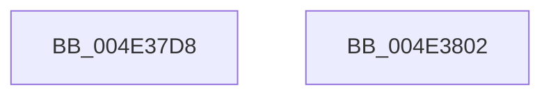

# PopResumeDeviceIdle

- RVA: `0x004E37D8`–`0x004E3803` (길이 `43` bytes)
- VA: `0x00000001404E37D8`
- 실행 섹션: `.text`
- PDB 이름 있음: `예`; PDB Function 태그: `아니요`
- unwind 정보 RVA: `0x0005C788`
- 디코드: `10`개 명령, `43/43` bytes 표시
- 미해석 바이트: `0` (있으면 어셈블리에 `.byte`로 보존)

> 이 문서는 커널 이미지의 기계어와 PDB 기호를 분석해 생성했습니다. 4번과 5번은 함수 원형과 자료형을 바이너리 사용 방식에서 추정한 C 해석이며 원본 소스 복구 결과는 아닙니다.

## 1. Dependencies

- 직접 호출 지점: **2**; 고유 호출 대상: **2**
- 직접 호출자로 확인된 함수: **1**
- RIP 상대 이미지 참조: **2**

### Outgoing calls
- `0x004E37E3` → [KeAcquireSpinLockRaiseToDpc](../20/KeAcquireSpinLockRaiseToDpc_function_00208470.md) (function, `0x00208470`)
- `0x004E37F8` → [KeReleaseSpinLock](../39/KeReleaseSpinLock_function_00392BA0.md) (function, `0x00392BA0`)

### Direct callers
- [PoClearBroadcast](../../page/AA/PoClearBroadcast_function_00AA3CE8.md) at `0x00AA3CFA`

### Static image references
- `0x004E37DC` → RVA `0x00F0CBA0` (`.data`; read)
- `0x004E37EA` → RVA `0x00E676A4` (`.data`; write)

## 2. Other-region calls and transfers

- 다른 실행 섹션으로 향하는 call: **0**
- 별도 외부 분기/꼬리 이동을 확인하지 못했습니다.

## 3. Assembly (complete function range)

```asm
004E37D8  48 83 EC 28                     sub rsp, 0x28
004E37DC  48 8D 0D BD 93 A2 00            lea rcx, [rip + 0xa293bd]
004E37E3  E8 88 4C D2 FF                  call 0x140208470
004E37E8  8A D0                           mov dl, al
004E37EA  C6 05 B3 3E 98 00 00            mov byte ptr [rip + 0x983eb3], 0
004E37F1  48 8D 0D A8 93 A2 00            lea rcx, [rip + 0xa293a8]
004E37F8  E8 A3 F3 EA FF                  call 0x140392ba0
004E37FD  48 83 C4 28                     add rsp, 0x28
004E3801  C3                              ret
004E3802  CC                              int3
```

## 4. C-style interpretation (structured pseudocode)

```c
__int64 __fastcall PopResumeDeviceIdle(void)
{
    __int64 result;
    __int64 v_rsp;

    v_rsp = (v_rsp) - (40);
    result = KeAcquireSpinLockRaiseToDpc(v_rip + 10654653, a2, a3, a4);
    *(unsigned __int8 *)(v_rip + 9977523) = 0;
    result = KeReleaseSpinLock(v_rip + 10654632, (unsigned __int8)(result), a3, a4);
    v_rsp = (v_rsp) + (40);
    return result;
}
```

## 5. (Beta) C Style

```c
void PopResumeDeviceIdle(void)
{
    int64_t result;
    int64_t local_rsp;

    local_rsp = (local_rsp) - (40);
    result = KeAcquireSpinLockRaiseToDpc(v_rip + 10654653, a2, a3, a4);
    *(uint8_t *)(v_rip + 0x983EB3) = 0;
    result = KeReleaseSpinLock(v_rip + 10654632, (uint8_t)(result), a3, a4);
    local_rsp = (local_rsp) + (40);
    return result;
}
```

## 6. Execution-region graph

[열기: 2D/3D 그래프와 함수 탐색 컨트롤 패널](../../../control-panel.html?section=text&rva=0x004E37D8&view=graph)

- 2D 그래프는 위에서 아래로 흐르고, 3D 그래프는 빈 공간을 드래그해 회전합니다. Shift+드래그는 이동, 휠은 확대·축소, 함수 노드 선택은 대상 보고서 이동입니다.

### Static fallback


