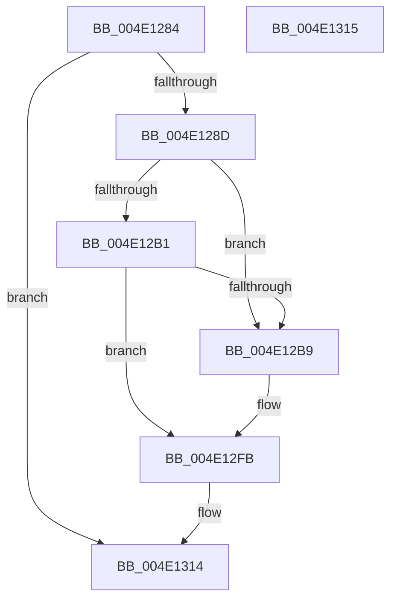

# PopThermalEventTransitionDisableDeepSleep

- RVA: `0x004E1284`–`0x004E1316` (길이 `146` bytes)
- VA: `0x00000001404E1284`
- 실행 섹션: `.text`
- PDB 이름 있음: `예`; PDB Function 태그: `아니요`
- unwind 정보 RVA: `0x000BF150`
- 디코드: `34`개 명령, `146/146` bytes 표시
- 미해석 바이트: `0` (있으면 어셈블리에 `.byte`로 보존)

> 이 문서는 커널 이미지의 기계어와 PDB 기호를 분석해 생성했습니다. 4번과 5번은 함수 원형과 자료형을 바이너리 사용 방식에서 추정한 C 해석이며 원본 소스 복구 결과는 아닙니다.

## 1. Dependencies

- 직접 호출 지점: **4**; 고유 호출 대상: **4**
- 직접 호출자로 확인된 함수: **1**
- RIP 상대 이미지 참조: **7**

### Outgoing calls
- `0x004E12A0` → [KeAcquireSpinLockRaiseToDpc](../20/KeAcquireSpinLockRaiseToDpc_function_00208470.md) (function, `0x00208470`)
- `0x004E12BE` → [PopDeepSleepSetDisengageReason](../38/PopDeepSleepSetDisengageReason_function_0038FEC4.md) (function, `0x0038FEC4`)
- `0x004E12EF` → [KeSetTimer2](../3A/KeSetTimer2_function_003A08E0.md) (function, `0x003A08E0`)
- `0x004E1305` → [KeReleaseSpinLock](../39/KeReleaseSpinLock_function_00392BA0.md) (function, `0x00392BA0`)

### Direct callers
- [PopThermalProcessUsermodeEvent](../../page/AB/PopThermalProcessUsermodeEvent_function_00AB7D58.md) at `0x00AB7D7C`

### Static image references
- `0x004E1299` → RVA `0x00F0B9A0` (`.data`; read)
- `0x004E12A5` → RVA `0x00F0B9A8` (`.data`; read)
- `0x004E12B1` → RVA `0x00F0B9AC` (`.data`; read)
- `0x004E12C3` → RVA `0x00F0B9AC` (`.data`; write)
- `0x004E12C9` → RVA `0x00F0B9B0` (`.data`; read)
- `0x004E12D2` → RVA `0x00F0B9A8` (`.data`; write)
- `0x004E12F4` → RVA `0x00F0BA38` (`.data`; write)

## 2. Other-region calls and transfers

- 다른 실행 섹션으로 향하는 call: **0**
- 별도 외부 분기/꼬리 이동을 확인하지 못했습니다.

## 3. Assembly (complete function range)

```asm
004E1284  83 F9 01                        cmp ecx, 1
004E1287  0F 87 87 00 00 00               ja 0x1404e1314
004E128D  48 89 5C 24 08                  mov qword ptr [rsp + 8], rbx
004E1292  57                              push rdi
004E1293  48 83 EC 20                     sub rsp, 0x20
004E1297  8B D9                           mov ebx, ecx
004E1299  48 8D 0D 00 A7 A2 00            lea rcx, [rip + 0xa2a700]
004E12A0  E8 CB 71 D2 FF                  call 0x140208470
004E12A5  80 3D FC A6 A2 00 00            cmp byte ptr [rip + 0xa2a6fc], 0
004E12AC  40 8A F8                        mov dil, al
004E12AF  75 08                           jne 0x1404e12b9
004E12B1  3B 1D F5 A6 A2 00               cmp ebx, dword ptr [rip + 0xa2a6f5]
004E12B7  73 42                           jae 0x1404e12fb
004E12B9  B9 0A 00 00 00                  mov ecx, 0xa
004E12BE  E8 01 EC EA FF                  call 0x14038fec4
004E12C3  89 1D E3 A6 A2 00               mov dword ptr [rip + 0xa2a6e3], ebx
004E12C9  48 8D 0D E0 A6 A2 00            lea rcx, [rip + 0xa2a6e0]
004E12D0  F7 DB                           neg ebx
004E12D2  C6 05 CF A6 A2 00 00            mov byte ptr [rip + 0xa2a6cf], 0
004E12D9  48 1B D2                        sbb rdx, rdx
004E12DC  45 33 C9                        xor r9d, r9d
004E12DF  81 E2 80 55 C8 20               and edx, 0x20c85580
004E12E5  45 33 C0                        xor r8d, r8d
004E12E8  48 81 C2 00 BA 3C DC            add rdx, -0x23c34600
004E12EF  E8 EC F5 EB FF                  call 0x1403a08e0
004E12F4  C6 05 3D A7 A2 00 01            mov byte ptr [rip + 0xa2a73d], 1
004E12FB  40 8A D7                        mov dl, dil
004E12FE  48 8D 0D 9B A6 A2 00            lea rcx, [rip + 0xa2a69b]
004E1305  E8 96 18 EB FF                  call 0x140392ba0
004E130A  48 8B 5C 24 30                  mov rbx, qword ptr [rsp + 0x30]
004E130F  48 83 C4 20                     add rsp, 0x20
004E1313  5F                              pop rdi
004E1314  C3                              ret
004E1315  CC                              int3
```

## 4. C-style interpretation (structured pseudocode)

```c
__int64 __fastcall PopThermalEventTransitionDisableDeepSleep(int a1, __int64 a2, int a3, int a4)
{
    __int64 result;
    __int64 v_rbx;
    __int64 v_rsp;
    unsigned __int64 v_stack_p8;

    if (a1 > 1) goto loc_004E1314;
    v_stack_p8 = v_rbx;
    v_rsp = (v_rsp) - (32);
    result = KeAcquireSpinLockRaiseToDpc(v_rip + 10659584, a2, a3, a4);
    if ((*(unsigned __int8 *)(v_rip + 10659580)) != 0) goto loc_004E12B9;
    v_rbx = (unsigned int)(a1);
    if (((unsigned int)((unsigned int)(a1))) < (*(unsigned int *)(v_rip + 10659573))) {
        a1 = 10;
        result = PopDeepSleepSetDisengageReason(a1, a2, a3, a4);
        *(unsigned int *)(v_rip + 10659555) = (unsigned int)((unsigned int)(a1));
        a1 = v_rip + 10659552;
        v_rbx = (unsigned int)(-((unsigned int)(a1)));
        *(unsigned __int8 *)(v_rip + 10659535) = 0;
        a4 = 0;
        a2 = (unsigned int)((a2) & (0x20C85580ULL));
        a3 = 0;
        a2 = (a2) + (0xFFFFFFFFDC3CBA00ULL);
        result = KeSetTimer2(a1, a2, a3, a4);
        *(unsigned __int8 *)(v_rip + 10659645) = 1;
    }
    result = KeReleaseSpinLock(v_rip + 10659483, (unsigned __int8)((unsigned __int8)(result)), a3, a4);
    v_rsp = (v_rsp) + (32);
loc_004E1314:
    return result;
}
```

## 5. (Beta) C Style

```c
int64_t PopThermalEventTransitionDisableDeepSleep(int32_t Arg1, int64_t Arg2, int32_t Arg3, int32_t Arg4)
{
    int64_t result;
    int64_t local_rbx;
    int64_t local_rsp;
    uint64_t v_stack_p8;

    if (Arg1 > 1) goto loc_004E1314;
    v_stack_p8 = local_rbx;
    local_rsp = (local_rsp) - (32);
    result = KeAcquireSpinLockRaiseToDpc(v_rip + 10659584, Arg2, Arg3, Arg4);
    if ((*(uint8_t *)(v_rip + 0xA2A6FC)) != 0) goto loc_004E12B9;
    local_rbx = (uint32_t)(Arg1);
    if (((uint32_t)((uint32_t)(Arg1))) < (*(uint32_t *)(v_rip + 0xA2A6F5))) {
        Arg1 = 10;
        result = PopDeepSleepSetDisengageReason(Arg1, Arg2, Arg3, Arg4);
        *(uint32_t *)(v_rip + 0xA2A6E3) = (uint32_t)((uint32_t)(Arg1));
        Arg1 = v_rip + 10659552;
        local_rbx = (uint32_t)(-((uint32_t)(Arg1)));
        *(uint8_t *)(v_rip + 0xA2A6CF) = 0;
        Arg4 = 0;
        Arg2 = (uint32_t)((Arg2) & (0x20C85580ULL));
        Arg3 = 0;
        Arg2 = (Arg2) + (0xFFFFFFFFDC3CBA00ULL);
        result = KeSetTimer2(Arg1, Arg2, Arg3, Arg4);
        *(uint8_t *)(v_rip + 0xA2A73D) = 1;
    }
    result = KeReleaseSpinLock(v_rip + 10659483, (uint8_t)((uint8_t)(result)), Arg3, Arg4);
    local_rsp = (local_rsp) + (32);
loc_004E1314:
    return result;
}
```

## 6. Execution-region graph

[열기: 2D/3D 그래프와 함수 탐색 컨트롤 패널](../../../control-panel.html?section=text&rva=0x004E1284&view=graph)

- 2D 그래프는 위에서 아래로 흐르고, 3D 그래프는 빈 공간을 드래그해 회전합니다. Shift+드래그는 이동, 휠은 확대·축소, 함수 노드 선택은 대상 보고서 이동입니다.

### Static fallback


