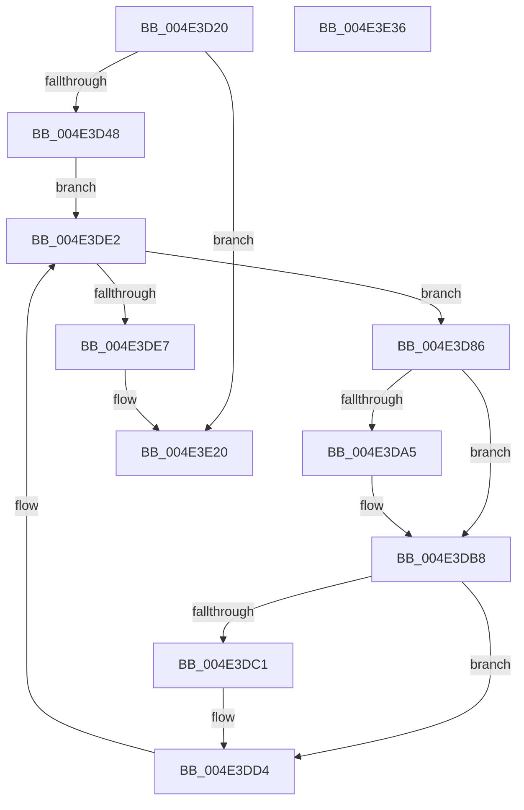

# PopThermalSxEntry

- RVA: `0x004E3D20`–`0x004E3E37` (길이 `279` bytes)
- VA: `0x00000001404E3D20`
- 실행 섹션: `.text`
- PDB 이름 있음: `예`; PDB Function 태그: `아니요`
- unwind 정보 RVA: `0x0006F978`
- 디코드: `62`개 명령, `279/279` bytes 표시
- 미해석 바이트: `0` (있으면 어셈블리에 `.byte`로 보존)

> 이 문서는 커널 이미지의 기계어와 PDB 기호를 분석해 생성했습니다. 4번과 5번은 함수 원형과 자료형을 바이너리 사용 방식에서 추정한 C 해석이며 원본 소스 복구 결과는 아닙니다.

## 1. Dependencies

- 직접 호출 지점: **15**; 고유 호출 대상: **10**
- 직접 호출자로 확인된 함수: **1**
- RIP 상대 이미지 참조: **6**

### Outgoing calls
- `0x004E3D4F` → [PopAcquireRwLockExclusive](../43/PopAcquireRwLockExclusive_function_00430B44.md) (function, `0x00430B44`)
- `0x004E3D59` → [PopThermalStandbyEndTracking](../4D/PopThermalStandbyEndTracking_function_004D1B2C.md) (function, `0x004D1B2C`)
- `0x004E3D65` → [PopReleaseRwLock](../2D/PopReleaseRwLock_function_002DFBBC.md) (function, `0x002DFBBC`)
- `0x004E3D71` → [PopAcquireRwLockShared](../2D/PopAcquireRwLockShared_function_002D9A40.md) (function, `0x002D9A40`)
- `0x004E3D90` → [PopAcquireRwLockExclusive](../43/PopAcquireRwLockExclusive_function_00430B44.md) (function, `0x00430B44`)
- `0x004E3DAB` → [PopThermalUpdatePassiveTimeTracking](../../page/AA/PopThermalUpdatePassiveTimeTracking_function_00AA15EC.md) (function, `0x00AA15EC`)
- `0x004E3DB3` → [PopTraceThermalZonePassiveHistogram](../4D/PopTraceThermalZonePassiveHistogram_function_004DDD10.md) (function, `0x004DDD10`)
- `0x004E3DC7` → [PopThermalUpdateActiveTimeTracking](../../page/AB/PopThermalUpdateActiveTimeTracking_function_00ABA79C.md) (function, `0x00ABA79C`)
- `0x004E3DCF` → [PopTraceThermalZoneActiveActivity](../5D/PopTraceThermalZoneActiveActivity_function_005D7FE0.md) (function, `0x005D7FE0`)
- `0x004E3DDA` → [PopReleaseRwLock](../2D/PopReleaseRwLock_function_002DFBBC.md) (function, `0x002DFBBC`)
- `0x004E3DEE` → [PopReleaseRwLock](../2D/PopReleaseRwLock_function_002DFBBC.md) (function, `0x002DFBBC`)
- `0x004E3DF5` → [PopCoolingSxTransition](../42/PopCoolingSxTransition_function_0042FEA8.md) (function, `0x0042FEA8`)
- `0x004E3DFC` → [PopPowerLimitSxTransition](../5D/PopPowerLimitSxTransition_function_005D0E64.md) (function, `0x005D0E64`)
- `0x004E3E08` → [PopAcquireRwLockExclusive](../43/PopAcquireRwLockExclusive_function_00430B44.md) (function, `0x00430B44`)
- `0x004E3E1B` → [PopReleaseRwLock](../2D/PopReleaseRwLock_function_002DFBBC.md) (function, `0x002DFBBC`)

### Direct callers
- [PopTransitionSystemPowerStateEx](../../pagelk/B7/PopTransitionSystemPowerStateEx_function_00B7E8C0.md) at `0x00B7F0C6`

### Static image references
- `0x004E3D3A` → RVA `0x00F0BAF4` (`.data`; read/write)
- `0x004E3D48` → RVA `0x00F0BB00` (`.data`; read)
- `0x004E3D6A` → RVA `0x00F0C900` (`.data`; read)
- `0x004E3D76` → RVA `0x00F0CE80` (`.data`; read)
- `0x004E3E01` → RVA `0x00F0B980` (`.data`; read)
- `0x004E3E14` → RVA `0x00F0B990` (`.data`; write)

## 2. Other-region calls and transfers

- 다른 실행 섹션으로 향하는 call: **2**
  - `0x004E3DAB` → [PopThermalUpdatePassiveTimeTracking](../../page/AA/PopThermalUpdatePassiveTimeTracking_function_00AA15EC.md) (`.text` → `PAGE`)
  - `0x004E3DC7` → [PopThermalUpdateActiveTimeTracking](../../page/AB/PopThermalUpdateActiveTimeTracking_function_00ABA79C.md) (`.text` → `PAGE`)
- 별도 외부 분기/꼬리 이동을 확인하지 못했습니다.

## 3. Assembly (complete function range)

```asm
004E3D20  48 89 5C 24 08                  mov qword ptr [rsp + 8], rbx
004E3D25  48 89 74 24 10                  mov qword ptr [rsp + 0x10], rsi
004E3D2A  48 89 7C 24 18                  mov qword ptr [rsp + 0x18], rdi
004E3D2F  41 56                           push r14
004E3D31  48 83 EC 20                     sub rsp, 0x20
004E3D35  B8 01 00 00 00                  mov eax, 1
004E3D3A  87 05 B4 7D A2 00               xchg dword ptr [rip + 0xa27db4], eax
004E3D40  85 C0                           test eax, eax
004E3D42  0F 85 D8 00 00 00               jne 0x1404e3e20
004E3D48  48 8D 0D B1 7D A2 00            lea rcx, [rip + 0xa27db1]
004E3D4F  E8 F0 CD F4 FF                  call 0x140430b44
004E3D54  B9 04 00 00 00                  mov ecx, 4
004E3D59  E8 CE DD FE FF                  call 0x1404d1b2c
004E3D5E  48 8D 0D 9B 7D A2 00            lea rcx, [rip + 0xa27d9b]
004E3D65  E8 52 BE DF FF                  call 0x1402dfbbc
004E3D6A  48 8D 0D 8F 8B A2 00            lea rcx, [rip + 0xa28b8f]
004E3D71  E8 CA 5C DF FF                  call 0x1402d9a40
004E3D76  48 8B 1D 03 91 A2 00            mov rbx, qword ptr [rip + 0xa29103]
004E3D7D  4C 8D 35 FC 90 A2 00            lea r14, [rip + 0xa290fc]
004E3D84  EB 5C                           jmp 0x1404e3de2
004E3D86  48 8D B3 B0 01 00 00            lea rsi, [rbx + 0x1b0]
004E3D8D  48 8B CE                        mov rcx, rsi
004E3D90  E8 AF CD F4 FF                  call 0x140430b44
004E3D95  80 BB 91 00 00 00 00            cmp byte ptr [rbx + 0x91], 0
004E3D9C  48 8D BB F8 01 00 00            lea rdi, [rbx + 0x1f8]
004E3DA3  74 13                           je 0x1404e3db8
004E3DA5  8A 53 50                        mov dl, byte ptr [rbx + 0x50]
004E3DA8  48 8B CF                        mov rcx, rdi
004E3DAB  E8 3C D8 5B 00                  call 0x140aa15ec
004E3DB0  48 8B CB                        mov rcx, rbx
004E3DB3  E8 58 9F FF FF                  call 0x1404ddd10
004E3DB8  80 BB F9 01 00 00 00            cmp byte ptr [rbx + 0x1f9], 0
004E3DBF  76 13                           jbe 0x1404e3dd4
004E3DC1  8A 53 45                        mov dl, byte ptr [rbx + 0x45]
004E3DC4  48 8B CF                        mov rcx, rdi
004E3DC7  E8 D0 69 5D 00                  call 0x140aba79c
004E3DCC  48 8B CB                        mov rcx, rbx
004E3DCF  E8 0C 42 0F 00                  call 0x1405d7fe0
004E3DD4  48 8B CE                        mov rcx, rsi
004E3DD7  C6 07 01                        mov byte ptr [rdi], 1
004E3DDA  E8 DD BD DF FF                  call 0x1402dfbbc
004E3DDF  48 8B 1B                        mov rbx, qword ptr [rbx]
004E3DE2  49 3B DE                        cmp rbx, r14
004E3DE5  75 9F                           jne 0x1404e3d86
004E3DE7  48 8D 0D 12 8B A2 00            lea rcx, [rip + 0xa28b12]
004E3DEE  E8 C9 BD DF FF                  call 0x1402dfbbc
004E3DF3  B1 01                           mov cl, 1
004E3DF5  E8 AE C0 F4 FF                  call 0x14042fea8
004E3DFA  B1 01                           mov cl, 1
004E3DFC  E8 63 D0 0E 00                  call 0x1405d0e64
004E3E01  48 8D 0D 78 7B A2 00            lea rcx, [rip + 0xa27b78]
004E3E08  E8 37 CD F4 FF                  call 0x140430b44
004E3E0D  48 8D 0D 6C 7B A2 00            lea rcx, [rip + 0xa27b6c]
004E3E14  C6 05 75 7B A2 00 00            mov byte ptr [rip + 0xa27b75], 0
004E3E1B  E8 9C BD DF FF                  call 0x1402dfbbc
004E3E20  48 8B 5C 24 30                  mov rbx, qword ptr [rsp + 0x30]
004E3E25  48 8B 74 24 38                  mov rsi, qword ptr [rsp + 0x38]
004E3E2A  48 8B 7C 24 40                  mov rdi, qword ptr [rsp + 0x40]
004E3E2F  48 83 C4 20                     add rsp, 0x20
004E3E33  41 5E                           pop r14
004E3E35  C3                              ret
004E3E36  CC                              int3
```

## 4. C-style interpretation (structured pseudocode)

```c
__int64 __fastcall PopThermalSxEntry(void)
{
    __int64 result;
    __int64 v_rsp;
    unsigned __int64 v_stack_p10;
    unsigned __int64 v_stack_p18;
    unsigned __int64 v_stack_p8;

    v_stack_p8 = v_rbx;
    v_stack_p10 = v_rsi;
    v_stack_p18 = v_rdi;
    v_rsp = (v_rsp) - (32);
    if (1 != 0) goto loc_004E3E20;
    result = PopAcquireRwLockExclusive(v_rip + 10649009, a2, a3, a4);
    result = PopThermalStandbyEndTracking(4, a2, a3, a4);
    result = PopReleaseRwLock(v_rip + 10648987, a2, a3, a4);
    result = PopAcquireRwLockShared(v_rip + 10652559, a2, a3, a4);
    goto loc_004E3DE2;
loc_004E3D86:
    result = PopAcquireRwLockExclusive(*(unsigned __int64 *)(v_rip + 10653955) + 432, a2, a3, a4);
    if ((*(unsigned __int8 *)(*(unsigned __int64 *)(v_rip + 10653955) + 145)) != 0) {
        a2 = *(unsigned __int8 *)(*(unsigned __int64 *)(v_rip + 10653955) + 80);
        a1 = *(unsigned __int64 *)(v_rip + 10653955) + 504;
        result = PopThermalUpdatePassiveTimeTracking(a1, a2, a3, a4);
        a1 = *(unsigned __int64 *)(v_rip + 10653955);
        result = PopTraceThermalZonePassiveHistogram(a1, a2, a3, a4);
    }
    if ((*(unsigned __int8 *)(*(unsigned __int64 *)(v_rip + 10653955) + 505)) >= = 0) {
        a2 = *(unsigned __int8 *)(*(unsigned __int64 *)(v_rip + 10653955) + 69);
        a1 = *(unsigned __int64 *)(v_rip + 10653955) + 504;
        result = PopThermalUpdateActiveTimeTracking(a1, a2, a3, a4);
        a1 = *(unsigned __int64 *)(v_rip + 10653955);
        result = PopTraceThermalZoneActiveActivity(a1, a2, a3, a4);
    }
    *(unsigned __int8 *)(*(unsigned __int64 *)(v_rip + 10653955) + 504) = 1;
    result = PopReleaseRwLock(*(unsigned __int64 *)(v_rip + 10653955) + 432, a2, a3, a4);
loc_004E3DE2:
    if ((*(unsigned __int64 *)(*(unsigned __int64 *)(v_rip + 10653955))) != (v_rip + 10653948)) goto loc_004E3D86;
    result = PopReleaseRwLock(v_rip + 10652434, a2, a3, a4);
    result = PopCoolingSxTransition(1, a2, a3, a4);
    result = PopPowerLimitSxTransition(1, a2, a3, a4);
    result = PopAcquireRwLockExclusive(v_rip + 10648440, a2, a3, a4);
    *(unsigned __int8 *)(v_rip + 10648437) = 0;
    result = PopReleaseRwLock(v_rip + 10648428, a2, a3, a4);
loc_004E3E20:
    v_rsp = (v_rsp) + (32);
    return result;
}
```

## 5. (Beta) C Style

```c
void PopThermalSxEntry(void)
{
    int64_t result;
    int64_t local_rsp;
    uint64_t v_stack_p10;
    uint64_t v_stack_p18;
    uint64_t v_stack_p8;

    v_stack_p8 = local_rbx;
    v_stack_p10 = local_rsi;
    v_stack_p18 = local_rdi;
    local_rsp = (local_rsp) - (32);
    if (1 != 0) goto loc_004E3E20;
    result = PopAcquireRwLockExclusive(v_rip + 10649009, a2, a3, a4);
    result = PopThermalStandbyEndTracking(4, a2, a3, a4);
    result = PopReleaseRwLock(v_rip + 10648987, a2, a3, a4);
    result = PopAcquireRwLockShared(v_rip + 10652559, a2, a3, a4);
    goto loc_004E3DE2;
loc_004E3D86:
    result = PopAcquireRwLockExclusive(*(uint64_t *)(v_rip + 0xA29103) + 432, a2, a3, a4);
    if ((*(uint8_t *)(*(uint64_t *)(v_rip + 0xA29103) + 0x91)) != 0) {
        a2 = *(uint8_t *)(*(uint64_t *)(v_rip + 0xA29103) + 0x50);
        a1 = *(uint64_t *)(v_rip + 0xA29103) + 504;
        result = PopThermalUpdatePassiveTimeTracking(a1, a2, a3, a4);
        a1 = *(uint64_t *)(v_rip + 0xA29103);
        result = PopTraceThermalZonePassiveHistogram(a1, a2, a3, a4);
    }
    if ((*(uint8_t *)(*(uint64_t *)(v_rip + 0xA29103) + 0x1F9)) >= = 0) {
        a2 = *(uint8_t *)(*(uint64_t *)(v_rip + 0xA29103) + 0x45);
        a1 = *(uint64_t *)(v_rip + 0xA29103) + 504;
        result = PopThermalUpdateActiveTimeTracking(a1, a2, a3, a4);
        a1 = *(uint64_t *)(v_rip + 0xA29103);
        result = PopTraceThermalZoneActiveActivity(a1, a2, a3, a4);
    }
    *(uint8_t *)(*(uint64_t *)(v_rip + 0xA29103) + 0x1F8) = 1;
    result = PopReleaseRwLock(*(uint64_t *)(v_rip + 0xA29103) + 432, a2, a3, a4);
loc_004E3DE2:
    if ((*(uint64_t *)(*(uint64_t *)(v_rip + 0xA29103))) != (v_rip + 10653948)) goto loc_004E3D86;
    result = PopReleaseRwLock(v_rip + 10652434, a2, a3, a4);
    result = PopCoolingSxTransition(1, a2, a3, a4);
    result = PopPowerLimitSxTransition(1, a2, a3, a4);
    result = PopAcquireRwLockExclusive(v_rip + 10648440, a2, a3, a4);
    *(uint8_t *)(v_rip + 0xA27B75) = 0;
    result = PopReleaseRwLock(v_rip + 10648428, a2, a3, a4);
loc_004E3E20:
    local_rsp = (local_rsp) + (32);
    return result;
}
```

## 6. Execution-region graph

[열기: 2D/3D 그래프와 함수 탐색 컨트롤 패널](../../../control-panel.html?section=text&rva=0x004E3D20&view=graph)

- 2D 그래프는 위에서 아래로 흐르고, 3D 그래프는 빈 공간을 드래그해 회전합니다. Shift+드래그는 이동, 휠은 확대·축소, 함수 노드 선택은 대상 보고서 이동입니다.

### Static fallback


