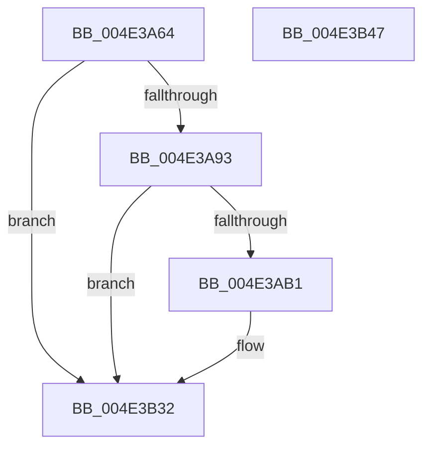

# PopTraceEsSetting

- RVA: `0x004E3A64`–`0x004E3B48` (길이 `228` bytes)
- VA: `0x00000001404E3A64`
- 실행 섹션: `.text`
- PDB 이름 있음: `예`; PDB Function 태그: `아니요`
- unwind 정보 RVA: `0x000AC058`
- 디코드: `47`개 명령, `228/228` bytes 표시
- 미해석 바이트: `0` (있으면 어셈블리에 `.byte`로 보존)

> 이 문서는 커널 이미지의 기계어와 PDB 기호를 분석해 생성했습니다. 4번과 5번은 함수 원형과 자료형을 바이너리 사용 방식에서 추정한 C 해석이며 원본 소스 복구 결과는 아닙니다.

## 1. Dependencies

- 직접 호출 지점: **3**; 고유 호출 대상: **3**
- 직접 호출자로 확인된 함수: **1**
- RIP 상대 이미지 참조: **3**

### Outgoing calls
- `0x004E3AA4` → [tlgKeywordOn](../42/tlgKeywordOn_function_0042EAA0.md) (function, `0x0042EAA0`)
- `0x004E3B2D` → [tlgWriteTransfer_EtwWriteTransfer](../42/tlgWriteTransfer_EtwWriteTransfer_function_004260E0.md) (function, `0x004260E0`)
- `0x004E3B39` → [_security_check_cookie](../6A/_security_check_cookie_function_006AC640.md) (function, `0x006AC640`)

### Direct callers
- [PopEsUpdateSetting](../../page/76/PopEsUpdateSetting_function_00769A48.md) at `0x00769AD0`

### Static image references
- `0x004E3A72` → RVA `0x00E0A740` (`.data`; read)
- `0x004E3A80` → RVA `0x00E07748` (`.data`; read)
- `0x004E3ABD` → RVA `0x0004A332` (`.rdata`; read)

## 2. Other-region calls and transfers

- 다른 실행 섹션으로 향하는 call: **0**
- 별도 외부 분기/꼬리 이동을 확인하지 못했습니다.

## 3. Assembly (complete function range)

```asm
004E3A64  40 55                           push rbp
004E3A66  48 8D 6C 24 A9                  lea rbp, [rsp - 0x57]
004E3A6B  48 81 EC C0 00 00 00            sub rsp, 0xc0
004E3A72  48 8B 05 C7 6C 92 00            mov rax, qword ptr [rip + 0x926cc7]
004E3A79  48 33 C4                        xor rax, rsp
004E3A7C  48 89 45 47                     mov qword ptr [rbp + 0x47], rax
004E3A80  83 3D C1 3C 92 00 05            cmp dword ptr [rip + 0x923cc1], 5
004E3A87  44 8B CA                        mov r9d, edx
004E3A8A  44 8B D1                        mov r10d, ecx
004E3A8D  0F 86 9F 00 00 00               jbe 0x1404e3b32
004E3A93  48 BA 00 00 00 00 00 40 00 00   movabs rdx, 0x400000000000
004E3A9D  48 8D 0D A4 3C 92 00            lea rcx, [rip + 0x923ca4]
004E3AA4  E8 F7 AF F4 FF                  call 0x14042eaa0
004E3AA9  84 C0                           test al, al
004E3AAB  0F 84 81 00 00 00               je 0x1404e3b32
004E3AB1  48 8D 45 C7                     lea rax, [rbp - 0x39]
004E3AB5  44 89 4D CB                     mov dword ptr [rbp - 0x35], r9d
004E3AB9  48 89 45 07                     mov qword ptr [rbp + 7], rax
004E3ABD  48 8D 15 6E 68 B6 FF            lea rdx, [rip - 0x499792]
004E3AC4  48 8D 45 CB                     lea rax, [rbp - 0x35]
004E3AC8  44 89 55 C7                     mov dword ptr [rbp - 0x39], r10d
004E3ACC  48 89 45 17                     mov qword ptr [rbp + 0x17], rax
004E3AD0  48 8D 0D 71 3C 92 00            lea rcx, [rip + 0x923c71]
004E3AD7  41 0F B6 C0                     movzx eax, r8b
004E3ADB  45 33 C9                        xor r9d, r9d
004E3ADE  89 45 CF                        mov dword ptr [rbp - 0x31], eax
004E3AE1  45 33 C0                        xor r8d, r8d
004E3AE4  48 8D 45 CF                     lea rax, [rbp - 0x31]
004E3AE8  48 C7 45 0F 04 00 00 00         mov qword ptr [rbp + 0xf], 4
004E3AF0  48 89 45 27                     mov qword ptr [rbp + 0x27], rax
004E3AF4  48 8D 45 D7                     lea rax, [rbp - 0x29]
004E3AF8  48 89 45 37                     mov qword ptr [rbp + 0x37], rax
004E3AFC  48 8D 45 E7                     lea rax, [rbp - 0x19]
004E3B00  48 89 44 24 28                  mov qword ptr [rsp + 0x28], rax
004E3B05  C7 44 24 20 06 00 00 00         mov dword ptr [rsp + 0x20], 6
004E3B0D  48 C7 45 1F 04 00 00 00         mov qword ptr [rbp + 0x1f], 4
004E3B15  48 C7 45 2F 04 00 00 00         mov qword ptr [rbp + 0x2f], 4
004E3B1D  48 C7 45 D7 00 00 00 01         mov qword ptr [rbp - 0x29], 0x1000000
004E3B25  48 C7 45 3F 08 00 00 00         mov qword ptr [rbp + 0x3f], 8
004E3B2D  E8 AE 25 F4 FF                  call 0x1404260e0
004E3B32  48 8B 4D 47                     mov rcx, qword ptr [rbp + 0x47]
004E3B36  48 33 CC                        xor rcx, rsp
004E3B39  E8 02 8B 1C 00                  call 0x1406ac640
004E3B3E  48 81 C4 C0 00 00 00            add rsp, 0xc0
004E3B45  5D                              pop rbp
004E3B46  C3                              ret
004E3B47  CC                              int3
```

## 4. C-style interpretation (structured pseudocode)

```c
__int64 __fastcall PopTraceEsSetting(int a1, int a2, int a3)
{
    __int64 result;
    __int64 v_rsp;
    unsigned __int64 v_stack_m18;
    unsigned __int64 v_stack_m20;
    unsigned __int64 v_stack_m28;
    unsigned __int64 v_stack_m30;
    unsigned __int64 v_stack_m38;
    unsigned __int64 v_stack_m40;
    unsigned __int64 v_stack_m48;
    unsigned __int64 v_stack_m50;
    unsigned __int64 v_stack_m58;
    unsigned __int64 v_stack_m5F;
    unsigned __int64 v_stack_m78;
    unsigned __int64 v_stack_m88;
    unsigned int v_stack_m90;
    unsigned int v_stack_m94;
    unsigned __int64 v_stack_m98;
    unsigned __int64 v_stack_mA0;
    unsigned int v_stack_mA8;

    v_rsp = (v_rsp) - (192);
    result = (*(unsigned __int64 *)(v_rip + 9596103)) ^ (v_rsp);
    v_stack_m18 = result;
    if ((*(unsigned int *)(v_rip + 9583809)) <= 5) goto loc_004E3B32;
    result = tlgKeywordOn(v_rip + 9583780, a2, a3, (unsigned int)(a2));
    if ((unsigned __int8)(result) != 0) {
        result = v_stack_m98;
        v_stack_m94 = (unsigned int)((unsigned int)(a2));
        v_stack_m58 = result;
        a2 = v_rip - 4822930;
        result = v_stack_m94;
        v_stack_m98 = (unsigned int)((unsigned int)(a1));
        v_stack_m48 = result;
        a1 = v_rip + 9583729;
        result = (unsigned __int8)(a3);
        a4 = 0;
        v_stack_m90 = (unsigned int)(result);
        a3 = 0;
        result = v_stack_m90;
        v_stack_m50 = 4;
        v_stack_m38 = result;
        result = v_stack_m88;
        v_stack_m28 = result;
        result = v_stack_m78;
        v_stack_mA0 = result;
        v_stack_mA8 = 6;
        v_stack_m40 = 4;
        v_stack_m30 = 4;
        v_stack_m88 = 0x1000000ULL;
        v_stack_m20 = 8;
        result = tlgWriteTransfer_EtwWriteTransfer(a1, a2, a3, a4);
    }
    a1 = (v_stack_m18) ^ (v_rsp);
    result = _security_check_cookie(a1, a2, a3, a4);
    v_rsp = (v_rsp) + (192);
    return result;
}
```

## 5. (Beta) C Style

```c
int64_t PopTraceEsSetting(int32_t Arg1, int32_t Arg2, int32_t Arg3)
{
    int64_t result;
    int64_t local_rsp;
    uint64_t v_stack_m18;
    uint64_t v_stack_m20;
    uint64_t v_stack_m28;
    uint64_t v_stack_m30;
    uint64_t v_stack_m38;
    uint64_t v_stack_m40;
    uint64_t v_stack_m48;
    uint64_t v_stack_m50;
    uint64_t v_stack_m58;
    uint64_t v_stack_m5F;
    uint64_t v_stack_m78;
    uint64_t v_stack_m88;
    uint32_t v_stack_m90;
    uint32_t v_stack_m94;
    uint64_t v_stack_m98;
    uint64_t v_stack_mA0;
    uint32_t v_stack_mA8;

    local_rsp = (local_rsp) - (192);
    result = (*(uint64_t *)(v_rip + 0x926CC7)) ^ (local_rsp);
    v_stack_m18 = result;
    if ((*(uint32_t *)(v_rip + 0x923CC1)) <= 5) goto loc_004E3B32;
    result = tlgKeywordOn(v_rip + 9583780, Arg2, Arg3, (uint32_t)(Arg2));
    if ((uint8_t)(result) != 0) {
        result = v_stack_m98;
        v_stack_m94 = (uint32_t)((uint32_t)(Arg2));
        v_stack_m58 = result;
        Arg2 = v_rip - 4822930;
        result = v_stack_m94;
        v_stack_m98 = (uint32_t)((uint32_t)(Arg1));
        v_stack_m48 = result;
        Arg1 = v_rip + 9583729;
        result = (uint8_t)(Arg3);
        a4 = 0;
        v_stack_m90 = (uint32_t)(result);
        Arg3 = 0;
        result = v_stack_m90;
        v_stack_m50 = 4;
        v_stack_m38 = result;
        result = v_stack_m88;
        v_stack_m28 = result;
        result = v_stack_m78;
        v_stack_mA0 = result;
        v_stack_mA8 = 6;
        v_stack_m40 = 4;
        v_stack_m30 = 4;
        v_stack_m88 = 0x1000000ULL;
        v_stack_m20 = 8;
        result = tlgWriteTransfer_EtwWriteTransfer(Arg1, Arg2, Arg3, a4);
    }
    Arg1 = (v_stack_m18) ^ (local_rsp);
    result = _security_check_cookie(Arg1, Arg2, Arg3, a4);
    local_rsp = (local_rsp) + (192);
    return result;
}
```

## 6. Execution-region graph

[열기: 2D/3D 그래프와 함수 탐색 컨트롤 패널](../../../control-panel.html?section=text&rva=0x004E3A64&view=graph)

- 2D 그래프는 위에서 아래로 흐르고, 3D 그래프는 빈 공간을 드래그해 회전합니다. Shift+드래그는 이동, 휠은 확대·축소, 함수 노드 선택은 대상 보고서 이동입니다.

### Static fallback


