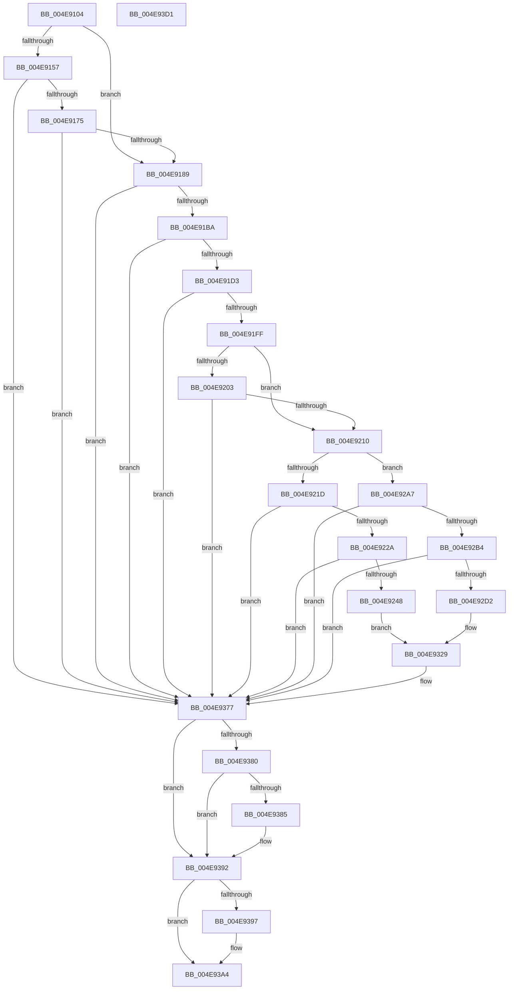

# PopTraceThermalRequestActiveActivity

- RVA: `0x004E9104`–`0x004E93D2` (길이 `718` bytes)
- VA: `0x00000001404E9104`
- 실행 섹션: `.text`
- PDB 이름 있음: `예`; PDB Function 태그: `아니요`
- unwind 정보 RVA: `0x00073414`
- 디코드: `164`개 명령, `718/718` bytes 표시
- 미해석 바이트: `0` (있으면 어셈블리에 `.byte`로 보존)

> 이 문서는 커널 이미지의 기계어와 PDB 기호를 분석해 생성했습니다. 4번과 5번은 함수 원형과 자료형을 바이너리 사용 방식에서 추정한 C 해석이며 원본 소스 복구 결과는 아닙니다.

## 1. Dependencies

- 직접 호출 지점: **16**; 고유 호출 대상: **11**
- 직접 호출자로 확인된 함수: **4**
- RIP 상대 이미지 참조: **5**

### Outgoing calls
- `0x004E914E` → [Feature_Servicing_CoolingFrameworkDeviceCleanupFix__private_IsEnabledDeviceUsageNoInline](../5D/Feature_Servicing_CoolingFrameworkDeviceCleanupFix__private_IsEnabledDeviceUsageNoInline_function_005D1004.md) (function, `0x005D1004`)
- `0x004E9164` → [IoGetDeviceAttachmentBaseRefWithTag](../27/IoGetDeviceAttachmentBaseRefWithTag_function_00272788.md) (function, `0x00272788`)
- `0x004E9194` → [PoStoreDiagnosticContext](../23/PoStoreDiagnosticContext_function_0023009C.md) (function, `0x0023009C`)
- `0x004E91A9` → [ExAllocatePool2](../../poolcode/B8/ExAllocatePool2_function_00B820F0.md) (function, `0x00B820F0`)
- `0x004E91C6` → [PoStoreDiagnosticContext](../23/PoStoreDiagnosticContext_function_0023009C.md) (function, `0x0023009C`)
- `0x004E91EC` → [PopDiagSnapActiveActivity](../4D/PopDiagSnapActiveActivity_function_004DB0F4.md) (function, `0x004DB0F4`)
- `0x004E9210` → [Feature_Servicing_CoolingFrameworkDeviceCleanupFix__private_IsEnabledDeviceUsageNoInline](../5D/Feature_Servicing_CoolingFrameworkDeviceCleanupFix__private_IsEnabledDeviceUsageNoInline_function_005D1004.md) (function, `0x005D1004`)
- `0x004E923B` → [tlgKeywordOn](../42/tlgKeywordOn_function_0042EAA0.md) (function, `0x0042EAA0`)
- `0x004E927C` → [tlgCreate1Sz_wchar_t](../42/tlgCreate1Sz_wchar_t_function_00426198.md) (function, `0x00426198`)
- `0x004E92C5` → [tlgKeywordOn](../42/tlgKeywordOn_function_0042EAA0.md) (function, `0x0042EAA0`)
- `0x004E9303` → [tlgCreate1Sz_wchar_t](../42/tlgCreate1Sz_wchar_t_function_00426198.md) (function, `0x00426198`)
- `0x004E9372` → [tlgWriteTransfer_EtwWriteTransfer](../42/tlgWriteTransfer_EtwWriteTransfer_function_004260E0.md) (function, `0x004260E0`)
- `0x004E9377` → [Feature_Servicing_CoolingFrameworkDeviceCleanupFix__private_IsEnabledDeviceUsageNoInline](../5D/Feature_Servicing_CoolingFrameworkDeviceCleanupFix__private_IsEnabledDeviceUsageNoInline_function_005D1004.md) (function, `0x005D1004`)
- `0x004E938D` → [ObfDereferenceObjectWithTag](../2F/ObfDereferenceObjectWithTag_function_002F78E0.md) (function, `0x002F78E0`)
- `0x004E939F` → [ExFreePoolWithTag](../../poolcode/B8/ExFreePoolWithTag_function_00B82870.md) (function, `0x00B82870`)
- `0x004E93AB` → [_security_check_cookie](../6A/_security_check_cookie_function_006AC640.md) (function, `0x006AC640`)

### Direct callers
- [PopCoolingTelemetryWorker](../42/PopCoolingTelemetryWorker_function_0042FC3C.md) at `0x0042FCEE`
- [PopCoolingSxTransition](../42/PopCoolingSxTransition_function_0042FEA8.md) at `0x0042FF8B`
- [PopOrphanCoolingExtension](../../page/75/PopOrphanCoolingExtension_function_00757474.md) at `0x00757516`
- [PopDeactiveThermalRequest](../../page/AD/PopDeactiveThermalRequest_function_00ADF634.md) at `0x00ADF6B9`

### Static image references
- `0x004E9127` → RVA `0x00E0A740` (`.data`; read)
- `0x004E9203` → RVA `0x00E0B564` (`.data`; read)
- `0x004E921D` → RVA `0x00E07748` (`.data`; read)
- `0x004E928F` → RVA `0x0004ABCF` (`.rdata`; read)
- `0x004E9316` → RVA `0x0004AC4A` (`.rdata`; read)

## 2. Other-region calls and transfers

- 다른 실행 섹션으로 향하는 call: **2**
  - `0x004E91A9` → [ExAllocatePool2](../../poolcode/B8/ExAllocatePool2_function_00B820F0.md) (`.text` → `POOLCODE`)
  - `0x004E939F` → [ExFreePoolWithTag](../../poolcode/B8/ExFreePoolWithTag_function_00B82870.md) (`.text` → `POOLCODE`)
- 별도 외부 분기/꼬리 이동을 확인하지 못했습니다.

## 3. Assembly (complete function range)

```asm
004E9104  48 8B C4                        mov rax, rsp
004E9107  48 89 58 10                     mov qword ptr [rax + 0x10], rbx
004E910B  48 89 70 18                     mov qword ptr [rax + 0x18], rsi
004E910F  48 89 78 20                     mov qword ptr [rax + 0x20], rdi
004E9113  55                              push rbp
004E9114  41 54                           push r12
004E9116  41 55                           push r13
004E9118  41 56                           push r14
004E911A  41 57                           push r15
004E911C  48 8D 68 A1                     lea rbp, [rax - 0x5f]
004E9120  48 81 EC 00 01 00 00            sub rsp, 0x100
004E9127  48 8B 05 12 16 92 00            mov rax, qword ptr [rip + 0x921612]
004E912E  48 33 C4                        xor rax, rsp
004E9131  48 89 45 2F                     mov qword ptr [rbp + 0x2f], rax
004E9135  45 33 ED                        xor r13d, r13d
004E9138  48 8B F1                        mov rsi, rcx
004E913B  4C 89 6C 24 38                  mov qword ptr [rsp + 0x38], r13
004E9140  45 8B F5                        mov r14d, r13d
004E9143  44 89 6C 24 30                  mov dword ptr [rsp + 0x30], r13d
004E9148  41 8B FD                        mov edi, r13d
004E914B  41 8B DD                        mov ebx, r13d
004E914E  E8 B1 7E 0E 00                  call 0x1405d1004
004E9153  85 C0                           test eax, eax
004E9155  75 32                           jne 0x1404e9189
004E9157  48 8B 4E 20                     mov rcx, qword ptr [rsi + 0x20]
004E915B  BA 50 6F 44 67                  mov edx, 0x67446f50
004E9160  48 8B 49 40                     mov rcx, qword ptr [rcx + 0x40]
004E9164  E8 1F 96 D8 FF                  call 0x140272788
004E9169  48 8B F8                        mov rdi, rax
004E916C  48 85 C0                        test rax, rax
004E916F  0F 84 02 02 00 00               je 0x1404e9377
004E9175  48 8B 88 38 01 00 00            mov rcx, qword ptr [rax + 0x138]
004E917C  4C 8B 71 28                     mov r14, qword ptr [rcx + 0x28]
004E9180  4D 85 F6                        test r14, r14
004E9183  0F 84 EE 01 00 00               je 0x1404e9377
004E9189  48 8B 4E 18                     mov rcx, qword ptr [rsi + 0x18]
004E918D  4C 8D 44 24 38                  lea r8, [rsp + 0x38]
004E9192  33 D2                           xor edx, edx
004E9194  E8 03 6F D4 FF                  call 0x14023009c
004E9199  48 8B 54 24 38                  mov rdx, qword ptr [rsp + 0x38]
004E919E  41 B8 54 56 45 50               mov r8d, 0x50455654
004E91A4  B9 00 01 00 00                  mov ecx, 0x100
004E91A9  E8 42 8F 69 00                  call 0x140b820f0
004E91AE  48 8B D8                        mov rbx, rax
004E91B1  48 85 C0                        test rax, rax
004E91B4  0F 84 BD 01 00 00               je 0x1404e9377
004E91BA  48 8B 4E 18                     mov rcx, qword ptr [rsi + 0x18]
004E91BE  4C 8D 44 24 38                  lea r8, [rsp + 0x38]
004E91C3  48 8B D0                        mov rdx, rax
004E91C6  E8 D1 6E D4 FF                  call 0x14023009c
004E91CB  85 C0                           test eax, eax
004E91CD  0F 88 A4 01 00 00               js 0x1404e9377
004E91D3  4C 8B 63 10                     mov r12, qword ptr [rbx + 0x10]
004E91D7  48 8D 4E 28                     lea rcx, [rsi + 0x28]
004E91DB  4C 8D 4D 07                     lea r9, [rbp + 7]
004E91DF  4C 03 E3                        add r12, rbx
004E91E2  4C 8D 44 24 34                  lea r8, [rsp + 0x34]
004E91E7  48 8D 54 24 30                  lea rdx, [rsp + 0x30]
004E91EC  E8 03 1F FF FF                  call 0x1404db0f4
004E91F1  44 8B 7C 24 30                  mov r15d, dword ptr [rsp + 0x30]
004E91F6  45 85 FF                        test r15d, r15d
004E91F9  0F 84 78 01 00 00               je 0x1404e9377
004E91FF  84 C0                           test al, al
004E9201  75 0D                           jne 0x1404e9210
004E9203  44 39 2D 5A 23 92 00            cmp dword ptr [rip + 0x92235a], r13d
004E920A  0F 84 67 01 00 00               je 0x1404e9377
004E9210  E8 EF 7D 0E 00                  call 0x1405d1004
004E9215  85 C0                           test eax, eax
004E9217  0F 84 8A 00 00 00               je 0x1404e92a7
004E921D  83 3D 24 E5 91 00 05            cmp dword ptr [rip + 0x91e524], 5
004E9224  0F 86 4D 01 00 00               jbe 0x1404e9377
004E922A  48 BA 00 00 00 00 00 40 00 00   movabs rdx, 0x400000000000
004E9234  48 8D 0D 0D E5 91 00            lea rcx, [rip + 0x91e50d]
004E923B  E8 60 58 F4 FF                  call 0x14042eaa0
004E9240  84 C0                           test al, al
004E9242  0F 84 2F 01 00 00               je 0x1404e9377
004E9248  48 8B 46 20                     mov rax, qword ptr [rsi + 0x20]
004E924C  0F B7 90 A0 00 00 00            movzx edx, word ptr [rax + 0xa0]
004E9253  48 8B 88 A8 00 00 00            mov rcx, qword ptr [rax + 0xa8]
004E925A  48 8D 45 BF                     lea rax, [rbp - 0x41]
004E925E  48 89 4D B7                     mov qword ptr [rbp - 0x49], rcx
004E9262  48 8D 4D C7                     lea rcx, [rbp - 0x39]
004E9266  89 55 BF                        mov dword ptr [rbp - 0x41], edx
004E9269  49 8B D4                        mov rdx, r12
004E926C  48 89 45 A7                     mov qword ptr [rbp - 0x59], rax
004E9270  48 C7 45 AF 02 00 00 00         mov qword ptr [rbp - 0x51], 2
004E9278  44 89 6D C3                     mov dword ptr [rbp - 0x3d], r13d
004E927C  E8 17 CF F3 FF                  call 0x140426198
004E9281  48 8D 44 24 30                  lea rax, [rsp + 0x30]
004E9286  44 89 7C 24 30                  mov dword ptr [rsp + 0x30], r15d
004E928B  48 89 45 D7                     mov qword ptr [rbp - 0x29], rax
004E928F  48 8D 15 39 19 B6 FF            lea rdx, [rip - 0x49e6c7]
004E9296  8B 45 07                        mov eax, dword ptr [rbp + 7]
004E9299  89 44 24 38                     mov dword ptr [rsp + 0x38], eax
004E929D  48 8D 44 24 38                  lea rax, [rsp + 0x38]
004E92A2  E9 82 00 00 00                  jmp 0x1404e9329
004E92A7  83 3D 9A E4 91 00 05            cmp dword ptr [rip + 0x91e49a], 5
004E92AE  0F 86 C3 00 00 00               jbe 0x1404e9377
004E92B4  48 BA 00 00 00 00 00 40 00 00   movabs rdx, 0x400000000000
004E92BE  48 8D 0D 83 E4 91 00            lea rcx, [rip + 0x91e483]
004E92C5  E8 D6 57 F4 FF                  call 0x14042eaa0
004E92CA  84 C0                           test al, al
004E92CC  0F 84 A5 00 00 00               je 0x1404e9377
004E92D2  48 8D 45 BF                     lea rax, [rbp - 0x41]
004E92D6  48 C7 45 AF 02 00 00 00         mov qword ptr [rbp - 0x51], 2
004E92DE  48 89 45 A7                     mov qword ptr [rbp - 0x59], rax
004E92E2  48 8D 4D C7                     lea rcx, [rbp - 0x39]
004E92E6  49 8B 86 88 00 00 00            mov rax, qword ptr [r14 + 0x88]
004E92ED  49 8B D4                        mov rdx, r12
004E92F0  48 89 45 B7                     mov qword ptr [rbp - 0x49], rax
004E92F4  41 0F B7 86 80 00 00 00         movzx eax, word ptr [r14 + 0x80]
004E92FC  89 45 BF                        mov dword ptr [rbp - 0x41], eax
004E92FF  44 89 6D C3                     mov dword ptr [rbp - 0x3d], r13d
004E9303  E8 90 CE F3 FF                  call 0x140426198
004E9308  48 8D 44 24 38                  lea rax, [rsp + 0x38]
004E930D  44 89 7C 24 38                  mov dword ptr [rsp + 0x38], r15d
004E9312  48 89 45 D7                     mov qword ptr [rbp - 0x29], rax
004E9316  48 8D 15 2D 19 B6 FF            lea rdx, [rip - 0x49e6d3]
004E931D  8B 45 07                        mov eax, dword ptr [rbp + 7]
004E9320  89 44 24 30                     mov dword ptr [rsp + 0x30], eax
004E9324  48 8D 44 24 30                  lea rax, [rsp + 0x30]
004E9329  48 89 45 E7                     mov qword ptr [rbp - 0x19], rax
004E932D  48 8D 4D 87                     lea rcx, [rbp - 0x79]
004E9331  48 8D 44 24 40                  lea rax, [rsp + 0x40]
004E9336  48 89 4C 24 28                  mov qword ptr [rsp + 0x28], rcx
004E933B  48 89 45 F7                     mov qword ptr [rbp - 9], rax
004E933F  48 8D 0D 02 E4 91 00            lea rcx, [rip + 0x91e402]
004E9346  B8 08 00 00 00                  mov eax, 8
004E934B  48 C7 45 DF 04 00 00 00         mov qword ptr [rbp - 0x21], 4
004E9353  45 33 C9                        xor r9d, r9d
004E9356  89 44 24 20                     mov dword ptr [rsp + 0x20], eax
004E935A  45 33 C0                        xor r8d, r8d
004E935D  48 89 45 FF                     mov qword ptr [rbp - 1], rax
004E9361  48 C7 45 EF 04 00 00 00         mov qword ptr [rbp - 0x11], 4
004E9369  48 C7 44 24 40 00 00 00 01      mov qword ptr [rsp + 0x40], 0x1000000
004E9372  E8 69 CD F3 FF                  call 0x1404260e0
004E9377  E8 88 7C 0E 00                  call 0x1405d1004
004E937C  85 C0                           test eax, eax
004E937E  75 12                           jne 0x1404e9392
004E9380  48 85 FF                        test rdi, rdi
004E9383  74 0D                           je 0x1404e9392
004E9385  BA 50 6F 44 67                  mov edx, 0x67446f50
004E938A  48 8B CF                        mov rcx, rdi
004E938D  E8 4E E5 E0 FF                  call 0x1402f78e0
004E9392  48 85 DB                        test rbx, rbx
004E9395  74 0D                           je 0x1404e93a4
004E9397  BA 54 56 45 50                  mov edx, 0x50455654
004E939C  48 8B CB                        mov rcx, rbx
004E939F  E8 CC 94 69 00                  call 0x140b82870
004E93A4  48 8B 4D 2F                     mov rcx, qword ptr [rbp + 0x2f]
004E93A8  48 33 CC                        xor rcx, rsp
004E93AB  E8 90 32 1C 00                  call 0x1406ac640
004E93B0  4C 8D 9C 24 00 01 00 00         lea r11, [rsp + 0x100]
004E93B8  49 8B 5B 38                     mov rbx, qword ptr [r11 + 0x38]
004E93BC  49 8B 73 40                     mov rsi, qword ptr [r11 + 0x40]
004E93C0  49 8B 7B 48                     mov rdi, qword ptr [r11 + 0x48]
004E93C4  49 8B E3                        mov rsp, r11
004E93C7  41 5F                           pop r15
004E93C9  41 5E                           pop r14
004E93CB  41 5D                           pop r13
004E93CD  41 5C                           pop r12
004E93CF  5D                              pop rbp
004E93D0  C3                              ret
004E93D1  CC                              int3
```

## 4. C-style interpretation (structured pseudocode)

```c
__int64 __fastcall PopTraceThermalRequestActiveActivity(__int64 a1)
{
    __int64 result;
    __int64 v_r12;
    __int64 v_r13;
    __int64 v_rsp;
    unsigned __int64 v_stack_m100;
    unsigned int v_stack_m108;
    unsigned __int64 v_stack_m28;
    unsigned __int64 v_stack_mE8;
    unsigned __int64 v_stack_mF0;
    unsigned __int64 v_stack_mF4;
    unsigned int v_stack_mF8;

    *(unsigned __int64 *)(v_rsp + 16) = v_rbx;
    *(unsigned __int64 *)(v_rsp + 24) = v_rsi;
    *(unsigned __int64 *)(v_rsp + 32) = v_rdi;
    v_rsp = (v_rsp) - (256);
    result = (*(unsigned __int64 *)(v_rip + 9573906)) ^ (v_rsp);
    *(unsigned __int64 *)(v_rsp - 95 + 47) = result;
    v_r13 = 0;
    v_stack_mF0 = 0;
    v_stack_mF8 = 0;
    result = Feature_Servicing_CoolingFrameworkDeviceCleanupFix__private_IsEnabledDeviceUsageNoInline(a1, a2, a3, a4);
    if ((unsigned int)(result) != 0) goto loc_004E9189;
    result = IoGetDeviceAttachmentBaseRefWithTag(*(unsigned __int64 *)(*(unsigned __int64 *)(a1 + 32) + 64), (unsigned int)(0x67446F50ULL), a3, a4);
    if (result == 0) goto loc_004E9377;
    if (*(unsigned __int64 *)(*(unsigned __int64 *)(result + 312) + 40) == 0) goto loc_004E9377;
loc_004E9189:
    a2 = 0;
    result = PoStoreDiagnosticContext(*(unsigned __int64 *)(a1 + 24), a2, v_stack_mF0, a4);
    result = ExAllocatePool2(256, v_stack_mF0, (unsigned int)(0x50455654ULL), a4);
    if (result == 0) goto loc_004E9377;
    result = PoStoreDiagnosticContext(*(unsigned __int64 *)(a1 + 24), result, v_stack_mF0, a4);
    if (sign_flag) goto loc_004E9377;
    v_r12 = (*(unsigned __int64 *)(result + 16)) + (result);
    result = PopDiagSnapActiveActivity(a1 + 40, v_stack_mF8, v_stack_mF4, v_rsp - 95 + 7);
    if ((unsigned int)((unsigned int)(v_stack_mF8)) == 0) goto loc_004E9377;
    if ((unsigned __int8)(result) != 0) goto loc_004E9210;
    if ((*(unsigned int *)(v_rip + 9577306)) == 0) goto loc_004E9377;
loc_004E9210:
    result = Feature_Servicing_CoolingFrameworkDeviceCleanupFix__private_IsEnabledDeviceUsageNoInline(a1 + 40, v_stack_mF8, v_stack_mF4, v_rsp - 95 + 7);
    if ((unsigned int)(result) == 0) goto loc_004E92A7;
    if ((*(unsigned int *)(v_rip + 9561380)) <= 5) goto loc_004E9377;
    result = tlgKeywordOn(v_rip + 9561357, v_stack_mF8, v_stack_mF4, v_rsp - 95 + 7);
    if ((unsigned __int8)(result) == 0) goto loc_004E9377;
    *(unsigned __int64 *)(v_rsp - 95 - 73) = *(unsigned __int64 *)(*(unsigned __int64 *)(a1 + 32) + 168);
    *(unsigned int *)(v_rsp - 95 - 65) = (unsigned int)(*(unsigned __int16 *)(*(unsigned __int64 *)(a1 + 32) + 160));
    *(unsigned __int64 *)(v_rsp - 95 - 89) = v_rsp - 95 - 65;
    *(unsigned __int64 *)(v_rsp - 95 - 81) = 2;
    *(unsigned int *)(v_rsp - 95 - 61) = 0;
    result = tlgCreate1Sz_wchar_t(v_rsp - 95 - 57, v_r12, v_stack_mF4, v_rsp - 95 + 7);
    v_stack_mF8 = (unsigned int)((unsigned int)(v_stack_mF8));
    *(unsigned __int64 *)(v_rsp - 95 - 41) = v_stack_mF8;
    v_stack_mF0 = (unsigned int)((unsigned int)(*(unsigned int *)(v_rsp - 95 + 7)));
    goto loc_004E9329;
loc_004E92A7:
    if ((*(unsigned int *)(v_rip + 9561242)) <= 5) goto loc_004E9377;
    result = tlgKeywordOn(v_rip + 9561219, v_rip - 4843207, v_stack_mF4, v_rsp - 95 + 7);
    if ((unsigned __int8)(result) == 0) goto loc_004E9377;
    *(unsigned __int64 *)(v_rsp - 95 - 81) = 2;
    *(unsigned __int64 *)(v_rsp - 95 - 89) = v_rsp - 95 - 65;
    *(unsigned __int64 *)(v_rsp - 95 - 73) = *(unsigned __int64 *)(*(unsigned __int64 *)(*(unsigned __int64 *)(result + 312) + 40) + 136);
    *(unsigned int *)(v_rsp - 95 - 65) = (unsigned int)(*(unsigned __int16 *)(*(unsigned __int64 *)(*(unsigned __int64 *)(result + 312) + 40) + 128));
    *(unsigned int *)(v_rsp - 95 - 61) = 0;
    result = tlgCreate1Sz_wchar_t(v_rsp - 95 - 57, v_r12, v_stack_mF4, v_rsp - 95 + 7);
    v_stack_mF0 = (unsigned int)((unsigned int)(v_stack_mF8));
    *(unsigned __int64 *)(v_rsp - 95 - 41) = v_stack_mF0;
    v_stack_mF8 = (unsigned int)((unsigned int)(*(unsigned int *)(v_rsp - 95 + 7)));
loc_004E9329:
    *(unsigned __int64 *)(v_rsp - 95 - 25) = v_stack_mF8;
    v_stack_m100 = v_rsp - 95 - 121;
    *(unsigned __int64 *)(v_rsp - 95 - 9) = v_stack_mE8;
    *(unsigned __int64 *)(v_rsp - 95 - 33) = 4;
    a4 = 0;
    v_stack_m108 = 8;
    a3 = 0;
    *(unsigned __int64 *)(v_rsp - 95 - 1) = 8;
    *(unsigned __int64 *)(v_rsp - 95 - 17) = 4;
    v_stack_mE8 = 0x1000000ULL;
    result = tlgWriteTransfer_EtwWriteTransfer(v_rip + 9561090, v_rip - 4843219, a3, a4);
loc_004E9377:
    result = Feature_Servicing_CoolingFrameworkDeviceCleanupFix__private_IsEnabledDeviceUsageNoInline(v_rip + 9561090, v_rip - 4843219, a3, a4);
    if ((unsigned int)(result) != 0) goto loc_004E9392;
    if (result != 0) {
        a2 = 0x67446F50ULL;
        a1 = result;
        result = ObfDereferenceObjectWithTag(a1, a2, a3, a4);
    }
    if (result != 0) {
        a2 = 0x50455654ULL;
        a1 = result;
        result = ExFreePoolWithTag(a1, a2, a3, a4);
    }
    a1 = (*(unsigned __int64 *)(v_rsp - 95 + 47)) ^ (v_rsp);
    result = _security_check_cookie(a1, a2, a3, a4);
    return result;
}
```

## 5. (Beta) C Style

```c
int64_t PopTraceThermalRequestActiveActivity(void *Arg1)
{
    uint8_t *arg1 = (uint8_t *)Arg1;

    int64_t result;
    int64_t local_r12;
    int64_t local_r13;
    int64_t local_rsp;
    uint64_t v_stack_m100;
    uint32_t v_stack_m108;
    uint64_t v_stack_m28;
    uint64_t v_stack_mE8;
    uint64_t v_stack_mF0;
    uint64_t v_stack_mF4;
    uint32_t v_stack_mF8;

    *(uint64_t *)(local_rsp + 0x10) = local_rbx;
    *(uint64_t *)(local_rsp + 0x18) = local_rsi;
    *(uint64_t *)(local_rsp + 0x20) = local_rdi;
    local_rsp = (local_rsp) - (256);
    result = (*(uint64_t *)(v_rip + 0x921612)) ^ (local_rsp);
    *(uint64_t *)(local_rsp - 0x5F + 0x2F) = result;
    local_r13 = 0;
    v_stack_mF0 = 0;
    v_stack_mF8 = 0;
    result = Feature_Servicing_CoolingFrameworkDeviceCleanupFix__private_IsEnabledDeviceUsageNoInline(Arg1, a2, a3, a4);
    if ((uint32_t)(result) != 0) goto loc_004E9189;
    result = IoGetDeviceAttachmentBaseRefWithTag(*(uint64_t *)(*(uint64_t *)(arg1 + 0x20) + 0x40), (uint32_t)(0x67446F50ULL), a3, a4);
    if (result == 0) goto loc_004E9377;
    if (*(uint64_t *)(*(uint64_t *)(result + 0x138) + 0x28) == 0) goto loc_004E9377;
loc_004E9189:
    a2 = 0;
    result = PoStoreDiagnosticContext(*(uint64_t *)(arg1 + 0x18), a2, v_stack_mF0, a4);
    result = ExAllocatePool2(256, v_stack_mF0, (uint32_t)(0x50455654ULL), a4);
    if (result == 0) goto loc_004E9377;
    result = PoStoreDiagnosticContext(*(uint64_t *)(arg1 + 0x18), result, v_stack_mF0, a4);
    if (sign_flag) goto loc_004E9377;
    local_r12 = (*(uint64_t *)(result + 0x10)) + (result);
    result = PopDiagSnapActiveActivity(Arg1 + 40, v_stack_mF8, v_stack_mF4, local_rsp - 95 + 7);
    if ((uint32_t)((uint32_t)(v_stack_mF8)) == 0) goto loc_004E9377;
    if ((uint8_t)(result) != 0) goto loc_004E9210;
    if ((*(uint32_t *)(v_rip + 0x92235A)) == 0) goto loc_004E9377;
loc_004E9210:
    result = Feature_Servicing_CoolingFrameworkDeviceCleanupFix__private_IsEnabledDeviceUsageNoInline(Arg1 + 40, v_stack_mF8, v_stack_mF4, local_rsp - 95 + 7);
    if ((uint32_t)(result) == 0) goto loc_004E92A7;
    if ((*(uint32_t *)(v_rip + 0x91E524)) <= 5) goto loc_004E9377;
    result = tlgKeywordOn(v_rip + 9561357, v_stack_mF8, v_stack_mF4, local_rsp - 95 + 7);
    if ((uint8_t)(result) == 0) goto loc_004E9377;
    *(uint64_t *)(local_rsp - 0x5F - 0x49) = *(uint64_t *)(*(uint64_t *)(arg1 + 0x20) + 0xA8);
    *(uint32_t *)(local_rsp - 0x5F - 0x41) = (uint32_t)(*(uint16_t *)(*(uint64_t *)(arg1 + 0x20) + 0xA0));
    *(uint64_t *)(local_rsp - 0x5F - 0x59) = local_rsp - 95 - 65;
    *(uint64_t *)(local_rsp - 0x5F - 0x51) = 2;
    *(uint32_t *)(local_rsp - 0x5F - 0x3D) = 0;
    result = tlgCreate1Sz_wchar_t(local_rsp - 95 - 57, local_r12, v_stack_mF4, local_rsp - 95 + 7);
    v_stack_mF8 = (uint32_t)((uint32_t)(v_stack_mF8));
    *(uint64_t *)(local_rsp - 0x5F - 0x29) = v_stack_mF8;
    v_stack_mF0 = (uint32_t)((uint32_t)(*(uint32_t *)(local_rsp - 0x5F + 0x7)));
    goto loc_004E9329;
loc_004E92A7:
    if ((*(uint32_t *)(v_rip + 0x91E49A)) <= 5) goto loc_004E9377;
    result = tlgKeywordOn(v_rip + 9561219, v_rip - 4843207, v_stack_mF4, local_rsp - 95 + 7);
    if ((uint8_t)(result) == 0) goto loc_004E9377;
    *(uint64_t *)(local_rsp - 0x5F - 0x51) = 2;
    *(uint64_t *)(local_rsp - 0x5F - 0x59) = local_rsp - 95 - 65;
    *(uint64_t *)(local_rsp - 0x5F - 0x49) = *(uint64_t *)(*(uint64_t *)(*(uint64_t *)(result + 0x138) + 0x28) + 0x88);
    *(uint32_t *)(local_rsp - 0x5F - 0x41) = (uint32_t)(*(uint16_t *)(*(uint64_t *)(*(uint64_t *)(result + 0x138) + 0x28) + 0x80));
    *(uint32_t *)(local_rsp - 0x5F - 0x3D) = 0;
    result = tlgCreate1Sz_wchar_t(local_rsp - 95 - 57, local_r12, v_stack_mF4, local_rsp - 95 + 7);
    v_stack_mF0 = (uint32_t)((uint32_t)(v_stack_mF8));
    *(uint64_t *)(local_rsp - 0x5F - 0x29) = v_stack_mF0;
    v_stack_mF8 = (uint32_t)((uint32_t)(*(uint32_t *)(local_rsp - 0x5F + 0x7)));
loc_004E9329:
    *(uint64_t *)(local_rsp - 0x5F - 0x19) = v_stack_mF8;
    v_stack_m100 = local_rsp - 95 - 121;
    *(uint64_t *)(local_rsp - 0x5F - 0x9) = v_stack_mE8;
    *(uint64_t *)(local_rsp - 0x5F - 0x21) = 4;
    a4 = 0;
    v_stack_m108 = 8;
    a3 = 0;
    *(uint64_t *)(local_rsp - 0x5F - 0x1) = 8;
    *(uint64_t *)(local_rsp - 0x5F - 0x11) = 4;
    v_stack_mE8 = 0x1000000ULL;
    result = tlgWriteTransfer_EtwWriteTransfer(v_rip + 9561090, v_rip - 4843219, a3, a4);
loc_004E9377:
    result = Feature_Servicing_CoolingFrameworkDeviceCleanupFix__private_IsEnabledDeviceUsageNoInline(v_rip + 9561090, v_rip - 4843219, a3, a4);
    if ((uint32_t)(result) != 0) goto loc_004E9392;
    if (result != 0) {
        a2 = 0x67446F50ULL;
        Arg1 = result;
        result = ObfDereferenceObjectWithTag(Arg1, a2, a3, a4);
    }
    if (result != 0) {
        a2 = 0x50455654ULL;
        Arg1 = result;
        result = ExFreePoolWithTag(Arg1, a2, a3, a4);
    }
    Arg1 = (*(uint64_t *)(local_rsp - 0x5F + 0x2F)) ^ (local_rsp);
    result = _security_check_cookie(Arg1, a2, a3, a4);
    return result;
}
```

### 관측된 메모리 오프셋

구조체 형식이 확인되지 않은 접근은 인자 기준의 오프셋으로만 기록했습니다.

| 기준 인자 | 오프셋 표현 | 폭 (bit) | 접근 |
|---|---:|---:|---|
| `Arg1` | `+ 0x18` | `64` | `R` |
| `Arg1` | `+ 0x20` | `64` | `R` |
| `Arg1` | `+ 0x28` | `64` | `R` |

## 6. Execution-region graph

[열기: 2D/3D 그래프와 함수 탐색 컨트롤 패널](../../../control-panel.html?section=text&rva=0x004E9104&view=graph)

- 2D 그래프는 위에서 아래로 흐르고, 3D 그래프는 빈 공간을 드래그해 회전합니다. Shift+드래그는 이동, 휠은 확대·축소, 함수 노드 선택은 대상 보고서 이동입니다.

### Static fallback


