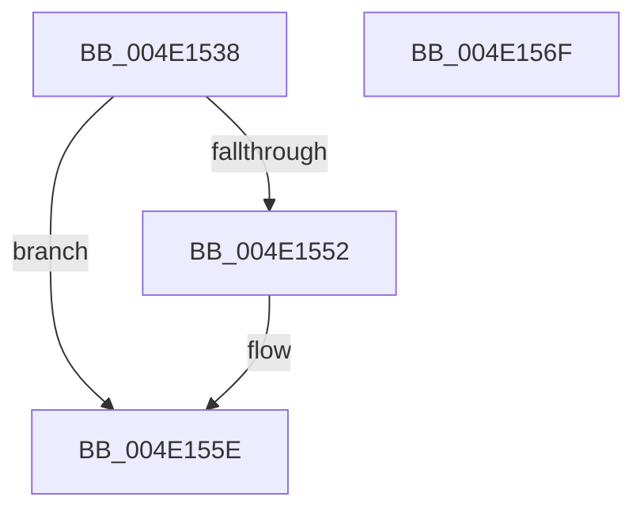

# PpmClearExitLatencySamplingPercentage

- RVA: `0x004E1538`–`0x004E1570` (길이 `56` bytes)
- VA: `0x00000001404E1538`
- 실행 섹션: `.text`
- PDB 이름 있음: `예`; PDB Function 태그: `아니요`
- unwind 정보 RVA: `0x0005C788`
- 디코드: `13`개 명령, `56/56` bytes 표시
- 미해석 바이트: `0` (있으면 어셈블리에 `.byte`로 보존)

> 이 문서는 커널 이미지의 기계어와 PDB 기호를 분석해 생성했습니다. 4번과 5번은 함수 원형과 자료형을 바이너리 사용 방식에서 추정한 C 해석이며 원본 소스 복구 결과는 아닙니다.

## 1. Dependencies

- 직접 호출 지점: **2**; 고유 호출 대상: **2**
- 직접 호출자로 확인된 함수: **1**
- RIP 상대 이미지 참조: **4**

### Outgoing calls
- `0x004E1543` → [PpmAcquireLock](../2D/PpmAcquireLock_function_002D9AA4.md) (function, `0x002D9AA4`)
- `0x004E1565` → [PpmReleaseLock](../2D/PpmReleaseLock_function_002DA428.md) (function, `0x002DA428`)

### Direct callers
- [NtPowerInformation](../../page/95/NtPowerInformation_function_00955D80.md) at `0x00957895`

### Static image references
- `0x004E153C` → RVA `0x00F0E760` (`.data`; read)
- `0x004E154A` → RVA `0x00E67680` (`.data`; read)
- `0x004E1552` → RVA `0x00E67680` (`.data`; write)
- `0x004E1558` → RVA `0x00E67668` (`.data`; write)

## 2. Other-region calls and transfers

- 다른 실행 섹션으로 향하는 call: **0**
- 별도 외부 분기/꼬리 이동을 확인하지 못했습니다.

## 3. Assembly (complete function range)

```asm
004E1538  48 83 EC 28                     sub rsp, 0x28
004E153C  48 8D 0D 1D D2 A2 00            lea rcx, [rip + 0xa2d21d]
004E1543  E8 5C 85 DF FF                  call 0x1402d9aa4
004E1548  33 C0                           xor eax, eax
004E154A  38 05 30 61 98 00               cmp byte ptr [rip + 0x986130], al
004E1550  74 0C                           je 0x1404e155e
004E1552  88 05 28 61 98 00               mov byte ptr [rip + 0x986128], al
004E1558  89 05 0A 61 98 00               mov dword ptr [rip + 0x98610a], eax
004E155E  48 8D 0D FB D1 A2 00            lea rcx, [rip + 0xa2d1fb]
004E1565  E8 BE 8E DF FF                  call 0x1402da428
004E156A  48 83 C4 28                     add rsp, 0x28
004E156E  C3                              ret
004E156F  CC                              int3
```

## 4. C-style interpretation (structured pseudocode)

```c
__int64 __fastcall PpmClearExitLatencySamplingPercentage(void)
{
    __int64 result;
    __int64 v_rsp;

    v_rsp = (v_rsp) - (40);
    result = PpmAcquireLock(v_rip + 10670621, a2, a3, a4);
    result = 0;
    if ((*(unsigned __int8 *)(v_rip + 9986352)) != 0) {
        *(unsigned __int8 *)(v_rip + 9986344) = 0;
        *(unsigned int *)(v_rip + 9986314) = 0;
    }
    result = PpmReleaseLock(v_rip + 10670587, a2, a3, a4);
    v_rsp = (v_rsp) + (40);
    return result;
}
```

## 5. (Beta) C Style

```c
void PpmClearExitLatencySamplingPercentage(void)
{
    int64_t result;
    int64_t local_rsp;

    local_rsp = (local_rsp) - (40);
    result = PpmAcquireLock(v_rip + 10670621, a2, a3, a4);
    result = 0;
    if ((*(uint8_t *)(v_rip + 0x986130)) != 0) {
        *(uint8_t *)(v_rip + 0x986128) = 0;
        *(uint32_t *)(v_rip + 0x98610A) = 0;
    }
    result = PpmReleaseLock(v_rip + 10670587, a2, a3, a4);
    local_rsp = (local_rsp) + (40);
    return result;
}
```

## 6. Execution-region graph

[열기: 2D/3D 그래프와 함수 탐색 컨트롤 패널](../../../control-panel.html?section=text&rva=0x004E1538&view=graph)

- 2D 그래프는 위에서 아래로 흐르고, 3D 그래프는 빈 공간을 드래그해 회전합니다. Shift+드래그는 이동, 휠은 확대·축소, 함수 노드 선택은 대상 보고서 이동입니다.

### Static fallback


