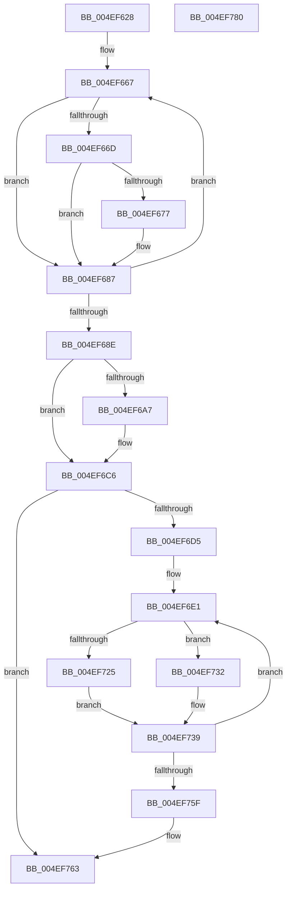

# PpmEventAddAffinityMaskAsSubset

- RVA: `0x004EF628`–`0x004EF781` (길이 `345` bytes)
- VA: `0x00000001404EF628`
- 실행 섹션: `.text`
- PDB 이름 있음: `예`; PDB Function 태그: `아니요`
- unwind 정보 RVA: `0x000AE2E0`
- 디코드: `96`개 명령, `345/345` bytes 표시
- 미해석 바이트: `0` (있으면 어셈블리에 `.byte`로 보존)

> 이 문서는 커널 이미지의 기계어와 PDB 기호를 분석해 생성했습니다. 4번과 5번은 함수 원형과 자료형을 바이너리 사용 방식에서 추정한 C 해석이며 원본 소스 복구 결과는 아닙니다.

## 1. Dependencies

- 직접 호출 지점: **0**; 고유 호출 대상: **0**
- 직접 호출자로 확인된 함수: **9**
- RIP 상대 이미지 참조: **1**

### Outgoing calls
- 직접 디코드된 call 명령이 없습니다.

### Direct callers
- [PpmEventParkNodeRecordedStatsEx](PpmEventParkNodeRecordedStatsEx_function_004EF378.md) at `0x004EF490`
- [PpmEventParkNodeParkHintChangedEx](../4F/PpmEventParkNodeParkHintChangedEx_function_004F3A34.md) at `0x004F3ACD`
- [PpmEventParkNodeParkHintChangedEx](../4F/PpmEventParkNodeParkHintChangedEx_function_004F3A34.md) at `0x004F3B00`
- [PpmEventTraceHeteroDistributeUtilityEx](../4F/PpmEventTraceHeteroDistributeUtilityEx_function_004F9C24.md) at `0x004F9CBF`
- [PpmEventAffinityMaskEx](../5D/PpmEventAffinityMaskEx_function_005DE490.md) at `0x005DE51E`
- [PpmEventParkNodeCapChangeEx](../5D/PpmEventParkNodeCapChangeEx_function_005DE580.md) at `0x005DE6BD`
- [PpmEventParkNodeClassRecordedStatsEx](../5D/PpmEventParkNodeClassRecordedStatsEx_function_005DE748.md) at `0x005DE7E7`
- [PpmEventParkNodePreferenceEx](../5D/PpmEventParkNodePreferenceEx_function_005DE8D8.md) at `0x005DE997`
- [PpmEventParkNodePreferenceEx](../5D/PpmEventParkNodePreferenceEx_function_005DE8D8.md) at `0x005DE9F7`
- [PpmEventParkNodePreferenceEx](../5D/PpmEventParkNodePreferenceEx_function_005DE8D8.md) at `0x005DEA2F`
- [PpmEventParkNodePreferenceEx](../5D/PpmEventParkNodePreferenceEx_function_005DE8D8.md) at `0x005DEA67`
- [PpmEventParkNodePreferenceEx](../5D/PpmEventParkNodePreferenceEx_function_005DE8D8.md) at `0x005DEA9F`
- [PpmEventParkNodeRestrictionEx](../5D/PpmEventParkNodeRestrictionEx_function_005DEB00.md) at `0x005DEBAE`
- [PpmEventTraceParkNodeRundownEx](../../page/77/PpmEventTraceParkNodeRundownEx_function_00772E5C.md) at `0x00773089`
- [PpmEventTraceParkNodeRundownEx](../../page/77/PpmEventTraceParkNodeRundownEx_function_00772E5C.md) at `0x007730C9`
- [PpmEventTraceParkNodeRundownEx](../../page/77/PpmEventTraceParkNodeRundownEx_function_00772E5C.md) at `0x00773145`
- [PpmEventTraceParkNodeRundownEx](../../page/77/PpmEventTraceParkNodeRundownEx_function_00772E5C.md) at `0x00773185`

### Static image references
- `0x004EF732` → RVA `0x00E67A78` (`.data`; read)

## 2. Other-region calls and transfers

- 다른 실행 섹션으로 향하는 call: **0**
- 별도 외부 분기/꼬리 이동을 확인하지 못했습니다.

## 3. Assembly (complete function range)

```asm
004EF628  48 8B C4                        mov rax, rsp
004EF62B  48 89 58 08                     mov qword ptr [rax + 8], rbx
004EF62F  48 89 68 10                     mov qword ptr [rax + 0x10], rbp
004EF633  48 89 70 18                     mov qword ptr [rax + 0x18], rsi
004EF637  48 89 78 20                     mov qword ptr [rax + 0x20], rdi
004EF63B  41 55                           push r13
004EF63D  41 56                           push r14
004EF63F  41 57                           push r15
004EF641  45 33 F6                        xor r14d, r14d
004EF644  4C 8B DA                        mov r11, rdx
004EF647  49 8B F1                        mov rsi, r9
004EF64A  48 85 C9                        test rcx, rcx
004EF64D  4C 8B 4C 24 50                  mov r9, qword ptr [rsp + 0x50]
004EF652  4C 8B EA                        mov r13, rdx
004EF655  4C 0F 45 D9                     cmovne r11, rcx
004EF659  45 0F B7 D6                     movzx r10d, r14w
004EF65D  41 8B D6                        mov edx, r14d
004EF660  41 8D 6E 01                     lea ebp, [r14 + 1]
004EF664  41 8B 19                        mov ebx, dword ptr [r9]
004EF667  66 41 3B 13                     cmp dx, word ptr [r11]
004EF66B  73 1A                           jae 0x1404ef687
004EF66D  0F B7 C2                        movzx eax, dx
004EF670  4D 39 74 C3 08                  cmp qword ptr [r11 + rax*8 + 8], r14
004EF675  74 10                           je 0x1404ef687
004EF677  41 8B 01                        mov eax, dword ptr [r9]
004EF67A  66 89 14 46                     mov word ptr [rsi + rax*2], dx
004EF67E  FF C0                           inc eax
004EF680  41 89 01                        mov dword ptr [r9], eax
004EF683  66 44 03 D5                     add r10w, bp
004EF687  03 D5                           add edx, ebp
004EF689  83 FA 20                        cmp edx, 0x20
004EF68C  72 D9                           jb 0x1404ef667
004EF68E  48 8B 54 24 48                  mov rdx, qword ptr [rsp + 0x48]
004EF693  8B 02                           mov eax, dword ptr [rdx]
004EF695  4D 8D 0C 40                     lea r9, [r8 + rax*2]
004EF699  4C 8B 44 24 58                  mov r8, qword ptr [rsp + 0x58]
004EF69E  66 45 89 11                     mov word ptr [r9], r10w
004EF6A2  48 85 C9                        test rcx, rcx
004EF6A5  75 1F                           jne 0x1404ef6c6
004EF6A7  41 8B 08                        mov ecx, dword ptr [r8]
004EF6AA  8B C1                           mov eax, ecx
004EF6AC  48 C1 E0 04                     shl rax, 4
004EF6B0  48 03 44 24 40                  add rax, qword ptr [rsp + 0x40]
004EF6B5  4C 89 08                        mov qword ptr [rax], r9
004EF6B8  48 C7 40 08 02 00 00 00         mov qword ptr [rax + 8], 2
004EF6C0  8D 41 01                        lea eax, [rcx + 1]
004EF6C3  41 89 00                        mov dword ptr [r8], eax
004EF6C6  41 0F B7 CA                     movzx ecx, r10w
004EF6CA  8D 04 19                        lea eax, [rcx + rbx]
004EF6CD  3B D8                           cmp ebx, eax
004EF6CF  0F 83 8E 00 00 00               jae 0x1404ef763
004EF6D5  4C 8D 0C 5E                     lea r9, [rsi + rbx*2]
004EF6D9  8B E9                           mov ebp, ecx
004EF6DB  41 BF 08 00 00 00               mov r15d, 8
004EF6E1  45 8B 10                        mov r10d, dword ptr [r8]
004EF6E4  41 8B DE                        mov ebx, r14d
004EF6E7  41 8B C2                        mov eax, r10d
004EF6EA  41 8B FF                        mov edi, r15d
004EF6ED  48 C1 E0 04                     shl rax, 4
004EF6F1  41 BE 0C 00 00 00               mov r14d, 0xc
004EF6F7  48 03 44 24 40                  add rax, qword ptr [rsp + 0x40]
004EF6FC  41 8D 4A 01                     lea ecx, [r10 + 1]
004EF700  48 C1 E1 04                     shl rcx, 4
004EF704  48 03 4C 24 40                  add rcx, qword ptr [rsp + 0x40]
004EF709  4C 89 08                        mov qword ptr [rax], r9
004EF70C  48 8B F1                        mov rsi, rcx
004EF70F  48 C7 40 08 02 00 00 00         mov qword ptr [rax + 8], 2
004EF717  48 8B C1                        mov rax, rcx
004EF71A  45 0F B7 19                     movzx r11d, word ptr [r9]
004EF71E  66 45 3B 5D 00                  cmp r11w, word ptr [r13]
004EF723  73 0D                           jae 0x1404ef732
004EF725  4E 8D 1C DD 08 00 00 00         lea r11, [r11*8 + 8]
004EF72D  4D 03 DD                        add r11, r13
004EF730  EB 07                           jmp 0x1404ef739
004EF732  4C 8D 1D 3F 83 97 00            lea r11, [rip + 0x97833f]
004EF739  4C 89 18                        mov qword ptr [rax], r11
004EF73C  49 83 C1 02                     add r9, 2
004EF740  41 89 3C 0F                     mov dword ptr [r15 + rcx], edi
004EF744  41 8D 42 02                     lea eax, [r10 + 2]
004EF748  41 89 1C 36                     mov dword ptr [r14 + rsi], ebx
004EF74C  41 BE 00 00 00 00               mov r14d, 0
004EF752  41 89 00                        mov dword ptr [r8], eax
004EF755  45 8D 7E 08                     lea r15d, [r14 + 8]
004EF759  48 83 ED 01                     sub rbp, 1
004EF75D  75 82                           jne 0x1404ef6e1
004EF75F  41 8D 6E 01                     lea ebp, [r14 + 1]
004EF763  01 2A                           add dword ptr [rdx], ebp
004EF765  48 8B 6C 24 28                  mov rbp, qword ptr [rsp + 0x28]
004EF76A  48 8B 5C 24 20                  mov rbx, qword ptr [rsp + 0x20]
004EF76F  48 8B 74 24 30                  mov rsi, qword ptr [rsp + 0x30]
004EF774  48 8B 7C 24 38                  mov rdi, qword ptr [rsp + 0x38]
004EF779  41 5F                           pop r15
004EF77B  41 5E                           pop r14
004EF77D  41 5D                           pop r13
004EF77F  C3                              ret
004EF780  CC                              int3
```

## 4. C-style interpretation (structured pseudocode)

```c
__int64 __fastcall PpmEventAddAffinityMaskAsSubset(__int64 a1, __int64 a2, __int64 a3, __int64 a4, __int64 a5, __int64 a6, __int64 a7, __int64 a8)
{
    __int64 result;
    __int64 v_r10;
    __int64 v_r11;
    __int64 v_r14;
    __int64 v_rbp;
    unsigned __int64 v_stack_p10;
    unsigned __int64 v_stack_p18;
    unsigned __int64 v_stack_p20;
    unsigned __int64 v_stack_p8;

    *(unsigned __int64 *)(v_rsp + 8) = v_rbx;
    *(unsigned __int64 *)(v_rsp + 16) = v_rbp;
    *(unsigned __int64 *)(v_rsp + 24) = v_rsi;
    *(unsigned __int64 *)(v_rsp + 32) = v_rdi;
    v_r14 = 0;
    if (a1 != 0) { a2 = a1; }
loc_004EF667:
    if (0 >= (*(unsigned __int16 *)(a2))) goto loc_004EF687;
    result = 0;
    v_r10 = 0;
    if ((*(unsigned __int64 *)(a2 + 0 * 8 + 8)) != 0) {
        result = *(unsigned int *)(a7);
        *(unsigned __int16 *)(a4 + result * 2) = 0;
        result = (unsigned int)((result) + 1);
        *(unsigned int *)(a7) = (unsigned int)(result);
        v_r10 = (unsigned __int16)((0) + ((unsigned __int16)(v_r14 + 1)));
    }
    a2 = (unsigned int)((0) + ((unsigned int)(v_r14 + 1)));
    if (((unsigned int)(a2)) < 32) goto loc_004EF667;
    *(unsigned __int16 *)(a3 + (unsigned int)(*(unsigned int *)(a6)) * 2) = (unsigned __int16)(v_r10);
    result = (unsigned int)(*(unsigned int *)(a6));
    if (a1 == 0) {
        a1 = *(unsigned int *)(a8);
        result = (unsigned int)(a1);
        result = (result) << (4);
        result = (result) + (a5);
        *(unsigned __int64 *)(result) = a3 + (unsigned int)(*(unsigned int *)(a6)) * 2;
        *(unsigned __int64 *)(result + 8) = 2;
        result = a1 + 1;
        *(unsigned int *)(a8) = (unsigned int)(result);
    }
    if (((unsigned int)((unsigned int)(*(unsigned int *)(a7)))) >= ((unsigned int)((unsigned __int16)(v_r10) + (unsigned int)(*(unsigned int *)(a7)) * 1))) goto loc_004EF763;
loc_004EF6E1:
    result = ((unsigned int)((unsigned int)((unsigned int)(*(unsigned int *)(a8))))) << (4);
    result = (result) + (a5);
    a1 = ((unsigned int)(*(unsigned int *)(a8)) + 1) << (4);
    a1 = (a1) + (a5);
    *(unsigned __int64 *)(result) = a4 + (unsigned int)(*(unsigned int *)(a7)) * 2;
    *(unsigned __int64 *)(result + 8) = 2;
    if (((unsigned __int16)(*(unsigned __int16 *)(a4 + (unsigned int)(*(unsigned int *)(a7)) * 2))) >= (*(unsigned __int16 *)(a2))) goto loc_004EF732;
    v_r11 = (*(unsigned __int16 *)(a4 + (unsigned int)(*(unsigned int *)(a7)) * 2) * 8 + 8) + (a2);
    goto loc_004EF739;
loc_004EF732:
loc_004EF739:
    *(unsigned __int64 *)(a1) = v_rip + 9929535;
    a4 = (a4 + (unsigned int)(*(unsigned int *)(a7)) * 2) + (2);
    *(unsigned int *)(8 + a1 * 1) = 8;
    *(unsigned int *)(12 + a1 * 1) = 0;
    *(unsigned int *)(a8) = (unsigned int)((unsigned int)(*(unsigned int *)(a8)) + 2);
    v_rbp = ((unsigned int)((unsigned int)((unsigned __int16)(v_r10)))) - (1);
    if (condition_is_not_equal) goto loc_004EF6E1;
loc_004EF763:
    return (unsigned int)(*(unsigned int *)(a8)) + 2;
}
```

## 5. (Beta) C Style

```c
int64_t PpmEventAddAffinityMaskAsSubset(int64_t Arg1, void *Arg2, void *Arg3, void *Arg4, int64_t Arg5, void *Arg6, void *Arg7, void *Arg8)
{
    uint8_t *arg2 = (uint8_t *)Arg2;
    uint8_t *arg3 = (uint8_t *)Arg3;
    uint8_t *arg4 = (uint8_t *)Arg4;
    uint8_t *arg6 = (uint8_t *)Arg6;
    uint8_t *arg7 = (uint8_t *)Arg7;
    uint8_t *arg8 = (uint8_t *)Arg8;

    int64_t result;
    int64_t local_r10;
    int64_t local_r11;
    int64_t local_r14;
    int64_t local_rbp;
    uint64_t v_stack_p10;
    uint64_t v_stack_p18;
    uint64_t v_stack_p20;
    uint64_t v_stack_p8;

    *(uint64_t *)(local_rsp + 0x8) = local_rbx;
    *(uint64_t *)(local_rsp + 0x10) = local_rbp;
    *(uint64_t *)(local_rsp + 0x18) = local_rsi;
    *(uint64_t *)(local_rsp + 0x20) = local_rdi;
    local_r14 = 0;
    if (Arg1 != 0) { Arg2 = Arg1; }
loc_004EF667:
    if (0 >= (*(uint16_t *)(arg2))) goto loc_004EF687;
    result = 0;
    local_r10 = 0;
    if ((*(uint64_t *)(arg2 + 0x0 * 8 + 0x8)) != 0) {
        result = *(uint32_t *)(arg7);
        *(uint16_t *)(arg4 + result * 2) = 0;
        result = (uint32_t)((result) + 1);
        *(uint32_t *)(arg7) = (uint32_t)(result);
        local_r10 = (uint16_t)((0) + ((uint16_t)(local_r14 + 1)));
    }
    Arg2 = (uint32_t)((0) + ((uint32_t)(local_r14 + 1)));
    if (((uint32_t)(Arg2)) < 32) goto loc_004EF667;
    *(uint16_t *)(arg3 + (uint32_t)(*(uint32_t *)(arg6)) * 2) = (uint16_t)(local_r10);
    result = (uint32_t)(*(uint32_t *)(arg6));
    if (Arg1 == 0) {
        Arg1 = *(uint32_t *)(arg8);
        result = (uint32_t)(Arg1);
        result = (result) << (4);
        result = (result) + (Arg5);
        *(void **)(result) = Arg3 + (uint32_t)(*(uint32_t *)(arg6)) * 2;
        *(uint64_t *)(result + 0x8) = 2;
        result = Arg1 + 1;
        *(uint32_t *)(arg8) = (uint32_t)(result);
    }
    if (((uint32_t)((uint32_t)(*(uint32_t *)(arg7)))) >= ((uint32_t)((uint16_t)(local_r10) + (uint32_t)(*(uint32_t *)(arg7)) * 1))) goto loc_004EF763;
loc_004EF6E1:
    result = ((uint32_t)((uint32_t)((uint32_t)(*(uint32_t *)(arg8))))) << (4);
    result = (result) + (Arg5);
    Arg1 = ((uint32_t)(*(uint32_t *)(arg8)) + 1) << (4);
    Arg1 = (Arg1) + (Arg5);
    *(void **)(result) = Arg4 + (uint32_t)(*(uint32_t *)(arg7)) * 2;
    *(uint64_t *)(result + 0x8) = 2;
    if (((uint16_t)(*(uint16_t *)(arg4 + (uint32_t)(*(uint32_t *)(arg7)) * 2))) >= (*(uint16_t *)(arg2))) goto loc_004EF732;
    local_r11 = (*(uint16_t *)(arg4 + (uint32_t)(*(uint32_t *)(arg7)) * 2) * 8 + 8) + (Arg2);
    goto loc_004EF739;
loc_004EF732:
loc_004EF739:
    *(uint64_t *)(Arg1) = v_rip + 9929535;
    Arg4 = (Arg4 + (uint32_t)(*(uint32_t *)(arg7)) * 2) + (2);
    *(uint32_t *)(8 + Arg1 * 1) = 8;
    *(uint32_t *)(12 + Arg1 * 1) = 0;
    *(uint32_t *)(arg8) = (uint32_t)((uint32_t)(*(uint32_t *)(arg8)) + 2);
    local_rbp = ((uint32_t)((uint32_t)((uint16_t)(local_r10)))) - (1);
    if (condition_is_not_equal) goto loc_004EF6E1;
loc_004EF763:
    return (uint32_t)(*(uint32_t *)(arg8)) + 2;
}
```

### 관측된 메모리 오프셋

구조체 형식이 확인되지 않은 접근은 인자 기준의 오프셋으로만 기록했습니다.

| 기준 인자 | 오프셋 표현 | 폭 (bit) | 접근 |
|---|---:|---:|---|
| `Arg2` | `+ 0x0` | `16` | `R` |
| `Arg3` | `+ 0x0` | `16` | `W` |
| `Arg3` | `+ 0x0 + rax*2` | `64` | `R` |
| `Arg4` | `+ 0x0` | `16` | `R` |
| `Arg4` | `+ 0x0 + rax*2` | `16` | `W` |
| `Arg4` | `+ 0x0 + rbx*2` | `64` | `R` |
| `Arg6` | `+ 0x0` | `32` | `R` |
| `Arg6` | `+ 0x0` | `32` | `R/W` |
| `Arg7` | `+ 0x0` | `32` | `R` |
| `Arg7` | `+ 0x0` | `32` | `W` |
| `Arg8` | `+ 0x0` | `32` | `R` |
| `Arg8` | `+ 0x0` | `32` | `W` |

## 6. Execution-region graph

[열기: 2D/3D 그래프와 함수 탐색 컨트롤 패널](../../../control-panel.html?section=text&rva=0x004EF628&view=graph)

- 2D 그래프는 위에서 아래로 흐르고, 3D 그래프는 빈 공간을 드래그해 회전합니다. Shift+드래그는 이동, 휠은 확대·축소, 함수 노드 선택은 대상 보고서 이동입니다.

### Static fallback


