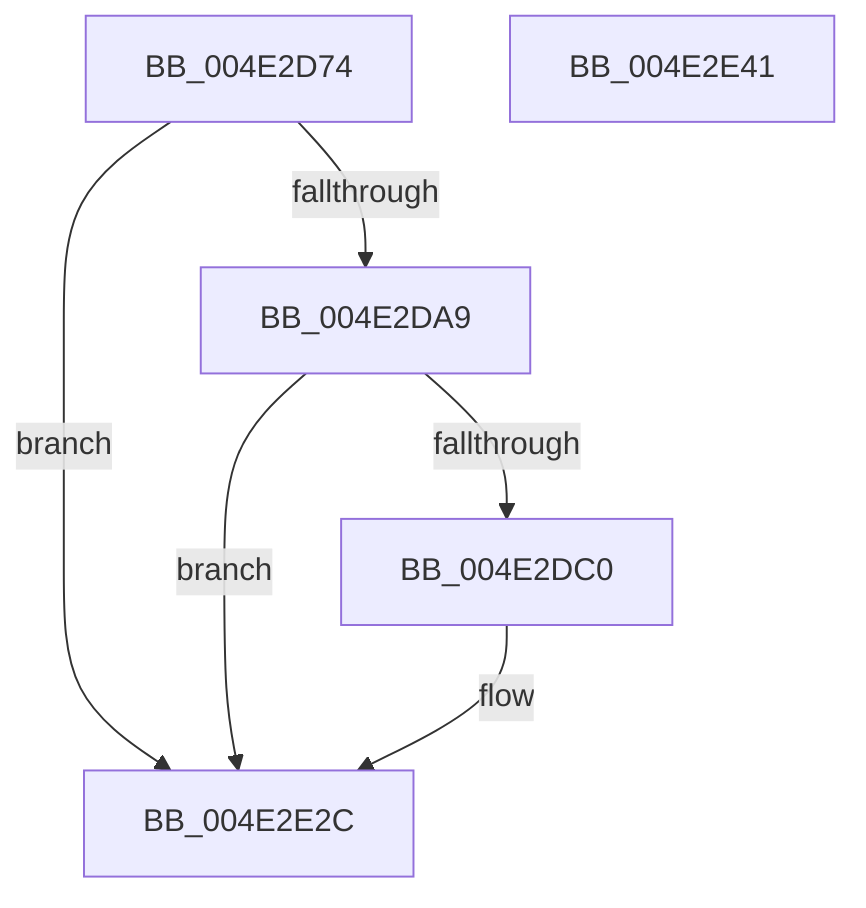

# PpmEventParkNodeParkHintChanged

- RVA: `0x004E2D74`–`0x004E2E42` (길이 `206` bytes)
- VA: `0x00000001404E2D74`
- 실행 섹션: `.text`
- PDB 이름 있음: `예`; PDB Function 태그: `아니요`
- unwind 정보 RVA: `0x000BF3D4`
- 디코드: `46`개 명령, `206/206` bytes 표시
- 미해석 바이트: `0` (있으면 어셈블리에 `.byte`로 보존)

> 이 문서는 커널 이미지의 기계어와 PDB 기호를 분석해 생성했습니다. 4번과 5번은 함수 원형과 자료형을 바이너리 사용 방식에서 추정한 C 해석이며 원본 소스 복구 결과는 아닙니다.

## 1. Dependencies

- 직접 호출 지점: **3**; 고유 호출 대상: **3**
- 직접 호출자로 확인된 함수: **1**
- RIP 상대 이미지 참조: **4**

### Outgoing calls
- `0x004E2DB7` → [EtwEventEnabled](../39/EtwEventEnabled_function_00392450.md) (function, `0x00392450`)
- `0x004E2E27` → [EtwWriteEx](../25/EtwWriteEx_function_0025F0D0.md) (function, `0x0025F0D0`)
- `0x004E2E33` → [_security_check_cookie](../6A/_security_check_cookie_function_006AC640.md) (function, `0x006AC640`)

### Direct callers
- [PpmParkApplyPolicy](../4B/PpmParkApplyPolicy_function_004B613C.md) at `0x004B64BB`

### Static image references
- `0x004E2D8E` → RVA `0x00E0A740` (`.data`; read)
- `0x004E2D9C` → RVA `0x00E67A39` (`.data`; read)
- `0x004E2DA9` → RVA `0x00F083E8` (`.data`; read)
- `0x004E2DB0` → RVA `0x00022F70` (`.rdata`; read)

## 2. Other-region calls and transfers

- 다른 실행 섹션으로 향하는 call: **0**
- 별도 외부 분기/꼬리 이동을 확인하지 못했습니다.

## 3. Assembly (complete function range)

```asm
004E2D74  4C 89 44 24 18                  mov qword ptr [rsp + 0x18], r8
004E2D79  48 89 54 24 10                  mov qword ptr [rsp + 0x10], rdx
004E2D7E  66 89 4C 24 08                  mov word ptr [rsp + 8], cx
004E2D83  55                              push rbp
004E2D84  48 8B EC                        mov rbp, rsp
004E2D87  48 81 EC 80 00 00 00            sub rsp, 0x80
004E2D8E  48 8B 05 AB 79 92 00            mov rax, qword ptr [rip + 0x9279ab]
004E2D95  48 33 C4                        xor rax, rsp
004E2D98  48 89 45 F0                     mov qword ptr [rbp - 0x10], rax
004E2D9C  80 3D 96 4C 98 00 00            cmp byte ptr [rip + 0x984c96], 0
004E2DA3  0F 84 83 00 00 00               je 0x1404e2e2c
004E2DA9  48 8B 0D 38 56 A2 00            mov rcx, qword ptr [rip + 0xa25638]
004E2DB0  48 8D 15 B9 01 B4 FF            lea rdx, [rip - 0x4bfe47]
004E2DB7  E8 94 F6 EA FF                  call 0x140392450
004E2DBC  84 C0                           test al, al
004E2DBE  74 6C                           je 0x1404e2e2c
004E2DC0  83 65 CC 00                     and dword ptr [rbp - 0x34], 0
004E2DC4  48 8D 45 10                     lea rax, [rbp + 0x10]
004E2DC8  83 65 DC 00                     and dword ptr [rbp - 0x24], 0
004E2DCC  48 8D 15 9D 01 B4 FF            lea rdx, [rip - 0x4bfe63]
004E2DD3  83 65 EC 00                     and dword ptr [rbp - 0x14], 0
004E2DD7  B9 08 00 00 00                  mov ecx, 8
004E2DDC  48 89 45 C0                     mov qword ptr [rbp - 0x40], rax
004E2DE0  45 33 C9                        xor r9d, r9d
004E2DE3  48 8D 45 18                     lea rax, [rbp + 0x18]
004E2DE7  89 4D D8                        mov dword ptr [rbp - 0x28], ecx
004E2DEA  48 89 45 D0                     mov qword ptr [rbp - 0x30], rax
004E2DEE  45 33 C0                        xor r8d, r8d
004E2DF1  48 8D 45 20                     lea rax, [rbp + 0x20]
004E2DF5  89 4D E8                        mov dword ptr [rbp - 0x18], ecx
004E2DF8  48 8B 0D E9 55 A2 00            mov rcx, qword ptr [rip + 0xa255e9]
004E2DFF  48 89 45 E0                     mov qword ptr [rbp - 0x20], rax
004E2E03  48 8D 45 C0                     lea rax, [rbp - 0x40]
004E2E07  48 89 44 24 38                  mov qword ptr [rsp + 0x38], rax
004E2E0C  C7 44 24 30 03 00 00 00         mov dword ptr [rsp + 0x30], 3
004E2E14  48 83 64 24 28 00               and qword ptr [rsp + 0x28], 0
004E2E1A  48 83 64 24 20 00               and qword ptr [rsp + 0x20], 0
004E2E20  C7 45 C8 02 00 00 00            mov dword ptr [rbp - 0x38], 2
004E2E27  E8 A4 C2 D7 FF                  call 0x14025f0d0
004E2E2C  48 8B 4D F0                     mov rcx, qword ptr [rbp - 0x10]
004E2E30  48 33 CC                        xor rcx, rsp
004E2E33  E8 08 98 1C 00                  call 0x1406ac640
004E2E38  48 81 C4 80 00 00 00            add rsp, 0x80
004E2E3F  5D                              pop rbp
004E2E40  C3                              ret
004E2E41  CC                              int3
```

## 4. C-style interpretation (structured pseudocode)

```c
__int64 __fastcall PpmEventParkNodeParkHintChanged(unsigned __int16 a1, __int64 a2, __int64 a3, int a4)
{
    __int64 result;
    __int64 v_rsp;
    unsigned __int64 v_stack_m18;
    unsigned int v_stack_m1C;
    unsigned int v_stack_m20;
    unsigned __int64 v_stack_m28;
    unsigned int v_stack_m2C;
    unsigned int v_stack_m30;
    unsigned __int64 v_stack_m38;
    unsigned int v_stack_m3C;
    unsigned int v_stack_m40;
    unsigned __int64 v_stack_m48;
    unsigned __int64 v_stack_m50;
    unsigned int v_stack_m58;
    unsigned __int64 v_stack_m60;
    unsigned __int64 v_stack_m68;
    unsigned __int64 v_stack_p10;
    unsigned __int64 v_stack_p18;
    unsigned __int16 v_stack_p8;

    v_stack_p18 = a3;
    v_stack_p10 = a2;
    v_stack_p8 = a1;
    v_rsp = (v_rsp) - (128);
    result = (*(unsigned __int64 *)(v_rip + 9599403)) ^ (v_rsp);
    v_stack_m18 = result;
    if ((*(unsigned __int8 *)(v_rip + 9981078)) == 0) goto loc_004E2E2C;
    result = EtwEventEnabled(*(unsigned __int64 *)(v_rip + 10638904), v_rip - 4980295, a3, a4);
    if ((unsigned __int8)(result) != 0) {
        result = v_stack_p8;
        a2 = v_rip - 4980323;
        a1 = 8;
        v_stack_m48 = result;
        a4 = 0;
        result = v_stack_p10;
        v_stack_m30 = a1;
        v_stack_m38 = result;
        a3 = 0;
        result = v_stack_p18;
        v_stack_m20 = a1;
        a1 = *(unsigned __int64 *)(v_rip + 10638825);
        v_stack_m28 = result;
        result = v_stack_m48;
        v_stack_m50 = result;
        v_stack_m58 = 3;
        v_stack_m40 = 2;
        result = EtwWriteEx(a1, a2, a3, a4);
    }
    a1 = (v_stack_m18) ^ (v_rsp);
    result = _security_check_cookie(a1, a2, a3, a4);
    v_rsp = (v_rsp) + (128);
    return result;
}
```

## 5. (Beta) C Style

```c
int64_t PpmEventParkNodeParkHintChanged(uint16_t Arg1, int64_t Arg2, int64_t Arg3, int32_t Arg4)
{
    int64_t result;
    int64_t local_rsp;
    uint64_t v_stack_m18;
    uint32_t v_stack_m1C;
    uint32_t v_stack_m20;
    uint64_t v_stack_m28;
    uint32_t v_stack_m2C;
    uint32_t v_stack_m30;
    uint64_t v_stack_m38;
    uint32_t v_stack_m3C;
    uint32_t v_stack_m40;
    uint64_t v_stack_m48;
    uint64_t v_stack_m50;
    uint32_t v_stack_m58;
    uint64_t v_stack_m60;
    uint64_t v_stack_m68;
    uint64_t v_stack_p10;
    uint64_t v_stack_p18;
    uint16_t v_stack_p8;

    v_stack_p18 = Arg3;
    v_stack_p10 = Arg2;
    v_stack_p8 = Arg1;
    local_rsp = (local_rsp) - (128);
    result = (*(uint64_t *)(v_rip + 0x9279AB)) ^ (local_rsp);
    v_stack_m18 = result;
    if ((*(uint8_t *)(v_rip + 0x984C96)) == 0) goto loc_004E2E2C;
    result = EtwEventEnabled(*(uint64_t *)(v_rip + 0xA25638), v_rip - 4980295, Arg3, Arg4);
    if ((uint8_t)(result) != 0) {
        result = v_stack_p8;
        Arg2 = v_rip - 4980323;
        Arg1 = 8;
        v_stack_m48 = result;
        Arg4 = 0;
        result = v_stack_p10;
        v_stack_m30 = Arg1;
        v_stack_m38 = result;
        Arg3 = 0;
        result = v_stack_p18;
        v_stack_m20 = Arg1;
        Arg1 = *(uint64_t *)(v_rip + 0xA255E9);
        v_stack_m28 = result;
        result = v_stack_m48;
        v_stack_m50 = result;
        v_stack_m58 = 3;
        v_stack_m40 = 2;
        result = EtwWriteEx(Arg1, Arg2, Arg3, Arg4);
    }
    Arg1 = (v_stack_m18) ^ (local_rsp);
    result = _security_check_cookie(Arg1, Arg2, Arg3, Arg4);
    local_rsp = (local_rsp) + (128);
    return result;
}
```

## 6. Execution-region graph

[열기: 2D/3D 그래프와 함수 탐색 컨트롤 패널](../../../control-panel.html?section=text&rva=0x004E2D74&view=graph)

- 2D 그래프는 위에서 아래로 흐르고, 3D 그래프는 빈 공간을 드래그해 회전합니다. Shift+드래그는 이동, 휠은 확대·축소, 함수 노드 선택은 대상 보고서 이동입니다.

### Static fallback


