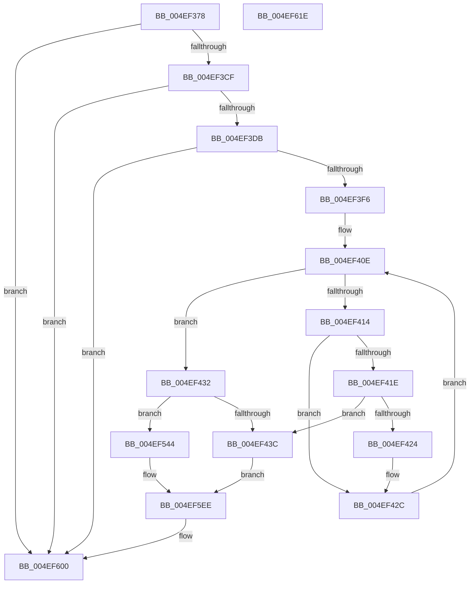

# PpmEventParkNodeRecordedStatsEx

- RVA: `0x004EF378`–`0x004EF61F` (길이 `679` bytes)
- VA: `0x00000001404EF378`
- 실행 섹션: `.text`
- PDB 이름 있음: `예`; PDB Function 태그: `아니요`
- unwind 정보 RVA: `0x000AE2BC`
- 디코드: `163`개 명령, `679/679` bytes 표시
- 미해석 바이트: `0` (있으면 어셈블리에 `.byte`로 보존)

> 이 문서는 커널 이미지의 기계어와 PDB 기호를 분석해 생성했습니다. 4번과 5번은 함수 원형과 자료형을 바이너리 사용 방식에서 추정한 C 해석이며 원본 소스 복구 결과는 아닙니다.

## 1. Dependencies

- 직접 호출 지점: **4**; 고유 호출 대상: **4**
- 직접 호출자로 확인된 함수: **1**
- RIP 상대 이미지 참조: **6**

### Outgoing calls
- `0x004EF3E9` → [EtwEventEnabled](../39/EtwEventEnabled_function_00392450.md) (function, `0x00392450`)
- `0x004EF490` → [PpmEventAddAffinityMaskAsSubset](PpmEventAddAffinityMaskAsSubset_function_004EF628.md) (function, `0x004EF628`)
- `0x004EF5FB` → [EtwWriteEx](../25/EtwWriteEx_function_0025F0D0.md) (function, `0x0025F0D0`)
- `0x004EF607` → [_security_check_cookie](../6A/_security_check_cookie_function_006AC640.md) (function, `0x006AC640`)

### Direct callers
- [PpmParkRecordNodeStatistics](../40/PpmParkRecordNodeStatistics_function_0040B02C.md) at `0x0040B162`

### Static image references
- `0x004EF399` → RVA `0x00E0A740` (`.data`; read)
- `0x004EF3A7` → RVA `0x00E67A70` (`.data`; read)
- `0x004EF3CF` → RVA `0x00E67A39` (`.data`; read)
- `0x004EF3DB` → RVA `0x00F083E8` (`.data`; read)
- `0x004EF3E2` → RVA `0x0001A490` (`.rdata`; read)
- `0x004EF5B4` → RVA `0x00019908` (`.rdata`; read)

## 2. Other-region calls and transfers

- 다른 실행 섹션으로 향하는 call: **0**
- 별도 외부 분기/꼬리 이동을 확인하지 못했습니다.

## 3. Assembly (complete function range)

```asm
004EF378  66 44 89 44 24 18               mov word ptr [rsp + 0x18], r8w
004EF37E  66 89 4C 24 08                  mov word ptr [rsp + 8], cx
004EF383  55                              push rbp
004EF384  53                              push rbx
004EF385  56                              push rsi
004EF386  57                              push rdi
004EF387  41 54                           push r12
004EF389  41 56                           push r14
004EF38B  41 57                           push r15
004EF38D  48 8D 6C 24 E0                  lea rbp, [rsp - 0x20]
004EF392  48 81 EC 20 01 00 00            sub rsp, 0x120
004EF399  48 8B 05 A0 B3 91 00            mov rax, qword ptr [rip + 0x91b3a0]
004EF3A0  48 33 C4                        xor rax, rsp
004EF3A3  48 89 45 10                     mov qword ptr [rbp + 0x10], rax
004EF3A7  4C 8B 35 C2 86 97 00            mov r14, qword ptr [rip + 0x9786c2]
004EF3AE  33 DB                           xor ebx, ebx
004EF3B0  88 5C 24 40                     mov byte ptr [rsp + 0x40], bl
004EF3B4  49 8B F9                        mov rdi, r9
004EF3B7  88 5C 24 41                     mov byte ptr [rsp + 0x41], bl
004EF3BB  48 8B F2                        mov rsi, rdx
004EF3BE  89 5C 24 54                     mov dword ptr [rsp + 0x54], ebx
004EF3C2  89 5C 24 50                     mov dword ptr [rsp + 0x50], ebx
004EF3C6  4D 85 F6                        test r14, r14
004EF3C9  0F 84 31 02 00 00               je 0x1404ef600
004EF3CF  38 1D 64 86 97 00               cmp byte ptr [rip + 0x978664], bl
004EF3D5  0F 84 25 02 00 00               je 0x1404ef600
004EF3DB  48 8B 0D 06 90 A1 00            mov rcx, qword ptr [rip + 0xa19006]
004EF3E2  48 8D 15 A7 B0 B2 FF            lea rdx, [rip - 0x4d4f59]
004EF3E9  E8 62 30 EA FF                  call 0x140392450
004EF3EE  84 C0                           test al, al
004EF3F0  0F 84 0A 02 00 00               je 0x1404ef600
004EF3F6  44 0F B7 06                     movzx r8d, word ptr [rsi]
004EF3FA  44 8D 4B 20                     lea r9d, [rbx + 0x20]
004EF3FE  41 0F B7 C9                     movzx ecx, r9w
004EF402  44 8D 53 01                     lea r10d, [rbx + 1]
004EF406  66 89 4C 24 44                  mov word ptr [rsp + 0x44], cx
004EF40B  0F B7 D3                        movzx edx, bx
004EF40E  66 41 3B D0                     cmp dx, r8w
004EF412  73 1E                           jae 0x1404ef432
004EF414  0F B7 C2                        movzx eax, dx
004EF417  48 39 5C C6 08                  cmp qword ptr [rsi + rax*8 + 8], rbx
004EF41C  74 0E                           je 0x1404ef42c
004EF41E  66 41 3B C9                     cmp cx, r9w
004EF422  75 18                           jne 0x1404ef43c
004EF424  0F B7 CA                        movzx ecx, dx
004EF427  66 89 54 24 44                  mov word ptr [rsp + 0x44], dx
004EF42C  66 41 03 D2                     add dx, r10w
004EF430  EB DC                           jmp 0x1404ef40e
004EF432  66 41 3B C9                     cmp cx, r9w
004EF436  0F 85 08 01 00 00               jne 0x1404ef544
004EF43C  41 83 66 0C 00                  and dword ptr [r14 + 0xc], 0
004EF441  48 8D 45 60                     lea rax, [rbp + 0x60]
004EF445  49 89 06                        mov qword ptr [r14], rax
004EF448  48 8D 5F 30                     lea rbx, [rdi + 0x30]
004EF44C  48 8D 44 24 48                  lea rax, [rsp + 0x48]
004EF451  41 C7 46 08 02 00 00 00         mov dword ptr [r14 + 8], 2
004EF459  48 89 44 24 38                  mov qword ptr [rsp + 0x38], rax
004EF45E  4C 8D 4D D0                     lea r9, [rbp - 0x30]
004EF462  48 8D 44 24 50                  lea rax, [rsp + 0x50]
004EF467  44 89 54 24 48                  mov dword ptr [rsp + 0x48], r10d
004EF46C  48 89 44 24 30                  mov qword ptr [rsp + 0x30], rax
004EF471  4C 8D 44 24 4C                  lea r8, [rsp + 0x4c]
004EF476  48 8D 44 24 54                  lea rax, [rsp + 0x54]
004EF47B  48 8B D6                        mov rdx, rsi
004EF47E  48 89 44 24 28                  mov qword ptr [rsp + 0x28], rax
004EF483  33 C9                           xor ecx, ecx
004EF485  4C 89 74 24 20                  mov qword ptr [rsp + 0x20], r14
004EF48A  4C 8B E3                        mov r12, rbx
004EF48D  4C 8B FB                        mov r15, rbx
004EF490  E8 93 01 00 00                  call 0x1404ef628
004EF495  44 8B 4C 24 48                  mov r9d, dword ptr [rsp + 0x48]
004EF49A  48 8D 4D 70                     lea rcx, [rbp + 0x70]
004EF49E  45 33 D2                        xor r10d, r10d
004EF4A1  4C 89 74 24 38                  mov qword ptr [rsp + 0x38], r14
004EF4A6  41 8B C1                        mov eax, r9d
004EF4A9  48 03 C0                        add rax, rax
004EF4AC  49 89 0C C6                     mov qword ptr [r14 + rax*8], rcx
004EF4B0  41 8D 49 01                     lea ecx, [r9 + 1]
004EF4B4  49 C7 44 C6 08 02 00 00 00      mov qword ptr [r14 + rax*8 + 8], 2
004EF4BD  48 03 C9                        add rcx, rcx
004EF4C0  49 89 1C CE                     mov qword ptr [r14 + rcx*8], rbx
004EF4C4  49 C7 44 CE 08 04 00 00 00      mov qword ptr [r14 + rcx*8 + 8], 4
004EF4CD  41 8D 49 02                     lea ecx, [r9 + 2]
004EF4D1  8B 13                           mov edx, dword ptr [rbx]
004EF4D3  48 03 C9                        add rcx, rcx
004EF4D6  48 8B 47 08                     mov rax, qword ptr [rdi + 8]
004EF4DA  C1 E2 03                        shl edx, 3
004EF4DD  49 89 04 CE                     mov qword ptr [r14 + rcx*8], rax
004EF4E1  48 8D 85 80 00 00 00            lea rax, [rbp + 0x80]
004EF4E8  41 89 54 CE 08                  mov dword ptr [r14 + rcx*8 + 8], edx
004EF4ED  48 8D 15 9C AF B2 FF            lea rdx, [rip - 0x4d5064]
004EF4F4  45 89 54 CE 0C                  mov dword ptr [r14 + rcx*8 + 0xc], r10d
004EF4F9  41 8D 49 03                     lea ecx, [r9 + 3]
004EF4FD  48 03 C9                        add rcx, rcx
004EF500  49 89 04 CE                     mov qword ptr [r14 + rcx*8], rax
004EF504  49 C7 44 CE 08 02 00 00 00      mov qword ptr [r14 + rcx*8 + 8], 2
004EF50D  41 8D 49 04                     lea ecx, [r9 + 4]
004EF511  44 8B 03                        mov r8d, dword ptr [rbx]
004EF514  48 8B 47 10                     mov rax, qword ptr [rdi + 0x10]
004EF518  41 C1 E0 03                     shl r8d, 3
004EF51C  48 03 C9                        add rcx, rcx
004EF51F  49 89 04 CE                     mov qword ptr [r14 + rcx*8], rax
004EF523  41 8D 41 05                     lea eax, [r9 + 5]
004EF527  89 44 24 30                     mov dword ptr [rsp + 0x30], eax
004EF52B  4C 89 54 24 28                  mov qword ptr [rsp + 0x28], r10
004EF530  4C 89 54 24 20                  mov qword ptr [rsp + 0x20], r10
004EF535  45 89 44 CE 08                  mov dword ptr [r14 + rcx*8 + 8], r8d
004EF53A  45 89 54 CE 0C                  mov dword ptr [r14 + rcx*8 + 0xc], r10d
004EF53F  E9 AA 00 00 00                  jmp 0x1404ef5ee
004EF544  0F B7 C9                        movzx ecx, cx
004EF547  48 8D 44 24 44                  lea rax, [rsp + 0x44]
004EF54C  48 89 44 24 60                  mov qword ptr [rsp + 0x60], rax
004EF551  48 8D 57 30                     lea rdx, [rdi + 0x30]
004EF555  8A 45 70                        mov al, byte ptr [rbp + 0x70]
004EF558  48 FF C1                        inc rcx
004EF55B  88 44 24 40                     mov byte ptr [rsp + 0x40], al
004EF55F  48 8D 44 24 40                  lea rax, [rsp + 0x40]
004EF564  48 89 45 80                     mov qword ptr [rbp - 0x80], rax
004EF568  48 8B 47 08                     mov rax, qword ptr [rdi + 8]
004EF56C  48 89 45 A0                     mov qword ptr [rbp - 0x60], rax
004EF570  48 8D 0C CE                     lea rcx, [rsi + rcx*8]
004EF574  8A 85 80 00 00 00               mov al, byte ptr [rbp + 0x80]
004EF57A  88 44 24 41                     mov byte ptr [rsp + 0x41], al
004EF57E  48 8D 44 24 41                  lea rax, [rsp + 0x41]
004EF583  48 89 45 B0                     mov qword ptr [rbp - 0x50], rax
004EF587  48 8B 47 10                     mov rax, qword ptr [rdi + 0x10]
004EF58B  48 89 4C 24 70                  mov qword ptr [rsp + 0x70], rcx
004EF590  8B 0A                           mov ecx, dword ptr [rdx]
004EF592  C1 E1 03                        shl ecx, 3
004EF595  48 89 45 C0                     mov qword ptr [rbp - 0x40], rax
004EF599  48 8D 44 24 60                  lea rax, [rsp + 0x60]
004EF59E  48 89 44 24 38                  mov qword ptr [rsp + 0x38], rax
004EF5A3  C7 44 24 30 07 00 00 00         mov dword ptr [rsp + 0x30], 7
004EF5AB  48 89 5C 24 28                  mov qword ptr [rsp + 0x28], rbx
004EF5B0  48 89 55 90                     mov qword ptr [rbp - 0x70], rdx
004EF5B4  48 8D 15 4D A3 B2 FF            lea rdx, [rip - 0x4d5cb3]
004EF5BB  48 89 5C 24 20                  mov qword ptr [rsp + 0x20], rbx
004EF5C0  48 C7 44 24 68 02 00 00 00      mov qword ptr [rsp + 0x68], 2
004EF5C9  48 C7 44 24 78 08 00 00 00      mov qword ptr [rsp + 0x78], 8
004EF5D2  4C 89 55 88                     mov qword ptr [rbp - 0x78], r10
004EF5D6  48 C7 45 98 04 00 00 00         mov qword ptr [rbp - 0x68], 4
004EF5DE  89 4D A8                        mov dword ptr [rbp - 0x58], ecx
004EF5E1  89 5D AC                        mov dword ptr [rbp - 0x54], ebx
004EF5E4  4C 89 55 B8                     mov qword ptr [rbp - 0x48], r10
004EF5E8  89 4D C8                        mov dword ptr [rbp - 0x38], ecx
004EF5EB  89 5D CC                        mov dword ptr [rbp - 0x34], ebx
004EF5EE  48 8B 0D F3 8D A1 00            mov rcx, qword ptr [rip + 0xa18df3]
004EF5F5  45 33 C9                        xor r9d, r9d
004EF5F8  45 33 C0                        xor r8d, r8d
004EF5FB  E8 D0 FA D6 FF                  call 0x14025f0d0
004EF600  48 8B 4D 10                     mov rcx, qword ptr [rbp + 0x10]
004EF604  48 33 CC                        xor rcx, rsp
004EF607  E8 34 D0 1B 00                  call 0x1406ac640
004EF60C  48 81 C4 20 01 00 00            add rsp, 0x120
004EF613  41 5F                           pop r15
004EF615  41 5E                           pop r14
004EF617  41 5C                           pop r12
004EF619  5F                              pop rdi
004EF61A  5E                              pop rsi
004EF61B  5B                              pop rbx
004EF61C  5D                              pop rbp
004EF61D  C3                              ret
004EF61E  CC                              int3
```

## 4. C-style interpretation (structured pseudocode)

```c
__int64 __fastcall PpmEventParkNodeRecordedStatsEx(unsigned __int16 a1, __int64 a2, unsigned __int16 a3, __int64 a4, unsigned __int8 a5)
{
    __int64 result;
    __int64 v_r10;
    __int64 v_rbx;
    __int64 v_rsp;
    unsigned int v_stack_m104;
    unsigned int v_stack_m108;
    unsigned __int64 v_stack_m10C;
    unsigned __int64 v_stack_m110;
    unsigned __int16 v_stack_m114;
    unsigned __int8 v_stack_m117;
    unsigned __int8 v_stack_m118;
    unsigned __int64 v_stack_m120;
    unsigned __int64 v_stack_m128;
    unsigned __int64 v_stack_m130;
    unsigned __int64 v_stack_m138;
    unsigned __int64 v_stack_m48;
    unsigned __int64 v_stack_m58;
    unsigned __int64 v_stack_m88;
    unsigned int v_stack_m8C;
    unsigned int v_stack_m90;
    unsigned __int64 v_stack_m98;
    unsigned __int64 v_stack_mA0;
    unsigned __int64 v_stack_mA8;
    unsigned int v_stack_mAC;
    unsigned int v_stack_mB0;
    unsigned __int64 v_stack_mB8;
    unsigned __int64 v_stack_mC0;
    unsigned __int64 v_stack_mC8;
    unsigned __int64 v_stack_mD0;
    unsigned __int64 v_stack_mD8;
    unsigned __int64 v_stack_mE0;
    unsigned __int64 v_stack_mE8;
    unsigned __int64 v_stack_mF0;
    unsigned __int64 v_stack_mF8;
    unsigned __int16 v_stack_p18;
    unsigned __int16 v_stack_p8;

    v_stack_p18 = a3;
    v_stack_p8 = a1;
    v_rsp = (v_rsp) - (288);
    result = (*(unsigned __int64 *)(v_rip + 9548704)) ^ (v_rsp);
    v_stack_m48 = result;
    v_rbx = 0;
    v_stack_m118 = 0;
    v_stack_m117 = 0;
    v_stack_m104 = 0;
    v_stack_m108 = 0;
    if (*(unsigned __int64 *)(v_rip + 9930434) == 0) goto loc_004EF600;
    if ((*(unsigned __int8 *)(v_rip + 9930340)) == 0) goto loc_004EF600;
    result = EtwEventEnabled(*(unsigned __int64 *)(v_rip + 10588166), v_rip - 5066585, a3, a4);
    if ((unsigned __int8)(result) == 0) goto loc_004EF600;
    v_stack_m114 = (unsigned __int16)((unsigned __int16)(v_rbx + 32));
loc_004EF40E:
    if (0 >= ((unsigned __int16)(*(unsigned __int16 *)(a2)))) goto loc_004EF432;
    if ((*(unsigned __int64 *)(a2 + 0 * 8 + 8)) == 0) goto loc_004EF42C;
    if (((unsigned __int16)((unsigned __int16)(v_rbx + 32))) != ((unsigned __int16)(v_rbx + 32))) goto loc_004EF43C;
    v_stack_m114 = 0;
loc_004EF42C:
    a2 = (unsigned __int16)((0) + ((unsigned __int16)(v_rbx + 1)));
    goto loc_004EF40E;
loc_004EF432:
    if (0 != ((unsigned __int16)(v_rbx + 32))) goto loc_004EF544;
loc_004EF43C:
    *(unsigned __int64 *)(*(unsigned __int64 *)(v_rip + 9930434)) = v_stack_p8;
    *(unsigned int *)(*(unsigned __int64 *)(v_rip + 9930434) + 8) = 2;
    v_stack_m120 = v_stack_m110;
    v_stack_m110 = (unsigned int)(v_rbx + 1);
    v_stack_m128 = v_stack_m108;
    v_stack_m130 = v_stack_m104;
    a1 = 0;
    v_stack_m138 = *(unsigned __int64 *)(v_rip + 9930434);
    result = PpmEventAddAffinityMaskAsSubset(a1, a2, v_stack_m10C, v_stack_m88);
    v_r10 = 0;
    v_stack_m120 = *(unsigned __int64 *)(v_rip + 9930434);
    result = ((unsigned int)((unsigned int)((unsigned int)(v_stack_m110)))) + ((unsigned int)((unsigned int)((unsigned int)(v_stack_m110))));
    *(unsigned __int64 *)(*(unsigned __int64 *)(v_rip + 9930434) + result * 8) = v_stack_p18;
    *(unsigned __int64 *)(*(unsigned __int64 *)(v_rip + 9930434) + result * 8 + 8) = 2;
    a1 = ((unsigned int)(v_stack_m110) + 1) + ((unsigned int)(v_stack_m110) + 1);
    *(unsigned __int64 *)(*(unsigned __int64 *)(v_rip + 9930434) + a1 * 8) = a4 + 48;
    *(unsigned __int64 *)(*(unsigned __int64 *)(v_rip + 9930434) + a1 * 8 + 8) = 4;
    a1 = ((unsigned int)(v_stack_m110) + 2) + ((unsigned int)(v_stack_m110) + 2);
    a2 = (unsigned int)(((unsigned int)(*(unsigned int *)(a4 + 48))) << (3));
    *(unsigned __int64 *)(*(unsigned __int64 *)(v_rip + 9930434) + a1 * 8) = *(unsigned __int64 *)(a4 + 8);
    *(unsigned int *)(*(unsigned __int64 *)(v_rip + 9930434) + a1 * 8 + 8) = (unsigned int)(a2);
    *(unsigned int *)(*(unsigned __int64 *)(v_rip + 9930434) + a1 * 8 + 12) = 0;
    a1 = ((unsigned int)(v_stack_m110) + 3) + ((unsigned int)(v_stack_m110) + 3);
    *(unsigned __int64 *)(*(unsigned __int64 *)(v_rip + 9930434) + a1 * 8) = a5;
    *(unsigned __int64 *)(*(unsigned __int64 *)(v_rip + 9930434) + a1 * 8 + 8) = 2;
    a3 = (unsigned int)(((unsigned int)(*(unsigned int *)(a4 + 48))) << (3));
    a1 = ((unsigned int)(v_stack_m110) + 4) + ((unsigned int)(v_stack_m110) + 4);
    *(unsigned __int64 *)(*(unsigned __int64 *)(v_rip + 9930434) + a1 * 8) = *(unsigned __int64 *)(a4 + 16);
    v_stack_m128 = (unsigned int)((unsigned int)(v_stack_m110) + 5);
    v_stack_m130 = 0;
    v_stack_m138 = 0;
    *(unsigned int *)(*(unsigned __int64 *)(v_rip + 9930434) + a1 * 8 + 8) = a3;
    *(unsigned int *)(*(unsigned __int64 *)(v_rip + 9930434) + a1 * 8 + 12) = 0;
    goto loc_004EF5EE;
loc_004EF544:
    v_stack_mF8 = v_stack_m114;
    a1 = (a1) + 1;
    v_stack_m118 = (unsigned __int8)(v_stack_p18);
    v_stack_mD8 = v_stack_m118;
    v_stack_mB8 = *(unsigned __int64 *)(a4 + 8);
    v_stack_m117 = a5;
    v_stack_mA8 = v_stack_m117;
    v_stack_mE8 = a2 + a1 * 8;
    a1 = (unsigned int)(((unsigned int)(*(unsigned int *)(a4 + 48))) << (3));
    v_stack_m98 = *(unsigned __int64 *)(a4 + 16);
    v_stack_m120 = v_stack_mF8;
    v_stack_m128 = 7;
    v_stack_m130 = a4 + 48;
    v_stack_mC8 = a4 + 48;
    v_stack_m138 = a4 + 48;
    v_stack_mF0 = 2;
    v_stack_mE0 = 8;
    v_stack_mD0 = 0;
    v_stack_mC0 = 4;
    v_stack_mB0 = a1;
    v_stack_mAC = (unsigned int)(a4 + 48);
    v_stack_mA0 = 0;
    v_stack_m90 = a1;
    v_stack_m8C = (unsigned int)(a4 + 48);
loc_004EF5EE:
    a4 = 0;
    a3 = 0;
    result = EtwWriteEx(*(unsigned __int64 *)(v_rip + 10587635), v_rip - 5070003, a3, a4);
loc_004EF600:
    a1 = (v_stack_m48) ^ (v_rsp);
    result = _security_check_cookie(a1, v_rip - 5070003, a3, a4);
    v_rsp = (v_rsp) + (288);
    return result;
}
```

## 5. (Beta) C Style

```c
int64_t PpmEventParkNodeRecordedStatsEx(uint16_t Arg1, void *Arg2, uint16_t Arg3, void *Arg4, uint8_t Arg5)
{
    uint8_t *arg2 = (uint8_t *)Arg2;
    uint8_t *arg4 = (uint8_t *)Arg4;

    int64_t result;
    int64_t local_r10;
    int64_t local_rbx;
    int64_t local_rsp;
    uint32_t v_stack_m104;
    uint32_t v_stack_m108;
    uint64_t v_stack_m10C;
    uint64_t v_stack_m110;
    uint16_t v_stack_m114;
    uint8_t v_stack_m117;
    uint8_t v_stack_m118;
    uint64_t v_stack_m120;
    uint64_t v_stack_m128;
    uint64_t v_stack_m130;
    uint64_t v_stack_m138;
    uint64_t v_stack_m48;
    uint64_t v_stack_m58;
    uint64_t v_stack_m88;
    uint32_t v_stack_m8C;
    uint32_t v_stack_m90;
    uint64_t v_stack_m98;
    uint64_t v_stack_mA0;
    uint64_t v_stack_mA8;
    uint32_t v_stack_mAC;
    uint32_t v_stack_mB0;
    uint64_t v_stack_mB8;
    uint64_t v_stack_mC0;
    uint64_t v_stack_mC8;
    uint64_t v_stack_mD0;
    uint64_t v_stack_mD8;
    uint64_t v_stack_mE0;
    uint64_t v_stack_mE8;
    uint64_t v_stack_mF0;
    uint64_t v_stack_mF8;
    uint16_t v_stack_p18;
    uint16_t v_stack_p8;

    v_stack_p18 = Arg3;
    v_stack_p8 = Arg1;
    local_rsp = (local_rsp) - (288);
    result = (*(uint64_t *)(v_rip + 0x91B3A0)) ^ (local_rsp);
    v_stack_m48 = result;
    local_rbx = 0;
    v_stack_m118 = 0;
    v_stack_m117 = 0;
    v_stack_m104 = 0;
    v_stack_m108 = 0;
    if (*(uint64_t *)(v_rip + 0x9786C2) == 0) goto loc_004EF600;
    if ((*(uint8_t *)(v_rip + 0x978664)) == 0) goto loc_004EF600;
    result = EtwEventEnabled(*(uint64_t *)(v_rip + 0xA19006), v_rip - 5066585, Arg3, Arg4);
    if ((uint8_t)(result) == 0) goto loc_004EF600;
    v_stack_m114 = (uint16_t)((uint16_t)(local_rbx + 32));
loc_004EF40E:
    if (0 >= ((uint16_t)(*(uint16_t *)(arg2)))) goto loc_004EF432;
    if ((*(uint64_t *)(arg2 + 0x0 * 8 + 0x8)) == 0) goto loc_004EF42C;
    if (((uint16_t)((uint16_t)(local_rbx + 32))) != ((uint16_t)(local_rbx + 32))) goto loc_004EF43C;
    v_stack_m114 = 0;
loc_004EF42C:
    Arg2 = (uint16_t)((0) + ((uint16_t)(local_rbx + 1)));
    goto loc_004EF40E;
loc_004EF432:
    if (0 != ((uint16_t)(local_rbx + 32))) goto loc_004EF544;
loc_004EF43C:
    *(uint64_t *)(*(uint64_t *)(v_rip + 0x9786C2)) = v_stack_p8;
    *(uint32_t *)(*(uint64_t *)(v_rip + 0x9786C2) + 0x8) = 2;
    v_stack_m120 = v_stack_m110;
    v_stack_m110 = (uint32_t)(local_rbx + 1);
    v_stack_m128 = v_stack_m108;
    v_stack_m130 = v_stack_m104;
    Arg1 = 0;
    v_stack_m138 = *(uint64_t *)(v_rip + 0x9786C2);
    result = PpmEventAddAffinityMaskAsSubset(Arg1, Arg2, v_stack_m10C, v_stack_m88);
    local_r10 = 0;
    v_stack_m120 = *(uint64_t *)(v_rip + 0x9786C2);
    result = ((uint32_t)((uint32_t)((uint32_t)(v_stack_m110)))) + ((uint32_t)((uint32_t)((uint32_t)(v_stack_m110))));
    *(uint64_t *)(*(uint64_t *)(v_rip + 0x9786C2) + result * 8) = v_stack_p18;
    *(uint64_t *)(*(uint64_t *)(v_rip + 0x9786C2) + result * 8 + 0x8) = 2;
    Arg1 = ((uint32_t)(v_stack_m110) + 1) + ((uint32_t)(v_stack_m110) + 1);
    *(void **)(*(uint64_t *)(v_rip + 0x9786C2) + Arg1 * 8) = Arg4 + 48;
    *(uint64_t *)(*(uint64_t *)(v_rip + 0x9786C2) + Arg1 * 8 + 0x8) = 4;
    Arg1 = ((uint32_t)(v_stack_m110) + 2) + ((uint32_t)(v_stack_m110) + 2);
    Arg2 = (uint32_t)(((uint32_t)(*(uint32_t *)(arg4 + 0x30))) << (3));
    *(uint64_t *)(*(uint64_t *)(v_rip + 0x9786C2) + Arg1 * 8) = *(uint64_t *)(arg4 + 0x8);
    *(uint32_t *)(*(uint64_t *)(v_rip + 0x9786C2) + Arg1 * 8 + 0x8) = (uint32_t)(Arg2);
    *(uint32_t *)(*(uint64_t *)(v_rip + 0x9786C2) + Arg1 * 8 + 0xC) = 0;
    Arg1 = ((uint32_t)(v_stack_m110) + 3) + ((uint32_t)(v_stack_m110) + 3);
    *(uint64_t *)(*(uint64_t *)(v_rip + 0x9786C2) + Arg1 * 8) = Arg5;
    *(uint64_t *)(*(uint64_t *)(v_rip + 0x9786C2) + Arg1 * 8 + 0x8) = 2;
    Arg3 = (uint32_t)(((uint32_t)(*(uint32_t *)(arg4 + 0x30))) << (3));
    Arg1 = ((uint32_t)(v_stack_m110) + 4) + ((uint32_t)(v_stack_m110) + 4);
    *(uint64_t *)(*(uint64_t *)(v_rip + 0x9786C2) + Arg1 * 8) = *(uint64_t *)(arg4 + 0x10);
    v_stack_m128 = (uint32_t)((uint32_t)(v_stack_m110) + 5);
    v_stack_m130 = 0;
    v_stack_m138 = 0;
    *(uint32_t *)(*(uint64_t *)(v_rip + 0x9786C2) + Arg1 * 8 + 0x8) = Arg3;
    *(uint32_t *)(*(uint64_t *)(v_rip + 0x9786C2) + Arg1 * 8 + 0xC) = 0;
    goto loc_004EF5EE;
loc_004EF544:
    v_stack_mF8 = v_stack_m114;
    Arg1 = (Arg1) + 1;
    v_stack_m118 = (uint8_t)(v_stack_p18);
    v_stack_mD8 = v_stack_m118;
    v_stack_mB8 = *(uint64_t *)(arg4 + 0x8);
    v_stack_m117 = Arg5;
    v_stack_mA8 = v_stack_m117;
    v_stack_mE8 = Arg2 + Arg1 * 8;
    Arg1 = (uint32_t)(((uint32_t)(*(uint32_t *)(arg4 + 0x30))) << (3));
    v_stack_m98 = *(uint64_t *)(arg4 + 0x10);
    v_stack_m120 = v_stack_mF8;
    v_stack_m128 = 7;
    v_stack_m130 = Arg4 + 48;
    v_stack_mC8 = Arg4 + 48;
    v_stack_m138 = Arg4 + 48;
    v_stack_mF0 = 2;
    v_stack_mE0 = 8;
    v_stack_mD0 = 0;
    v_stack_mC0 = 4;
    v_stack_mB0 = Arg1;
    v_stack_mAC = (uint32_t)(Arg4 + 48);
    v_stack_mA0 = 0;
    v_stack_m90 = Arg1;
    v_stack_m8C = (uint32_t)(Arg4 + 48);
loc_004EF5EE:
    Arg4 = 0;
    Arg3 = 0;
    result = EtwWriteEx(*(uint64_t *)(v_rip + 0xA18DF3), v_rip - 5070003, Arg3, Arg4);
loc_004EF600:
    Arg1 = (v_stack_m48) ^ (local_rsp);
    result = _security_check_cookie(Arg1, v_rip - 5070003, Arg3, Arg4);
    local_rsp = (local_rsp) + (288);
    return result;
}
```

### 관측된 메모리 오프셋

구조체 형식이 확인되지 않은 접근은 인자 기준의 오프셋으로만 기록했습니다.

| 기준 인자 | 오프셋 표현 | 폭 (bit) | 접근 |
|---|---:|---:|---|
| `Arg2` | `+ 0x0` | `16` | `R` |
| `Arg2` | `+ 0x0 + rcx*8` | `64` | `R` |
| `Arg2` | `+ 0x8 + rax*8` | `64` | `R` |
| `Arg4` | `+ 0x0` | `32` | `R` |
| `Arg4` | `+ 0x8` | `64` | `R` |
| `Arg4` | `+ 0x10` | `64` | `R` |
| `Arg4` | `+ 0x30` | `64` | `R` |

## 6. Execution-region graph

[열기: 2D/3D 그래프와 함수 탐색 컨트롤 패널](../../../control-panel.html?section=text&rva=0x004EF378&view=graph)

- 2D 그래프는 위에서 아래로 흐르고, 3D 그래프는 빈 공간을 드래그해 회전합니다. Shift+드래그는 이동, 휠은 확대·축소, 함수 노드 선택은 대상 보고서 이동입니다.

### Static fallback


