# PpmHeteroDistributeUtilityEx

- RVA: `0x004EFC00`–`0x004F0203` (길이 `1,539` bytes)
- VA: `0x00000001404EFC00`
- 실행 섹션: `.text`
- PDB 이름 있음: `예`; PDB Function 태그: `아니요`
- unwind 정보 RVA: `0x000B2E00`
- 디코드: `351`개 명령, `1,539/1,539` bytes 표시
- 미해석 바이트: `0` (있으면 어셈블리에 `.byte`로 보존)

> 이 문서는 커널 이미지의 기계어와 PDB 기호를 분석해 생성했습니다. 4번과 5번은 함수 원형과 자료형을 바이너리 사용 방식에서 추정한 C 해석이며 원본 소스 복구 결과는 아닙니다.

## 1. Dependencies

- 직접 호출 지점: **29**; 고유 호출 대상: **9**
- 직접 호출자로 확인된 함수: **1**
- RIP 상대 이미지 참조: **8**

### Outgoing calls
- `0x004EFC48` → [memset](../6C/memset_function_006C6C40.md) (function, `0x006C6C40`)
- `0x004EFC65` → [memset](../6C/memset_function_006C6C40.md) (function, `0x006C6C40`)
- `0x004EFCB8` → [memset](../6C/memset_function_006C6C40.md) (function, `0x006C6C40`)
- `0x004EFCCE` → [memset](../6C/memset_function_006C6C40.md) (function, `0x006C6C40`)
- `0x004EFD27` → [PpmParkDistributeUtilityEx](../4F/PpmParkDistributeUtilityEx_function_004F020C.md) (function, `0x004F020C`)
- `0x004EFDD7` → [KeAndAffinityEx2](../3C/KeAndAffinityEx2_function_003C0740.md) (function, `0x003C0740`)
- `0x004EFE01` → [PpmParkDistributeUtilityEx](../4F/PpmParkDistributeUtilityEx_function_004F020C.md) (function, `0x004F020C`)
- `0x004EFE5A` → [KeAndAffinityEx2](../3C/KeAndAffinityEx2_function_003C0740.md) (function, `0x003C0740`)
- `0x004EFE84` → [PpmParkDistributeUtilityEx](../4F/PpmParkDistributeUtilityEx_function_004F020C.md) (function, `0x004F020C`)
- `0x004EFEC2` → [KeAndAffinityEx2](../3C/KeAndAffinityEx2_function_003C0740.md) (function, `0x003C0740`)
- `0x004EFEE7` → [PpmParkDistributeUtilityEx](../4F/PpmParkDistributeUtilityEx_function_004F020C.md) (function, `0x004F020C`)
- `0x004EFF28` → [PpmParkDistributeUtilityEx](../4F/PpmParkDistributeUtilityEx_function_004F020C.md) (function, `0x004F020C`)
- `0x004EFF6F` → [KiSubtractAffinityEx](../2D/KiSubtractAffinityEx_function_002D61E8.md) (function, `0x002D61E8`)
- `0x004EFF93` → [KeAndAffinityEx2](../3C/KeAndAffinityEx2_function_003C0740.md) (function, `0x003C0740`)
- `0x004EFFBF` → [KeEnumerateNextProcessor](../41/KeEnumerateNextProcessor_function_00415480.md) (function, `0x00415480`)
- `0x004EFFD1` → [KeGetPrcb](../2D/KeGetPrcb_function_002D85D0.md) (function, `0x002D85D0`)
- `0x004EFFFB` → [KeEnumerateNextProcessor](../41/KeEnumerateNextProcessor_function_00415480.md) (function, `0x00415480`)
- `0x004F0024` → [KeXorAffinityEx2](../2D/KeXorAffinityEx2_function_002D5B70.md) (function, `0x002D5B70`)
- `0x004F004A` → [KeGetPrcb](../2D/KeGetPrcb_function_002D85D0.md) (function, `0x002D85D0`)
- `0x004F006C` → [KeEnumerateNextProcessor](../41/KeEnumerateNextProcessor_function_00415480.md) (function, `0x00415480`)
- `0x004F00BD` → [KiSubtractAffinityEx](../2D/KiSubtractAffinityEx_function_002D61E8.md) (function, `0x002D61E8`)
- `0x004F00E9` → [KeEnumerateNextProcessor](../41/KeEnumerateNextProcessor_function_00415480.md) (function, `0x00415480`)
- `0x004F0100` → [KeGetPrcb](../2D/KeGetPrcb_function_002D85D0.md) (function, `0x002D85D0`)
- `0x004F0129` → [KeEnumerateNextProcessor](../41/KeEnumerateNextProcessor_function_00415480.md) (function, `0x00415480`)
- `0x004F014F` → [KeXorAffinityEx2](../2D/KeXorAffinityEx2_function_002D5B70.md) (function, `0x002D5B70`)
- `0x004F0172` → [KeGetPrcb](../2D/KeGetPrcb_function_002D85D0.md) (function, `0x002D85D0`)
- `0x004F0194` → [KeEnumerateNextProcessor](../41/KeEnumerateNextProcessor_function_00415480.md) (function, `0x00415480`)
- `0x004F01A5` → [PpmEventTraceHeteroDistributeUtility](../4D/PpmEventTraceHeteroDistributeUtility_function_004DF094.md) (function, `0x004DF094`)
- `0x004F01D7` → [_security_check_cookie](../6A/_security_check_cookie_function_006AC640.md) (function, `0x006AC640`)

### Direct callers
- [PpmHeteroDistributeUtility](../4A/PpmHeteroDistributeUtility_function_004AE7B0.md) at `0x004AE7E2`

### Static image references
- `0x004EFC26` → RVA `0x00E0A740` (`.data`; read)
- `0x004EFC6A` → RVA `0x00E08380` (`.data`; read)
- `0x004EFC74` → RVA `0x00F0CE0C` (`.data`; read)
- `0x004EFCD3` → RVA `0x00F083E0` (`.data`; read)
- `0x004EFCF2` → RVA `0x00F083D8` (`.data`; read)
- `0x004EFCF9` → RVA `0x00FC5038` (`ALMOSTRO`; read)
- `0x004EFD77` → RVA `0x00FC6DAC` (`ALMOSTRO`; read)
- `0x004F0096` → RVA `0x00FC6AA6` (`ALMOSTRO`; read)

## 2. Other-region calls and transfers

- 다른 실행 섹션으로 향하는 call: **0**
- 별도 외부 분기/꼬리 이동을 확인하지 못했습니다.

## 3. Assembly (complete function range)

```asm
004EFC00  48 8B C4                        mov rax, rsp
004EFC03  48 89 58 08                     mov qword ptr [rax + 8], rbx
004EFC07  48 89 70 10                     mov qword ptr [rax + 0x10], rsi
004EFC0B  48 89 78 18                     mov qword ptr [rax + 0x18], rdi
004EFC0F  55                              push rbp
004EFC10  41 54                           push r12
004EFC12  41 55                           push r13
004EFC14  41 56                           push r14
004EFC16  41 57                           push r15
004EFC18  48 8D A8 28 FE FF FF            lea rbp, [rax - 0x1d8]
004EFC1F  48 81 EC B0 02 00 00            sub rsp, 0x2b0
004EFC26  48 8B 05 13 AB 91 00            mov rax, qword ptr [rip + 0x91ab13]
004EFC2D  48 33 C4                        xor rax, rsp
004EFC30  48 89 85 A0 01 00 00            mov qword ptr [rbp + 0x1a0], rax
004EFC37  BF 00 01 00 00                  mov edi, 0x100
004EFC3C  48 8D 8D 98 00 00 00            lea rcx, [rbp + 0x98]
004EFC43  44 8B C7                        mov r8d, edi
004EFC46  33 D2                           xor edx, edx
004EFC48  E8 F3 6F 1D 00                  call 0x1406c6c40
004EFC4D  0F 57 C0                        xorps xmm0, xmm0
004EFC50  48 8D 4D 88                     lea rcx, [rbp - 0x78]
004EFC54  33 C0                           xor eax, eax
004EFC56  44 8B C7                        mov r8d, edi
004EFC59  33 D2                           xor edx, edx
004EFC5B  48 89 44 24 50                  mov qword ptr [rsp + 0x50], rax
004EFC60  0F 11 44 24 40                  movups xmmword ptr [rsp + 0x40], xmm0
004EFC65  E8 D6 6F 1D 00                  call 0x1406c6c40
004EFC6A  48 8B 0D 0F 87 91 00            mov rcx, qword ptr [rip + 0x91870f]
004EFC71  45 33 FF                        xor r15d, r15d
004EFC74  48 63 05 91 D1 A1 00            movsxd rax, dword ptr [rip + 0xa1d191]
004EFC7B  44 8B C7                        mov r8d, edi
004EFC7E  48 69 C0 E8 01 00 00            imul rax, rax, 0x1e8
004EFC85  48 89 4C 24 58                  mov qword ptr [rsp + 0x58], rcx
004EFC8A  45 8D 77 01                     lea r14d, [r15 + 1]
004EFC8E  48 89 44 24 60                  mov qword ptr [rsp + 0x60], rax
004EFC93  44 38 BC 08 B3 00 00 00         cmp byte ptr [rax + rcx + 0xb3], r15b
004EFC9B  48 8D 8D 98 00 00 00            lea rcx, [rbp + 0x98]
004EFCA2  48 C7 85 90 00 00 00 01 00 20 00  mov qword ptr [rbp + 0x90], 0x200001
004EFCAD  41 0F 95 C4                     setne r12b
004EFCB1  33 D2                           xor edx, edx
004EFCB3  44 88 64 24 30                  mov byte ptr [rsp + 0x30], r12b
004EFCB8  E8 83 6F 1D 00                  call 0x1406c6c40
004EFCBD  44 8B C7                        mov r8d, edi
004EFCC0  48 C7 45 80 01 00 20 00         mov qword ptr [rbp - 0x80], 0x200001
004EFCC8  33 D2                           xor edx, edx
004EFCCA  48 8D 4D 88                     lea rcx, [rbp - 0x78]
004EFCCE  E8 6D 6F 1D 00                  call 0x1406c6c40
004EFCD3  44 39 3D 06 87 A1 00            cmp dword ptr [rip + 0xa18706], r15d
004EFCDA  45 8B EF                        mov r13d, r15d
004EFCDD  44 89 7C 24 38                  mov dword ptr [rsp + 0x38], r15d
004EFCE2  0F 86 E2 04 00 00               jbe 0x1404f01ca
004EFCE8  41 8B C5                        mov eax, r13d
004EFCEB  48 69 F0 10 05 00 00            imul rsi, rax, 0x510
004EFCF2  48 03 35 DF 86 A1 00            add rsi, qword ptr [rip + 0xa186df]
004EFCF9  83 3D 38 53 AD 00 04            cmp dword ptr [rip + 0xad5338], 4
004EFD00  48 89 74 24 68                  mov qword ptr [rsp + 0x68], rsi
004EFD05  74 2A                           je 0x1404efd31
004EFD07  44 0F B7 86 9C 04 00 00         movzx r8d, word ptr [rsi + 0x49c]
004EFD0F  48 8D 96 38 01 00 00            lea rdx, [rsi + 0x138]
004EFD16  48 8D 4E 30                     lea rcx, [rsi + 0x30]
004EFD1A  4C 89 7C 24 28                  mov qword ptr [rsp + 0x28], r15
004EFD1F  45 8A CC                        mov r9b, r12b
004EFD22  44 89 7C 24 20                  mov dword ptr [rsp + 0x20], r15d
004EFD27  E8 E0 04 00 00                  call 0x1404f020c
004EFD2C  E9 84 04 00 00                  jmp 0x1404f01b5
004EFD31  45 8B C7                        mov r8d, r15d
004EFD34  45 33 D2                        xor r10d, r10d
004EFD37  44 0F B6 7E 0C                  movzx r15d, byte ptr [rsi + 0xc]
004EFD3C  45 84 FF                        test r15b, r15b
004EFD3F  0F 84 BD 01 00 00               je 0x1404eff02
004EFD45  48 8B 96 08 05 00 00            mov rdx, qword ptr [rsi + 0x508]
004EFD4C  45 8B CF                        mov r9d, r15d
004EFD4F  48 83 C2 0A                     add rdx, 0xa
004EFD53  66 44 39 12                     cmp word ptr [rdx], r10w
004EFD57  41 8D 48 01                     lea ecx, [r8 + 1]
004EFD5B  48 8D 92 80 02 00 00            lea rdx, [rdx + 0x280]
004EFD62  41 0F 44 C8                     cmove ecx, r8d
004EFD66  44 8B C1                        mov r8d, ecx
004EFD69  4D 2B CE                        sub r9, r14
004EFD6C  75 E5                           jne 0x1404efd53
004EFD6E  41 3B CE                        cmp ecx, r14d
004EFD71  0F 86 8B 01 00 00               jbe 0x1404eff02
004EFD77  8B 0D 2F 70 AD 00               mov ecx, dword ptr [rip + 0xad702f]
004EFD7D  85 C9                           test ecx, ecx
004EFD7F  0F 84 10 01 00 00               je 0x1404efe95
004EFD85  83 E9 01                        sub ecx, 1
004EFD88  0F 84 74 01 00 00               je 0x1404eff02
004EFD8E  83 E9 01                        sub ecx, 1
004EFD91  0F 84 8F 00 00 00               je 0x1404efe26
004EFD97  83 F9 01                        cmp ecx, 1
004EFD9A  0F 85 62 01 00 00               jne 0x1404eff02
004EFDA0  44 8A 6C 24 30                  mov r13b, byte ptr [rsp + 0x30]
004EFDA5  4C 8D B6 38 01 00 00            lea r14, [rsi + 0x138]
004EFDAC  45 8B FA                        mov r15d, r10d
004EFDAF  44 89 54 24 34                  mov dword ptr [rsp + 0x34], r10d
004EFDB4  45 8B E2                        mov r12d, r10d
004EFDB7  41 8B C4                        mov eax, r12d
004EFDBA  4C 8D 85 90 00 00 00            lea r8, [rbp + 0x90]
004EFDC1  49 8B CE                        mov rcx, r14
004EFDC4  48 8D 3C 80                     lea rdi, [rax + rax*4]
004EFDC8  48 C1 E7 07                     shl rdi, 7
004EFDCC  48 03 BE 08 05 00 00            add rdi, qword ptr [rsi + 0x508]
004EFDD3  48 8D 57 28                     lea rdx, [rdi + 0x28]
004EFDD7  E8 64 09 ED FF                  call 0x1403c0740
004EFDDC  44 0F B7 87 78 02 00 00         movzx r8d, word ptr [rdi + 0x278]
004EFDE4  48 8D 44 24 34                  lea rax, [rsp + 0x34]
004EFDE9  48 89 44 24 28                  mov qword ptr [rsp + 0x28], rax
004EFDEE  48 8D 95 90 00 00 00            lea rdx, [rbp + 0x90]
004EFDF5  45 8A CD                        mov r9b, r13b
004EFDF8  44 89 7C 24 20                  mov dword ptr [rsp + 0x20], r15d
004EFDFD  48 8D 4F 28                     lea rcx, [rdi + 0x28]
004EFE01  E8 06 04 00 00                  call 0x1404f020c
004EFE06  0F B6 46 0C                     movzx eax, byte ptr [rsi + 0xc]
004EFE0A  41 FF C4                        inc r12d
004EFE0D  44 3B E0                        cmp r12d, eax
004EFE10  73 07                           jae 0x1404efe19
004EFE12  44 8B 7C 24 34                  mov r15d, dword ptr [rsp + 0x34]
004EFE17  EB 9E                           jmp 0x1404efdb7
004EFE19  44 8B 6C 24 38                  mov r13d, dword ptr [rsp + 0x38]
004EFE1E  45 33 FF                        xor r15d, r15d
004EFE21  E9 07 01 00 00                  jmp 0x1404eff2d
004EFE26  44 8A 6C 24 30                  mov r13b, byte ptr [rsp + 0x30]
004EFE2B  4C 8D B6 38 01 00 00            lea r14, [rsi + 0x138]
004EFE32  45 8B E2                        mov r12d, r10d
004EFE35  44 89 54 24 34                  mov dword ptr [rsp + 0x34], r10d
004EFE3A  41 FF CF                        dec r15d
004EFE3D  4C 8D 85 90 00 00 00            lea r8, [rbp + 0x90]
004EFE44  49 8B CE                        mov rcx, r14
004EFE47  4B 8D 3C BF                     lea rdi, [r15 + r15*4]
004EFE4B  48 C1 E7 07                     shl rdi, 7
004EFE4F  48 03 BE 08 05 00 00            add rdi, qword ptr [rsi + 0x508]
004EFE56  48 8D 57 28                     lea rdx, [rdi + 0x28]
004EFE5A  E8 E1 08 ED FF                  call 0x1403c0740
004EFE5F  44 0F B7 87 78 02 00 00         movzx r8d, word ptr [rdi + 0x278]
004EFE67  48 8D 44 24 34                  lea rax, [rsp + 0x34]
004EFE6C  48 89 44 24 28                  mov qword ptr [rsp + 0x28], rax
004EFE71  48 8D 95 90 00 00 00            lea rdx, [rbp + 0x90]
004EFE78  45 8A CD                        mov r9b, r13b
004EFE7B  44 89 64 24 20                  mov dword ptr [rsp + 0x20], r12d
004EFE80  48 8D 4F 28                     lea rcx, [rdi + 0x28]
004EFE84  E8 83 03 00 00                  call 0x1404f020c
004EFE89  45 85 FF                        test r15d, r15d
004EFE8C  74 6A                           je 0x1404efef8
004EFE8E  44 8B 64 24 34                  mov r12d, dword ptr [rsp + 0x34]
004EFE93  EB A5                           jmp 0x1404efe3a
004EFE95  45 8B FA                        mov r15d, r10d
004EFE98  4C 8D B6 38 01 00 00            lea r14, [rsi + 0x138]
004EFE9F  45 33 ED                        xor r13d, r13d
004EFEA2  41 8B C7                        mov eax, r15d
004EFEA5  4C 8D 85 90 00 00 00            lea r8, [rbp + 0x90]
004EFEAC  49 8B CE                        mov rcx, r14
004EFEAF  48 8D 3C 80                     lea rdi, [rax + rax*4]
004EFEB3  48 C1 E7 07                     shl rdi, 7
004EFEB7  48 03 BE 08 05 00 00            add rdi, qword ptr [rsi + 0x508]
004EFEBE  48 8D 57 28                     lea rdx, [rdi + 0x28]
004EFEC2  E8 79 08 ED FF                  call 0x1403c0740
004EFEC7  44 0F B7 87 78 02 00 00         movzx r8d, word ptr [rdi + 0x278]
004EFECF  48 8D 95 90 00 00 00            lea rdx, [rbp + 0x90]
004EFED6  45 8A CC                        mov r9b, r12b
004EFED9  4C 89 6C 24 28                  mov qword ptr [rsp + 0x28], r13
004EFEDE  48 8D 4F 28                     lea rcx, [rdi + 0x28]
004EFEE2  44 89 6C 24 20                  mov dword ptr [rsp + 0x20], r13d
004EFEE7  E8 20 03 00 00                  call 0x1404f020c
004EFEEC  0F B6 46 0C                     movzx eax, byte ptr [rsi + 0xc]
004EFEF0  41 FF C7                        inc r15d
004EFEF3  44 3B F8                        cmp r15d, eax
004EFEF6  72 AA                           jb 0x1404efea2
004EFEF8  44 8B 6C 24 38                  mov r13d, dword ptr [rsp + 0x38]
004EFEFD  45 33 FF                        xor r15d, r15d
004EFF00  EB 2B                           jmp 0x1404eff2d
004EFF02  44 0F B7 86 9C 04 00 00         movzx r8d, word ptr [rsi + 0x49c]
004EFF0A  4C 8D B6 38 01 00 00            lea r14, [rsi + 0x138]
004EFF11  45 33 FF                        xor r15d, r15d
004EFF14  48 8D 4E 30                     lea rcx, [rsi + 0x30]
004EFF18  4C 89 7C 24 28                  mov qword ptr [rsp + 0x28], r15
004EFF1D  49 8B D6                        mov rdx, r14
004EFF20  45 8A CC                        mov r9b, r12b
004EFF23  44 89 7C 24 20                  mov dword ptr [rsp + 0x20], r15d
004EFF28  E8 DF 02 00 00                  call 0x1404f020c
004EFF2D  BB 01 00 00 00                  mov ebx, 1
004EFF32  41 8A FF                        mov dil, r15b
004EFF35  45 8A E7                        mov r12b, r15b
004EFF38  38 5E 0C                        cmp byte ptr [rsi + 0xc], bl
004EFF3B  0F 86 BD 02 00 00               jbe 0x1404f01fe
004EFF41  4C 8B 6C 24 58                  mov r13, qword ptr [rsp + 0x58]
004EFF46  48 8B 8E 08 05 00 00            mov rcx, qword ptr [rsi + 0x508]
004EFF4D  4C 8D 45 80                     lea r8, [rbp - 0x80]
004EFF51  44 0F B7 4D 82                  movzx r9d, word ptr [rbp - 0x7e]
004EFF56  48 83 C1 28                     add rcx, 0x28
004EFF5A  8B C3                           mov eax, ebx
004EFF5C  49 8B D6                        mov rdx, r14
004EFF5F  4C 8D 3C 80                     lea r15, [rax + rax*4]
004EFF63  49 C1 E7 07                     shl r15, 7
004EFF67  49 03 CF                        add rcx, r15
004EFF6A  4C 89 7C 24 70                  mov qword ptr [rsp + 0x70], r15
004EFF6F  E8 74 62 DE FF                  call 0x1402d61e8
004EFF74  33 C9                           xor ecx, ecx
004EFF76  85 C0                           test eax, eax
004EFF78  0F 84 F9 00 00 00               je 0x1404f0077
004EFF7E  40 8A F9                        mov dil, cl
004EFF81  48 8D 96 40 02 00 00            lea rdx, [rsi + 0x240]
004EFF88  48 8D 4D 80                     lea rcx, [rbp - 0x80]
004EFF8C  41 B4 01                        mov r12b, 1
004EFF8F  4C 8D 45 80                     lea r8, [rbp - 0x80]
004EFF93  E8 A8 07 ED FF                  call 0x1403c0740
004EFF98  33 C0                           xor eax, eax
004EFF9A  48 8D 54 24 40                  lea rdx, [rsp + 0x40]
004EFF9F  89 44 24 34                     mov dword ptr [rsp + 0x34], eax
004EFFA3  48 8D 4C 24 34                  lea rcx, [rsp + 0x34]
004EFFA8  66 89 44 24 50                  mov word ptr [rsp + 0x50], ax
004EFFAD  48 8B 45 88                     mov rax, qword ptr [rbp - 0x78]
004EFFB1  48 89 44 24 48                  mov qword ptr [rsp + 0x48], rax
004EFFB6  48 8D 45 80                     lea rax, [rbp - 0x80]
004EFFBA  48 89 44 24 40                  mov qword ptr [rsp + 0x40], rax
004EFFBF  E8 BC 54 F2 FF                  call 0x140415480
004EFFC4  85 C0                           test eax, eax
004EFFC6  75 46                           jne 0x1404f000e
004EFFC8  48 8B 74 24 60                  mov rsi, qword ptr [rsp + 0x60]
004EFFCD  8B 4C 24 34                     mov ecx, dword ptr [rsp + 0x34]
004EFFD1  E8 FA 85 DE FF                  call 0x1402d85d0
004EFFD6  48 8B 88 C0 89 00 00            mov rcx, qword ptr [rax + 0x89c0]
004EFFDD  48 85 C9                        test rcx, rcx
004EFFE0  74 0F                           je 0x1404efff1
004EFFE2  42 8A BC 2E DC 01 00 00         mov dil, byte ptr [rsi + r13 + 0x1dc]
004EFFEA  40 88 B9 EF 00 00 00            mov byte ptr [rcx + 0xef], dil
004EFFF1  48 8D 54 24 40                  lea rdx, [rsp + 0x40]
004EFFF6  48 8D 4C 24 34                  lea rcx, [rsp + 0x34]
004EFFFB  E8 80 54 F2 FF                  call 0x140415480
004F0000  85 C0                           test eax, eax
004F0002  74 C9                           je 0x1404effcd
004F0004  48 8B 74 24 68                  mov rsi, qword ptr [rsp + 0x68]
004F0009  4C 8B 7C 24 70                  mov r15, qword ptr [rsp + 0x70]
004F000E  48 8B 96 08 05 00 00            mov rdx, qword ptr [rsi + 0x508]
004F0015  4C 8D 45 80                     lea r8, [rbp - 0x80]
004F0019  49 83 C7 28                     add r15, 0x28
004F001D  48 8D 4D 80                     lea rcx, [rbp - 0x80]
004F0021  49 03 D7                        add rdx, r15
004F0024  E8 47 5B DE FF                  call 0x1402d5b70
004F0029  48 8B 45 88                     mov rax, qword ptr [rbp - 0x78]
004F002D  45 33 FF                        xor r15d, r15d
004F0030  48 89 44 24 48                  mov qword ptr [rsp + 0x48], rax
004F0035  48 8D 45 80                     lea rax, [rbp - 0x80]
004F0039  48 89 44 24 40                  mov qword ptr [rsp + 0x40], rax
004F003E  66 44 89 7C 24 50               mov word ptr [rsp + 0x50], r15w
004F0044  EB 1C                           jmp 0x1404f0062
004F0046  8B 4C 24 34                     mov ecx, dword ptr [rsp + 0x34]
004F004A  E8 81 85 DE FF                  call 0x1402d85d0
004F004F  48 8B 88 C0 89 00 00            mov rcx, qword ptr [rax + 0x89c0]
004F0056  48 85 C9                        test rcx, rcx
004F0059  74 07                           je 0x1404f0062
004F005B  44 88 B9 EF 00 00 00            mov byte ptr [rcx + 0xef], r15b
004F0062  48 8D 54 24 40                  lea rdx, [rsp + 0x40]
004F0067  48 8D 4C 24 34                  lea rcx, [rsp + 0x34]
004F006C  E8 0F 54 F2 FF                  call 0x140415480
004F0071  85 C0                           test eax, eax
004F0073  74 D1                           je 0x1404f0046
004F0075  EB 03                           jmp 0x1404f007a
004F0077  45 33 FF                        xor r15d, r15d
004F007A  0F B6 46 0C                     movzx eax, byte ptr [rsi + 0xc]
004F007E  FF C3                           inc ebx
004F0080  3B D8                           cmp ebx, eax
004F0082  0F 82 BE FE FF FF               jb 0x1404eff46
004F0088  44 8B 6C 24 38                  mov r13d, dword ptr [rsp + 0x38]
004F008D  45 84 E4                        test r12b, r12b
004F0090  0F 84 14 01 00 00               je 0x1404f01aa
004F0096  44 38 3D 09 6A AD 00            cmp byte ptr [rip + 0xad6a09], r15b
004F009D  41 8A DF                        mov bl, r15b
004F00A0  0F 85 F7 00 00 00               jne 0x1404f019d
004F00A6  48 8B 8E 08 05 00 00            mov rcx, qword ptr [rsi + 0x508]
004F00AD  4C 8D 45 80                     lea r8, [rbp - 0x80]
004F00B1  44 0F B7 4D 82                  movzx r9d, word ptr [rbp - 0x7e]
004F00B6  48 83 C1 28                     add rcx, 0x28
004F00BA  49 8B D6                        mov rdx, r14
004F00BD  E8 26 61 DE FF                  call 0x1402d61e8
004F00C2  48 8B 45 88                     mov rax, qword ptr [rbp - 0x78]
004F00C6  48 8D 54 24 40                  lea rdx, [rsp + 0x40]
004F00CB  48 89 44 24 48                  mov qword ptr [rsp + 0x48], rax
004F00D0  48 8D 4C 24 34                  lea rcx, [rsp + 0x34]
004F00D5  48 8D 45 80                     lea rax, [rbp - 0x80]
004F00D9  44 89 7C 24 34                  mov dword ptr [rsp + 0x34], r15d
004F00DE  48 89 44 24 40                  mov qword ptr [rsp + 0x40], rax
004F00E3  66 44 89 7C 24 50               mov word ptr [rsp + 0x50], r15w
004F00E9  E8 92 53 F2 FF                  call 0x140415480
004F00EE  85 C0                           test eax, eax
004F00F0  75 4A                           jne 0x1404f013c
004F00F2  4C 8B 6C 24 58                  mov r13, qword ptr [rsp + 0x58]
004F00F7  48 8B 74 24 60                  mov rsi, qword ptr [rsp + 0x60]
004F00FC  8B 4C 24 34                     mov ecx, dword ptr [rsp + 0x34]
004F0100  E8 CB 84 DE FF                  call 0x1402d85d0
004F0105  48 8B 88 C0 89 00 00            mov rcx, qword ptr [rax + 0x89c0]
004F010C  48 85 C9                        test rcx, rcx
004F010F  74 0E                           je 0x1404f011f
004F0111  42 8A 9C 2E DB 01 00 00         mov bl, byte ptr [rsi + r13 + 0x1db]
004F0119  88 99 EE 00 00 00               mov byte ptr [rcx + 0xee], bl
004F011F  48 8D 54 24 40                  lea rdx, [rsp + 0x40]
004F0124  48 8D 4C 24 34                  lea rcx, [rsp + 0x34]
004F0129  E8 52 53 F2 FF                  call 0x140415480
004F012E  85 C0                           test eax, eax
004F0130  74 CA                           je 0x1404f00fc
004F0132  48 8B 74 24 68                  mov rsi, qword ptr [rsp + 0x68]
004F0137  44 8B 6C 24 38                  mov r13d, dword ptr [rsp + 0x38]
004F013C  48 8B 96 08 05 00 00            mov rdx, qword ptr [rsi + 0x508]
004F0143  4C 8D 45 80                     lea r8, [rbp - 0x80]
004F0147  48 83 C2 28                     add rdx, 0x28
004F014B  48 8D 4D 80                     lea rcx, [rbp - 0x80]
004F014F  E8 1C 5A DE FF                  call 0x1402d5b70
004F0154  48 8B 45 88                     mov rax, qword ptr [rbp - 0x78]
004F0158  48 89 44 24 48                  mov qword ptr [rsp + 0x48], rax
004F015D  48 8D 45 80                     lea rax, [rbp - 0x80]
004F0161  48 89 44 24 40                  mov qword ptr [rsp + 0x40], rax
004F0166  66 44 89 7C 24 50               mov word ptr [rsp + 0x50], r15w
004F016C  EB 1C                           jmp 0x1404f018a
004F016E  8B 4C 24 34                     mov ecx, dword ptr [rsp + 0x34]
004F0172  E8 59 84 DE FF                  call 0x1402d85d0
004F0177  48 8B 88 C0 89 00 00            mov rcx, qword ptr [rax + 0x89c0]
004F017E  48 85 C9                        test rcx, rcx
004F0181  74 07                           je 0x1404f018a
004F0183  44 88 B9 EE 00 00 00            mov byte ptr [rcx + 0xee], r15b
004F018A  48 8D 54 24 40                  lea rdx, [rsp + 0x40]
004F018F  48 8D 4C 24 34                  lea rcx, [rsp + 0x34]
004F0194  E8 E7 52 F2 FF                  call 0x140415480
004F0199  85 C0                           test eax, eax
004F019B  74 D1                           je 0x1404f016e
004F019D  44 8A C7                        mov r8b, dil
004F01A0  8A D3                           mov dl, bl
004F01A2  48 8B CE                        mov rcx, rsi
004F01A5  E8 EA EE FE FF                  call 0x1404df094
004F01AA  41 BE 01 00 00 00               mov r14d, 1
004F01B0  44 8A 64 24 30                  mov r12b, byte ptr [rsp + 0x30]
004F01B5  45 03 EE                        add r13d, r14d
004F01B8  44 3B 2D 21 82 A1 00            cmp r13d, dword ptr [rip + 0xa18221]
004F01BF  44 89 6C 24 38                  mov dword ptr [rsp + 0x38], r13d
004F01C4  0F 82 1E FB FF FF               jb 0x1404efce8
004F01CA  41 8A C6                        mov al, r14b
004F01CD  48 8B 8D A0 01 00 00            mov rcx, qword ptr [rbp + 0x1a0]
004F01D4  48 33 CC                        xor rcx, rsp
004F01D7  E8 64 C4 1B 00                  call 0x1406ac640
004F01DC  4C 8D 9C 24 B0 02 00 00         lea r11, [rsp + 0x2b0]
004F01E4  49 8B 5B 30                     mov rbx, qword ptr [r11 + 0x30]
004F01E8  49 8B 73 38                     mov rsi, qword ptr [r11 + 0x38]
004F01EC  49 8B 7B 40                     mov rdi, qword ptr [r11 + 0x40]
004F01F0  49 8B E3                        mov rsp, r11
004F01F3  41 5F                           pop r15
004F01F5  41 5E                           pop r14
004F01F7  41 5D                           pop r13
004F01F9  41 5C                           pop r12
004F01FB  5D                              pop rbp
004F01FC  C3                              ret
004F01FD  CC                              int3
004F01FE  4C 8B F3                        mov r14, rbx
004F0201  EB AD                           jmp 0x1404f01b0
```

## 4. C-style interpretation (structured pseudocode)

```c
__int64 __fastcall PpmHeteroDistributeUtilityEx(__int64 a1, int a2)
{
    __int64 result;
    __int64 v_r10;
    __int64 v_r12;
    __int64 v_r13;
    __int64 v_r15;
    __int64 v_rbx;
    __int64 v_rdi;
    __int64 v_rsi;
    __int64 v_rsp;
    unsigned __int64 v_stack_m268;
    unsigned __int64 v_stack_m270;
    unsigned __int64 v_stack_m278;
    unsigned __int64 v_stack_m28;
    unsigned __int64 v_stack_m280;
    unsigned __int64 v_stack_m288;
    unsigned __int64 v_stack_m290;
    unsigned __int64 v_stack_m298;
    unsigned int v_stack_m2A0;
    unsigned int v_stack_m2A4;
    unsigned __int8 v_stack_m2A8;
    unsigned __int64 v_stack_m2B0;
    unsigned int v_stack_m2B8;

    *(unsigned __int64 *)(v_rsp + 8) = v_rbx;
    *(unsigned __int64 *)(v_rsp + 16) = v_rsi;
    *(unsigned __int64 *)(v_rsp + 24) = v_rdi;
    v_rsp = (v_rsp) - (688);
    result = (*(unsigned __int64 *)(v_rip + 9546515)) ^ (v_rsp);
    *(unsigned __int64 *)(v_rsp - 472 + 416) = result;
    a2 = 0;
    result = memset(v_rsp - 472 + 152, a2, 256, a4);
    result = 0;
    a2 = 0;
    v_stack_m288 = 0;
    v_stack_m298 = v_xmm0;
    result = memset(v_rsp - 472 - 120, a2, 256, a4);
    v_r15 = 0;
    result = ((int)(*(unsigned int *)(v_rip + 10604945))) * ((int)(*(unsigned int *)(v_rip + 10604945)));
    v_stack_m280 = *(unsigned __int64 *)(v_rip + 9537295);
    v_stack_m278 = result;
    *(unsigned __int64 *)(v_rsp - 472 + 144) = 0x200001ULL;
    v_r12 = ((*(unsigned __int8 *)(result + *(unsigned __int64 *)(v_rip + 9537295) * 1 + 179)) != 0) ? 1 : 0;
    a2 = 0;
    v_stack_m2A8 = (unsigned __int8)(v_r12);
    result = memset(v_rsp - 472 + 152, a2, 256, a4);
    *(unsigned __int64 *)(v_rsp - 472 - 128) = 0x200001ULL;
    a2 = 0;
    result = memset(v_rsp - 472 - 120, a2, 256, a4);
    v_stack_m2A0 = 0;
    if ((*(unsigned int *)(v_rip + 10585862)) <= 0) goto loc_004F01CA;
loc_004EFCE8:
    v_rsi = (v_rsi) * (0);
    v_rsi = (v_rsi) + (*(unsigned __int64 *)(v_rip + 10585823));
    v_stack_m270 = v_rsi;
    if ((*(unsigned int *)(v_rip + 11359032)) == 4) goto loc_004EFD31;
    v_stack_m2B0 = 0;
    v_stack_m2B8 = 0;
    result = PpmParkDistributeUtilityEx(v_rsi + 48, v_rsi + 312, *(unsigned __int16 *)(v_rsi + 1180), (unsigned __int8)(v_r12));
    goto loc_004F01B5;
loc_004EFD31:
    v_r10 = 0;
    if ((unsigned __int8)(*(unsigned __int8 *)(v_rsi + 12)) == 0) goto loc_004EFF02;
    a2 = (*(unsigned __int64 *)(v_rsi + 1288)) + (10);
loc_004EFD53:
    a1 = 0 + 1;
    if ((*(unsigned __int16 *)(a2)) == 0) { a1 = 0; }
    a4 = ((unsigned int)((unsigned int)(*(unsigned __int8 *)(v_rsi + 12)))) - (v_r15 + 1);
    if (condition_is_not_equal) goto loc_004EFD53;
    if (((unsigned int)(a1)) <= ((unsigned int)(v_r15 + 1))) goto loc_004EFF02;
    if ((unsigned int)((unsigned int)(*(unsigned int *)(v_rip + 11366447))) == 0) goto loc_004EFE95;
    a1 = (unsigned int)(((unsigned int)(*(unsigned int *)(v_rip + 11366447))) - (1));
    if (condition_is_equal) goto loc_004EFF02;
    a1 = (unsigned int)((a1) - (1));
    if (condition_is_equal) goto loc_004EFE26;
    if (((unsigned int)(a1)) != 1) goto loc_004EFF02;
    v_stack_m2A4 = 0;
loc_004EFDB7:
    v_rdi = (0 + 0 * 4) << (7);
    v_rdi = (v_rdi) + (*(unsigned __int64 *)(v_rsi + 1288));
    result = KeAndAffinityEx2(v_rsi + 312, v_rdi + 40, v_rsp - 472 + 144, a4);
    v_stack_m2B0 = v_stack_m2A4;
    v_stack_m2B8 = 0;
    result = PpmParkDistributeUtilityEx(v_rdi + 40, v_rsp - 472 + 144, *(unsigned __int16 *)(v_rdi + 632), (unsigned __int8)(v_stack_m2A8));
    v_r12 = (unsigned int)((0) + 1);
    if (((unsigned int)(v_r12)) >= ((unsigned int)(*(unsigned __int8 *)(v_rsi + 12)))) goto loc_004EFE19;
    goto loc_004EFDB7;
loc_004EFE19:
    v_r15 = 0;
    goto loc_004EFF2D;
loc_004EFE26:
    v_stack_m2A4 = 0;
loc_004EFE3A:
    v_r15 = (unsigned int)((v_r15) - 1);
    v_rdi = (v_r15 + v_r15 * 4) << (7);
    v_rdi = (v_rdi) + (*(unsigned __int64 *)(v_rsi + 1288));
    result = KeAndAffinityEx2(v_rsi + 312, v_rdi + 40, v_rsp - 472 + 144, (unsigned __int8)(v_stack_m2A8));
    v_stack_m2B0 = v_stack_m2A4;
    v_stack_m2B8 = 0;
    result = PpmParkDistributeUtilityEx(v_rdi + 40, v_rsp - 472 + 144, *(unsigned __int16 *)(v_rdi + 632), (unsigned __int8)(v_stack_m2A8));
    if ((unsigned int)(v_r15) == 0) goto loc_004EFEF8;
    goto loc_004EFE3A;
loc_004EFE95:
    v_r13 = 0;
loc_004EFEA2:
    v_rdi = (0 + 0 * 4) << (7);
    v_rdi = (v_rdi) + (*(unsigned __int64 *)(v_rsi + 1288));
    result = KeAndAffinityEx2(v_rsi + 312, v_rdi + 40, v_rsp - 472 + 144, (unsigned __int8)(v_stack_m2A8));
    v_stack_m2B0 = 0;
    v_stack_m2B8 = 0;
    result = PpmParkDistributeUtilityEx(v_rdi + 40, v_rsp - 472 + 144, *(unsigned __int16 *)(v_rdi + 632), (unsigned __int8)((unsigned int)(v_stack_m2A4)));
    v_r15 = (unsigned int)((0) + 1);
    if (((unsigned int)(v_r15)) < ((unsigned int)(*(unsigned __int8 *)(v_rsi + 12)))) goto loc_004EFEA2;
loc_004EFEF8:
    v_r15 = 0;
    goto loc_004EFF2D;
loc_004EFF02:
    v_r15 = 0;
    v_stack_m2B0 = 0;
    v_stack_m2B8 = 0;
    result = PpmParkDistributeUtilityEx(v_rsi + 48, v_rsi + 312, *(unsigned __int16 *)(v_rsi + 1180), (unsigned __int8)((unsigned int)(v_stack_m2A4)));
loc_004EFF2D:
    if ((*(unsigned __int8 *)(v_rsi + 12)) <= 1) goto loc_004F01FE;
loc_004EFF46:
    a1 = (*(unsigned __int64 *)(v_rsi + 1288)) + (40);
    v_r15 = (1 + 1 * 4) << (7);
    a1 = (a1) + (v_r15);
    v_stack_m268 = v_r15;
    result = KiSubtractAffinityEx(a1, v_rsi + 312, v_rsp - 472 - 128, *(unsigned __int16 *)(v_rsp - 472 - 126));
    a1 = 0;
    if ((unsigned int)(result) == 0) goto loc_004F0077;
    result = KeAndAffinityEx2(v_rsp - 472 - 128, v_rsi + 576, v_rsp - 472 - 128, *(unsigned __int16 *)(v_rsp - 472 - 126));
    result = 0;
    v_stack_m2A4 = 0;
    v_stack_m288 = 0;
    v_stack_m290 = *(unsigned __int64 *)(v_rsp - 472 - 120);
    v_stack_m298 = v_rsp - 472 - 128;
    result = KeEnumerateNextProcessor(v_stack_m2A4, v_stack_m298, v_rsp - 472 - 128, *(unsigned __int16 *)(v_rsp - 472 - 126));
    if ((unsigned int)(result) != 0) goto loc_004F000E;
loc_004EFFCD:
    result = KeGetPrcb((unsigned int)(v_stack_m2A4), v_stack_m298, v_rsp - 472 - 128, *(unsigned __int16 *)(v_rsp - 472 - 126));
    v_rdi = 0;
    if (*(unsigned __int64 *)(result + 35264) != 0) {
        v_rdi = *(unsigned __int8 *)(v_stack_m278 + v_stack_m280 * 1 + 476);
        *(unsigned __int8 *)(*(unsigned __int64 *)(result + 35264) + 239) = (unsigned __int8)(v_rdi);
    }
    result = KeEnumerateNextProcessor(v_stack_m2A4, v_stack_m298, v_rsp - 472 - 128, *(unsigned __int16 *)(v_rsp - 472 - 126));
    if ((unsigned int)(result) == 0) goto loc_004EFFCD;
loc_004F000E:
    v_r15 = (v_stack_m268) + (40);
    a2 = (*(unsigned __int64 *)(v_stack_m270 + 1288)) + (v_r15);
    result = KeXorAffinityEx2(v_rsp - 472 - 128, a2, v_rsp - 472 - 128, *(unsigned __int16 *)(v_rsp - 472 - 126));
    v_r15 = 0;
    v_stack_m290 = *(unsigned __int64 *)(v_rsp - 472 - 120);
    v_stack_m298 = v_rsp - 472 - 128;
    v_stack_m288 = 0;
    goto loc_004F0062;
loc_004F0046:
    result = KeGetPrcb((unsigned int)(v_stack_m2A4), a2, v_rsp - 472 - 128, *(unsigned __int16 *)(v_rsp - 472 - 126));
    if (*(unsigned __int64 *)(result + 35264) != 0) {
        *(unsigned __int8 *)(*(unsigned __int64 *)(result + 35264) + 239) = 0;
    }
    result = KeEnumerateNextProcessor(v_stack_m2A4, v_stack_m298, v_rsp - 472 - 128, *(unsigned __int16 *)(v_rsp - 472 - 126));
    if ((unsigned int)(result) == 0) goto loc_004F0046;
    goto loc_004F007A;
loc_004F0077:
    v_r15 = 0;
loc_004F007A:
    v_rbx = (unsigned int)((1) + 1);
    if (((unsigned int)(v_rbx)) < ((unsigned int)(*(unsigned __int8 *)(v_stack_m270 + 12)))) goto loc_004EFF46;
    if (1 == 0) goto loc_004F01AA;
    if ((*(unsigned __int8 *)(v_rip + 11364873)) != 0) goto loc_004F019D;
    a1 = (*(unsigned __int64 *)(v_stack_m270 + 1288)) + (40);
    result = KiSubtractAffinityEx(a1, v_rsi + 312, v_rsp - 472 - 128, *(unsigned __int16 *)(v_rsp - 472 - 126));
    v_stack_m290 = *(unsigned __int64 *)(v_rsp - 472 - 120);
    v_stack_m2A4 = 0;
    v_stack_m298 = v_rsp - 472 - 128;
    v_stack_m288 = 0;
    result = KeEnumerateNextProcessor(v_stack_m2A4, v_stack_m298, v_rsp - 472 - 128, *(unsigned __int16 *)(v_rsp - 472 - 126));
    if ((unsigned int)(result) != 0) goto loc_004F013C;
loc_004F00FC:
    result = KeGetPrcb((unsigned int)(v_stack_m2A4), v_stack_m298, v_rsp - 472 - 128, *(unsigned __int16 *)(v_rsp - 472 - 126));
    v_rbx = 0;
    if (*(unsigned __int64 *)(result + 35264) != 0) {
        v_rbx = *(unsigned __int8 *)(v_stack_m278 + v_stack_m280 * 1 + 475);
        *(unsigned __int8 *)(*(unsigned __int64 *)(result + 35264) + 238) = (unsigned __int8)(v_rbx);
    }
    result = KeEnumerateNextProcessor(v_stack_m2A4, v_stack_m298, v_rsp - 472 - 128, *(unsigned __int16 *)(v_rsp - 472 - 126));
    if ((unsigned int)(result) == 0) goto loc_004F00FC;
loc_004F013C:
    a2 = (*(unsigned __int64 *)(v_stack_m270 + 1288)) + (40);
    result = KeXorAffinityEx2(v_rsp - 472 - 128, a2, v_rsp - 472 - 128, *(unsigned __int16 *)(v_rsp - 472 - 126));
    v_stack_m290 = *(unsigned __int64 *)(v_rsp - 472 - 120);
    v_stack_m298 = v_rsp - 472 - 128;
    v_stack_m288 = 0;
    goto loc_004F018A;
loc_004F016E:
    result = KeGetPrcb((unsigned int)(v_stack_m2A4), a2, v_rsp - 472 - 128, *(unsigned __int16 *)(v_rsp - 472 - 126));
    if (*(unsigned __int64 *)(result + 35264) != 0) {
        *(unsigned __int8 *)(*(unsigned __int64 *)(result + 35264) + 238) = 0;
    }
    result = KeEnumerateNextProcessor(v_stack_m2A4, v_stack_m298, v_rsp - 472 - 128, *(unsigned __int16 *)(v_rsp - 472 - 126));
    if ((unsigned int)(result) == 0) goto loc_004F016E;
loc_004F019D:
    result = PpmEventTraceHeteroDistributeUtility(v_stack_m270, (unsigned __int8)(v_rbx), (unsigned __int8)(v_rdi), *(unsigned __int16 *)(v_rsp - 472 - 126));
loc_004F01AA:
loc_004F01B0:
loc_004F01B5:
    v_r13 = (unsigned int)(((unsigned int)(v_stack_m2A0)) + (1));
    v_stack_m2A0 = (unsigned int)(v_r13);
    if (((unsigned int)(v_r13)) < (*(unsigned int *)(v_rip + 10584609))) goto loc_004EFCE8;
loc_004F01CA:
    a1 = (*(unsigned __int64 *)(v_rsp - 472 + 416)) ^ (v_rsp);
    result = _security_check_cookie(a1, (unsigned __int8)(v_rbx), (unsigned __int8)(v_rdi), *(unsigned __int16 *)(v_rsp - 472 - 126));
    return result;
loc_004F01FE:
    goto loc_004F01B0;
}
```

## 5. (Beta) C Style

```c
int64_t PpmHeteroDistributeUtilityEx(int64_t Arg1, int32_t Arg2)
{
    int64_t result;
    int64_t local_r10;
    int64_t local_r12;
    int64_t local_r13;
    int64_t local_r15;
    int64_t local_rbx;
    int64_t local_rdi;
    int64_t local_rsi;
    int64_t local_rsp;
    uint64_t v_stack_m268;
    uint64_t v_stack_m270;
    uint64_t v_stack_m278;
    uint64_t v_stack_m28;
    uint64_t v_stack_m280;
    uint64_t v_stack_m288;
    uint64_t v_stack_m290;
    uint64_t v_stack_m298;
    uint32_t v_stack_m2A0;
    uint32_t v_stack_m2A4;
    uint8_t v_stack_m2A8;
    uint64_t v_stack_m2B0;
    uint32_t v_stack_m2B8;

    *(uint64_t *)(local_rsp + 0x8) = local_rbx;
    *(uint64_t *)(local_rsp + 0x10) = local_rsi;
    *(uint64_t *)(local_rsp + 0x18) = local_rdi;
    local_rsp = (local_rsp) - (688);
    result = (*(uint64_t *)(v_rip + 0x91AB13)) ^ (local_rsp);
    *(uint64_t *)(local_rsp - 0x1D8 + 0x1A0) = result;
    Arg2 = 0;
    result = memset(local_rsp - 472 + 152, Arg2, 256, a4);
    result = 0;
    Arg2 = 0;
    v_stack_m288 = 0;
    v_stack_m298 = v_xmm0;
    result = memset(local_rsp - 472 - 120, Arg2, 256, a4);
    local_r15 = 0;
    result = ((int32_t)(*(uint32_t *)(v_rip + 0xA1D191))) * ((int32_t)(*(uint32_t *)(v_rip + 0xA1D191)));
    v_stack_m280 = *(uint64_t *)(v_rip + 0x91870F);
    v_stack_m278 = result;
    *(uint64_t *)(local_rsp - 0x1D8 + 0x90) = 0x200001ULL;
    local_r12 = ((*(uint8_t *)(result + *(uint64_t *)(v_rip + 0x91870F) * 1 + 0xB3)) != 0) ? 1 : 0;
    Arg2 = 0;
    v_stack_m2A8 = (uint8_t)(local_r12);
    result = memset(local_rsp - 472 + 152, Arg2, 256, a4);
    *(uint64_t *)(local_rsp - 0x1D8 - 0x80) = 0x200001ULL;
    Arg2 = 0;
    result = memset(local_rsp - 472 - 120, Arg2, 256, a4);
    v_stack_m2A0 = 0;
    if ((*(uint32_t *)(v_rip + 0xA18706)) <= 0) goto loc_004F01CA;
loc_004EFCE8:
    local_rsi = (local_rsi) * (0);
    local_rsi = (local_rsi) + (*(uint64_t *)(v_rip + 0xA186DF));
    v_stack_m270 = local_rsi;
    if ((*(uint32_t *)(v_rip + 0xAD5338)) == 4) goto loc_004EFD31;
    v_stack_m2B0 = 0;
    v_stack_m2B8 = 0;
    result = PpmParkDistributeUtilityEx(local_rsi + 48, local_rsi + 312, *(uint16_t *)(local_rsi + 0x49C), (uint8_t)(local_r12));
    goto loc_004F01B5;
loc_004EFD31:
    local_r10 = 0;
    if ((uint8_t)(*(uint8_t *)(local_rsi + 0xC)) == 0) goto loc_004EFF02;
    Arg2 = (*(uint64_t *)(local_rsi + 0x508)) + (10);
loc_004EFD53:
    Arg1 = 0 + 1;
    if ((*(uint16_t *)(Arg2)) == 0) { Arg1 = 0; }
    a4 = ((uint32_t)((uint32_t)(*(uint8_t *)(local_rsi + 0xC)))) - (local_r15 + 1);
    if (condition_is_not_equal) goto loc_004EFD53;
    if (((uint32_t)(Arg1)) <= ((uint32_t)(local_r15 + 1))) goto loc_004EFF02;
    if ((uint32_t)((uint32_t)(*(uint32_t *)(v_rip + 0xAD702F))) == 0) goto loc_004EFE95;
    Arg1 = (uint32_t)(((uint32_t)(*(uint32_t *)(v_rip + 0xAD702F))) - (1));
    if (condition_is_equal) goto loc_004EFF02;
    Arg1 = (uint32_t)((Arg1) - (1));
    if (condition_is_equal) goto loc_004EFE26;
    if (((uint32_t)(Arg1)) != 1) goto loc_004EFF02;
    v_stack_m2A4 = 0;
loc_004EFDB7:
    local_rdi = (0 + 0 * 4) << (7);
    local_rdi = (local_rdi) + (*(uint64_t *)(local_rsi + 0x508));
    result = KeAndAffinityEx2(local_rsi + 312, local_rdi + 40, local_rsp - 472 + 144, a4);
    v_stack_m2B0 = v_stack_m2A4;
    v_stack_m2B8 = 0;
    result = PpmParkDistributeUtilityEx(local_rdi + 40, local_rsp - 472 + 144, *(uint16_t *)(local_rdi + 0x278), (uint8_t)(v_stack_m2A8));
    local_r12 = (uint32_t)((0) + 1);
    if (((uint32_t)(local_r12)) >= ((uint32_t)(*(uint8_t *)(local_rsi + 0xC)))) goto loc_004EFE19;
    goto loc_004EFDB7;
loc_004EFE19:
    local_r15 = 0;
    goto loc_004EFF2D;
loc_004EFE26:
    v_stack_m2A4 = 0;
loc_004EFE3A:
    local_r15 = (uint32_t)((local_r15) - 1);
    local_rdi = (local_r15 + local_r15 * 4) << (7);
    local_rdi = (local_rdi) + (*(uint64_t *)(local_rsi + 0x508));
    result = KeAndAffinityEx2(local_rsi + 312, local_rdi + 40, local_rsp - 472 + 144, (uint8_t)(v_stack_m2A8));
    v_stack_m2B0 = v_stack_m2A4;
    v_stack_m2B8 = 0;
    result = PpmParkDistributeUtilityEx(local_rdi + 40, local_rsp - 472 + 144, *(uint16_t *)(local_rdi + 0x278), (uint8_t)(v_stack_m2A8));
    if ((uint32_t)(local_r15) == 0) goto loc_004EFEF8;
    goto loc_004EFE3A;
loc_004EFE95:
    local_r13 = 0;
loc_004EFEA2:
    local_rdi = (0 + 0 * 4) << (7);
    local_rdi = (local_rdi) + (*(uint64_t *)(local_rsi + 0x508));
    result = KeAndAffinityEx2(local_rsi + 312, local_rdi + 40, local_rsp - 472 + 144, (uint8_t)(v_stack_m2A8));
    v_stack_m2B0 = 0;
    v_stack_m2B8 = 0;
    result = PpmParkDistributeUtilityEx(local_rdi + 40, local_rsp - 472 + 144, *(uint16_t *)(local_rdi + 0x278), (uint8_t)((uint32_t)(v_stack_m2A4)));
    local_r15 = (uint32_t)((0) + 1);
    if (((uint32_t)(local_r15)) < ((uint32_t)(*(uint8_t *)(local_rsi + 0xC)))) goto loc_004EFEA2;
loc_004EFEF8:
    local_r15 = 0;
    goto loc_004EFF2D;
loc_004EFF02:
    local_r15 = 0;
    v_stack_m2B0 = 0;
    v_stack_m2B8 = 0;
    result = PpmParkDistributeUtilityEx(local_rsi + 48, local_rsi + 312, *(uint16_t *)(local_rsi + 0x49C), (uint8_t)((uint32_t)(v_stack_m2A4)));
loc_004EFF2D:
    if ((*(uint8_t *)(local_rsi + 0xC)) <= 1) goto loc_004F01FE;
loc_004EFF46:
    Arg1 = (*(uint64_t *)(local_rsi + 0x508)) + (40);
    local_r15 = (1 + 1 * 4) << (7);
    Arg1 = (Arg1) + (local_r15);
    v_stack_m268 = local_r15;
    result = KiSubtractAffinityEx(Arg1, local_rsi + 312, local_rsp - 472 - 128, *(uint16_t *)(local_rsp - 0x1D8 - 0x7E));
    Arg1 = 0;
    if ((uint32_t)(result) == 0) goto loc_004F0077;
    result = KeAndAffinityEx2(local_rsp - 472 - 128, local_rsi + 576, local_rsp - 472 - 128, *(uint16_t *)(local_rsp - 0x1D8 - 0x7E));
    result = 0;
    v_stack_m2A4 = 0;
    v_stack_m288 = 0;
    v_stack_m290 = *(uint64_t *)(local_rsp - 0x1D8 - 0x78);
    v_stack_m298 = local_rsp - 472 - 128;
    result = KeEnumerateNextProcessor(v_stack_m2A4, v_stack_m298, local_rsp - 472 - 128, *(uint16_t *)(local_rsp - 0x1D8 - 0x7E));
    if ((uint32_t)(result) != 0) goto loc_004F000E;
loc_004EFFCD:
    result = KeGetPrcb((uint32_t)(v_stack_m2A4), v_stack_m298, local_rsp - 472 - 128, *(uint16_t *)(local_rsp - 0x1D8 - 0x7E));
    local_rdi = 0;
    if (*(uint64_t *)(result + 0x89C0) != 0) {
        local_rdi = *(uint8_t *)(v_stack_m278 + v_stack_m280 * 1 + 0x1DC);
        *(uint8_t *)(*(uint64_t *)(result + 0x89C0) + 0xEF) = (uint8_t)(local_rdi);
    }
    result = KeEnumerateNextProcessor(v_stack_m2A4, v_stack_m298, local_rsp - 472 - 128, *(uint16_t *)(local_rsp - 0x1D8 - 0x7E));
    if ((uint32_t)(result) == 0) goto loc_004EFFCD;
loc_004F000E:
    local_r15 = (v_stack_m268) + (40);
    Arg2 = (*(uint64_t *)(v_stack_m270 + 0x508)) + (local_r15);
    result = KeXorAffinityEx2(local_rsp - 472 - 128, Arg2, local_rsp - 472 - 128, *(uint16_t *)(local_rsp - 0x1D8 - 0x7E));
    local_r15 = 0;
    v_stack_m290 = *(uint64_t *)(local_rsp - 0x1D8 - 0x78);
    v_stack_m298 = local_rsp - 472 - 128;
    v_stack_m288 = 0;
    goto loc_004F0062;
loc_004F0046:
    result = KeGetPrcb((uint32_t)(v_stack_m2A4), Arg2, local_rsp - 472 - 128, *(uint16_t *)(local_rsp - 0x1D8 - 0x7E));
    if (*(uint64_t *)(result + 0x89C0) != 0) {
        *(uint8_t *)(*(uint64_t *)(result + 0x89C0) + 0xEF) = 0;
    }
    result = KeEnumerateNextProcessor(v_stack_m2A4, v_stack_m298, local_rsp - 472 - 128, *(uint16_t *)(local_rsp - 0x1D8 - 0x7E));
    if ((uint32_t)(result) == 0) goto loc_004F0046;
    goto loc_004F007A;
loc_004F0077:
    local_r15 = 0;
loc_004F007A:
    local_rbx = (uint32_t)((1) + 1);
    if (((uint32_t)(local_rbx)) < ((uint32_t)(*(uint8_t *)(v_stack_m270 + 0xC)))) goto loc_004EFF46;
    if (1 == 0) goto loc_004F01AA;
    if ((*(uint8_t *)(v_rip + 0xAD6A09)) != 0) goto loc_004F019D;
    Arg1 = (*(uint64_t *)(v_stack_m270 + 0x508)) + (40);
    result = KiSubtractAffinityEx(Arg1, local_rsi + 312, local_rsp - 472 - 128, *(uint16_t *)(local_rsp - 0x1D8 - 0x7E));
    v_stack_m290 = *(uint64_t *)(local_rsp - 0x1D8 - 0x78);
    v_stack_m2A4 = 0;
    v_stack_m298 = local_rsp - 472 - 128;
    v_stack_m288 = 0;
    result = KeEnumerateNextProcessor(v_stack_m2A4, v_stack_m298, local_rsp - 472 - 128, *(uint16_t *)(local_rsp - 0x1D8 - 0x7E));
    if ((uint32_t)(result) != 0) goto loc_004F013C;
loc_004F00FC:
    result = KeGetPrcb((uint32_t)(v_stack_m2A4), v_stack_m298, local_rsp - 472 - 128, *(uint16_t *)(local_rsp - 0x1D8 - 0x7E));
    local_rbx = 0;
    if (*(uint64_t *)(result + 0x89C0) != 0) {
        local_rbx = *(uint8_t *)(v_stack_m278 + v_stack_m280 * 1 + 0x1DB);
        *(uint8_t *)(*(uint64_t *)(result + 0x89C0) + 0xEE) = (uint8_t)(local_rbx);
    }
    result = KeEnumerateNextProcessor(v_stack_m2A4, v_stack_m298, local_rsp - 472 - 128, *(uint16_t *)(local_rsp - 0x1D8 - 0x7E));
    if ((uint32_t)(result) == 0) goto loc_004F00FC;
loc_004F013C:
    Arg2 = (*(uint64_t *)(v_stack_m270 + 0x508)) + (40);
    result = KeXorAffinityEx2(local_rsp - 472 - 128, Arg2, local_rsp - 472 - 128, *(uint16_t *)(local_rsp - 0x1D8 - 0x7E));
    v_stack_m290 = *(uint64_t *)(local_rsp - 0x1D8 - 0x78);
    v_stack_m298 = local_rsp - 472 - 128;
    v_stack_m288 = 0;
    goto loc_004F018A;
loc_004F016E:
    result = KeGetPrcb((uint32_t)(v_stack_m2A4), Arg2, local_rsp - 472 - 128, *(uint16_t *)(local_rsp - 0x1D8 - 0x7E));
    if (*(uint64_t *)(result + 0x89C0) != 0) {
        *(uint8_t *)(*(uint64_t *)(result + 0x89C0) + 0xEE) = 0;
    }
    result = KeEnumerateNextProcessor(v_stack_m2A4, v_stack_m298, local_rsp - 472 - 128, *(uint16_t *)(local_rsp - 0x1D8 - 0x7E));
    if ((uint32_t)(result) == 0) goto loc_004F016E;
loc_004F019D:
    result = PpmEventTraceHeteroDistributeUtility(v_stack_m270, (uint8_t)(local_rbx), (uint8_t)(local_rdi), *(uint16_t *)(local_rsp - 0x1D8 - 0x7E));
loc_004F01AA:
loc_004F01B0:
loc_004F01B5:
    local_r13 = (uint32_t)(((uint32_t)(v_stack_m2A0)) + (1));
    v_stack_m2A0 = (uint32_t)(local_r13);
    if (((uint32_t)(local_r13)) < (*(uint32_t *)(v_rip + 0xA18221))) goto loc_004EFCE8;
loc_004F01CA:
    Arg1 = (*(uint64_t *)(local_rsp - 0x1D8 + 0x1A0)) ^ (local_rsp);
    result = _security_check_cookie(Arg1, (uint8_t)(local_rbx), (uint8_t)(local_rdi), *(uint16_t *)(local_rsp - 0x1D8 - 0x7E));
    return result;
loc_004F01FE:
    goto loc_004F01B0;
}
```

## 6. Execution-region graph

[열기: 2D/3D 그래프와 함수 탐색 컨트롤 패널](../../../control-panel.html?section=text&rva=0x004EFC00&view=graph)

- 2D 그래프는 위에서 아래로 흐르고, 3D 그래프는 빈 공간을 드래그해 회전합니다. Shift+드래그는 이동, 휠은 확대·축소, 함수 노드 선택은 대상 보고서 이동입니다.

### Static fallback

```mermaid
flowchart TD
  bb_004EFC00[BB_004EFC00]
  bb_004EFCE8[BB_004EFCE8]
  bb_004EFD07[BB_004EFD07]
  bb_004EFD31[BB_004EFD31]
  bb_004EFD45[BB_004EFD45]
  bb_004EFD53[BB_004EFD53]
  bb_004EFD6E[BB_004EFD6E]
  bb_004EFD77[BB_004EFD77]
  bb_004EFD85[BB_004EFD85]
  bb_004EFD8E[BB_004EFD8E]
  bb_004EFD97[BB_004EFD97]
  bb_004EFDA0[BB_004EFDA0]
  bb_004EFDB7[BB_004EFDB7]
  bb_004EFE12[BB_004EFE12]
  bb_004EFE19[BB_004EFE19]
  bb_004EFE26[BB_004EFE26]
  bb_004EFE3A[BB_004EFE3A]
  bb_004EFE8E[BB_004EFE8E]
  bb_004EFE95[BB_004EFE95]
  bb_004EFEA2[BB_004EFEA2]
  bb_004EFEF8[BB_004EFEF8]
  bb_004EFF02[BB_004EFF02]
  bb_004EFF2D[BB_004EFF2D]
  bb_004EFF41[BB_004EFF41]
  bb_004EFF46[BB_004EFF46]
  bb_004EFF7E[BB_004EFF7E]
  bb_004EFFC8[BB_004EFFC8]
  bb_004EFFCD[BB_004EFFCD]
  bb_004EFFE2[BB_004EFFE2]
  bb_004EFFF1[BB_004EFFF1]
  bb_004F0004[BB_004F0004]
  bb_004F000E[BB_004F000E]
  bb_004F0046[BB_004F0046]
  bb_004F005B[BB_004F005B]
  bb_004F0062[BB_004F0062]
  bb_004F0075[BB_004F0075]
  bb_004F0077[BB_004F0077]
  bb_004F007A[BB_004F007A]
  bb_004F0088[BB_004F0088]
  bb_004F0096[BB_004F0096]
  bb_004F00A6[BB_004F00A6]
  bb_004F00F2[BB_004F00F2]
  bb_004F00FC[BB_004F00FC]
  bb_004F0111[BB_004F0111]
  bb_004F011F[BB_004F011F]
  bb_004F0132[BB_004F0132]
  bb_004F013C[BB_004F013C]
  bb_004F016E[BB_004F016E]
  bb_004F0183[BB_004F0183]
  bb_004F018A[BB_004F018A]
  bb_004F019D[BB_004F019D]
  bb_004F01AA[BB_004F01AA]
  bb_004F01B0[BB_004F01B0]
  bb_004F01B5[BB_004F01B5]
  bb_004F01CA[BB_004F01CA]
  bb_004F01FD[BB_004F01FD]
  bb_004F01FE[BB_004F01FE]
  bb_004EFC00 -->|branch| bb_004F01CA
  bb_004EFC00 -->|fallthrough| bb_004EFCE8
  bb_004EFCE8 -->|branch| bb_004EFD31
  bb_004EFCE8 -->|fallthrough| bb_004EFD07
  bb_004EFD07 -->|branch| bb_004F01B5
  bb_004EFD31 -->|branch| bb_004EFF02
  bb_004EFD31 -->|fallthrough| bb_004EFD45
  bb_004EFD45 -->|flow| bb_004EFD53
  bb_004EFD53 -->|branch| bb_004EFD53
  bb_004EFD53 -->|fallthrough| bb_004EFD6E
  bb_004EFD6E -->|branch| bb_004EFF02
  bb_004EFD6E -->|fallthrough| bb_004EFD77
  bb_004EFD77 -->|branch| bb_004EFE95
  bb_004EFD77 -->|fallthrough| bb_004EFD85
  bb_004EFD85 -->|branch| bb_004EFF02
  bb_004EFD85 -->|fallthrough| bb_004EFD8E
  bb_004EFD8E -->|branch| bb_004EFE26
  bb_004EFD8E -->|fallthrough| bb_004EFD97
  bb_004EFD97 -->|branch| bb_004EFF02
  bb_004EFD97 -->|fallthrough| bb_004EFDA0
  bb_004EFDA0 -->|flow| bb_004EFDB7
  bb_004EFDB7 -->|branch| bb_004EFE19
  bb_004EFDB7 -->|fallthrough| bb_004EFE12
  bb_004EFE12 -->|branch| bb_004EFDB7
  bb_004EFE19 -->|branch| bb_004EFF2D
  bb_004EFE26 -->|flow| bb_004EFE3A
  bb_004EFE3A -->|branch| bb_004EFEF8
  bb_004EFE3A -->|fallthrough| bb_004EFE8E
  bb_004EFE8E -->|branch| bb_004EFE3A
  bb_004EFE95 -->|flow| bb_004EFEA2
  bb_004EFEA2 -->|branch| bb_004EFEA2
  bb_004EFEA2 -->|fallthrough| bb_004EFEF8
  bb_004EFEF8 -->|branch| bb_004EFF2D
  bb_004EFF02 -->|flow| bb_004EFF2D
  bb_004EFF2D -->|branch| bb_004F01FE
  bb_004EFF2D -->|fallthrough| bb_004EFF41
  bb_004EFF41 -->|flow| bb_004EFF46
  bb_004EFF46 -->|branch| bb_004F0077
  bb_004EFF46 -->|fallthrough| bb_004EFF7E
  bb_004EFF7E -->|branch| bb_004F000E
  bb_004EFF7E -->|fallthrough| bb_004EFFC8
  bb_004EFFC8 -->|flow| bb_004EFFCD
  bb_004EFFCD -->|branch| bb_004EFFF1
  bb_004EFFCD -->|fallthrough| bb_004EFFE2
  bb_004EFFE2 -->|flow| bb_004EFFF1
  bb_004EFFF1 -->|branch| bb_004EFFCD
  bb_004EFFF1 -->|fallthrough| bb_004F0004
  bb_004F0004 -->|flow| bb_004F000E
  bb_004F000E -->|branch| bb_004F0062
  bb_004F0046 -->|branch| bb_004F0062
  bb_004F0046 -->|fallthrough| bb_004F005B
  bb_004F005B -->|flow| bb_004F0062
  bb_004F0062 -->|branch| bb_004F0046
  bb_004F0062 -->|fallthrough| bb_004F0075
  bb_004F0075 -->|branch| bb_004F007A
  bb_004F0077 -->|flow| bb_004F007A
  bb_004F007A -->|branch| bb_004EFF46
  bb_004F007A -->|fallthrough| bb_004F0088
  bb_004F0088 -->|branch| bb_004F01AA
  bb_004F0088 -->|fallthrough| bb_004F0096
  bb_004F0096 -->|branch| bb_004F019D
  bb_004F0096 -->|fallthrough| bb_004F00A6
  bb_004F00A6 -->|branch| bb_004F013C
  bb_004F00A6 -->|fallthrough| bb_004F00F2
  bb_004F00F2 -->|flow| bb_004F00FC
  bb_004F00FC -->|branch| bb_004F011F
  bb_004F00FC -->|fallthrough| bb_004F0111
  bb_004F0111 -->|flow| bb_004F011F
  bb_004F011F -->|branch| bb_004F00FC
  bb_004F011F -->|fallthrough| bb_004F0132
  bb_004F0132 -->|flow| bb_004F013C
  bb_004F013C -->|branch| bb_004F018A
  bb_004F016E -->|branch| bb_004F018A
  bb_004F016E -->|fallthrough| bb_004F0183
  bb_004F0183 -->|flow| bb_004F018A
  bb_004F018A -->|branch| bb_004F016E
  bb_004F018A -->|fallthrough| bb_004F019D
  bb_004F019D -->|flow| bb_004F01AA
  bb_004F01AA -->|flow| bb_004F01B0
  bb_004F01B0 -->|flow| bb_004F01B5
  bb_004F01B5 -->|branch| bb_004EFCE8
  bb_004F01B5 -->|fallthrough| bb_004F01CA
  bb_004F01FD -->|flow| bb_004F01FE
  bb_004F01FE -->|branch| bb_004F01B0
```


