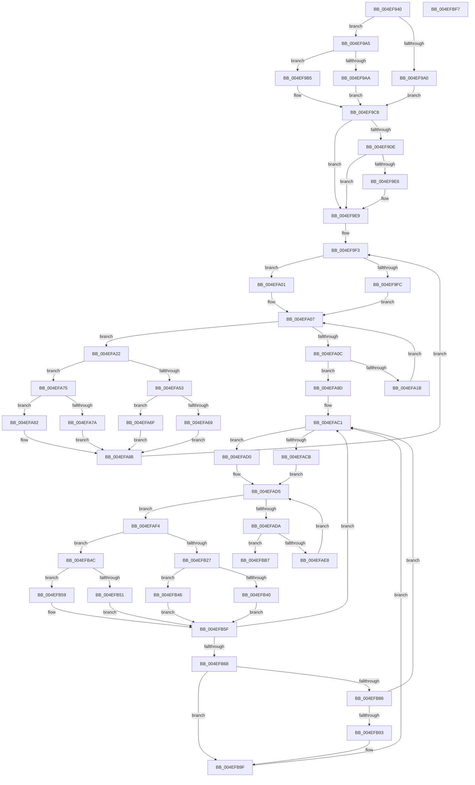

# PpmHeteroRestrictToFavoredClassEx

- RVA: `0x004EF940`–`0x004EFBF8` (길이 `696` bytes)
- VA: `0x00000001404EF940`
- 실행 섹션: `.text`
- PDB 이름 있음: `예`; PDB Function 태그: `아니요`
- unwind 정보 RVA: `0x000B2818`
- 디코드: `193`개 명령, `696/696` bytes 표시
- 미해석 바이트: `0` (있으면 어셈블리에 `.byte`로 보존)

> 이 문서는 커널 이미지의 기계어와 PDB 기호를 분석해 생성했습니다. 4번과 5번은 함수 원형과 자료형을 바이너리 사용 방식에서 추정한 C 해석이며 원본 소스 복구 결과는 아닙니다.

## 1. Dependencies

- 직접 호출 지점: **6**; 고유 호출 대상: **4**
- 직접 호출자로 확인된 함수: **1**
- RIP 상대 이미지 참조: **8**

### Outgoing calls
- `0x004EF987` → [memset](../6C/memset_function_006C6C40.md) (function, `0x006C6C40`)
- `0x004EFA44` → [KeGetPrcb](../2D/KeGetPrcb_function_002D85D0.md) (function, `0x002D85D0`)
- `0x004EFAB3` → [memset](../6C/memset_function_006C6C40.md) (function, `0x006C6C40`)
- `0x004EFB18` → [KeGetPrcb](../2D/KeGetPrcb_function_002D85D0.md) (function, `0x002D85D0`)
- `0x004EFBC3` → [KiCopyAffinityEx](../2C/KiCopyAffinityEx_function_002CE860.md) (function, `0x002CE860`)
- `0x004EFBD7` → [_security_check_cookie](../6A/_security_check_cookie_function_006AC640.md) (function, `0x006AC640`)

### Direct callers
- [PpmParkComputeUnparkMaskEx](../5E/PpmParkComputeUnparkMaskEx_function_005E05E0.md) at `0x005E0D84`

### Static image references
- `0x004EF95C` → RVA `0x00E0A740` (`.data`; read)
- `0x004EF98C` → RVA `0x00FC6B40` (`ALMOSTRO`; read)
- `0x004EF9C8` → RVA `0x00FC5038` (`ALMOSTRO`; read)
- `0x004EF9D6` → RVA `0x00FC6A86` (`ALMOSTRO`; read)
- `0x004EFA38` → RVA `0x00F231B8` (`.data`; read)
- `0x004EFA53` → RVA `0x00E0B804` (`.data`; read)
- `0x004EFA5A` → RVA `0x00FC6BC8` (`ALMOSTRO`; read)
- `0x004EFB68` → RVA `0x00F231B0` (`.data`; read)

## 2. Other-region calls and transfers

- 다른 실행 섹션으로 향하는 call: **0**
- 별도 외부 분기/꼬리 이동을 확인하지 못했습니다.

## 3. Assembly (complete function range)

```asm
004EF940  48 89 5C 24 18                  mov qword ptr [rsp + 0x18], rbx
004EF945  55                              push rbp
004EF946  56                              push rsi
004EF947  57                              push rdi
004EF948  41 54                           push r12
004EF94A  41 55                           push r13
004EF94C  41 56                           push r14
004EF94E  41 57                           push r15
004EF950  48 8D 6C 24 B0                  lea rbp, [rsp - 0x50]
004EF955  48 81 EC 50 01 00 00            sub rsp, 0x150
004EF95C  48 8B 05 DD AD 91 00            mov rax, qword ptr [rip + 0x91addd]
004EF963  48 33 C4                        xor rax, rsp
004EF966  48 89 45 40                     mov qword ptr [rbp + 0x40], rax
004EF96A  41 0F B6 F0                     movzx esi, r8b
004EF96E  48 8B D9                        mov rbx, rcx
004EF971  48 89 54 24 28                  mov qword ptr [rsp + 0x28], rdx
004EF976  48 8D 4C 24 30                  lea rcx, [rsp + 0x30]
004EF97B  33 D2                           xor edx, edx
004EF97D  41 0F B6 F9                     movzx edi, r9b
004EF981  41 B8 08 01 00 00               mov r8d, 0x108
004EF987  E8 B4 72 1D 00                  call 0x1406c6c40
004EF98C  8B 05 AE 71 AD 00               mov eax, dword ptr [rip + 0xad71ae]
004EF992  33 D2                           xor edx, edx
004EF994  44 8B EA                        mov r13d, edx
004EF997  44 8D 42 01                     lea r8d, [rdx + 1]
004EF99B  83 F8 03                        cmp eax, 3
004EF99E  75 05                           jne 0x1404ef9a5
004EF9A0  41 8A C8                        mov cl, r8b
004EF9A3  EB 23                           jmp 0x1404ef9c8
004EF9A5  83 F8 06                        cmp eax, 6
004EF9A8  75 0B                           jne 0x1404ef9b5
004EF9AA  39 95 C0 00 00 00               cmp dword ptr [rbp + 0xc0], edx
004EF9B0  0F 97 C1                        seta cl
004EF9B3  EB 13                           jmp 0x1404ef9c8
004EF9B5  8B 85 B0 00 00 00               mov eax, dword ptr [rbp + 0xb0]
004EF9BB  39 85 B8 00 00 00               cmp dword ptr [rbp + 0xb8], eax
004EF9C1  0F B6 CA                        movzx ecx, dl
004EF9C4  41 0F 42 C8                     cmovb ecx, r8d
004EF9C8  39 15 6A 56 AD 00               cmp dword ptr [rip + 0xad566a], edx
004EF9CE  44 0F B6 F1                     movzx r14d, cl
004EF9D2  45 0F 44 F0                     cmove r14d, r8d
004EF9D6  38 15 AA 70 AD 00               cmp byte ptr [rip + 0xad70aa], dl
004EF9DC  74 0B                           je 0x1404ef9e9
004EF9DE  44 8B EE                        mov r13d, esi
004EF9E1  45 84 F6                        test r14b, r14b
004EF9E4  75 03                           jne 0x1404ef9e9
004EF9E6  44 8B EF                        mov r13d, edi
004EF9E9  4C 8B 7B 08                     mov r15, qword ptr [rbx + 8]
004EF9ED  40 8A F2                        mov sil, dl
004EF9F0  0F B7 FA                        movzx edi, dx
004EF9F3  44 0F B6 E6                     movzx r12d, sil
004EF9F7  48 85 DB                        test rbx, rbx
004EF9FA  74 05                           je 0x1404efa01
004EF9FC  0F B7 0B                        movzx ecx, word ptr [rbx]
004EF9FF  EB 06                           jmp 0x1404efa07
004EFA01  0F B7 CF                        movzx ecx, di
004EFA04  41 03 C8                        add ecx, r8d
004EFA07  4D 85 FF                        test r15, r15
004EFA0A  75 16                           jne 0x1404efa22
004EFA0C  66 41 03 F8                     add di, r8w
004EFA10  0F B7 FF                        movzx edi, di
004EFA13  3B F9                           cmp edi, ecx
004EFA15  0F 83 82 00 00 00               jae 0x1404efa9d
004EFA1B  4C 8B 7C FB 08                  mov r15, qword ptr [rbx + rdi*8 + 8]
004EFA20  EB E5                           jmp 0x1404efa07
004EFA22  49 0F BC D7                     bsf rdx, r15
004EFA26  0F B7 CF                        movzx ecx, di
004EFA29  0F B6 C2                        movzx eax, dl
004EFA2C  C1 E1 06                        shl ecx, 6
004EFA2F  49 0F B3 C7                     btr r15, rax
004EFA33  0F B6 C2                        movzx eax, dl
004EFA36  03 C8                           add ecx, eax
004EFA38  48 8B 05 79 37 A3 00            mov rax, qword ptr [rip + 0xa33779]
004EFA3F  8B 34 88                        mov esi, dword ptr [rax + rcx*4]
004EFA42  8B CE                           mov ecx, esi
004EFA44  E8 87 8B DE FF                  call 0x1402d85d0
004EFA49  33 D2                           xor edx, edx
004EFA4B  38 15 35 70 AD 00               cmp byte ptr [rip + 0xad7035], dl
004EFA51  74 22                           je 0x1404efa75
004EFA53  0F AF 35 AA BD 91 00            imul esi, dword ptr [rip + 0x91bdaa]
004EFA5A  48 8B 0D 67 71 AD 00            mov rcx, qword ptr [rip + 0xad7167]
004EFA61  41 03 F5                        add esi, r13d
004EFA64  45 84 F6                        test r14b, r14b
004EFA67  74 06                           je 0x1404efa6f
004EFA69  8A 44 B1 19                     mov al, byte ptr [rcx + rsi*4 + 0x19]
004EFA6D  EB 19                           jmp 0x1404efa88
004EFA6F  8A 44 B1 18                     mov al, byte ptr [rcx + rsi*4 + 0x18]
004EFA73  EB 13                           jmp 0x1404efa88
004EFA75  45 84 F6                        test r14b, r14b
004EFA78  74 08                           je 0x1404efa82
004EFA7A  8A 80 09 8A 00 00               mov al, byte ptr [rax + 0x8a09]
004EFA80  EB 06                           jmp 0x1404efa88
004EFA82  8A 80 0A 8A 00 00               mov al, byte ptr [rax + 0x8a0a]
004EFA88  0F B6 F0                        movzx esi, al
004EFA8B  41 B8 01 00 00 00               mov r8d, 1
004EFA91  44 3A E6                        cmp r12b, sil
004EFA94  41 0F 47 F4                     cmova esi, r12d
004EFA98  E9 56 FF FF FF                  jmp 0x1404ef9f3
004EFA9D  33 D2                           xor edx, edx
004EFA9F  48 C7 44 24 30 01 00 20 00      mov qword ptr [rsp + 0x30], 0x200001
004EFAA8  41 B8 00 01 00 00               mov r8d, 0x100
004EFAAE  48 8D 4C 24 38                  lea rcx, [rsp + 0x38]
004EFAB3  E8 88 71 1D 00                  call 0x1406c6c40
004EFAB8  4C 8B 7B 08                     mov r15, qword ptr [rbx + 8]
004EFABC  33 D2                           xor edx, edx
004EFABE  0F B7 FA                        movzx edi, dx
004EFAC1  B8 01 00 00 00                  mov eax, 1
004EFAC6  48 85 DB                        test rbx, rbx
004EFAC9  74 05                           je 0x1404efad0
004EFACB  0F B7 0B                        movzx ecx, word ptr [rbx]
004EFACE  EB 05                           jmp 0x1404efad5
004EFAD0  0F B7 CF                        movzx ecx, di
004EFAD3  03 C8                           add ecx, eax
004EFAD5  4D 85 FF                        test r15, r15
004EFAD8  75 1A                           jne 0x1404efaf4
004EFADA  66 03 F8                        add di, ax
004EFADD  0F B7 FF                        movzx edi, di
004EFAE0  3B F9                           cmp edi, ecx
004EFAE2  0F 83 CF 00 00 00               jae 0x1404efbb7
004EFAE8  4C 8B 7C FB 08                  mov r15, qword ptr [rbx + rdi*8 + 8]
004EFAED  B8 01 00 00 00                  mov eax, 1
004EFAF2  EB E1                           jmp 0x1404efad5
004EFAF4  49 0F BC D7                     bsf rdx, r15
004EFAF8  0F B7 CF                        movzx ecx, di
004EFAFB  0F B6 C2                        movzx eax, dl
004EFAFE  C1 E1 06                        shl ecx, 6
004EFB01  49 0F B3 C7                     btr r15, rax
004EFB05  0F B6 C2                        movzx eax, dl
004EFB08  03 C8                           add ecx, eax
004EFB0A  48 8B 05 A7 36 A3 00            mov rax, qword ptr [rip + 0xa336a7]
004EFB11  44 8B 24 88                     mov r12d, dword ptr [rax + rcx*4]
004EFB15  41 8B CC                        mov ecx, r12d
004EFB18  E8 B3 8A DE FF                  call 0x1402d85d0
004EFB1D  33 D2                           xor edx, edx
004EFB1F  38 15 61 6F AD 00               cmp byte ptr [rip + 0xad6f61], dl
004EFB25  74 25                           je 0x1404efb4c
004EFB27  48 8B 0D 9A 70 AD 00            mov rcx, qword ptr [rip + 0xad709a]
004EFB2E  41 8B C4                        mov eax, r12d
004EFB31  0F AF 05 CC BC 91 00            imul eax, dword ptr [rip + 0x91bccc]
004EFB38  41 03 C5                        add eax, r13d
004EFB3B  45 84 F6                        test r14b, r14b
004EFB3E  74 06                           je 0x1404efb46
004EFB40  8A 44 81 19                     mov al, byte ptr [rcx + rax*4 + 0x19]
004EFB44  EB 19                           jmp 0x1404efb5f
004EFB46  8A 44 81 18                     mov al, byte ptr [rcx + rax*4 + 0x18]
004EFB4A  EB 13                           jmp 0x1404efb5f
004EFB4C  45 84 F6                        test r14b, r14b
004EFB4F  74 08                           je 0x1404efb59
004EFB51  8A 80 09 8A 00 00               mov al, byte ptr [rax + 0x8a09]
004EFB57  EB 06                           jmp 0x1404efb5f
004EFB59  8A 80 0A 8A 00 00               mov al, byte ptr [rax + 0x8a0a]
004EFB5F  40 3A C6                        cmp al, sil
004EFB62  0F 85 59 FF FF FF               jne 0x1404efac1
004EFB68  48 8B 05 41 36 A3 00            mov rax, qword ptr [rip + 0xa33641]
004EFB6F  46 8B 04 A0                     mov r8d, dword ptr [rax + r12*4]
004EFB73  41 8B C8                        mov ecx, r8d
004EFB76  0F B7 44 24 30                  movzx eax, word ptr [rsp + 0x30]
004EFB7B  41 83 E0 3F                     and r8d, 0x3f
004EFB7F  C1 E9 06                        shr ecx, 6
004EFB82  3B C1                           cmp eax, ecx
004EFB84  77 19                           ja 0x1404efb9f
004EFB86  0F B7 44 24 32                  movzx eax, word ptr [rsp + 0x32]
004EFB8B  3B C1                           cmp eax, ecx
004EFB8D  0F 86 2E FF FF FF               jbe 0x1404efac1
004EFB93  B8 01 00 00 00                  mov eax, 1
004EFB98  03 C1                           add eax, ecx
004EFB9A  66 89 44 24 30                  mov word ptr [rsp + 0x30], ax
004EFB9F  8B D1                           mov edx, ecx
004EFBA1  48 8B 4C CC 38                  mov rcx, qword ptr [rsp + rcx*8 + 0x38]
004EFBA6  41 8B C0                        mov eax, r8d
004EFBA9  48 0F AB C1                     bts rcx, rax
004EFBAD  48 89 4C D4 38                  mov qword ptr [rsp + rdx*8 + 0x38], rcx
004EFBB2  E9 0A FF FF FF                  jmp 0x1404efac1
004EFBB7  0F B7 53 02                     movzx edx, word ptr [rbx + 2]
004EFBBB  4C 8D 44 24 30                  lea r8, [rsp + 0x30]
004EFBC0  48 8B CB                        mov rcx, rbx
004EFBC3  E8 98 EC DD FF                  call 0x1402ce860
004EFBC8  48 8B 44 24 28                  mov rax, qword ptr [rsp + 0x28]
004EFBCD  40 88 30                        mov byte ptr [rax], sil
004EFBD0  48 8B 4D 40                     mov rcx, qword ptr [rbp + 0x40]
004EFBD4  48 33 CC                        xor rcx, rsp
004EFBD7  E8 64 CA 1B 00                  call 0x1406ac640
004EFBDC  48 8B 9C 24 A0 01 00 00         mov rbx, qword ptr [rsp + 0x1a0]
004EFBE4  48 81 C4 50 01 00 00            add rsp, 0x150
004EFBEB  41 5F                           pop r15
004EFBED  41 5E                           pop r14
004EFBEF  41 5D                           pop r13
004EFBF1  41 5C                           pop r12
004EFBF3  5F                              pop rdi
004EFBF4  5E                              pop rsi
004EFBF5  5D                              pop rbp
004EFBF6  C3                              ret
004EFBF7  CC                              int3
```

## 4. C-style interpretation (structured pseudocode)

```c
__int64 __fastcall PpmHeteroRestrictToFavoredClassEx(__int64 a1, __int64 a2, unsigned __int8 a3, unsigned __int8 a4, unsigned int a5, unsigned int a6, unsigned int a7)
{
    __int64 result;
    __int64 v_r13;
    __int64 v_r14;
    __int64 v_rdi;
    __int64 v_rsi;
    __int64 v_rsp;
    unsigned __int64 v_stack_m150;
    unsigned __int16 v_stack_m156;
    unsigned __int64 v_stack_m158;
    unsigned __int64 v_stack_m160;
    unsigned __int64 v_stack_m48;
    unsigned __int64 v_stack_m88;
    unsigned __int64 v_stack_p18;

    v_stack_p18 = v_rbx;
    v_rsp = (v_rsp) - (336);
    result = (*(unsigned __int64 *)(v_rip + 9547229)) ^ (v_rsp);
    v_stack_m48 = result;
    v_stack_m160 = a2;
    a2 = 0;
    result = memset(v_stack_m158, a2, 264, a4);
    a2 = 0;
    if (((unsigned int)((unsigned int)(*(unsigned int *)(v_rip + 11366830)))) != 3) goto loc_004EF9A5;
    goto loc_004EF9C8;
loc_004EF9A5:
    if (((unsigned int)((unsigned int)(*(unsigned int *)(v_rip + 11366830)))) != 6) goto loc_004EF9B5;
    a1 = (a7 > 0) ? 1 : 0;
    goto loc_004EF9C8;
loc_004EF9B5:
    a1 = 0;
    if (a6 < ((unsigned int)((unsigned int)(a5)))) { a1 = (unsigned int)(a2 + 1); }
loc_004EF9C8:
    v_r14 = (unsigned __int8)(a1);
    if ((*(unsigned int *)(v_rip + 11359850)) == 0) { v_r14 = (unsigned int)(a2 + 1); }
    if ((*(unsigned __int8 *)(v_rip + 11366570)) == 0) goto loc_004EF9E9;
    v_r13 = (unsigned int)(a3);
    if ((unsigned __int8)(v_r14) == 0) {
        v_r13 = a4;
    }
loc_004EF9F3:
    if (a1 == 0) goto loc_004EFA01;
    goto loc_004EFA07;
loc_004EFA01:
    a1 = (unsigned int)((0) + ((unsigned int)(a2 + 1)));
loc_004EFA07:
    if (*(unsigned __int64 *)(a1 + 8) != 0) goto loc_004EFA22;
    v_rdi = (unsigned __int16)((0) + ((unsigned __int16)(a2 + 1)));
    if (((unsigned int)((unsigned __int16)(v_rdi))) >= ((unsigned int)(a1))) goto loc_004EFA9D;
    goto loc_004EFA07;
loc_004EFA22:
    a1 = (unsigned int)(((unsigned __int16)((unsigned __int16)(v_rdi))) << (6));
    a1 = (unsigned int)((a1) + (0));
    result = KeGetPrcb((unsigned int)((unsigned int)((unsigned int)(*(unsigned int *)(*(unsigned __int64 *)(v_rip + 10696569) + a1 * 4)))), a2, a2 + 1, a4);
    a2 = 0;
    if ((*(unsigned __int8 *)(v_rip + 11366453)) == 0) goto loc_004EFA75;
    v_rsi = (unsigned int)(((unsigned int)(*(unsigned int *)(*(unsigned __int64 *)(v_rip + 10696569) + a1 * 4))) * (*(unsigned int *)(v_rip + 9551274)));
    v_rsi = (unsigned int)((v_rsi) + ((unsigned int)(v_r13)));
    if ((unsigned __int8)(v_r14) == 0) goto loc_004EFA6F;
    goto loc_004EFA88;
loc_004EFA6F:
    goto loc_004EFA88;
loc_004EFA75:
    if ((unsigned __int8)(v_r14) == 0) goto loc_004EFA82;
    goto loc_004EFA88;
loc_004EFA82:
loc_004EFA88:
    v_rsi = (unsigned __int8)(*(unsigned __int8 *)(*(unsigned __int8 *)(*(unsigned __int8 *)(*(unsigned __int64 *)(v_rip + 11366759) + v_rsi * 4 + 24) + 35337) + 35338));
    if (0 > ((unsigned __int8)((unsigned __int8)(*(unsigned __int8 *)(*(unsigned __int8 *)(*(unsigned __int8 *)(*(unsigned __int64 *)(v_rip + 11366759) + v_rsi * 4 + 24) + 35337) + 35338))))) { v_rsi = 0; }
    goto loc_004EF9F3;
loc_004EFA9D:
    a2 = 0;
    v_stack_m158 = 0x200001ULL;
    result = memset(v_stack_m150, a2, 256, a4);
    a2 = 0;
loc_004EFAC1:
    if (a1 == 0) goto loc_004EFAD0;
    goto loc_004EFAD5;
loc_004EFAD0:
    a1 = (unsigned int)((0) + (1));
loc_004EFAD5:
    if (*(unsigned __int64 *)(a1 + 8) != 0) goto loc_004EFAF4;
    v_rdi = (unsigned __int16)((0) + (1));
    if (((unsigned int)((unsigned __int16)(v_rdi))) >= ((unsigned int)(a1))) goto loc_004EFBB7;
    goto loc_004EFAD5;
loc_004EFAF4:
    a1 = (unsigned int)(((unsigned __int16)((unsigned __int16)(v_rdi))) << (6));
    a1 = (unsigned int)((a1) + (0));
    result = KeGetPrcb((unsigned int)((unsigned int)((unsigned int)(*(unsigned int *)(*(unsigned __int64 *)(v_rip + 10696359) + a1 * 4)))), a2, 256, a4);
    a2 = 0;
    if ((*(unsigned __int8 *)(v_rip + 11366241)) == 0) goto loc_004EFB4C;
    result = (unsigned int)(((unsigned int)((unsigned int)((unsigned int)(*(unsigned int *)(*(unsigned __int64 *)(v_rip + 10696359) + a1 * 4))))) * (*(unsigned int *)(v_rip + 9551052)));
    result = (unsigned int)((result) + ((unsigned int)(v_r13)));
    if ((unsigned __int8)(v_r14) == 0) goto loc_004EFB46;
    goto loc_004EFB5F;
loc_004EFB46:
    goto loc_004EFB5F;
loc_004EFB4C:
    if ((unsigned __int8)(v_r14) == 0) goto loc_004EFB59;
    goto loc_004EFB5F;
loc_004EFB59:
loc_004EFB5F:
    if (((unsigned __int8)(*(unsigned __int8 *)(*(unsigned __int8 *)(*(unsigned __int8 *)(*(unsigned __int64 *)(v_rip + 11366554) + *(unsigned __int8 *)(*(unsigned __int64 *)(v_rip + 11366554) + result * 4 + 25) * 4 + 24) + 35337) + 35338))) != ((unsigned __int8)(v_rsi))) goto loc_004EFAC1;
    a3 = (unsigned int)(((unsigned int)(*(unsigned int *)(*(unsigned __int64 *)(v_rip + 10696257) + (unsigned int)(*(unsigned int *)(*(unsigned __int64 *)(v_rip + 10696359) + a1 * 4)) * 4))) & (63));
    a1 = (unsigned int)(((unsigned int)((unsigned int)((unsigned int)(*(unsigned int *)(*(unsigned __int64 *)(v_rip + 10696257) + (unsigned int)(*(unsigned int *)(*(unsigned __int64 *)(v_rip + 10696359) + a1 * 4)) * 4))))) >> (6));
    if (((unsigned int)(v_stack_m158)) > ((unsigned int)(a1))) goto loc_004EFB9F;
    if (((unsigned int)(v_stack_m156)) <= ((unsigned int)(a1))) goto loc_004EFAC1;
    result = (unsigned int)((1) + ((unsigned int)(a1)));
    v_stack_m158 = (unsigned __int16)(result);
loc_004EFB9F:
    *(unsigned __int64 *)(v_rsp + (unsigned int)((unsigned int)(a1)) * 8 + 56) = *(unsigned __int64 *)(v_rsp + a1 * 8 + 56);
    goto loc_004EFAC1;
loc_004EFBB7:
    result = KiCopyAffinityEx(a1, *(unsigned __int16 *)(a1 + 2), v_stack_m158, a4);
    *(unsigned __int8 *)(v_stack_m160) = (unsigned __int8)(v_rsi);
    a1 = (v_stack_m48) ^ (v_rsp);
    result = _security_check_cookie(a1, *(unsigned __int16 *)(a1 + 2), v_stack_m158, a4);
    v_rsp = (v_rsp) + (336);
    return result;
}
```

## 5. (Beta) C Style

```c
int64_t PpmHeteroRestrictToFavoredClassEx(void *Arg1, int64_t Arg2, uint8_t Arg3, uint8_t Arg4, uint32_t Arg5, uint32_t Arg6, uint32_t Arg7)
{
    uint8_t *arg1 = (uint8_t *)Arg1;

    int64_t result;
    int64_t local_r13;
    int64_t local_r14;
    int64_t local_rdi;
    int64_t local_rsi;
    int64_t local_rsp;
    uint64_t v_stack_m150;
    uint16_t v_stack_m156;
    uint64_t v_stack_m158;
    uint64_t v_stack_m160;
    uint64_t v_stack_m48;
    uint64_t v_stack_m88;
    uint64_t v_stack_p18;

    v_stack_p18 = local_rbx;
    local_rsp = (local_rsp) - (336);
    result = (*(uint64_t *)(v_rip + 0x91ADDD)) ^ (local_rsp);
    v_stack_m48 = result;
    v_stack_m160 = Arg2;
    Arg2 = 0;
    result = memset(v_stack_m158, Arg2, 264, Arg4);
    Arg2 = 0;
    if (((uint32_t)((uint32_t)(*(uint32_t *)(v_rip + 0xAD71AE)))) != 3) goto loc_004EF9A5;
    goto loc_004EF9C8;
loc_004EF9A5:
    if (((uint32_t)((uint32_t)(*(uint32_t *)(v_rip + 0xAD71AE)))) != 6) goto loc_004EF9B5;
    Arg1 = (Arg7 > 0) ? 1 : 0;
    goto loc_004EF9C8;
loc_004EF9B5:
    Arg1 = 0;
    if (Arg6 < ((uint32_t)((uint32_t)(Arg5)))) { Arg1 = (uint32_t)(Arg2 + 1); }
loc_004EF9C8:
    local_r14 = (uint8_t)(Arg1);
    if ((*(uint32_t *)(v_rip + 0xAD566A)) == 0) { local_r14 = (uint32_t)(Arg2 + 1); }
    if ((*(uint8_t *)(v_rip + 0xAD70AA)) == 0) goto loc_004EF9E9;
    local_r13 = (uint32_t)(Arg3);
    if ((uint8_t)(local_r14) == 0) {
        local_r13 = Arg4;
    }
loc_004EF9F3:
    if (Arg1 == NULL) goto loc_004EFA01;
    goto loc_004EFA07;
loc_004EFA01:
    Arg1 = (uint32_t)((0) + ((uint32_t)(Arg2 + 1)));
loc_004EFA07:
    if (*(uint64_t *)(arg1 + 0x8) != 0) goto loc_004EFA22;
    local_rdi = (uint16_t)((0) + ((uint16_t)(Arg2 + 1)));
    if (((uint32_t)((uint16_t)(local_rdi))) >= ((uint32_t)(Arg1))) goto loc_004EFA9D;
    goto loc_004EFA07;
loc_004EFA22:
    Arg1 = (uint32_t)(((uint16_t)((uint16_t)(local_rdi))) << (6));
    Arg1 = (uint32_t)((Arg1) + (0));
    result = KeGetPrcb((uint32_t)((uint32_t)((uint32_t)(*(uint32_t *)(*(uint64_t *)(v_rip + 0xA33779) + arg1 * 4)))), Arg2, Arg2 + 1, Arg4);
    Arg2 = 0;
    if ((*(uint8_t *)(v_rip + 0xAD7035)) == 0) goto loc_004EFA75;
    local_rsi = (uint32_t)(((uint32_t)(*(uint32_t *)(*(uint64_t *)(v_rip + 0xA33779) + arg1 * 4))) * (*(uint32_t *)(v_rip + 0x91BDAA)));
    local_rsi = (uint32_t)((local_rsi) + ((uint32_t)(local_r13)));
    if ((uint8_t)(local_r14) == 0) goto loc_004EFA6F;
    goto loc_004EFA88;
loc_004EFA6F:
    goto loc_004EFA88;
loc_004EFA75:
    if ((uint8_t)(local_r14) == 0) goto loc_004EFA82;
    goto loc_004EFA88;
loc_004EFA82:
loc_004EFA88:
    local_rsi = (uint8_t)(*(uint8_t *)(*(uint8_t *)(*(uint8_t *)(*(uint64_t *)(v_rip + 0xAD7167) + local_rsi * 4 + 0x18) + 0x8A09) + 0x8A0A));
    if (0 > ((uint8_t)((uint8_t)(*(uint8_t *)(*(uint8_t *)(*(uint8_t *)(*(uint64_t *)(v_rip + 0xAD7167) + local_rsi * 4 + 0x18) + 0x8A09) + 0x8A0A))))) { local_rsi = 0; }
    goto loc_004EF9F3;
loc_004EFA9D:
    Arg2 = 0;
    v_stack_m158 = 0x200001ULL;
    result = memset(v_stack_m150, Arg2, 256, Arg4);
    Arg2 = 0;
loc_004EFAC1:
    if (Arg1 == NULL) goto loc_004EFAD0;
    goto loc_004EFAD5;
loc_004EFAD0:
    Arg1 = (uint32_t)((0) + (1));
loc_004EFAD5:
    if (*(uint64_t *)(arg1 + 0x8) != 0) goto loc_004EFAF4;
    local_rdi = (uint16_t)((0) + (1));
    if (((uint32_t)((uint16_t)(local_rdi))) >= ((uint32_t)(Arg1))) goto loc_004EFBB7;
    goto loc_004EFAD5;
loc_004EFAF4:
    Arg1 = (uint32_t)(((uint16_t)((uint16_t)(local_rdi))) << (6));
    Arg1 = (uint32_t)((Arg1) + (0));
    result = KeGetPrcb((uint32_t)((uint32_t)((uint32_t)(*(uint32_t *)(*(uint64_t *)(v_rip + 0xA336A7) + arg1 * 4)))), Arg2, 256, Arg4);
    Arg2 = 0;
    if ((*(uint8_t *)(v_rip + 0xAD6F61)) == 0) goto loc_004EFB4C;
    result = (uint32_t)(((uint32_t)((uint32_t)((uint32_t)(*(uint32_t *)(*(uint64_t *)(v_rip + 0xA336A7) + arg1 * 4))))) * (*(uint32_t *)(v_rip + 0x91BCCC)));
    result = (uint32_t)((result) + ((uint32_t)(local_r13)));
    if ((uint8_t)(local_r14) == 0) goto loc_004EFB46;
    goto loc_004EFB5F;
loc_004EFB46:
    goto loc_004EFB5F;
loc_004EFB4C:
    if ((uint8_t)(local_r14) == 0) goto loc_004EFB59;
    goto loc_004EFB5F;
loc_004EFB59:
loc_004EFB5F:
    if (((uint8_t)(*(uint8_t *)(*(uint8_t *)(*(uint8_t *)(*(uint64_t *)(v_rip + 0xAD709A) + *(uint8_t *)(*(uint64_t *)(v_rip + 0xAD709A) + result * 4 + 0x19) * 4 + 0x18) + 0x8A09) + 0x8A0A))) != ((uint8_t)(local_rsi))) goto loc_004EFAC1;
    Arg3 = (uint32_t)(((uint32_t)(*(uint32_t *)(*(uint64_t *)(v_rip + 0xA33641) + (uint32_t)(*(uint32_t *)(*(uint64_t *)(v_rip + 0xA336A7) + arg1 * 4)) * 4))) & (63));
    Arg1 = (uint32_t)(((uint32_t)((uint32_t)((uint32_t)(*(uint32_t *)(*(uint64_t *)(v_rip + 0xA33641) + (uint32_t)(*(uint32_t *)(*(uint64_t *)(v_rip + 0xA336A7) + arg1 * 4)) * 4))))) >> (6));
    if (((uint32_t)(v_stack_m158)) > ((uint32_t)(Arg1))) goto loc_004EFB9F;
    if (((uint32_t)(v_stack_m156)) <= ((uint32_t)(Arg1))) goto loc_004EFAC1;
    result = (uint32_t)((1) + ((uint32_t)(Arg1)));
    v_stack_m158 = (uint16_t)(result);
loc_004EFB9F:
    *(uint64_t *)(local_rsp + (uint32_t)((uint32_t)(arg1)) * 8 + 0x38) = *(uint64_t *)(local_rsp + arg1 * 8 + 0x38);
    goto loc_004EFAC1;
loc_004EFBB7:
    result = KiCopyAffinityEx(Arg1, *(uint16_t *)(arg1 + 0x2), v_stack_m158, Arg4);
    *(uint8_t *)(v_stack_m160) = (uint8_t)(local_rsi);
    Arg1 = (v_stack_m48) ^ (local_rsp);
    result = _security_check_cookie(Arg1, *(uint16_t *)(arg1 + 0x2), v_stack_m158, Arg4);
    local_rsp = (local_rsp) + (336);
    return result;
}
```

### 관측된 메모리 오프셋

구조체 형식이 확인되지 않은 접근은 인자 기준의 오프셋으로만 기록했습니다.

| 기준 인자 | 오프셋 표현 | 폭 (bit) | 접근 |
|---|---:|---:|---|
| `Arg1` | `+ 0x8` | `64` | `R` |

## 6. Execution-region graph

[열기: 2D/3D 그래프와 함수 탐색 컨트롤 패널](../../../control-panel.html?section=text&rva=0x004EF940&view=graph)

- 2D 그래프는 위에서 아래로 흐르고, 3D 그래프는 빈 공간을 드래그해 회전합니다. Shift+드래그는 이동, 휠은 확대·축소, 함수 노드 선택은 대상 보고서 이동입니다.

### Static fallback


