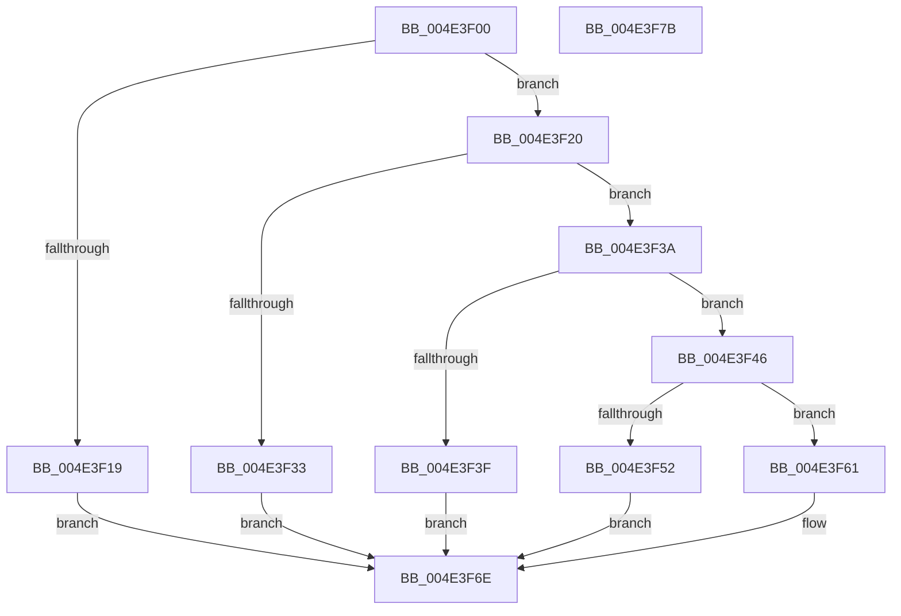

# PpmInternalProcessorIdleVeto

- RVA: `0x004E3F00`–`0x004E3F7C` (길이 `124` bytes)
- VA: `0x00000001404E3F00`
- 실행 섹션: `.text`
- PDB 이름 있음: `예`; PDB Function 태그: `아니요`
- unwind 정보 RVA: `0x0005CAAC`
- 디코드: `33`개 명령, `124/124` bytes 표시
- 미해석 바이트: `0` (있으면 어셈블리에 `.byte`로 보존)

> 이 문서는 커널 이미지의 기계어와 PDB 기호를 분석해 생성했습니다. 4번과 5번은 함수 원형과 자료형을 바이너리 사용 방식에서 추정한 C 해석이며 원본 소스 복구 결과는 아닙니다.

## 1. Dependencies

- 직접 호출 지점: **1**; 고유 호출 대상: **1**
- 직접 호출자로 확인된 함수: **1**
- RIP 상대 이미지 참조: **1**

### Outgoing calls
- `0x004E3F20` → [KeGetPrcb](../2D/KeGetPrcb_function_002D85D0.md) (function, `0x002D85D0`)

### Direct callers
- [PopPowerInformationInternal](../../page/A8/PopPowerInformationInternal_function_00A8B7C0.md) at `0x00A8C59D`

### Static image references
- `0x004E3F0A` → RVA `0x00FC6A80` (`ALMOSTRO`; read)

## 2. Other-region calls and transfers

- 다른 실행 섹션으로 향하는 call: **0**
- 별도 외부 분기/꼬리 이동을 확인하지 못했습니다.

## 3. Assembly (complete function range)

```asm
004E3F00  48 89 5C 24 08                  mov qword ptr [rsp + 8], rbx
004E3F05  57                              push rdi
004E3F06  48 83 EC 20                     sub rsp, 0x20
004E3F0A  8B 05 70 2B AE 00               mov eax, dword ptr [rip + 0xae2b70]
004E3F10  41 8A F8                        mov dil, r8b
004E3F13  8B DA                           mov ebx, edx
004E3F15  3B C8                           cmp ecx, eax
004E3F17  72 07                           jb 0x1404e3f20
004E3F19  B9 EF 00 00 C0                  mov ecx, 0xc00000ef
004E3F1E  EB 4E                           jmp 0x1404e3f6e
004E3F20  E8 AB 46 DF FF                  call 0x1402d85d0
004E3F25  33 C9                           xor ecx, ecx
004E3F27  48 8B 90 40 88 00 00            mov rdx, qword ptr [rax + 0x8840]
004E3F2E  48 85 D2                        test rdx, rdx
004E3F31  75 07                           jne 0x1404e3f3a
004E3F33  B9 AB 00 00 C0                  mov ecx, 0xc00000ab
004E3F38  EB 34                           jmp 0x1404e3f6e
004E3F3A  3B 5A 28                        cmp ebx, dword ptr [rdx + 0x28]
004E3F3D  72 07                           jb 0x1404e3f46
004E3F3F  B9 F0 00 00 C0                  mov ecx, 0xc00000f0
004E3F44  EB 28                           jmp 0x1404e3f6e
004E3F46  4C 69 C3 58 01 00 00            imul r8, rbx, 0x158
004E3F4D  40 84 FF                        test dil, dil
004E3F50  74 0F                           je 0x1404e3f61
004E3F52  F0 41 81 8C 10 48 05 00 00 00 00 00 80  lock or dword ptr [r8 + rdx + 0x548], 0x80000000
004E3F5F  EB 0D                           jmp 0x1404e3f6e
004E3F61  F0 41 81 A4 10 48 05 00 00 FF FF FF 7F  lock and dword ptr [r8 + rdx + 0x548], 0x7fffffff
004E3F6E  48 8B 5C 24 30                  mov rbx, qword ptr [rsp + 0x30]
004E3F73  8B C1                           mov eax, ecx
004E3F75  48 83 C4 20                     add rsp, 0x20
004E3F79  5F                              pop rdi
004E3F7A  C3                              ret
004E3F7B  CC                              int3
```

## 4. C-style interpretation (structured pseudocode)

```c
__int64 __fastcall PpmInternalProcessorIdleVeto(int a1, int a2, unsigned __int8 a3)
{
    __int64 result;
    __int64 v_rsp;
    unsigned __int64 v_stack_p8;

    v_stack_p8 = v_rbx;
    v_rsp = (v_rsp) - (32);
    if (a1 < ((unsigned int)((unsigned int)(*(unsigned int *)(v_rip + 11414384))))) goto loc_004E3F20;
    goto loc_004E3F6E;
loc_004E3F20:
    result = KeGetPrcb((unsigned int)(0xC00000EFULL), a2, a3, a4);
    a1 = 0;
    if (*(unsigned __int64 *)(result + 34880) != 0) goto loc_004E3F3A;
    goto loc_004E3F6E;
loc_004E3F3A:
    if (((unsigned int)((unsigned int)(a2))) < (*(unsigned int *)(*(unsigned __int64 *)(result + 34880) + 40))) goto loc_004E3F46;
    goto loc_004E3F6E;
loc_004E3F46:
    a3 = (a3) * ((unsigned int)(a2));
    if (a3 == 0) goto loc_004E3F61;
    goto loc_004E3F6E;
loc_004E3F61:
loc_004E3F6E:
    v_rsp = (v_rsp) + (32);
    return (unsigned int)((unsigned int)((unsigned int)(0xC00000F0ULL)));
}
```

## 5. (Beta) C Style

```c
int64_t PpmInternalProcessorIdleVeto(int32_t Arg1, int32_t Arg2, uint8_t Arg3)
{
    int64_t result;
    int64_t local_rsp;
    uint64_t v_stack_p8;

    v_stack_p8 = local_rbx;
    local_rsp = (local_rsp) - (32);
    if (Arg1 < ((uint32_t)((uint32_t)(*(uint32_t *)(v_rip + 0xAE2B70))))) goto loc_004E3F20;
    goto loc_004E3F6E;
loc_004E3F20:
    result = KeGetPrcb((uint32_t)(0xC00000EFULL), Arg2, Arg3, a4);
    Arg1 = 0;
    if (*(uint64_t *)(result + 0x8840) != 0) goto loc_004E3F3A;
    goto loc_004E3F6E;
loc_004E3F3A:
    if (((uint32_t)((uint32_t)(Arg2))) < (*(uint32_t *)(*(uint64_t *)(result + 0x8840) + 0x28))) goto loc_004E3F46;
    goto loc_004E3F6E;
loc_004E3F46:
    Arg3 = (Arg3) * ((uint32_t)(Arg2));
    if (Arg3 == 0) goto loc_004E3F61;
    goto loc_004E3F6E;
loc_004E3F61:
loc_004E3F6E:
    local_rsp = (local_rsp) + (32);
    return (uint32_t)((uint32_t)((uint32_t)(0xC00000F0ULL)));
}
```

## 6. Execution-region graph

[열기: 2D/3D 그래프와 함수 탐색 컨트롤 패널](../../../control-panel.html?section=text&rva=0x004E3F00&view=graph)

- 2D 그래프는 위에서 아래로 흐르고, 3D 그래프는 빈 공간을 드래그해 회전합니다. Shift+드래그는 이동, 휠은 확대·축소, 함수 노드 선택은 대상 보고서 이동입니다.

### Static fallback


