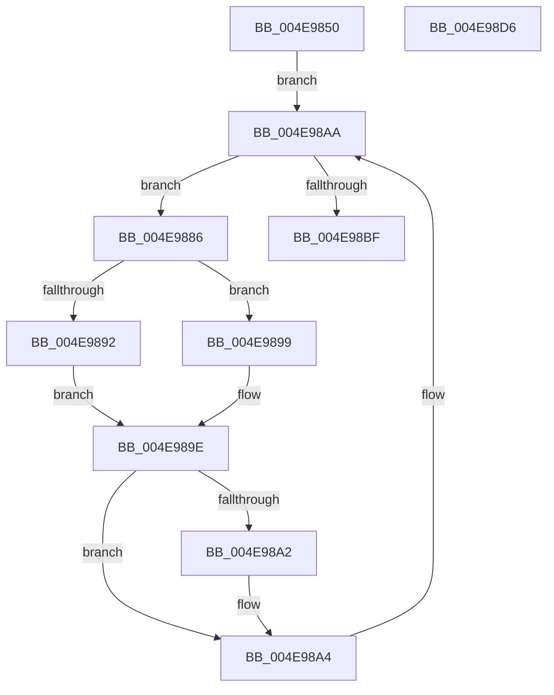

# PspExecuteJobFreezeThawCallback

- RVA: `0x004E9850`–`0x004E98D7` (길이 `135` bytes)
- VA: `0x00000001404E9850`
- 실행 섹션: `.text`
- PDB 이름 있음: `예`; PDB Function 태그: `아니요`
- unwind 정보 RVA: `0x0007D3C0`
- 디코드: `41`개 명령, `135/135` bytes 표시
- 미해석 바이트: `0` (있으면 어셈블리에 `.byte`로 보존)

> 이 문서는 커널 이미지의 기계어와 PDB 기호를 분석해 생성했습니다. 4번과 5번은 함수 원형과 자료형을 바이너리 사용 방식에서 추정한 C 해석이며 원본 소스 복구 결과는 아닙니다.

## 1. Dependencies

- 직접 호출 지점: **4**; 고유 호출 대상: **4**
- 직접 호출자로 확인된 함수: **0**
- RIP 상대 이미지 참조: **0**

### Outgoing calls
- `0x004E9886` → [Feature_ProcesDirectSwap__private_IsEnabledDeviceUsageNoInline](../5E/Feature_ProcesDirectSwap__private_IsEnabledDeviceUsageNoInline_function_005E3264.md) (function, `0x005E3264`)
- `0x004E9892` → [PspChangeProcessExecutionStateLegacy](../5E/PspChangeProcessExecutionStateLegacy_function_005E4098.md) (function, `0x005E4098`)
- `0x004E9899` → [PspChangeProcessExecutionState](../../page/AE/PspChangeProcessExecutionState_function_00AEC594.md) (function, `0x00AEC594`)
- `0x004E98B2` → [PspGetNextJobProcess](../../page/91/PspGetNextJobProcess_function_00918450.md) (function, `0x00918450`)

### Direct callers
- 이 함수 시작 RVA로 연결되는 직접 call은 확인되지 않았습니다. 간접 호출은 완전히 역산할 수 없습니다.

### Static image references
- 디코드된 RIP-relative 메모리 참조가 없습니다.

## 2. Other-region calls and transfers

- 다른 실행 섹션으로 향하는 call: **2**
  - `0x004E9899` → [PspChangeProcessExecutionState](../../page/AE/PspChangeProcessExecutionState_function_00AEC594.md) (`.text` → `PAGE`)
  - `0x004E98B2` → [PspGetNextJobProcess](../../page/91/PspGetNextJobProcess_function_00918450.md) (`.text` → `PAGE`)
- 별도 외부 분기/꼬리 이동을 확인하지 못했습니다.

## 3. Assembly (complete function range)

```asm
004E9850  4C 8B DC                        mov r11, rsp
004E9853  49 89 5B 08                     mov qword ptr [r11 + 8], rbx
004E9857  49 89 6B 10                     mov qword ptr [r11 + 0x10], rbp
004E985B  49 89 73 18                     mov qword ptr [r11 + 0x18], rsi
004E985F  57                              push rdi
004E9860  48 83 EC 40                     sub rsp, 0x40
004E9864  33 C0                           xor eax, eax
004E9866  0F 57 C0                        xorps xmm0, xmm0
004E9869  0F 11 44 24 20                  movups xmmword ptr [rsp + 0x20], xmm0
004E986E  49 89 43 E8                     mov qword ptr [r11 - 0x18], rax
004E9872  48 8B FA                        mov rdi, rdx
004E9875  65 48 8B 2C 25 88 01 00 00      mov rbp, qword ptr gs:[0x188]
004E987E  48 8B F1                        mov rsi, rcx
004E9881  45 33 C9                        xor r9d, r9d
004E9884  EB 24                           jmp 0x1404e98aa
004E9886  E8 D9 99 0F 00                  call 0x1405e3264
004E988B  48 8B CB                        mov rcx, rbx
004E988E  85 C0                           test eax, eax
004E9890  75 07                           jne 0x1404e9899
004E9892  E8 01 A8 0F 00                  call 0x1405e4098
004E9897  EB 05                           jmp 0x1404e989e
004E9899  E8 F6 2C 60 00                  call 0x140aec594
004E989E  85 C0                           test eax, eax
004E98A0  79 02                           jns 0x1404e98a4
004E98A2  89 07                           mov dword ptr [rdi], eax
004E98A4  4C 8B CB                        mov r9, rbx
004E98A7  48 8B CE                        mov rcx, rsi
004E98AA  4C 8D 44 24 20                  lea r8, [rsp + 0x20]
004E98AF  48 8B D5                        mov rdx, rbp
004E98B2  E8 99 EB 42 00                  call 0x140918450
004E98B7  48 8B D8                        mov rbx, rax
004E98BA  48 85 C0                        test rax, rax
004E98BD  75 C7                           jne 0x1404e9886
004E98BF  48 8B 5C 24 50                  mov rbx, qword ptr [rsp + 0x50]
004E98C4  33 C0                           xor eax, eax
004E98C6  48 8B 6C 24 58                  mov rbp, qword ptr [rsp + 0x58]
004E98CB  48 8B 74 24 60                  mov rsi, qword ptr [rsp + 0x60]
004E98D0  48 83 C4 40                     add rsp, 0x40
004E98D4  5F                              pop rdi
004E98D5  C3                              ret
004E98D6  CC                              int3
```

## 4. C-style interpretation (structured pseudocode)

```c
__int64 __fastcall PspExecuteJobFreezeThawCallback(__int64 a1, __int64 a2, __int64 a3, int a4)
{
    __int64 result;
    __int64 v_rsp;
    unsigned __int64 v_stack_m28;
    unsigned __int64 v_stack_p10;
    unsigned __int64 v_stack_p18;
    unsigned __int64 v_stack_p8;

    *(unsigned __int64 *)(v_rsp + 8) = v_rbx;
    *(unsigned __int64 *)(v_rsp + 16) = v_rbp;
    *(unsigned __int64 *)(v_rsp + 24) = v_rsi;
    v_rsp = (v_rsp) - (64);
    result = 0;
    v_stack_m28 = v_xmm0;
    *(unsigned __int64 *)(v_rsp - 24) = 0;
    a4 = 0;
    goto loc_004E98AA;
loc_004E9886:
    result = Feature_ProcesDirectSwap__private_IsEnabledDeviceUsageNoInline(a1, a2, a3, a4);
    if ((unsigned int)(result) != 0) goto loc_004E9899;
    result = PspChangeProcessExecutionStateLegacy(v_rbx, a2, a3, a4);
    goto loc_004E989E;
loc_004E9899:
    result = PspChangeProcessExecutionState(v_rbx, a2, a3, a4);
loc_004E989E:
    if (sign_flag) {
        *(unsigned int *)(a2) = (unsigned int)(result);
    }
loc_004E98AA:
    result = PspGetNextJobProcess(a1, *(unsigned __int64 *)(gs_base + (0 + 392)), v_stack_m28, v_rbx);
    if (result != 0) goto loc_004E9886;
    result = 0;
    v_rsp = (v_rsp) + (64);
    return result;
}
```

## 5. (Beta) C Style

```c
int64_t PspExecuteJobFreezeThawCallback(int64_t Arg1, void *Arg2, int64_t Arg3, int32_t Arg4)
{
    uint8_t *arg2 = (uint8_t *)Arg2;

    int64_t result;
    int64_t local_rsp;
    uint64_t v_stack_m28;
    uint64_t v_stack_p10;
    uint64_t v_stack_p18;
    uint64_t v_stack_p8;

    *(uint64_t *)(local_rsp + 0x8) = local_rbx;
    *(uint64_t *)(local_rsp + 0x10) = local_rbp;
    *(uint64_t *)(local_rsp + 0x18) = local_rsi;
    local_rsp = (local_rsp) - (64);
    result = 0;
    v_stack_m28 = v_xmm0;
    *(uint64_t *)(local_rsp - 0x18) = 0;
    Arg4 = 0;
    goto loc_004E98AA;
loc_004E9886:
    result = Feature_ProcesDirectSwap__private_IsEnabledDeviceUsageNoInline(Arg1, Arg2, Arg3, Arg4);
    if ((uint32_t)(result) != 0) goto loc_004E9899;
    result = PspChangeProcessExecutionStateLegacy(local_rbx, Arg2, Arg3, Arg4);
    goto loc_004E989E;
loc_004E9899:
    result = PspChangeProcessExecutionState(local_rbx, Arg2, Arg3, Arg4);
loc_004E989E:
    if (sign_flag) {
        *(uint32_t *)(arg2) = (uint32_t)(result);
    }
loc_004E98AA:
    result = PspGetNextJobProcess(Arg1, *(uint64_t *)(gs_base + (0 + 0x188)), v_stack_m28, local_rbx);
    if (result != 0) goto loc_004E9886;
    result = 0;
    local_rsp = (local_rsp) + (64);
    return result;
}
```

### 관측된 메모리 오프셋

구조체 형식이 확인되지 않은 접근은 인자 기준의 오프셋으로만 기록했습니다.

| 기준 인자 | 오프셋 표현 | 폭 (bit) | 접근 |
|---|---:|---:|---|
| `Arg2` | `+ 0x0` | `32` | `W` |

## 6. Execution-region graph

[열기: 2D/3D 그래프와 함수 탐색 컨트롤 패널](../../../control-panel.html?section=text&rva=0x004E9850&view=graph)

- 2D 그래프는 위에서 아래로 흐르고, 3D 그래프는 빈 공간을 드래그해 회전합니다. Shift+드래그는 이동, 휠은 확대·축소, 함수 노드 선택은 대상 보고서 이동입니다.

### Static fallback


